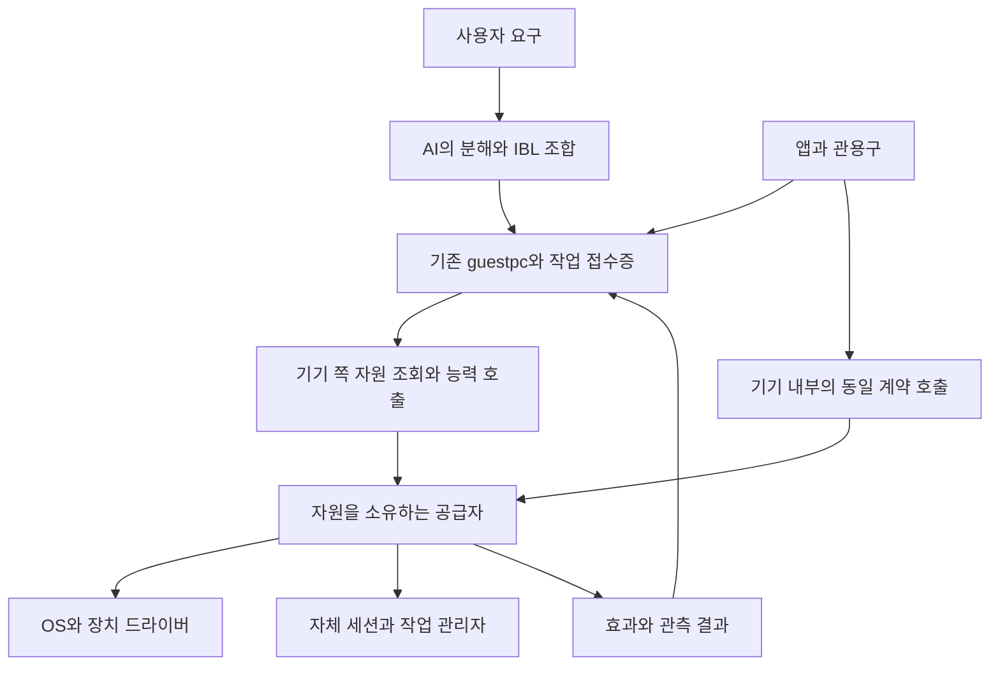

# 원격 하드웨어의 원자적 능력 설계

작성일: 2026-10-17. 상태: **설계 제안, 미구현**. 이번 변경은 문서만 반영한다.

후속 제품 설계: [수동 하드웨어 앱과 AI 공유 실행](HARDWARE_CONTROL_APPS_AND_GUIDES_DESIGN_2026_10_18.md).
앱을 직접 사용하면서 공유 코드·가이드를 완성하는 구현 순서는 후속 설계를 따른다.
아래 자원·결과 계약은 계승하되 새 범용 op와 전 OS 계약 생성기를 앱 개발의 선행 조건으로 두지 않는다.

원격 기기에 내린 명령을 앱별 사용법 탐색에 의존하지 않고, 그 기기가 제공하는 원자적
능력의 조합으로 수행한다. 앱과 관용구는 같은 기본 능력을 소비한다. 기본 능력의 구현은
기기 쪽이 소유하고, 중앙 AI는 대상과 의도를 조합한다.

목적은 원자적 액션의 개수를 늘리는 것이 아니라, 새로운 요구에도 재사용할 수 있는
기본 동작을 확보해 결과 품질을 유지하면서 작성·탐색·실행 비용을 낮추는 것이다.
판단 기준은 [IBL 진화 목적](IBL_EVOLUTION_PURPOSE.md), 책임 배치는
[구조 수렴 설계](IBL_SYSTEM_CONSOLIDATION_DESIGN.md)를 따른다.

## 1 설계 결정

1. **자원과 원자적 능력을 앱에서 독립시킨다.** 기기·출력 장치·세션·프로세스·파일·센서를
   명시적으로 가리키고, 각 자원에 적용 가능한 최소 동작을 호출한다.
2. **공통 의미와 기기별 구현을 분리한다.** 같은 능력 이름은 같은 입력·효과·확인 조건을 뜻한다.
   Android·PC 구현이 보장하는 대상 범위가 다르면 범위를 명세하고 요청과 대조한다.
3. **원자성은 의미 단위다.** 단일 CPU 명령, 단일 시스템 호출, 분산 트랜잭션을 뜻하지 않는다.
   여러 독립 목표를 감춘 만능 동작을 원자적 능력으로 등록하지 않는다.
4. **현재 원격 전송과 작업 원장을 재사용한다.** 등록·인증·세대·접수증·취소·결과 회수·배포에
   새로운 병렬 체계를 만들지 않는다. 자원 제어 계약을 그 위에 연결한다.
5. **기존 앱의 기본 제어도 같은 구현으로 옮긴다.** 공통 제어 추가만으로 이행을 완료하지 않는다.
   전환한 영역의 중복 구현·앱별 우회 교재·과도한 능력 주장을 함께 정리한다.
6. **IBL 문법과 기능어 코어를 바꾸지 않는다.** 능력 정의는 패키지·드라이버의 데이터 계약이고,
   중앙 연결은 기존 `limbs:guestpc`의 op 확장으로 제안한다. 새 op도 사전 변경 절차를 거친다.

범위는 주인이 등록한 상주 PC와 Android 손발이다. 로컬 앱과 제어의 구현 공유는 이행 범위에
포함하지만, 회원 기기·이웃 부탁의 권한을 손발 권한으로 합치지 않는다. 휴대형 헬퍼는 기존
경로를 유지하며 새 계약을 신고하기 전에는 이 능력을 지원한다고 보지 않는다.

## 2 현재 구조와 실제 공백

2026-10-17 정본 코드 기준이다. 과거 설계의 계획 상태보다 현재 코드를 우선한다.

| 현재 기반 | 근거 | 그대로 사용할 것과 바꿀 것 |
| --- | --- | --- |
| 등록 기기 해소와 op 접수 | `backend/services/resident_pcs.py`의 `resolve`, `submit` | 기기·권한·등록 검사 유지. 현재 op 허용 목록에 판본별 능력 요청을 연결한다. |
| 중복 접수 방지와 결과 원장 | `backend/base/resident_store.py` | `(device,generation,request_id)`와 명령 지문, started/result 사건, 기존 task_ref를 유지한다. |
| 폰 능력 신고와 실행 | `backend/services/limb_client.py`, `phone_remote_execution.py` | `info`·ops·실행 계약이 있다. 임의 Python 코드 없이 호출할 수 있는 의미 계약을 보강한다. |
| PC 헬퍼의 능력 신고와 실행 | `helper/resident_runtime.go`, `resident_execute.go` | shell·파일·화면·재생 기능이 있다. 자원 범위와 효과 확인을 명시한 공급자로 추출한다. |
| IBL 원격 표면 | `data/packages/installed/tools/guest-helper/ibl_actions.yaml`, `handler.py` | 전송·동기/배경 결과·실패 변환을 재사용한다. 신규 op와 결과 계약을 같은 원천에 선언한다. |
| 폰의 기기 음량 구현 | `phone-companion/app/src/main/java/com/indiebiz/phoneagent/DeviceAudio.kt` | 플레이어 수명과 독립된 음량 읽기·설정·재확인이 이미 있다. 새 공급자의 구현으로 재사용한다. |
| 폰의 서비스 소유 자원 호출 | 같은 트리의 `execution/RemoteDeviceCalls.kt` | 별도 Python worker와 실제 자원을 가진 프로세스가 다르다. 상태 소유자에 도달하는 원칙을 유지한다. |
| 미디어 세션과 실제 출력 관측 | `backend/services/media_sessions.py`, `helper/media_session_*.go`, 폰 `media/` | 통화·송수신 수명과 출력 관측을 재사용한다. 일반 자원 호출이 기존 grant 경계를 우회하지 않는다. |

공백은 실행 통로의 부재가 아니다. `shell/python/ibl`로 접근할 수 있는 실제 능력을
매번 코드로 재구성하고, 어떤 앱·범위에 효과가 있는지 AI가 다시 알아내야 하는 점이다.
현재 `media_volume:true` 같은 신고도 기기 출력 음량인지 특정 재생기의 음량인지까지 표현하지 못한다.
폰 명함에 기존 어휘가 있다는 사실도 그 어휘가 기기 전체를 제어한다는 뜻은 아니다.

### 두 에피소드에서 확인한 반례

원문 정본은 `data/world_pulse.db`의 에피소드 4870·4871과 연결된 실행 증거다.

- 4870: 자체 음악 대기열은 비었고 라디오는 재생 중이 아니었으나 `isMusicActive()`는 true였다.
  공통 pause 키를 보낸 뒤에도 true였고, 오디오 포커스를 요청한 뒤 false로 바뀌었다.
  이것은 해당 시점의 관측이며 포커스 요청을 보편적인 정지 계약으로 삼을 근거는 아니다.
- 4871: 알림 리스너는 활성 상태였다. `getActiveSessions(None)`은 권한 오류였지만 자기
  NotificationCaptureService의 ComponentName을 넘기면 외부 앱 세션과 상태 2를 반환했다.
  세션 조회 성공은 해당 세션에 정지 명령을 보내 검증한 것과 다르다.

같은 원인은 PC의 외부 플레이어, 백그라운드 프로세스, 센서 소유 세션에도 적용된다.
개별 앱 이름이나 예나폰 별칭을 공통 실행기·파서의 분기에 넣지 않는다.

## 3 목표 구조와 책임



| 주체 | 책임 | 맡지 않는 일 |
| --- | --- | --- |
| 중앙 AI·IBL 프로그램 | 의도·대상 범위 결정, 능력 선택, 여러 원자의 조합, 남은 작업 처리 | 매번 OS 바인딩 재작성, 앱 이름 추측으로 자원 신원 대체 |
| guest-helper와 resident 접수층 | 등록 기기 고정, 계약 검사, 권한 확인, 기존 작업으로 전달·회수 | 음악·프로세스별 업무 정책, 다른 기기로의 자동 대체 |
| 기기 능력 디스패처 | 자원 참조 해소, 공급자 선택, 인자·범위 검사, 수명·결과 보존 | 자연어 해석, 전역 목표 판단, 임의 앱 탐색 |
| 자원 공급자 | OS/서비스 호출, 실제 대상과 효과 확인, 한계·오류 반환 | 다른 종류의 효과로 조용히 우회 |
| 앱·관용구 | 플레이리스트·업무 흐름·사용자 경험 등 복합 의미 | 추출된 기본 동작의 별도 구현 유지 |

공급자는 기기 실행부에 설치한 신뢰된 구현이다. 원격 신고 문자열을 import 경로나 셸 코드로
실행하지 않는다. 업무별 공급자 이름은 데이터로 해소하고 IBL 엔진에는 넣지 않는다.
새 상주 데몬·새 원격 작업 DB·새 모델 호출은 필요하지 않다.

## 4 원자적 능력의 기준

다음 조건을 모두 만족하는 기능을 원자로 추출한다.

- 명시한 자원 하나 또는 하나의 일관된 자원 경계에 적용한다.
- 하나의 상태 전이·관측 목적을 가진다. 별도로 선택할 수 있는 효과는 분리한다.
- 호출 전제와 결과가 호출자 앱에 의존하지 않는다.
- 제어 범위, 부수 효과, 재호출 성질과 확인 한계를 설명할 수 있다.
- 독립 시험이 가능하고 다른 프로그램의 부품으로 쓸 수 있다.

예를 들어 프로세스 종료는 자원 해제 등 부수 효과가 있어도 하나의 생명주기 동작이다.
반면 ‘모든 음악 정지 후 음소거하고 관련 앱 닫기’는 서로 다른 효과의 조합이다.
재생 정지를 음량 0으로 대신하거나 일시정지를 프로세스 강제 종료로 대신하지 않는다.

| 자원 종류 | 원자적 능력 후보 | 반드시 나눌 의미 |
| --- | --- | --- |
| 음량 제어점 | 음량 읽기·설정, 음소거 읽기·설정 | OS 미디어 스트림, 출력 endpoint, 앱 세션의 범위 |
| 재생 세션 | 조회·상태 읽기·pause·stop | 일시정지, 정지, 대기열 자동 진행, 프로세스 종료 |
| 자체 재생 대기열 | 자동 진행 허용 설정·상태 읽기 | 현재 곡 정지와 다음 곡 시작 금지 |
| 프로세스 | 신원 조회·시작·종료 요청 | 단일 프로세스, 관리 작업 전체, 강제 종료 |
| 파일 | 읽기·쓰기·이동·삭제·상태 읽기 | 파일 내용 변경, 편집기 초안, 여러 파일 트랜잭션 |
| 센서와 수집 세션 | 장치 조회·수집 시작·세션 종료 | 자기 수집 중단, 타 앱의 점유 해제, 기기 전체 차단 |

이 표는 전체 구현 약속이나 고정된 완전 목록이 아니다. 초기 범위는 §11에서 제한한다.
응용프로그램 고유 기능은 앱 공급자에 남길 수 있다. 단, 일반 기본 동작을 쓸 때마다 앱의
복잡한 사용 절차를 해석하도록 하지는 않는다. OS 공통 API가 없어 앱 프로토콜이 필요한
구현은 공급자가 담당하고, 제어 가능한 자원 범위를 정확히 신고한다.

## 5 능력 정의와 발견

### 정의와 실행 상태를 분리

제안 원천은 `data/device_capabilities/*.yaml`이다. 입력·출력·자원 종류·효과·검증 조건·판본의
의미 계약을 이곳에 한 번 정의하고, Python·Go·Kotlin이 쓰는 스키마와 설명은 빌드로 파생한다.
네이티브 바인딩은 코드에 둔다. 기존 body 프로파일은 번들 가용성의 정본으로 유지하며,
동적 권한이나 장치 목록을 `data/bodies/android.json`에 넣지 않는다.

정의마다 소유 패키지 또는 기기 드라이버를 지정한다. 동일 이름·판본의 중복 정의는 빌드에서
거절하며, 패키지 소유 능력은 기존 활성 원장을 따른다. 설치·활성·기기의 실행 바인딩이 있어야
지원한다고 신고한다. 일시적인 권한·장치 미준비는 ready:false로 드러낸다.
자원 종류는 실제 제어 경계의 타입이고 사용자 기기 이름·앱 목록은 관측
데이터다. 이 정의를 세계의 모든 사물을 미리 분류하는 객체 스키마로 확대하지 않는다.

능력별 정의에는 다음이 필요하다.

| 항목 | 뜻 |
| --- | --- |
| `capability`, `version` | 예: `audio.volume.set`, 1. 의미가 바뀌면 호환 판본을 새로 만든다. |
| `resource_kind`, `args_schema`, `result_schema` | 적용 자원과 값의 타입·단위·범위. 알 수 없는 인자를 조용히 버리지 않는다. |
| `effect`, `postcondition` | 변경 대상과 완료 조건. 의미별 조건이며 AI가 임의 조건 코드를 주입하지 않는다. |
| `retry_class` | observation, absolute_set, non_repeatable. 이것만으로 자동 재실행을 허용하지 않는다. |
| `verification` | OS 재조회·소유 서비스 상태·관측 불가 등 확인 수단과 한계 |
| `authorization` | 기존 주체·등록·기능 권한 체계에서 필요한 조건 |

기기의 동적 신고에는 설치된 공급자·계약 digest·판본과 `supported`, `ready`, `reason`,
`observed_at`을 포함한다. `supported`는 구현 존재, `ready`는 현재 실행 전제다.
권한 거절·잠긴 사용자 세션·출력 장치 부재는 구별한다. 실행 직전 다시 확인한다.

### 전체 설명을 매 턴 싣지 않는다

기존 sync 능력 봉투의 16 KiB 상한을 유지한다. `info`에는 `device_contract:1`, 지원 op,
카탈로그 digest, 작은 도메인 목록만 추가한다. 상세 정의는 `capabilities` op로 도메인·능력별
조회하고 페이지를 나눈다. 장치·세션 목록은 `resources`로 별도 조회한다.

중앙은 알려진 의미 계약과 기기 공급자가 지원하는 판본의 교집합을 사용한다. 기기가 새 이름을
신고했다고 바로 실행 가능으로 승인하지 않는다. 캐시는 기기·등록 세대·계약 digest로 분리하고,
동적 준비 상태는 오래된 카탈로그 캐시로 확정하지 않는다.

검색·교재는 생성된 계약을 소비한다. ‘음량’, ‘프로세스’ 같은 도메인 안내만 기본 맥락에 두고,
관련 상세를 필요할 때 읽는다. 원자별 자연어 프롬프트와 과거 코드 조각을 상시 주입하지 않는다.

## 6 자원 신원과 제어 범위

`resources`의 각 행은 opaque한 `resource_ref`, `kind`, 표시 이름, 제어 가능한 capability,
상태와 관측 시간을 반환한다. 참조는 내부적으로 다음 신원을 결속한다.

- 인증된 device_id와 등록 generation.
- 공급자 ID와 그 공급자의 자원 수명 epoch.
- OS 자원 식별자와 필요한 생존 신원. 프로세스는 PID만 쓰지 않고 생성 신원을 포함한다.
- 필요하면 출력 경로·사용자 세션·자원 revision.

별칭은 최초 기기 해소에만 사용한다. 조회 이후 별칭·기본 장치가 바뀌었다고 호출 대상을
다시 해소하지 않는다. 재연결만으로 참조를 전부 폐기하지 않되, 재부팅·재등록·자원 재생성으로
신원이 달라지면 stale 오류를 낸다. OS가 안전하게 구별할 신원을 주지 못하면 수명이 짧은
참조를 쓰고 그 한계를 신고한다. 참조는 권한 토큰이 아니다. 매 호출에서 권한을 검사한다.

자원 종류는 거짓 동일성을 만들지 않아야 한다. 예를 들어 Android의 미디어 스트림 음량과
PC의 출력 장치 음량을 `audio.volume_control`로 다루더라도 각 행에
`control_scope:media_stream|output_endpoint|application_session`과 대상 경로를 명시한다.
‘기기 전체 출력’ 요청을 앱 세션 하나의 지원으로 충족했다고 처리하지 않는다.

조회 결과에는 `coverage`를 둔다. `complete|partial|unknown`과 그 판정의 `domain`을 함께
돌려준다. complete는 명시된 도메인 내부의 완전성이지 모든 앱·모든 하드웨어의 관측을 뜻하지
않는다. 예를 들어 ‘OS에 등록된 미디어 세션 전체’와 ‘기기에서 소리를 내는 모든 주체’는 다르다.
빈 목록도 coverage가 불명이라면 ‘없음’이 아니라 ‘관측하지 못함’이다.

여러 대상을 조작할 때는 한 조회에서 얻은 명시적인 참조 집합을 사용한다. `all:true`라는
미지정 범위를 쓰지 않는다. 조회 후 새 세션이 생길 수 있으므로 전체 완료 판단은 재조회하고,
무한히 새로운 세션을 쫓지 않도록 프로그램이 확인 기한을 정한다. 지속 차단은 별도 정책이며
일회성 정지에서 자동으로 시작하지 않는다.

## 7 호출 표면과 결과 계약

### 기존 원격 표면의 확장

다음은 **구현할 op 제안**이다. 현재 실행 가능한 IBL 예제로 취급하지 않는다.

| 기존 액션에 추가할 op | 역할 | 효과 분류 |
| --- | --- | --- |
| `guestpc capabilities` | 도메인 또는 능력의 정의·지원·준비 상태 조회 | 읽기. 실시간 준비 상태는 호출 간 자동 재사용하지 않는다. |
| `guestpc resources` | 자원 목록 또는 특정 참조의 현재 상태 조회 | 읽기. 범위·페이지·관측 시간·완전성을 반환한다. |
| `guestpc invoke` | 명시 참조에 능력 하나 적용 | 보수적으로 effect. 인자 속 문자열만 보고 순수 호출로 승격하지 않는다. |

조회 입력은 `capabilities(domain?,capability?,cursor?)`와
`resources(kind?,resource_ref?,cursor?)`로 제한한다. resource_ref 지정은 특정 자원의 최신 상태
조회이고, 목록 필터와 혼용하지 않는다. cursor는 조회 조건·기기·공급자 세대에 묶는다.
페이지가 남았으면 아직 전체를 읽지 않은 것이며, 페이지 사이 목록이 바뀌면 snapshot 변경을 표시한다.
상세 지원 조회와 자원 조회는 기존 result 안에 각각 capabilities/resources 목록, coverage,
observed_at, next_cursor를 반환한다. 하나의 자원은 다음처럼 표현한다.

```json
{
  "resource_ref": "opaque-resource-ref",
  "kind": "audio.volume_control",
  "control_scope": "media_stream",
  "label": "미디어 음량",
  "capabilities": [{"capability": "audio.volume.set", "version": 1, "ready": true}],
  "state": {"level": 0.6, "native_step": 9, "native_max": 15, "fixed": false},
  "observed_at": "2026-10-17T04:00:00Z"
}
```

공통 인자는 기존 limb·request_id·background·timeout을 유지한다. 변경 요청에는 capability,
version, resource_ref, args, 필요한 조건 precondition을 전달한다. 초기 invoke는 존재하는
자원의 동작에 한정한다. 파일·프로세스·수집 세션 생성은 생성 부모/관리자 자원에 대한 동작으로
후속 정의하며, `resource_ref:null`을 임의의 기기 전체 대상으로 해석하지 않는다.

초기 세 op는 주인의 등록 손발 권한에서만 제공한다. 제어뿐 아니라 자원 목록 조회도 같은
기기 접근 검사를 거친다. 이후 제한 주체에 공개하려면 기존 권한 체계에 능력·자원 범위를
연결해야 하며, 범용 invoke가 기존 shell·센서·미디어의 제한을 우회하는 통로가 되지 않게 한다.

```json
{
  "op": "invoke",
  "capability": "audio.volume.set",
  "version": 1,
  "resource_ref": "opaque-resource-ref",
  "args": {"level": 0.3},
  "precondition": {"revision": "observed-revision"},
  "request_id": "caller-generated-operation-id",
  "timeout": 10
}
```

이는 전송 내용의 예시다. device_id·등록 generation·인증 주체는 기존 접수층이 결속한다.
`level`은 OS 제어 눈금의 정규화 값 0..1이며 지각 음압 비율이 아니다. 공급자는 실제 지원
눈금에 양자화한 expected 값과 재조회 actual 값을 함께 반환한다. 임의 오차 허용으로 성공을
만들지 않고 변환 규칙을 계약에 둔다.

조건부 변경은 공급자가 보장하는 수준을 명시한다. 자체 자원 잠금은 자체 호출만 직렬화한다.
외부 앱도 바꾸는 OS 속성은 원자적 compare-and-set이 없을 수 있다. 이런 경우 사전 검사와
사후 재조회만 보장하며, 강한 조건부 변경을 요구한 호출은 미지원으로 거절한다.
기본 출력 장치 변경·경로 교체가 감지되면 다른 장치로 요청을 옮기지 않는다.

### 결과와 기존 원장의 연결

invoke의 모든 반환은 `device_result`에 대상·능력 판본·요청 효과·관측을 보존한다.
변경 결과의 outcome은 `verified`, `not_achieved`, `unknown`으로 제한한다.

```json
{
  "device_result": {
    "capability": "audio.volume.set",
    "version": 1,
    "resource_ref": "opaque-resource-ref",
    "outcome": "verified",
    "effect": {"attempted": true, "requested": 0.3, "expected": 0.3},
    "observation": {
      "actual": 0.3,
      "method": "os_readback",
      "observed_at": "2026-10-17T04:00:00Z",
      "scope": "resolved_volume_control"
    }
  }
}
```

이 예시는 능력 결과이며, 바깥의 기존 success/result/task_ref를 대체하지 않는다.
`verified`는 명시한 원자의 완료 조건이 관측 시점에 성립했다는 뜻이다. 음량 값의 확인으로
현장의 무음, 세션 상태의 확인으로 모든 재생원의 정지까지 증명한 것은 아니다.

| 능력 결과 | 기존 resident 결과로 변환 | IBL과 대기의 처리 |
| --- | --- | --- |
| verified | 일반 성공 결과에 device_result 포함 | 동기·wait 모두 업무 값으로 반환한다. 이미 목표 상태면 attempted:false를 기록한다. |
| not_achieved | `error`와 device_result | 동기·wait 모두 기존 실패 경로. 확인한 불일치·거절·stale·미지원을 reason으로 구별한다. |
| unknown | `unknown:true`와 device_result | task 상태 unknown과 실패 상세를 보존한다. 이미 적용됐을 가능성을 지우지 않는다. |

**입력 처리 성공이나 내부의 `success:false`만으로 결과를 정하면 안 된다.** 현재 resident_store는
error·unknown·timeout 등으로 종결을 판정하므로 공급자부터 task 어댑터까지 같은 변환을 적용해야
한다. 거절·불일치에도 일부 효과가 생겼으면 effect에 남긴다. 실패 상세에는 원래 결과와 task_ref를
보존하여 `try/catch`나 `table:each on_error:collect`로 개별 회수할 수 있게 한다.
접수 확인만 가능한 동작은 verified로 만들지 않고 unknown으로 남기며, 재관측 방법을 제공한다.

## 8 재송신과 지속 작업

기존 request_id 중복 제거를 사용한다. 같은 ID의 같은 의뢰는 같은 접수증을 돌려주고, 내용이 다르면
충돌로 처리한다. 접수 전에 대상 참조와 의미에 영향을 주는 기본값을 확정해 지문에 포함한다.
같은 ID를 재조회할 때 새 관측 시각이나 동적 기본값을 붙여 다른 지문을 만들지 않는다.

접수 중복 제거는 외부 효과의 exactly-once 보장이 아니다. 기기에서 효과를 낸 뒤 결과 기록 전에
프로세스가 죽으면 unknown이다. 복구 시 원래 task_ref와 대상 상태를 확인하며 같은 요청을 무조건
재실행하지 않는다. absolute_set도 이후 사람이 바꾼 상태를 덮을 수 있으므로 같은 값의 설정이라는
이유만으로 재송신하지 않는다. 상대 변경·toggle은 초기 계약에 넣지 않는다.

시작 동작은 접수 작업의 수명과 시작한 세션의 수명을 분리한다. 시작 결과에 resource_ref를 반환하고,
종료는 그 참조에 별도 원자를 적용한다. 호출 worker가 끝났다고 카메라·플레이어도 끝났다고 가정하지
않는다. 실제 자원은 기기의 기존 서비스가 소유한다.

대기 기한 초과와 실행 기한 초과, 호출 취소와 대상 자원 종료도 다르다. 기존 task cancel은 실행에 대한
중단 요청이며 과거 효과의 취소가 아니다. 자기 제어 서비스 종료·기기 재시작은 기존 재시작 제어자나
관리 경로에 맡긴다. 일반 process terminate로 자신을 죽이고 그 뒤 보고를 자신에게 요구하지 않는다.

## 9 대표적인 조합

### 음량 변경

기기의 음량 제어점을 조회하고 목적의 출력 범위에 맞는 참조를 고른다. `audio.volume.set`을 적용한 뒤
같은 참조의 값과 경로를 확인한다. 곡 검색·플레이어 시작·앱 목록 탐색이 필요하지 않다.
음량만 바꾸는 요청에 재생 정지를 추가하지 않는다.

### 재생 중단

대상 범위를 확정하고, 관리하는 재생 작업이 있으면 자동 진행을 중단한다. 자체 플레이리스트는 먼저
대기열의 다음 곡 시작을 막고 이미 시작한 세션을 조회해 멈춘다. 대기열 공급자는 진행 중인 곡 시작까지
관리하여 자동 진행을 막은 뒤 늦게 다음 곡이 시작되지 않게 한다. 대기열 참조를 가진 자체 관리자에서
보장하는 조건이며 임의 외부 앱의 대기열까지 멈췄다는 뜻은 아니다.

OS나 자체 서비스가 공개하는 세션에 pause 또는 stop을 개별 적용하고 결과를 모은다. pause만 지원하는
대상에 stop이 성공했다고 반환하지 않는다. 사용자의 ‘음악을 멈춰’에 pause가 적합한지는 상위 의도
해석에서 정한다. 재조회한 coverage와 남은 재생 상태로 완료 범위를 보고한다. 실패 시 음량 0·앱 강제
종료·오디오 포커스 획득을 같은 효과의 자동 대안으로 사용하지 않는다.

### 다른 자원과의 조합

‘이 PC에서 녹음하고 파일을 가져와’는 입력 장치 선택→수집 시작→세션 종료→출력 확정→기존 transfer의
조합이다. 시작 접수나 파일 경로 획득만으로 녹음 회수가 완료된 것은 아니다. 수집 세션과 파일 참조가
호출을 넘어 결과와 이어져야 한다.

‘이 원격 처리를 멈춰’는 이미 아는 관리 작업이면 기존 task cancel과 결과 확인을 사용한다.
임의 프로세스는 관측한 생존 참조에 process terminate를 적용한다. 자손을 포함한 전체 작업 종료는
관리자가 보유한 작업 경계에서 확인하고, PID 하나의 소멸을 전체 작업의 정지로 해석하지 않는다.

이 조합은 일반 IBL 함수·제어와 기존 task/transfer로 구성한다. 초기 구현에 새 workflow 엔진이나
모든 원자의 일괄 트랜잭션은 추가하지 않는다. 왕복 비용이 문제라면 측정 후 묶음 전달을 검토하되,
향후 묶어서 보내더라도 각 원자의 참조와 결과를 보존한다.

## 10 구현 위치와 전환 대상

아래 새 이름은 후보 경로이며 현존하는 구현을 뜻하지 않는다.

| 책임 | 배치안과 기존 소비자 |
| --- | --- |
| 의미 계약 | `data/device_capabilities/`. 빌드로 언어별 스키마·설명을 생성한다. 기존 인자·값 검증과 공유할 부분을 재사용한다. |
| 중앙 접속 | guest-helper의 ibl_actions/handler와 resident_pcs. 타입·권한·판본·결과 변환을 연결한다. 새 Python 보조 모듈은 적절한 base/services 층과 LAYERS에 배정한다. |
| Android 공급자 | `phoneagent/device/`안. DeviceAudio와 PhoneActions·media의 서비스 소유 동작을 재사용한다. limb_client에서 직접 전달해 원자마다 Python worker를 시작하지 않는다. |
| PC 공급자 | `helper/devicecap/`안. 기존 Go 실행부에서 호출한다. OS별 바인딩을 여기 두고 기존 media·화면 등의 소비자를 순차 전환한다. |
| 로컬 소비자 | Android는 같은 네이티브 구현을 호출한다. 중앙 PC 패키지는 후속 단계에서 같은 실행부의 로컬 호출로 연결한다. 자신을 원격 등록하거나 별도 데몬을 만들지 않는다. |
| 결과와 기록 | resident_store·task_receipts·기존 task 어댑터와 실행 증거. 자원 참조의 임시 해소표 이외에 새 범용 자원 DB를 만들지 않는다. |

로컬 PC 연결은 기존 관리 대상 헬퍼를 일회성 JSON 입출력으로 호출하는 방식을 첫 안으로 삼는다.
호출자의 기존 권한 검사와 OS 사용자 신원을 유지하고 원격 등록을 위조하지 않는다. 자체 세션을 소유한
동작은 일회성 프로세스의 메모리로 소유권을 옮기지 않고 기존 소유 서비스로 전달한다. 이 연결은 후속
단계에서 검증하며 계약만 같고 구현은 다른 경로를 영구적으로 늘리지 않는다.

### OS별 구현 후보

- Android 음량은 기존 DeviceAudio와 AudioManager를 쓴다. 외부 미디어는 활성 알림 리스너를 통한
  MediaSessionManager 경로가 후보다. 조회한 세션에 TransportControls를 적용하고 상태를 확인한다.
  [음량 API](https://developer.android.com/reference/android/media/AudioManager),
  [세션 접근](https://developer.android.com/reference/kotlin/android/media/session/MediaSessionManager),
  [재생 제어](https://developer.android.com/reference/android/media/session/MediaController.TransportControls).
- Windows 음량은 Core Audio endpoint, 외부 재생은 지원 세션의 표준 제어가 후보다.
  [출력 음량](https://learn.microsoft.com/en-us/windows/win32/api/endpointvolume/nf-endpointvolume-iaudioendpointvolume-setmastervolumelevelscalar),
  [세션 pause](https://learn.microsoft.com/en-us/uwp/api/windows.media.control.globalsystemmediatransportcontrolssession.trypauseasync).
- macOS 음량은 Core Audio를 후보로 두고 실제 장치의 변경 가능성을 확인한다.
  [음량 속성](https://developer.apple.com/documentation/coreaudio/kaudiodevicepropertyvolumescalar).
  외부 앱 전체의 재생 제어는 별도 실증이 필요하다. 공통 미디어 키를 보낼 수 있다는 이유만으로
  임의 세션의 정지 능력을 선언하지 않는다. Linux도 대상 환경을 확보한 뒤 구현한다.

API의 존재는 실기 적합의 증명이 아니다. 초기 대상은 직접 검사할 수 있는 Android와 macOS다.
Windows/Linux는 의미 계약을 공유하되 미구현을 정확히 반환하는 것부터 시작한다.
기존 [OS 이식성 이음매](OS_PORTABILITY_SEAM.md)의, 검증할 수 없는 OS 구현을 선제 양산하지 않는
원칙을 따른다. OS 권한·현장 동의·기존 미디어 grant 경계는 유지한다.

## 11 단계별 구현과 완료 조건

| 단계 | 구현 범위 | 함께 정리할 것 | 완료 조건 |
| --- | --- | --- | --- |
| 0 계약 기반 | 정의·resource_ref·coverage·결과 변환과 세 op. 모의 공급자로 연결한다. | info에서 실행 수단과 의미 능력을 구별한다. 기존 op는 유지한다. | 조회부터 invoke, 동기/배경 결과, 실패 상세가 기존 IBL·task 경로로 연결된다. |
| 1 두 자원과 두 기기 | Android/macOS의 음량 제어, 시험용 프로세스의 참조·종료. | 해당 기본 동작의 중복을 추출하고 이행한 소비자를 같은 공급자에 연결한다. | 앱 이름 없는 음량 변경과 생존 참조 기반 종료가 실기에서 성립한다. 미지원 범위는 명시한다. |
| 2 여러 소유자의 세션 | 자체 재생 세션·대기열과 Android 외부 세션. PC 외부 세션은 OS별 실증 범위로 한정한다. | 자체 음악·라디오·영화의 중복 기본 제어를 통합한다. | 대기열이 다음 곡을 다시 시작하지 않고, 여러 소유자의 결과·관측 한계를 보존한다. |
| 3 센서와 기존 파일 조작 | 수집 세션 수명과 전송 연결. 기존 파일 조작의 공유 가능한 계약을 추출한다. | 기존 transfer·파일 엔진을 복제하지 않는다. | 시작·종료·결과물 회수가 같은 대상과 참조 계열로 이어진다. |
| 4 로컬과 다른 OS | 중앙 PC 앱도 같은 기본 구현으로 연결하고 실기를 확보한 OS의 공급자를 추가한다. | 영구적인 구 구현을 없애고 호환 입구는 위임만 남긴다. | 앱과 직접 명령이 같은 자원을 조작할 때 의미와 결과가 일치한다. |

단계 1은 음량에만 머물지 않는다. 상태 설정과 프로세스 수명이라는 다른 성질을 검증하여 설계가
음악 전용으로 굳는 것을 막는다. 단계 2 이후에도 모든 기기·외부 앱의 지원을 약속하지 않는다.

각 단계는 계약·공급자·소비자·교재·회귀를 한 묶음으로 완료한다. 기존 API의 의미를 바꾸지 않고 같은
의미의 부분만 새 구현에 위임한다. 예를 들어 기존 media(volume)가 플레이어의 이득 조절이라면
이를 조용히 장치 전체의 음량으로 바꾸지 않는다. 기존 뜻을 유지하거나 명시적인 이행으로 다룬다.

새 중앙/구형 기기는 새 op 실행 전에 미지원으로 판단하고, 구형 중앙/새 기기는 기존 op를 계속 쓴다.
뜻이 다른 shell·앱 조작으로 자동 대체하지 않는다. 범용 shell/Python은 새로운 작업을 탐색하는 길로
유지하고, 검증된 기본 능력으로 올릴 때 반복 탐색을 제거한다.

실제 배포는 기존 APK·헬퍼 갱신 경로를 사용하고, 기기가 새 계약을 신고한 뒤에 이용한다.
소스 수정·빌드 성공·기기 갱신·실기 적합을 각각 구별한다. 공급자 비활성화와 카탈로그 갱신으로
새 호출을 중단할 수 있어야 하며, 이미 살아 있는 세션의 소유자와 종료 경로는 남긴다.

## 12 검증 계획

같은 계약 fixture를 Python 입구와 Go/Kotlin 공급자에서 검증한다. 생성 정의의 digest와 실제 binding의
대응은 기존 빌드 검증에 통합하여 연결되지 않은 능력을 신고하지 못하게 한다. 자가점검이 검증 목적으로
실제 기기를 변경하지 않도록 일반 프로브와 명시적인 실기 시험을 구분한다.

| 검사 | 기대 결과 |
| --- | --- |
| 별칭 충돌·재등록·PID 재사용·세션 재생성 | 다른 자원을 변경하지 않고 stale/대상 불명을 반환한다. |
| 기기가 모르는 능력·거짓 ready·다른 판본을 신고 | 중앙의 허용과 계약 대조를 넘어 실행하지 않는다. |
| 음량 반올림·고정 음량·복수 출력·경로 변경 | expected/actual과 대상 범위를 보존하며 다른 출력의 성공을 가져오지 않는다. |
| 외부 앱 비협조·권한 상실·세션 비공개 | 거절·불일치·관측 불명을 구분하고 mute/kill로 자동 대체하지 않는다. |
| 변경 직후 외부의 동시 변경 | 관측 시점과 실제 값을 반환하며 외부 변경을 무한히 덮어쓰지 않는다. |
| 같은 request_id 재송신·내용 변경 | 같은 접수증 회수 또는 충돌. 정상 재송신으로 효과를 중복 실행하지 않는다. |
| 효과 이후 기록 전 기기 중단·응답 유실 | unknown과 원래 task_ref 보존. 복구 시 관측하며 무조건 재실행하지 않는다. |
| 복수 세션 일부 실패·중간의 새 재생 | 개별 결과와 재조회 coverage를 보존하며 전체 성공을 주장하지 않는다. |
| 대기열·수집 세션의 소유 프로세스 | 일시 worker에서 실제 소유 자원에 도달하고 worker 종료와 자원 종료를 혼동하지 않는다. |
| 동기 호출과 background 후 wait | verified/failed/unknown과 원문·task_ref의 의미가 일치한다. |
| 기존 media/IBL/shell/transfer와 판본 혼용 | 기존 의미·권한·결과 회수에 퇴행이 없다. |

실기 시험은 대상·변경 전 상태·비교 조건을 고정한다. 시험으로 바꾼 음량 등은 자신이 설정한 상태에서
다시 바뀌지 않았을 때만 복원하여 사람의 후속 조작을 되돌리지 않는다. 프로세스 종료는 시험용
프로세스를 대상으로 한다. 모의 시험 통과만으로 실기 미검증 OS를 지원 완료로 표시하지 않는다.

구현별 회귀 범위는 [회귀 규약](REGRESSION_TESTING.md)과 select_tests로 정한다. 새 backend 모듈은
층 등록·Android bundle을 갱신한다. 어휘 변경은 ibl_actions에서 빌드하고 가이드·오류 문구·도움말·
관련 기존 용례까지 갱신한다. 생성 마커 구간과 tool.json은 손으로 편집하지 않는다.

성능 평가는 같은 목적·대상·권한에서 앱을 지정하지 않은 처음 보는 요청을 포함한다. 품질은 요청 범위
달성·잘못된 대상 변경·불명의 정직한 처리, 시간은 완료까지의 경과, 토큰은 탐색·실행·검증을 포함한
전체를 측정한다. 카탈로그 조회와 추가 관측 비용도 포함한다. 원자 개수·짧은 IBL·모의 시험 통과를
비용 감소의 증명으로 쓰지 않는다. 성능 측정 대기를 계약 구현의 선행 조건으로 삼지도 않는다.

## 13 첫 구현 단위

다음 개발은 단계 0과 1을 하나의 연결된 구현으로 다룬다. 능력 정의, 기기의 자원 조회, 한 자원에 대한
호출, 결과 변환, Android/macOS 구현, 기존 소비자의 위임, 실기 적합 검증을 범위로 한다.
다른 OS 전체 지원·모든 외부 재생 앱 지원·전체 파일/센서 이행을 첫 완료 조건에 섞지 않는다.

착수 시 확정할 구현 세부는 기존 값 검증의 재사용 위치, 네이티브 binding과 스키마 생성의 형태,
실기에서 해소할 수 있는 참조 수명이다. 이를 검증하면서 원자의 의미·대상 범위·결과 계약을 몰래
축소하지 않는다. 변경이 필요하면 이 설계와 소비자의 계약을 함께 갱신한다.

설계 완료 시점에는 API·어휘·APK·헬퍼·운영 기억을 변경하지 않았다. 구현과 실기 검증은 미착수다.
