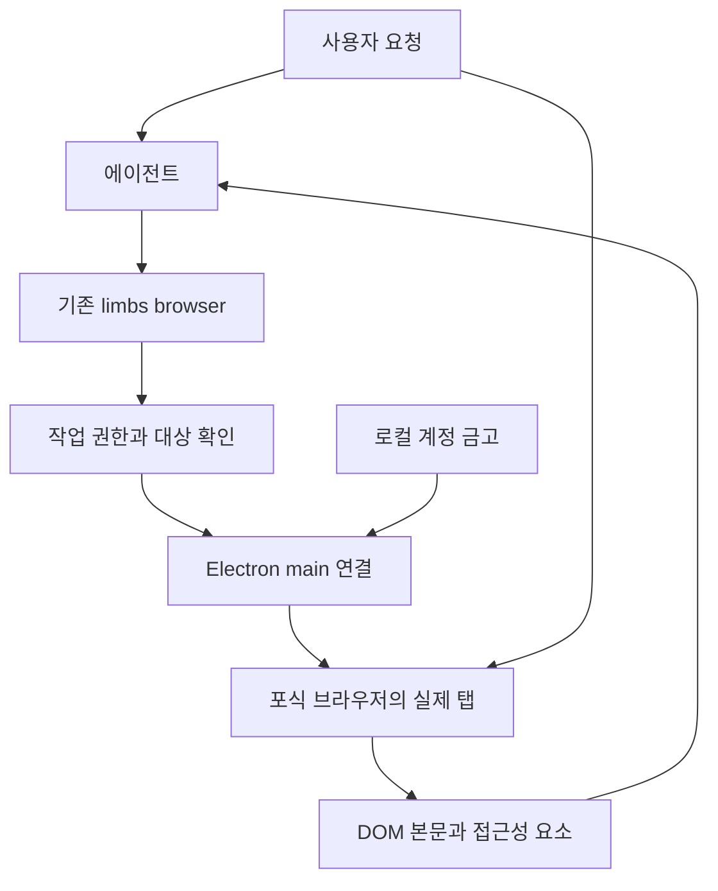

# 내장 브라우저의 AI 이용과 로그인 설계

상태: 데스크톱 내장 드라이버 구현 및 합성 사이트 검증. 2026년 10월 12일. 적용은 Electron 앱 재시작 후이며, 실제 네이버 계정 접속은 별도 검증이다.

AI가 필요한 사이트를 내장 포식 브라우저에서 직접 열고, 기존 로그인 상태 또는 저장된 계정으로 인증한 뒤 정보를 읽고 작업한다. 사용자가 미리 사이트를 열거나 로그인할 필요는 없다. 사람과 AI가 같은 탭을 이어 사용하며, 추가 인증이나 계정 선택이 필요한 단계만 사람에게 돌려준다.

실행 입구는 기존 `[limbs:browser]`를 유지하고 `driver:"embedded"`를 추가한다. 공개 자료의 HTTP 수집과 대량 수집용 Playwright는 계속 사용한다. 브라우저를 새로 하나 더 만드는 대신 현재 포식 브라우저의 탭과 인증 상태를 기존 도구에 연결한다.

## 현재 구조와 개선 목적

현재 코드에서 확인되는 분리는 다음과 같다.

| 위치 | 현재 책임 | 변경 방향 |
| --- | --- | --- |
| `frontend/src/components/ForageBrowser.tsx` | 사용자 탐색, 번역용 텍스트 추출, 비밀번호 자동채움 | AI에 맡기기와 되찾기, 작업 중인 탭 표시 |
| `frontend/src/components/forage/views.tsx` | `persist:forage` 세션의 Electron webview | 탭 신원 등록과 수명 동기화 |
| `frontend/electron/main.js` | guest webContents 관리, 금고 IPC, 팝업 처리 | 실제 탭을 제어하는 main 모듈 연결 |
| `frontend/electron/forage-passwords.js` | OS 암호화를 사용하는 계정 금고 | 계정 참조로 채우기, 로그인 실행 지원 |
| `data/packages/installed/tools/browser-action/handler.py` | Chrome MCP 또는 Playwright 선택 | embedded 연결과 작업별 드라이버 고정 |
| 같은 패키지의 `browser_content.py`, `browser_snapshot.py` | DOM 텍스트와 CDP 접근성 트리 읽기 | 기존 반환 의미를 내장 드라이버에도 적용 |

기존 browser-action도 화면 캡처 없이 DOM과 접근성 트리를 읽는다. 따라서 내장 드라이버의 이점은 화면 캡처 제거 자체에 있지 않다. 이미 기동한 브라우저·열린 문서·로그인 세션을 재사용하고, 브라우저 사이를 옮기며 잃던 작업 문맥을 유지하는 것이 목적이다. 새 URL의 로딩이나 사이트 응답 속도는 여전히 비용이며, 속도 우위는 구현 후 측정한다.

일반 능력의 개선 대상은 로그인된 자료 접근, 사람과 AI의 작업 인계, 실행 결과와 출처 보존이다. 네이버 전용 동작은 코어에 넣지 않는다. 사이트별 로그인 경로·성공 조건은 필요할 때 데이터 또는 검증된 관용구로 축적한다. 판단 기준은 [IBL 진화 목적](IBL_EVOLUTION_PURPOSE.md)을 따른다.

## 사용자가 경험하는 흐름

“네이버에서 안 읽은 메일을 확인하고 요약해줘”라고 요청하면 다음 순서로 진행한다.

1. AI가 사이트 주소를 확인하고 내장 브라우저에 작업 탭을 연다. 현재 탭을 대상으로 요청했다면 그 탭을 사용한다. 브라우저 표면이 닫혀 있으면 앱 안에서 연다.
2. 해당 탭에서 메일함에 접근할 수 있는지 확인한다. 로그인돼 있으면 바로 수집한다. 현재 계정이 요구한 계정과 다르면 다른 계정의 메일을 읽기 전에 멈춘다.
3. 로그인 화면이면 브라우저가 해당 인증 출처에 저장된 계정을 찾는다. 요청이나 기존 선택으로 계정이 결정되면 로컬 금고에서 채우고 로그인 제출까지 수행한다.
4. 계정이 없으면 사용자가 브라우저에 직접 로그인한다. 복수 계정 중 선택 근거가 없으면 선택을 요청한다. 추가 인증·보안 키·CAPTCHA가 필요하면 탭을 보여주고 그 단계만 기다린다.
5. 인증 이후 목적 화면을 다시 읽어 접근 성공을 확인한다. 로그인 버튼을 눌렀다는 이유만으로 성공을 반환하지 않는다.
6. 메일 목록과 본문을 필요한 만큼 읽고 출처와 함께 요약한다. 더 읽어야 할 목록·페이지가 있으면 계속 탐색한다.

메일 열람 자체로 사이트가 읽음 상태를 바꿀 수 있다. “읽음 상태를 유지해줘” 같은 제약이 있으면 목록 미리보기 등 가능한 방법을 우선하고, 보존을 보장할 수 없는 본문 열기는 실행 전에 알려준다. 메일 확인 요청에 발송·삭제·전달은 포함되지 않는다. 사용자가 이미 요청한 행위에는 반복 승인을 추가하지 않는다.

탭에는 “AI가 읽는 중”, “AI가 조작 중”, “로그인 필요” 등 사용자가 이해할 상태와 중지 버튼을 표시한다. 내부 드라이버 이름이나 IPC 설명은 진단 화면에만 둔다.

## 연결 구조와 책임



Electron main이 등록한 guest webContents만 조작 대상으로 삼는다. React는 표시와 탭 생성 요청을 맡고, 실제 제어·출처 확인·자격증명 처리는 main이 소유한다. React에서 받은 숫자 ID만으로 임의 webContents에 접근하지 않는다. 앱의 설정창·문서 편집기·개발자 도구 등은 대상에서 제외한다.

연결은 macOS와 Linux에서 사용자 전용 로컬 소켓을 사용한다. Electron이 사용자 전용 런타임 디렉터리에 소켓과 인스턴스 정보를 만들고 백엔드가 연결한다. 디렉터리 0700, 연결 정보 0600, 재기동마다 교체되는 연결 비밀값으로 handshake한다. 기존 전역 런처 WebSocket은 원격 접속과 권한 범위가 다르므로 제어 명령 전달에 사용하지 않는다. Windows는 사용자 ACL을 제한한 named pipe로 같은 메시지 계약을 구현하며, 준비 전에는 미지원으로 명시한다.

메시지는 길이를 제한한 프레임으로 전송한다. `request_id`, `instance_id`, 신뢰된 실행 문맥에서 얻은 `session_owner`, `task_id`, `tab_id`, `document_id`, `op`, 인자, 기한을 담는다. 연결 비밀값과 실행 권한은 모델이 쓰는 도구 인자에 넣지 않는다. 설치 경로·런타임 경로 해소는 기존 부팅 경로 규칙을 따른다.

백엔드는 기존 principal·프로젝트·에이전트·작업 신원을 이용해 호출 가능 여부를 판정한다. 웹사이트나 외부 회원이 보낸 `owner` 문자열은 권한 근거가 아니다. 첫 구현은 로컬 소유자 작업만 허용한다. 원격 소유자 요청은 기존 인증에서 소유자 신원이 확정되고 해당 작업의 PC 브라우저 이용 권한이 전달되는 경우에 한해 후속 지원한다. 외부 회원·공개 API·페이지 스크립트에 소유자 브라우저 접근을 열지 않는다.

Electron의 `webContents`와 `debugger`는 페이지 실행과 CDP 연결을 제공한다. DOM 추출은 앱 소유의 고정 코드, 접근성·프레임·입력은 필요한 CDP 명령으로 구현한다. 원격 디버깅 TCP 포트는 열지 않는다. 실제 지원 API는 프로젝트의 Electron 39 계열에서 검증한다. [Electron webContents](https://www.electronjs.org/docs/latest/api/web-contents/) · [Debugger](https://www.electronjs.org/docs/latest/api/debugger).

## 기존 도구의 확장 계약

새 액션 없이 기존 browser 액션에 다음 확장을 구현한다. 실제 지원 범위와 제약은 아래 구현 상태 및 browser_action 가이드가 소유한다.

| 호출 | 의미 |
| --- | --- |
| `tab mode:list` | 호출 작업이 접근 가능한 탭과 지원 기능 확인 |
| `tab mode:new url:…` | 포식 브라우저 안에 작업 탭 생성 |
| `navigate url:…` | 작업에 고정된 탭에서 이동, 최초 대상이 없으면 새 작업 탭 생성 |
| `snapshot` | 접근성 역할·이름·상태·요소 ref 읽기 |
| `content mode:text` | 렌더링된 본문·링크·표 등 목적에 맞는 구조화 내용 읽기 |
| `click`, `type`, `press_key`, `select`, `check`, `scroll`, `wait` | 관측된 요소 조작과 완료 조건 대기 |
| `iframe mode:list/switch/reset` | 명시적으로 프레임 선택 |
| `auth mode:status/login/resume/cancel` | 인증 상태 확인, 저장 계정 로그인, 사용자 인증 이후 재개, 취소 |

`auth`는 비밀값을 일반 `type` 인자로 흘리지 않기 위한 로컬 처리다. 추가 파라미터는 불투명한 `account_ref`, 관측한 `username_ref`, `password_ref`, `submit_ref` 등이다. 계정 전체 목록은 모델에 보내지 않고 해당 출처의 후보와 마스킹된 계정 표시만 제공한다. 로그인 화면의 버튼·폼은 먼저 snapshot으로 확인한다. 이메일 주소 입력 후 다음 화면에서 비밀번호를 요구하는 단계형 로그인도 각 문서에서 다시 관측한다.

지원 여부는 드라이버별 기능 목록에 명시한다. 1차 범위에 없는 `evaluate`, `content mode:html`, `cookies save/load`, `logs`, `upload_file`, `drag`, `pdf`, `vision` 등은 `UNSUPPORTED_OPERATION`을 반환한다. 자유 JavaScript와 전체 HTML은 초기 읽기 도구로 제공하지 않는다. 지원하지 않는 동작 때문에 로그인 상태가 없는 다른 드라이버로 자동 이동하지 않는다.

기존 브라우저 결과의 scalar/effect 의미를 유지하며 `driver`, `session_owner`, `tab_id`, 문서 신원과 실행 영수증을 추가한다. IBL 통화 변환은 기존 경계를 따른다. 기존 호출자가 의존하는 본문 필드를 임의로 `items` 안에 재포장하지 않는다.

내장 브라우저가 연결된 소유자 작업에서 사용하는 구문:

```ibl
$열기 = [limbs:browser]{driver:"embedded",op:"navigate",url:"https://mail.naver.com"}
$화면 = [limbs:browser]{driver:"embedded",op:"snapshot",tab_id:$열기.tab_id}
# 인증 필요 시 화면에서 얻은 요소 ref와 해당 출처의 account_ref로 auth login.
# 추가 인증이면 반환된 대기 상태를 보존하고 사용자 완료 뒤 auth resume.
$내용 = [limbs:browser]{driver:"embedded",op:"content",mode:"text",tab_id:$열기.tab_id}
return $내용
```

## 계정과 로그인

`auth status`는 `authenticated`, `login_required`, `account_selection_required`, `user_action_required`, `unknown` 중 하나와 관측 근거를 반환한다. 전 사이트 공통으로 로그인 여부를 확정할 수 있다고 가정하지 않는다. 비밀번호 입력칸이 없다는 사실만으로 인증 성공을 판정하지 않고, 보호된 목적 화면 접근·계정 표시 등 확인 가능한 근거를 쓴다. 근거가 부족하면 `unknown`이다.

기존 쿠키는 `persist:forage`에 그대로 둔다. HTTP 수집기나 Playwright로 쿠키를 복사하지 않는다. 저장 비밀번호는 main에서만 복호화하여 검증한 실제 로그인 프레임에 채운다. 기존의 `foragePwGet → React → fillPwJs` 경로는 `fillCredential(tab_id, frame_id, account_ref)`로 대체한다. 수동 채움과 AI 채움이 같은 출처·문서 검사와 금고 코드를 사용한다.

입력 직전 브라우저가 관측한 현재 scheme·host·port, 프레임 출처, 문서 세대를 다시 검사한다. HTTPS 인증 출처를 정확히 매칭하며 접미사나 같은 최상위 도메인만으로 계정을 공유하지 않는다. 현재 금고의 host 기반 매칭은 강화 대상이다. 기존 저장 항목은 origin을 검사해 사용 가능 여부를 판정하고, HTTP 항목이나 출처를 확정할 수 없는 항목은 자동 채움에서 제외한다. 예외가 필요한 로컬 사이트는 별도 명시 설정을 둔다.

SSO에서는 실제 인증 제공자 출처에 맞는 계정을 사용한다. 다른 출처의 프레임·폼 목적지에 비밀번호를 넣지 않는다. 정당한 별도 제출 출처가 필요한 사이트는 검증한 명시 매핑으로 등록한다. 자동 제출은 사용자가 요청한 로그인·정보 접근 작업 안에서 수행한다. 수동 탐색 중 자동채움은 기존처럼 제출하지 않는다.

인증 대기는 작업을 계속 폴링하지 않고 상태를 보존해 사용자에게 제어를 넘긴다. 사용자 완료 신호 후 화면을 재검증한다. MFA·CAPTCHA를 우회하거나 새 비밀번호를 대화에 입력하도록 요구하지 않는다. 비밀번호 오류는 무한 재시도하지 않으며 사용자 개입 상태로 전환한다. 팝업 로그인은 원래 탭과의 관계를 유지해야 하므로 현재의 모든 `window.open`을 동일 탭 이동으로 바꾸는 처리를 인증 팝업용 관리 창/탭 정책으로 보완한다.

금고 비밀번호·쿠키·인증 헤더·OTP는 모델 결과와 도구 로그에 포함하지 않는다. 인증 화면의 입력값과 토큰성 URL 파라미터를 결과 직렬화 전에 제외하고, 원시 HTML·네트워크 본문을 수집하지 않는다. 로그인 사이트 자체는 입력된 자격증명을 받으므로 “비밀번호가 어떤 페이지에도 보이지 않는다”는 보장을 하지 않는다. 비밀값을 일반 에이전트 경로로 노출하지 않는 경계를 만든다.

`persist:forage`를 이용하는 기존 창고 로그인 캡처는 별도 백엔드 전송 경로다. AI 인증 탭에서 이 캡처가 비밀값 비전달 계약을 깨지 않도록 자동 제외하고, 기존 창고 폴러 자격 등록은 별도 명시 흐름으로 남긴다. 일반 웹 로그인 입력을 창고 로그인으로 오인해 수집하지 않는 회귀가 필요하다.

## 탭 수명과 사람의 개입

2026-10-21: 패널 표시와 탭 수명을 분리한다. AI 때문에 열린 패널은 진행 중인 브라우저
호출이 모두 끝나면 성공·실패와 관계없이 숨겨 런처를 보여준다. 모델의 `close` 호출이나
마지막 탭 삭제를 기다리지 않는다. 숨김은 guest를 unmount하지 않아 같은 문서·ref로
후속 호출을 이어갈 수 있다. 새 탭 생성 중에는 유지하고, 추가 인증·계정 선택 요청은
패널을 다시 연다. 기존 사용자 패널·직접 조작을 이어받은 화면은 자동으로 숨기지 않는다.
`close`의 제어권 해제는 사람의 조작 인계로 간주하지 않는다. 명시 탭 닫기와 임시 수집
탭 제거는 기존대로 guest를 제거한다. 적용에는 Electron 앱 재시작이 필요하다.

탭 식별자는 앱 인스턴스·webContents 생명주기와 묶는다. URL만으로 같은 탭이나 계정이라고 판단하지 않는다. 각 작업은 대상 탭을 고정하고 전역 활성 탭에 의존하지 않는다. 읽기와 조작은 탭별 큐에서 순서대로 처리한다.

기존 사용자의 탭은 “이 페이지 읽어줘” 같은 명시 대상 요청이나 UI의 맡기기로 연결한다. 새 사이트 업무는 기본적으로 별도 작업 탭을 만든다. 사람의 다른 탭 탐색은 계속 가능하다. 작업 탭에서 사람이 입력하거나 이동하면 대기 명령을 취소하고 제어를 돌려준다. 재개할 때 화면을 다시 읽는다.

동일 partition의 여러 탭은 로그인 계정을 공유할 수 있다. 탭별 잠금만으로 계정 격리를 보장하지 않는다. 로그인·로그아웃·계정 전환은 인증 출처/프로필 단위로 직렬화하고 관련 작업의 인증 증거를 무효화한다. 기존 업무와 다른 계정이 필요한 경우 임의 로그아웃하지 않는다. 별도 프로필은 후속 범위이며, 초기 구현은 계정 충돌을 사용자에게 알린다.

ref는 문서와 프레임, 관측한 요소 신원에 묶는다. 탐색 후에는 폐기하고 조작 직전 부착 상태·역할·이름·대상의 유일성을 검증한다. 동적 재렌더링으로 다른 요소가 되면 `STALE_REF`, 중복 후보면 `REF_AMBIGUOUS`다. URL이 그대로인 SPA도 고려한다.

탭 닫힘·앱 종료·연결 상실은 명시 오류다. 기한을 넘긴 명령은 늦게 도착해도 실행하지 않는다. 입력·로그인 제출 후 응답을 잃으면 `outcome_unknown`으로 남기고 상태부터 다시 읽는다. 같은 request_id의 완료 결과는 짧게 보존해 재전송에 반환하며, 재기동 뒤 불확실한 변경 명령은 자동 재실행하지 않는다. `close`는 작업 연결을 해제하고 사용자 소유 탭이나 Electron 앱을 종료하지 않는다. 명시적 `tab close`만 대상 탭을 닫는다.

## 본문 수집과 출처

기본은 DOM 텍스트, 의미 있는 링크·표, 접근성 요소다. script·style·숨겨진 인증 데이터·입력값은 제외한다. 이미지·캔버스 등 텍스트로 읽을 수 없는 부분은 미수집으로 표시한다. 필요할 때만 별도 시각 읽기를 추가한다.

결과에는 제목, 최종 URL, 수집 시각, 탭·프레임·문서 신원, 추출 범위, 잘림 여부를 담는다. 긴 문서는 구간별로 읽는다. 커서는 특정 추출 스냅샷에 묶어 같은 구간의 중복·누락을 줄인다. 가상 목록·무한 스크롤·접힌 메일은 현재 DOM에 존재하는 범위만 읽었음을 표시하고 추가 탐색으로 보완한다. 로그인 후 실제 데이터가 로딩되기 전에 빈 성공을 반환하지 않는다.

iframe은 브라우저 프레임 식별자로 별도 선택한다. 교차 출처 iframe을 부모 JavaScript로 무조건 읽을 수 있다고 가정하지 않는다. OOPIF 등은 CDP 타깃 연결을 검증하고, 읽지 못한 프레임은 제한을 반환한다. 개발자 도구로 debugger 연결이 해제되면 ref를 무효화하고 재연결 또는 명시 오류로 처리한다.

웹 본문은 신뢰할 수 없는 자료다. 페이지에 포함된 명령이 작업 범위·계정 접근·로컬 파일 권한을 바꾸지 못한다. 외부 페이지에는 Node·금고·제어 IPC를 노출하지 않는다. webview 생성 옵션, IPC sender, 프레임 출처를 main에서 검사하고 `contextIsolation`, sandbox, `webSecurity`를 유지한다. [Electron 보안 지침](https://www.electronjs.org/docs/latest/tutorial/security).

## 수집 방식과 기본 드라이버 선택

공개 자료는 HTTP 수집으로 충분하면 그 경로를 사용한다. 렌더링이 필요하면 내장 브라우저로 읽고, 사용자가 내장 탭이나 로그인된 자료를 지정했다면 처음부터 내장 브라우저를 사용한다. 공개 수집 실패가 임의의 개인 계정 사용 권한을 뜻하지는 않는다. 요청한 사이트와 업무에 필요한 인증 범위에서만 진행한다.

명시 driver와 기존 작업에 고정된 driver가 최우선이다. 새 데스크톱 소유자 작업의 `auto`는 내장 브라우저가 연결되고 요청 기능을 지원하면 embedded를 선택한다. 그 외에는 초기 선택 시에만 기존 Chrome/Playwright 순서를 쓴다. 최초 반환에 실제 driver와 기능 목록을 알리고 이후 호출을 같은 드라이버에 고정한다. 내장 브라우저가 필요한 요청에서 연결이 없으면 `BROWSER_UNAVAILABLE`로 알린다.

무인 서버·대량 병렬 작업은 Playwright를 명시할 수 있고, 사용자의 외부 Chrome이 대상이면 Chrome을 선택한다. 같은 도구 아래 실행 환경을 선택하는 구조로 통합한다. 공개 자료 처리 중 무인증으로 재시도 가능한 경우도 새 시도로 기록하며, 로그인된 탭의 실패를 다른 세션의 빈 결과로 대체하지 않는다.

## 구현 순서와 변경 위치

1. **탭 연결과 읽기**: `frontend/electron/embedded-browser-bridge.js`, `embedded-browser-tabs.js`와 패키지 `browser_embedded.py`를 추가한다. 로컬 연결·권한·탭 등록·navigate·snapshot·content·작업별 driver 고정을 구현한다. React 탭 표시와 사람이 되찾기를 연결한다.
2. **조작과 인증**: `embedded-browser-dom.js`, `embedded-browser-auth.js`로 역할을 나눈다. 공통 ref 검증·입력·프레임·대기를 붙이고 금고 채움의 main 이전, auth 상태기계, 추가 인증 재개, SSO 팝업을 구현한다. 창고 캡처 예외도 함께 처리한다.
3. **수집 경로와 교재**: 실패가 드러나는 HTTP 수집→브라우저 후속 실행, 출처·구간 수집을 연결한다. `ibl_actions.yaml`에서 driver·auth·반환 설명을 추가하고 빌드로 파생물을 생성한다. `browser_action.md`, discovery 문구, 핸들러 오류·도움말까지 갱신한다.
4. **계약 검증 후 기본 적용**: 지원되는 데스크톱 작업의 auto를 내장 드라이버 우선으로 전환한다. Chrome/Playwright 명시 선택과 기존 작업 재개를 회귀 검사한다. 수동 로그인·번역도 공통 main 추출/채움 경로를 사용해 중복 실행 코드를 줄인다.

새 backend 서비스가 필요하면 층·수명 규약에 맞춰 배정하며 main 파일이나 ForageBrowser 본체에 구현을 몰아넣지 않는다. 파일당 1500줄 제한을 지킨다. 코드 변경 시 [회귀 절차](REGRESSION_TESTING.md), 어휘 빌드, frontend TypeScript 검사, backend 변경의 Android 번들 재생성을 적용한다.

## 완료 조건과 성능 검증

로컬 합성 사이트에서 정적 문서·JS 지연 로딩·기존 쿠키 로그인·계정 금고 로그인·단계형 로그인·MFA 인계·팝업 인증·세션 만료·복수 계정·가상 목록·iframe을 검증한다. 직접 수행할 네이버 수용 검사는 사용자의 로그인 상태와 요청 범위에서 별도로 진행하며, 지원을 검증하기 전에 네이버 성공을 단정하지 않는다.

핵심 완료 조건은 다음과 같다.

- 사람이 먼저 사이트를 열지 않아도 AI가 생성한 내장 탭에서 인증 후 자료를 읽는다.
- 로그인 정보는 모델·백엔드 결과·일반 로그로 나오지 않으며, 기존 창고 캡처를 포함한 전 경로에서 검사한다.
- 악성/다른 출처, 오래된 문서, 외부 회원 호출은 자격증명을 받지 못한다.
- 사용자 개입, 다른 작업의 계정 전환, 탭 닫힘, Electron/백엔드 재기동, 타임아웃에서 잘못된 탭 조작과 로그인 재제출이 없다.
- 부분 수집·추가 인증·불확실한 실행을 빈 성공으로 숨기지 않는다. 메일 열람의 읽음 변화 등 부작용도 검증한다.
- 기존 Chrome·Playwright, 수동 자동채움·저장·번역·창고 폴러가 회귀 없이 유지된다.

성능은 같은 자료·완료 조건으로 HTTP, 새 Playwright, 재사용 중인 Playwright/Chrome, 이미 열린 내장 탭, 새 내장 탭을 구분해 비교한다. 브라우저 기동·탐색·본문 추출 시간과 사용자 요청부터 결과까지의 시간을 분리하고, 실제 전체 모델 토큰·누락률·성공률을 함께 기록한다. 추가 인증에서 사람이 기다린 시간도 따로 표시한다. 내장 브라우저가 모든 사이트에서 더 빠르다는 목표 대신, 품질을 유지하면서 재로그인·탭 인계·중복 로딩 비용을 줄였는지를 판단한다.


## 구현 상태와 검증 범위

2026년 10월 12일 구현은 기존 Electron webview의 guest를 등록하고, 사용자 전용 로컬 소켓을 통해
browser-action과 연결한다. 새 작업의 auto는 지원되는 동작이면 내장 브라우저를 우선한다.
Windows 연결은 미지원이며 기존 Playwright/Chrome을 사용한다. 소유자 판정은 기존 principal을 따른다.
따라서 인증된 원격 소유자도 기존 실행 관문에서 owner로 확인되는 경우 같은 권한을 사용한다.
외부 회원·anonymous·body는 내장 드라이버에 접근할 수 없다.

구현 파일은 frontend/electron/embedded-browser-{bridge,tabs,dom,auth,install}.js,
패키지 browser_embedded.py, React forage/embedded.tsx다. 비밀번호 반환 IPC와 renderer의 fillPwJs는
제거했고, 수동 자동채움도 main의 출처 검사와 채우기 코드를 사용한다. 저장·계정 관리 화면은 유지한다.
기존 HTTP 계정은 자동채움에서 제외하며 이번 구현에 HTTP 예외 설정은 포함하지 않는다.

탭별 명령이 섞이지 않도록 main에서 요청을 직렬 실행한다. 인증 제출 대기는 동일 프로필의 다른
AI 작업을 AUTH_SESSION_BUSY로 막고 resume/cancel/close로 해제한다. 사람의 키·마우스 입력,
주소창 이동·뒤로/앞으로·새로고침은 작업을 중지한다. 서로 다른 사용자의 프로필을 만드는 기능과
사용자가 다른 탭에서 직접 바꾼 계정 신원을 모든 사이트에서 자동 판별하는 기능은 지원하지 않는다.
다른 계정을 요구한 작업은 모델이 목적 화면의 계정을 확인하고 불명확하면 사용자에게 선택을 요청한다.

snapshot은 DOM의 역할·접근 가능한 이름·상태를 구조화하고 실제 노드 참조를 격리된 JS 세계에 보존한다.
프레임 선택과 격리 세계 생성은 CDP를 이용한다. 같은 프로세스 프레임은 검증했으며, 연결 불가능한
OOPIF는 FRAME_UNAVAILABLE 등 명시 오류를 반환한다. 모든 접근성 노드를 복제하는 구현은 아니다.
SSO용 새 창의 생성·소유 작업 연결은 구현했고, 실제 외부 SSO 제공자별 호환성은 미검증이다.

기본 본문 추출은 렌더링된 텍스트와 링크이며 구조화된 표 전용 반환·이미지·시각 캡처는 후속 범위다.
입력값·편집 영역·숨겨진 요소는 제외하고 form 안의 공개 본문은 포함한다. 기본 추출 범위는 현재 프레임의
body이며 ref를 주면 관측 요소로 좁힌다. 한번의 추출 상한은 약 50만 자이며 보관 스냅샷에서 구간을 이어 읽는다.
URL의 쿼리·fragment는 인증 토큰 노출을 줄이기 위해 반환에서 제거한다. 쿼리로 구분되는 원문은
탭·문서·프레임 신원과 관측 ref로 이어서 접근하며 정밀 공유 URL 보존은 별도 설계가 필요하다.

일반 crawl의 수집 엔진은 유지한다. 로그인·차단 실패의 런타임 안내와 웹 검색 교재를 내장 브라우저로
이어가도록 고쳤으며, 인증된 자료를 공개 원문 캐시에 몰래 넣거나 쿠키를 HTTP 수집기에 복사하지 않는다.
새 내장 제어 경로는 동일 작업에서 navigate→auth→content를 이어 사용하는 에이전트 도구다.

검증은 backend/test_browser_embedded.py의 권한·소켓·작업 고정·끊긴 제출, 기존 브라우저 회귀,
frontend/scripts/embedded-browser-live.mjs의 실제 Electron guest와 합성 TLS 로그인으로 수행한다.
합성 자격증명만 사용하고 실제 계정·메일은 열지 않는다. 실행·검증 결과는 이 변경의 커밋 및 changelog에 남긴다.
성능 우위와 전체 에이전트 토큰 절감은 측정하지 않았으므로 주장하지 않는다.

최종 검증: backend not-system 종합 10011 통과·1 건너뜀, 관련 IBL/어휘 시스템 묶음 72 통과.
신규 브라우저 경계 시험 8개 통과(종합에 포함), 실제 Electron 합성 검증 26개 확인과 Python 핸들러→Electron 인증 본문 연결 통과.
frontend TypeScript 및 프로덕션 빌드, IBL --check, Android 번들 생성, backend 층 가드 통과.
네이버 실계정·외부 SSO 제공자·Windows 연결·OOPIF 전수는 미검증이다.

60회차 긴문장 훈련에서 내장 본문이 항상 PARTIAL_SOURCE가 되고 form 본문9건이 누락되는 결함을 확인했다.
후속 수리는 선언한 구간과 실제 수집 손실을 구분하고 공개 본문·인라인 문맥·복수 article을 보존한다.
커서의 본문·링크·제목·수집 시각을 함께 고정하며 실제 본문/링크 상한은 정직하게 드러낸다.
전체 IBL·독립 AI의 최초 관측과 후속 Electron 검증 범위는 [60회차 보고서](experiments/long_sentence_imagination/round_60/report.md)에 기록한다.
