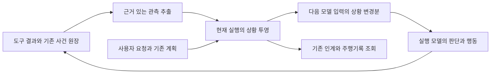

# 일반 업무의 실행 상황 인식과 모델 전달 설계

작성일: 2026-10-31. 상태: **실행 상황 수집·전달 구현 · 제한된 실제 모델 비교 완료**.
현재 구현 범위·검증·미지원 경로는 §13이 정본이다. 아래 설계의 모든 확장점이 구현됐다는 뜻은 아니다.
조사 기준: 정본 main `f5d51c06`과 조사 시점 작업 트리. 동시에 편집 중인 작업 지속·부분 수리
코드는 구현 후보로만 참고했다. 이 문서는 해당 변경의 배포나 검증 완료를 뜻하지 않는다.
목적 정본은 [IBL 진화 목적](IBL_EVOLUTION_PURPOSE.md)과
[vision](../data/system_docs/vision.md#ibl과-주변-시스템의-진화-목적)이다.

**실행 모델이 지금까지의 행동과 관측을 현재 업무의 상황으로 함께 보고 판단하게 한다.**
하네스는 관측 사실·판본·변화·미확인을 유지하고 전달한다. 작업 단계의 의미, 원인 가설,
다음 방법과 충분성 판단은 모델이 맡는다. 원격 PC뿐 아니라 조사·집필·분석·문서 편집·코딩·
병렬 실행에 같은 원리를 적용한다. 규칙을 더 외우게 하거나 별도 감독 모델을 상시 호출하는
방식보다, 이미 있는 관측이 실제 판단 문맥에 도달하는 연결을 먼저 완성한다.

## 1 문제와 개선 목표

현재는 도구 결과·접수증·로그·할 일·산출물 판본이 각각 존재해도 실행자가 긴 이력에서
상황을 다시 조립해야 한다. 호출 순서나 성공 표시가 업무 진척을 대신하지 못한다.
사용자가 맡긴 결과, 확보한 것, 진행 중인 것, 바뀐 것, 아직 확인하지 못한 것이 함께 보여야 한다.

맥12 사례에서는 업데이트 전에 실행 중이던 앱을 종료한 뒤 재시도하자 설치 도구가 종료된
상태를 출발 상태로 기록했다. 설치는 성공했지만 기동은 실패했고, 외부 명령의 성공 표시와
내부 부팅 결과도 달랐다. 이는 상황 연결의 필요성을 보여준다. 정확한 부팅 병목이나 TV1의
실패 원인까지 이 사례로 확정하지 않는다. 행동 개선의 크기도 구현 후 비교해야 한다.

첫 구현이 제공할 능력은 다음과 같다.

- 작업 중 얻은 결과와 관측을 해당 실행·대상·판본에 연결한다.
- 최초 관측과 이후 변화를 함께 유지한다. 재시도가 최초 상태를 덮어쓰지 않는다.
- 아직 도착하지 않은 결과, 관측 공백, 오래된 검증, 서로 다른 관측을 드러낸다.
- 실행자가 다음 판단을 할 때 관련 변경분을 받는다. 같은 사실의 반복 주입은 줄인다.
- 도구가 없는 설명·작성은 기존 대화 문맥으로 수행한다. 계획 작성이나 상태 신고를 강제하지 않는다.

## 2 현재 기반과 공백

| 기반 | 확인한 역할 | 이번에 연결할 부분 |
| --- | --- | --- |
| `base/execution_turn.py` | 현재 실행 신원·문맥과 종료 수명 | 같은 실행의 관측 투영과 소비자별 전달 위치를 연결. 장기 과제 내용 저장소로 바꾸지 않음 |
| `base/task_receipts.py`, `base/resident_store.py` | 긴 작업의 접수·실행·종료, 원격 사건·결과 | 현재 실행이 만든 접수증을 자동 연결하고 변화 관측을 일반 상황에 포함 |
| `datastore/supervision_store.py` | 감독 없는 실행도 사용할 수 있는 증거 원문·사건 저장 | 근거 참조, 투영 체크포인트, 전달 기록을 기존 턴 저장소에 보존 |
| `cognition/conscious_supervisor.py` | 목표·호출·사건·검수 상태 조회, 조건부 개입 | 감독과 실행자가 같은 관측 투영을 사용. 감독의 지시가 있어야만 사실이 전달되는 결합 해소 |
| `base/supervision_watch.py` | 로컬 Script 로그 변화 감시 | 일반 접수증 어댑터와 결합. 로컬 로그 감시만으로 원격 작업을 관측했다고 간주하지 않음 |
| `ibl/ibl_progress.py` | IBL 호출·행 좌표와 움직임 | 실행 위치 정보로 사용. 업무 의미상의 진척률·완료로 번역하지 않음 |
| `cognition/todo_bridge.py`, `essentials_todo.py` | 모델이 작성한 할 일 상태 | 모델의 작업 해석으로 표시. 관측·검증 증거와 같은 권위로 취급하지 않음 |
| `cognition/associative_recall.py` | 기기·도구·관련 자료 소개 | 소개된 정보와 작업 중 최신 관측을 구분하고 중복 전달 축소 |
| `datastore/conversation_handoff.py` | 중단 실행·효과 미확인·접수증 인계 | 재개 시 이전 상황을 회수하되 변하는 대상은 마지막 관측으로 표시 |
| 연구 계획·질문, 문서/시트 세션, 코딩·수리 원장 | 해당 업무의 계획·판본·확정·검사·재개 | 원래 소유자를 유지한 읽기 어댑터로 연결 |
| `services/execution_trace.py` | 기존 원장을 합친 사후 조회 | 관측 근거와 전달 기록도 조회하도록 연결. 매 호출 전체 이력 검색은 하지 않음 |

API 제공자에는 오래된 도구 결과를 생략하는 경로가 있다. 네이티브 CLI의 문맥 관리는 별개다.
어느 제공자에서도 전체 대화가 계속 같은 형태로 남는다는 전제에 기대지 않는다.
`World Pulse`의 정기 위치·일정 갱신은 작업 중 상황 공급과 역할이 다르다.

## 3 판단과 관측의 책임

세 종류를 분리해서 같은 문맥에 제시한다.

| 종류 | 소유자 | 예 |
| --- | --- | --- |
| 목적·제약 | 사용자 요청, 기존 조향·규정 계약 | 보고서의 대상 기간, 지정 출처, 결과 전달 형식 |
| 관측 | 실행기·도구·자료/산출물 저장소 | 파일 v2 저장, v1 검증 통과, 작업 접수 후 결과 미도착 |
| 해석 | 현재 실행 모델, 기존 계획·할 일 | 자료가 부족함, 초안 작성 단계, 다음에 비교할 가설 |

하네스는 ‘파일 저장 완료’에서 ‘보고서 완성’을 추론하지 않는다. 모델의 `completed` 표시도
해당 모델의 판단으로 남긴다. 판단에 근거 참조가 있으면 연결하고, 없으면 근거가 있다고
채우지 않는다. 추가 모델 호출이나 비공개 사고 과정 저장 없이 기존 계획·할 일·명시적
중간 요약이 있는 경우에만 해석을 회수한다. 새 상태 작성 명령은 첫 구현의 전제가 아니다.

원래 목표와 사용자의 후속 변경은 기존 대화/조향 경로에서 가져온다. 상황 투영이 목표를
새로 정의하거나 ‘실패 보고’를 원래 결과의 대체 완료 기준으로 채택하지 않는다.

## 4 전체 흐름과 저장 위치

원격 작업·파일·연구·문서 상태의 정본은 기존 저장소에 둔다. 현재 실행은 해당 참조의
작은 읽기 투영만 보유한다. 독립 DB, 자동 과제 선택, 장기 목표 요약, 순찰 실행은 만들지
않는다. [pursuit 제거](PURSUIT_REMOVAL_PLAN_2026_10_29.md)의 경계를 유지한다.

투영 체크포인트와 소비자 전달 기록은 기존 `TurnStore`의 증거·사건 형식으로 보존한다.
원 도구 결과 전체를 두 번 저장하지 않고 증거 참조를 사용한다. `execution_turn`은 현재
투영 인스턴스만 연결한다. MCP 재진입은 같은 인스턴스를 사용하며, 별도 프로세스는 기존
인증된 실행 경계로 갱신한다. 각 프로세스가 동일 사건 파일을 독자적으로 덮어쓰지 않는다.

종료하면 메모리 인스턴스와 감시 구독은 해제한다. 기존 대화/수리 인계로 재개할 때만
참조를 다시 연결한다. 오래된 미완료 기록이 있다는 이유로 실행을 자동 시작하지 않는다.
참조 원문이 만료·삭제·접근 불가이면 그 사실을 표시하고 복원된 것으로 간주하지 않는다.

## 5 관측 계약

내부 관측은 다음 정보를 가진다. 이것은 새 IBL 문법이나 모든 도구의 반환 형식 변경이 아니다.
기존 계약을 읽는 어댑터에서 확실히 아는 값만 채우며, 누락은 `unknown`으로 남긴다.

| 정보 | 의미 |
| --- | --- |
| `id`, `source_ref`, `source_revision` | 원 사건/영수증과 증거 판본. 중복 수신을 같은 사건으로 식별 |
| `scope`, `actor`, `call_id` | 사용자·대화·실행 소유권과 관측을 만든 호출 |
| `subject`, `facet`, `value` | 안정적인 대상 식별자, 관측한 측면, 실제 값 |
| `observed_at`, `received_at`, `source_cursor` | 대상에서 관측한 시각, 중앙 수신 시각, 원장 순서. 시계 차이를 보존 |
| `subject_revision` | 파일 지문·세대·문서 판본 등. 없으면 미확인 |
| `relation` | 명시된 입력 의존·적용 결과·대체·무효화 참조 |
| `basis` | 직접 관측, 도구의 주장, 모델의 해석 구분 |
| `availability` | 마지막 관측, 변경으로 재확인 필요, 충돌, 접근 불가 등의 상태 |

대상은 기기뿐 아니라 자료집·문서 판본·파일·분석 결과·렌더 작업·외부 전송이다.
경로 이름만 같다고 같은 파일이나 같은 호스트로 합치지 않는다. 대상 ID에는 저장소/호스트/
세션 범위를 포함하고, 임의 본문에서 추출한 이름으로 다른 대상의 관측을 덮어쓰지 않는다.

하나의 `success`로 합치지 않고 서로 다른 관측 측면을 유지한다. 예를 들어 원격 명령
`exit=0`과 서비스 `health=unavailable`은 공존할 수 있다. 둘 중 하나를 삭제하거나 전자를
서비스 성공으로 승격하지 않는다. 자유로운 셸 출력에서 업무 성공을 일반 정규식으로 추측하지
않는다. 구조화되지 않은 결과는 원문 참조로 남겨 모델이 해석하도록 한다.

### 상태 변화와 판본

- 실행에서 처음 확인한 대상 상태를 기준 관측으로 보존한다. 사전 관측이 없었다면 ‘원래
  상태 미확인’이다. 쓰기 직전 모든 대상에 새 읽기를 강제하지 않는다.
- 행동의 의도, 접수, 실행 결과, 대상에서 확인한 효과를 구분한다. 결과 유실은 효과 실패와
  다르다. 인과 관계는 영수증이나 명시된 관계가 있을 때만 확정하고 시간상 인접은 추정으로 남긴다.
- 같은 대상·측면의 새 관측은 기존 값과 연결한다. 다른 소스의 상충 값은 숨기지 않는다.
  수신 시각만으로 늦게 도착한 옛 결과를 최신으로 선택하지 않는다.
- `검사 대상=v1`, `현재 산출물=v2`라면 ‘v1 검사 통과, v2 미검증’을 보여준다. 이 연결은
  명시된 판본·의존 관계에만 적용한다. 상관없는 모든 결과를 무효화하지 않는다.
- 자체 쓰기나 알려진 외부 변경은 관련 관측을 재확인 대상으로 바꾼다. 모든 외부 변화를
  감지할 수 있다고 보장하지 않는다. 살아 있는 대상도 ‘마지막 관측 시각’을 항상 유지한다.
- 같은 호출의 반복 조회는 새로운 진척으로 세지 않는다. 원장 커서·결과 지문이 바뀐 경우만
  변화로 처리하고, 시각만 갱신되는 맥박은 생존과 진척을 구분한다.

## 6 모델에게 보이는 상황

각 판단 입력은 ‘전체 기준 상황’ 또는 그 뒤의 ‘변경분’이다. 기본 구성은 다음과 같다.

1. 현재 요청과 사용자 변경의 참조, 기존 계획/할 일이 있으면 그 판본.
2. 관련 대상·자료·산출물의 마지막 관측과 판본.
3. 진행 중인 실행, 도착한 결과, 효과 미확인 호출.
4. 처음 상태와 이번 실행이 만든 변화의 연결.
5. 서로 충돌하는 관측, 유효 범위가 달라진 검사, 아직 없는 근거.
6. 원문 조회 참조와 이번 전달에서 생략한 범위.

문서 업무에서의 예시 표현은 다음과 같다. 실제 UI 문구나 강제 계획 형식은 아니다.

> 요청: 9월 매출 보고서 작성. 입력 CSV는 v2로 교체됨. 계산표는 v1에서 생성됐고 해당
> 계산 검사만 통과함. 보고서 초안은 저장됨. v2 기준 재계산과 초안의 수치 대조 기록은 없음.
> PDF 렌더는 접수됐으며 종료 결과는 아직 없음. ‘초안 작성 완료’는 실행 모델의 할 일 표시임.

모델은 이것을 보고 재계산·부분 수정·관측 확인 등 다음 행동을 선택한다. 하네스는
‘지금 재계산하라’는 지시를 자동 생산하지 않는다. 의미상 중요한 누락을 모두 기계적으로
찾을 수는 없으므로, 관계를 못 아는 자료는 연결 미확인으로 표시한다.

### 분량과 정보 선택

설계 목표는 기준 상황 최대 2,000토큰, 변경분 최대 600토큰이다. 현재 구현은 제공자별
tokenizer 계측 대신 각각 UTF-8 **8,000바이트/2,400바이트** 제한을 사용한다. 토큰 상한을
보장하지 않으며 `size_method`에도 바이트 제한임을 적는다. 실제 토큰 비용은 모델 응답의
usage로 별도 측정한다. 제공자별 토큰 예산과 관련성 선택의 고도화는 후속 범위다.

현재 요청의 변경, 효과 미확인, 관련 판본 충돌, 접수증의 종료 전환을 우선 표시한다.
최근 연결된 대상과 현재 계획의 명시 참조로 관련성을 정하며, 전체 저장소를 키워드 검색하지
않는다. 한도를 넘으면 건수·원문 참조·누락 종류를 남긴다. 누락된 항목을 해결된 것으로
취급하지 않는다. 본문은 신뢰할 수 없는 자료로 인용하며 도구 출력 속 지시를 명령으로 올리지 않는다.

## 7 전달 시점과 제공자별 경계

‘실시간’은 관련 사건을 수집하고 **다음 가능한 판단 입력에 반영한다**는 뜻이다.
이미 진행 중인 모델 생성이나 외부 계산을 임의로 끊지 않는다. 전달 지연과 관측 시각을
기록해, 공급할 수 없는 경로를 실시간 지원으로 발표하지 않는다.

| 경로 | 전달 위치 | 첫 구현의 확인 조건 |
| --- | --- | --- |
| 일반 API 모델 | 다음 모델 호출 직전, 기존 메시지 조립 경계 | 실제 요청 본문에 해당 상황 판본이 포함됨. system prefix는 고정해 캐시 유지 |
| MCP/IBL 도구를 쓰는 실행자 | 해당 호출 결과의 모델용 문맥 | 업무 반환값/IBL `value`는 보존. 전송 계층에서 사실 블록을 분리 |
| Claude Code 네이티브 도구 | 지원되는 훅의 추가 문맥 경로 | 설치된 CLI의 훅 계약과 실제 모델 수신 시험을 먼저 확인. 사실 전달을 도구 거절로 흉내내지 않음 |
| Codex 네이티브 도구 | 현재 확인된 경로는 다음 MCP 결과 또는 하네스가 소유하는 다음 실행 입력 | 네이티브 도구 사이 자동 주입은 현재 보장하지 않음. 지원 SDK 경계 확인 전에는 부분 지원으로 표시 |
| REFLEX에서 일반 실행으로 전환 | 기존 문맥 인계에 같은 상황 추가 | 이미 실행된 효과와 접수증을 함께 전달, 예산·취소 계승 |
| 중간 감독·최종 검수 | 같은 관측 투영의 읽기 소비자 | 실행자와 같은 판본을 읽되 전달 cursor는 각자 분리 |

네이티브 도구만 연속 사용하는 CLI에서 신뢰할 수 있는 주입 경계가 없으면 로그 관측은
가능해도 그 구간의 상황 전달은 미지원이다. SDK 교체·세션 재시작·반복 MCP 호출 강제로
감추지 않는다. 모든 경로의 동등 지원을 출시 조건으로 선언하지 않고 지원 범위를 공개한다.

전달에는 `projection_revision`, `base_revision`, `source_cursors`, `omitted`, `delivery_id`를
붙인다. 전송 실패이면 소비자 cursor를 전진시키지 않는다. API 요청/CLI 통로에 실린 것을
‘전달’로 기록하며 모델이 이해했다고 간주하지 않는다. 문맥 압축·세션 교체·재시도 때 기준
판본 유지 여부가 불명확하면 작은 전체 상황을 다시 보낸다. 병렬 모델 호출과 감독의 cursor는
독립이다. 다른 소비자가 읽었다고 실행자의 변경분을 생략하지 않는다.

## 8 수집과 갱신 비용

등록은 현재 실행의 도구 인자·결과에서 확인된 대상/접수증, 기존 계획의 명시 참조에 한정한다.
이미 확보한 결과를 먼저 소비한다. `self:task status/wait`의 기존 투영과 로컬 Script 감시를
재사용하고, 원격 수신 사건이 도착하면 해당 구독만 갱신한다. 모든 기기·파일을 상시 스캔하지 않는다.

외부 조회가 필요한 어댑터는 읽기 범위·비용·취소·조회 시각을 선언한다. 기본 상태 전달은
추가 외부 호출 없이 기존 원장 읽기로 수행한다. 새 원격 탐침이나 비용 있는 API 조회는 기존
권한의 실제 도구 호출로 관측하고, 통상의 사용자 승인 경계를 우회하지 않는다. 필요한 확인이
없으면 모델에 ‘미확인’을 전달한다. 새 감시 데몬이나 모델 폴링을 도입하지 않는다.

동일 대상에 다른 실행의 변경이 감지돼도 그 실행의 대화 내용을 가져오지 않는다. 현재
사용자가 읽을 수 있는 자원 판본 변화만 전달한다. 회원·프로젝트·대화 격리는 원 소유권
검사를 유지한다. 로그·증거의 기존 비밀 마스킹과 보존 기간도 이어 쓴다.

## 9 구현 위치와 기존 기능의 정리

아래 새 파일명은 제안이다. 구현 직전 기존 함수와 동시 변경을 다시 대조해 중복 없이 배치한다.

| 소유 위치 | 구현 책임 |
| --- | --- |
| `backend/base/execution_situation.py` 제안 | 내부 관측 계약, 현재 실행 투영, 멱등 병합, 소비자 cursor. 위층 import 없이 어댑터 등록 |
| `backend/datastore/situation_evidence.py` 제안 | 기존 TurnStore를 이용한 근거/체크포인트 접근·회수. 독립 DB 없음 |
| `backend/cognition/situation_context.py` 제안 | 목적/해석과 사실의 구분, 관련 범위·분량 선택, 모델용 입력 구성 |
| `backend/services/situation_sources.py` 제안 | 접수증·자원 원장의 읽기 어댑터 연결. 내용어별 판정은 각 패키지/업무 소유자에 유지 |
| 기존 provider·MCP 전송 경계 | 결과 관측과 모델 전달. 중복 이벤트는 원 호출 ID로 결합 |
| 기존 대화/수리/연구 인계 | 상황 참조와 판본 회수. 각자의 재개·취소 소유권 유지 |

새 모듈은 층 검사 `LAYERS`에 배정하고 파일 1500줄 제한을 지킨다. 모든 확장점을 첫 단계에
별도 모듈로 만들 필요는 없으며, 책임이 기존 소유자에 맞으면 그 안에서 시작한다.

관측 생산자의 결함도 해당 소유자에서 고친다. 예를 들어 `remote_update_runtime.quiesce`는
정지 안내로 반환하기 전 최초 실행 상태를 보존하고, 재시도는 그 기록을 계승해야 한다.
이전 기록이 없으면 현재 정지 상태를 업데이트 전 상태로 소급하지 않는다. 상황 표시만
추가해 기존 복원 로직의 결함이 해결됐다고 주장하지 않는다. 문서 저장·검사 어댑터도 같은
방식으로 실제 대상 판본을 반환해야 한다. 임의 셸 명령은 전달된 종료값과 원문만 관측하며,
하네스가 명령을 재작성하거나 종료값을 업무 성공으로 바꾸지 않는다.

연결 뒤 `conscious_supervisor.state()`의 작업 관측과 새 문맥 공급자가 서로 다른 판정을
만들지 않게 같은 투영을 사용한다. 기존 도구 원문·계측·검수 판정은 보존한다.
기기 소개·인계·실행 문맥의 중복 상태 설명은 동일 관측 참조로 모은다. 할 일을 자동 완료
처리하는 경로를 새로 만들지 않는다. 경고 문구를 추가하는 대신 전달되는 사실의 품질을 검증한다.

[작업 지속·부분 수리 설계](TASK_CONTINUOUS_REPAIR_DESIGN_2026_10_31.md)는 계속 실행과
수리 권한의 소유자다. 본 설계는 그 판단에 필요한 관측을 공급한다. 구현 중인
`task_continuation.py`의 추가 실행 한도나 최종 오류 판정은 여기서 다시 구현하지 않는다.
상황 인식 도입으로 자기수리·외부 쓰기 권한이 넓어지지 않는다.

## 10 구현 순서와 인수 조건

| 단계 | 작업 | 완료 조건 |
| --- | --- | --- |
| A 계약과 제공자 경계 확인 | 현재 사건/자료 식별자·전달 경로 조사, 작은 고정 사례로 실제 모델 입력 확인 | API·MCP·CLI별 관측/전달 가능 범위 확정. 실제 입력에서 전달 판본을 확인하고 한계를 기록 |
| B 공통 투영과 수명 | 기존 턴 저장소 연결, 관측 병합·판본·최초 상태·효과 미확인·취소/정리 | 순서 뒤바뀜·중복·동시 실행·재개에도 근거와 소유권 유지. 새로운 장기 과제 생성 없음 |
| C 일반 업무 연결 | 공통 호출·접수증, 파일/산출물 판본, 기존 계획/할 일, 데이터 의존과 검증 참조 | 문서 편집·분석·병렬 결과에서 현재 상황을 구성. 원격 PC 사례만으로 통과하지 않음 |
| D 모델 전달과 인계 | API·MCP, 검증된 CLI 경계, 의식 OFF·REFLEX·감독·재개 연결 | 실제 실행자 입력에서 변화 수신 확인. 압축 뒤 기준 상황 복원, 소비자 간 cursor 격리 |
| E 행동 검증과 정리 | 기존 방식과 비교, 중복 상태 설명 정리, 제한된 배포 | 아래 계약/행동 시험 통과, 품질·시간·토큰·미지원 경로를 함께 보고 |

B–D는 작은 수직 구현을 반복한다. 첫 수직 구현은 ‘파일 판본 변경 → 이전 검사 범위 표시 →
다음 모델 입력’으로 잡고, 긴 작업 접수증과 원격 관측을 같은 계약으로 확장한다.
첫 지원 배포에는 문서·데이터/코딩·긴 작업 세 범주의 연결과 API/MCP 전달을 포함한다.
TV1/맥12 연결만, 상태 화면만, 기록 저장만 완성한 것을 일반 상황 인식 완료로 발표하지 않는다.
전체 구현을 시작하기 전에 행동 실험 결과를 기다리는 구조로 만들지는 않는다.

## 11 검증 계획

### 계약과 통합 검사

- 관측 중복·역순·시계 차이·소스 충돌·재시도에도 최초 관측과 판본 관계가 유지된다.
- 접수·대기 시간 초과·작업 실패·응답 유실·실제 효과가 구분된다. 오래된 성공이 현재
  실패를 덮지 않고, 성공한 조회가 조회 대상의 성공으로 바뀌지 않는다.
- 파일 수정 후 옛 판본의 검사는 남되 새 판본에 적용되지 않는다. 부분 의존 관계와
  무관한 자료는 분리한다. 미지원 도구는 사실을 발명하지 않는다.
- 회원/대화/프로젝트 간 원문 유출, 출력 속 지시 승격, 마스킹 누락이 없다.
- 전달 실패·소비자 병렬·컨텍스트 압축·재기동에서 누락/중복 전달을 검출한다.
- 취소 후 신규 조회/실행이 없고, 감시 수명은 현재 실행과 함께 정리된다.
- 정상 경로에 이 기능 전용 모델 호출이 0이다. 기존 검수·권한·예산 동작을 보존한다.

새 검사는 소유 모듈별 시험 파일에 둔다. `select_tests.py`와
[회귀 절차](REGRESSION_TESTING.md)를 따르며, 공통 실행/제공자/저장소 변경은 관련 system
묶음과 종합 회귀로 확인한다. 실제 CLI 모델 입력 검사는 단위 mock 통과로 대체하지 않는다.

### 실제 모델 행동과 비용

동일 모델·기어·도구·권한·사용자 요청·예산으로 기존 입력과 상황 제공 입력을 비교한다.
행동 지침은 양쪽에서 같게 두어 상황 공급의 효과를 분리한다. 재현 환경을 초기화하거나
같은 사건 재생을 사용하고 순서/반복 조건을 기록한다. 실제 변형 입력도 포함한다.

| 사례 | 확인할 행동 |
| --- | --- |
| 보고서 초안 뒤 근거 자료 교체 | 이전 초안·검증 범위를 파악하고 필요한 부분을 갱신 |
| 분석 결과 생성 뒤 입력 판본 변경 | 옛 계산을 최신으로 전달하지 않고 유효한 결과로 마무리 |
| 문서/코딩 수정 뒤 옛 검사만 존재 | 검사한 판본과 전달할 판본을 구분해 필요한 검증 수행 |
| 병렬 작업의 일부 완료·일부 실패 | 확보한 결과를 보존하고 남은 부분을 정확히 다룸 |
| 외부 쓰기 응답 유실 | 효과 확인 없이 같은 쓰기를 중복 전송하지 않음 |
| 장시간 실행과 맥박만 있는 정체 | 정상 진행과 미확인을 구분해 적절한 조회·진단 선택 |
| 앱 종료 후 업데이트 재시도 | 최초 상태와 종료 원인을 유지하고 실제 사용 상태까지 확인 |
| 사용자 방향 변경·취소·새 대화 인계 | 옛 목적 자동 부활 없이 현재 지시와 유효한 근거 계승 |
| 짧은 질의·도구 없는 작성 | 불필요한 계획·조회·상태 나열 없이 기존 품질 유지 |

결과 적합성·실제 완료·사용자 재명령·중복 효과·낡은 근거 사용·불필요한 재조회·진단 전환
시간을 채점한다. 명령 수나 ‘현재 단계’를 말하는 문장 수는 성공 지표가 아니다.
전체 경과 시간과 모든 모델의 입력/출력/캐시 토큰, 추가 관측 비용·메모리도 함께 측정한다.
동일 관측에는 같은 크기/캐시 기준을 적용하고, 평균만으로 특정 범주의 퇴행을 숨기지 않는다.

계약 위반·원문 유출·취소 위반·중복 쓰기는 출시 차단 사유다. 행동 성공률·비용은 실측
분포와 실패 사례로 보고한다. 개선되지 않으면 더 많은 지침으로 결과를 가리지 않고,
관련 정보 선택·전달 시점·누락을 먼저 분석한다. 모든 업무의 올바른 판단을 보장한다고 주장하지 않는다.

## 12 배포와 완료의 의미

기능 설정으로 현재 실행 단위 활성화를 선택한다. 먼저 모델에 보내지 않는 관측 구성 검사,
다음으로 허용된 비교 업무, 마지막으로 검증된 제공자/업무 범위에 적용한다. 비활성화하면
기존 도구 실행과 인계가 유지되며, 원장이나 산출물을 되돌리지 않는다. 진행 중 실행은 시작한
설정을 유지해 도중 의미가 바뀌지 않게 한다. 별도 상주 서비스와 자동 재개 기능은 없다.

출시 보고에는 관측 범위, 실제 모델 전달 경로, 미지원 경로, 계약 검사, 행동/비용 결과를
각각 적는다. 구현 결과와 운영 반영 여부는 §13에 구분해 기록한다.
사용자가 체감해야 할 결과는 **모델이 앞선 일을 잊어 재시작하거나 낡은 결과로 마무리하는
일이 줄고, 현재 상황에 맞는 다음 행동으로 요청한 결과에 도달하는 것**이다.

## 13 2026-10-31 구현과 확인 범위

### 실제 연결

`execution_turn.Binding`에 실행 수명의 `Situation`을 붙였다. 기존 `TurnStore`의 사건·원문
참조와 대화 인계 체크포인트를 사용한다. 독립 목표 DB, 새 IBL 낱말, 추가 감독 모델 호출,
상주 감시 프로세스는 없다. 실행 시작 시 World Pulse 설정의 `execution_situation.enabled`를
읽으며 생략 시 활성화한다. `false`면 새 실행에 연결하지 않는다. 실행 중 설정은 바뀌지 않는다.

| 구현 | 실제 책임 |
| --- | --- |
| `backend/base/execution_situation.py` | 최초/최신 관측·출처별 순서·충돌·명시 의존 판본·효과 미확인·소비자별 전달 위치 |
| `backend/datastore/situation_evidence.py` | TurnStore 보존·구조화 결과의 도구 주장·파일/Office 생산자 영수증 연결 |
| `backend/base/situation_delivery.py` | 기존 모델 요청에 기준 상황/변경분 삽입, 전달 승인, 문맥 소실 시 기준 상황 재전달 |
| `backend/ibl/ibl_situation.py` | 실행기의 실제 선택된 증거 간선으로 입력 판본과 계산 결과·명시 assertion 연결 |
| 기존 접수증/원격 원장/수리/할 일/대화 인계 | 해당 소유자가 이미 확보한 사실을 전달하고 수명·권한·마스킹 유지 |

파일 읽기의 안정된 전체 해시와 원자적 쓰기 영수증, Office의 확정된 저장소 읽기/저장/사본
출력, 수리 후보 판본·검사 영수증을 수집한다. 문서 형식 검사는 **검사한 초안 바이트 해시**에
붙고 원본 파일의 현재 내용이나 저장 완료를 대신 증명하지 않는다. 수리 검사 의존 관계는
후보 코드 해시에 연결하며 환경 해시는 원래 검사 영수증에 남는다. 환경 변화의 자동 무효화는
아직 일반 상황 투영에 연결하지 않았다.

접수·실행·대기 시간 초과·종료 결과를 별개로 보존한다. 도구의 `success`/`exit_code`는
`tool_claim`, 할 일은 `model_interpretation`이며 업무 성공 판정으로 승격하지 않는다.
현재 실행이 제출한 원격 job만 다음 전달 경계에서 **로컬 수신 원장**을 읽는다. 새 네트워크
조회는 하지 않는다. 끝난 실행과 취소된 실행은 이 조회를 하지 않는다.

IBL 계산은 실행 기록의 실제 입력 의존 간선만 사용한다. 읽기만 하고 계산에 쓰지 않은
파일의 변경은 그 계산을 낡은 결과로 만들지 않는다. 같은 출처의 늦은 사건이 최신 상태를
덮지 않으며 파일 A→B→A 복귀도 새 변화로 인식한다. 검증한 입력이 바뀌면 예전 검사 결과를
보존한 채 `needs_recheck`로 표시한다. 불확실한 임의 셸 효과를 추론하지 않는다.

### 모델 전달과 인계

OpenAI 계열·Anthropic·Gemini SDK/HTTP·DeepSeek HTTP·Ollama의 실제 요청 경계와 마지막
보고 호출에 연결했다. 고정 system prefix는 변경하지 않는다. 지연 스트림 생성만으로 전달
완료를 기록하지 않고 첫 응답을 받은 뒤 cursor를 전진시킨다. 이것도 모델의 이해 증명은 아니다.
전달 한도에서 빠진 관측은 건수와 기존 `read_result` 원문 참조로 회수할 수 있다.

MCP `execute_ibl`은 업무 값과 분리된 TextContent로 상황을 전달한다. 읽기 전용
`/ibl/situation`은 같은 principal·agent·task만 조회한다. MCP/훅의 실제 문맥 보존은 관측할 수
없으므로 매번 제한된 기준 상황을 준비하며 전달 완료로 기록하지 않는다. Claude PreToolUse는
기존 `updatedInput`과 함께 `additionalContext`를 전달하고 권한 거절/허용 결정은 추가하지 않는다.
Codex 네이티브 도구 사이 자동 주입은 지원하지 않으며 다음 MCP 결과 또는 하네스가 소유한
다음 실행 입력에서만 전달된다.

기존 대화 인계가 허용한 완전한 체크포인트만 복원한다. 복원한 사실은
`last_observed_before_resume`으로 표시하고 새 직접 관측 전까지 현재 확인으로 바꾸지 않는다.
옛 과제나 감시를 자동 재시작하지 않는다. 관측 수집의 실패는 완료된 쓰기/도구 결과를 실패로
바꾸지 않으며 진단 로그에 남긴다.

원격 업데이트 생산자도 수정했다. `quiesce`는 앱 종료 요청을 반환하기 **전에** 최초 상태를
기록하고 재시도 시 유지한다. 최초 데스크톱 상태가 확인되지 않았거나 관리 밖 프로세스가
있었으면 ‘원래 꺼져 있던 설치’라는 성공으로 바꾸지 않는다. 이는 Mac12 부팅 원인 해결이나
실기기 재현 완료를 뜻하지 않는다.

### 실제 모델의 작은 비교

재현 스크립트: `scripts/probe_execution_situation.py`.
원문·usage·조건 순서: [실험 기록](experiments/execution_situation_probe_2026_10_31.json).
설치된 Claude Code 2.1.309, 요청 별칭 `sonnet`/실제 `claude-sonnet-5-5`, 사례별 1쌍이다.
동일 지침·요청에 상황 블록만 달리 주고 조건 순서를 교대했다. 외부 효과 없는 합성 상황에서
**다음 행동 선택**을 비교했으며 실제 업무의 종단 완료율 시험은 아니다.

| 사례 | 기존 입력의 선택 | 상황 제공 입력의 선택 | 총 입력 토큰 기존→상황 |
| --- | --- | --- | --- |
| 계산 뒤 입력 교체 | 옛 계산을 전제로 초안 검토·확정 | v2 재계산·재검증 후 마무리 | 710→1,281 |
| 병렬 작업 일부 실패 | 완료 여부와 결과 조회 | 확보한 결과를 두고 실패한 렌더만 수리·재시도 | 700→1,200 |
| 외부 쓰기 응답 유실 | 전송 여부부터 확인 | 효과 미확인 참조를 따라 확인 | 686→1,280 |

입력 토큰은 API의 input/cache creation/cache read 합계다. 경과 시간은 각각
3.876→4.172초, 4.262→4.339초, 3.807→4.133초였다. 세 번째 사례는 양쪽 모두 적절했다.
추가 문맥의 비용이 관측됐으며 비용 절감·일반 성공률 향상·통계적 우위를 주장하지 않는다.

별도 실제 CLI 시험에서 훅만 알고 있는 임의 표식을 모델이 응답해 `additionalContext` 수신을
확인했다. 실제 훅 출력 함수와 설치된 CLI를 사용했지만 HTTP 브리지는 시험용으로 대체했다.
따라서 실행 중인 앱→HTTP→훅의 전체 운영 경로를 실기기 검증했다고 보고하지 않는다.

### 남은 범위와 운영 상태

관측은 연결된 생산자와 다음 판단 경계에 한정된다. 임의 외부 파일 변경의 상시 감지, 임의
셸 명령의 의미상 성공 판정, 연구 질문·모든 문서/시트 공급자의 의존 관계, REFLEX 호출 중
전 구간의 독립 투영, 네이티브 Codex 도구 사이 전달은 아직 보장하지 않는다. 원격 맥박만 있는
정체·장시간 압축·업무 완주 비교·Mac12/TV1 실기기 재현도 후속 검증이 필요하다.

초기 확인에서는 localhost:8765 연결이 안 됐지만 최종 확인에서는 `healthy/ACTIVE`였다.
활성 세대 `3c25056c57613be6c5a6b4c63f29e79f`의 변경 backend/패키지 파일 32개와
`mcp_server.py`를 정본 바이트와 대조해 모두 일치했다. 새 `/ibl/situation`도 없는 실행에
`active:false`로 응답했다. 이 작업에서 서비스를 직접 시작하지 않았다. 이 확인은 코드 활성화와
API 연결 증거이며 실제 업무의 종단 행동 시험을 대신하지 않는다.

### 최종 회귀

- `.venv/bin/python3 -m pytest backend/ -m "not system" -n auto --dist loadfile`:
  **11,405 통과·9 건너뜀**, 종료 코드 0(311.82초).
- `test_restart_process.py`, `test_restart_generation_process.py`, `test_python_libraries.py`:
  **78 통과**, 종료 코드 0(357.80초). 실제 프로세스 교체·죽음·부팅 실패 복구를 포함한다.
- 집중 검사 88 통과, 마지막 전달/크기/이벤트 루프 경계 검사 25 통과. 전수와 중복이 있으므로
  합산한 고유 검사 수로 보고하지 않는다.
- IBL 파생물·Android 몸 번들·층 구조·윈도우 이식성·의식 출력 스키마 검사를 통과했다.
  회원 어댑터는 변경된 패키지의 실행 경계를 재감사해 어휘 소스의 감사 지문을 갱신하고 파생했다.
- 검사 실행 중 문서 편집으로 저장소 변경 관문이 실패한 세션은 통과로 세지 않고,
  편집을 멈춘 상태에서 위 78개를 재실행해 정상 종료를 확인했다.
