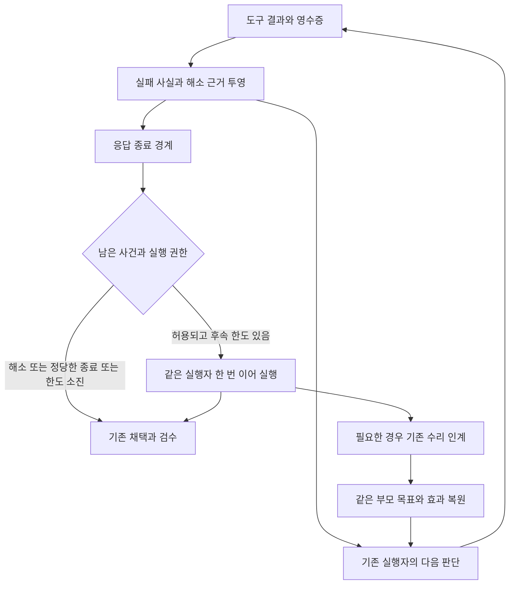

# 실패 이후 관측과 원래 업무 복귀 수리 설계

작성일: 2026-11-04. 상태: **R1~R4 구현·검증 완료**. 설계 이후의 실제 반영 범위는 §12를 따른다.

실패 뒤 성공한 조회가 원래 장애를 지우지 않게 하고, 실행자·감독·수리 인계가 같은 근거를 보도록 연결한다. 후속 실행은 기존 실행자가 기존 예산 안에서 맡는다. 수리의 완료와 사용자가 맡긴 업무의 완료는 별개로 유지한다.

근거는 [에피소드 5803 연구 보고서](failure_recovery_research_2026-11-03/research_report.md), 목적은 [IBL 진화 목적](IBL_EVOLUTION_PURPOSE.md)과 [비전](../data/system_docs/vision.md#ibl과-주변-시스템의-진화-목적)이다. 구현은 [실행 상황 인식](EXECUTION_SITUATION_AWARENESS_DESIGN_2026_10_31.md)과 [작업 지속 및 부분 수리](TASK_CONTINUOUS_REPAIR_DESIGN_2026_10_31.md)를 확장한다.

대조 기준 HEAD는 `2806f3563ed2f5c3fe62af482c43fd110b6dcf2f`다. 읽은 작업 트리에는 평가·감독·수리 재개 등의 미커밋 변경이 있다. 특히 `conscious_supervisor.py`, `repair_resume.py`의 현재 본문을 배포 완료의 근거로 삼지 않는다. 구현 시작 시 해당 변경의 확정 판본과 소비자를 다시 맞춘다.

## 1 수리 범위와 우선순위

| 구분 | 확인한 구조 또는 근거 | 이번 설계의 결정 |
| --- | --- | --- |
| 직접 수정 | `task_continuation.needs_followup()`은 `calls[-1]`만 검사한다. #5748의 실패 뒤 가이드 조회와 양립하는 누락 경로다 | 마지막 호출 판정을 실행 전체의 미해소 실패 투영으로 교체한다. 당시 종료의 단독 원인이었다고 단정하지 않는다 |
| 직접 수정 | `Situation.tool_finished()`는 반환·결과 유실을 기록하고 `observe_result()`는 도구의 주장을 보존한다. 업무와 실패의 해소 관계는 별도 계약이 없다 | 도구 실패 사실과 그 실패에 대한 처리 판단을 구분해 연결한다 |
| 소비자 통합 | 감독의 `issues`는 호출 서명·반복·일부 IBL 교정 키로 갱신한다. 마지막 호출 후속 규칙과는 독립이다 | 실패 내용은 같은 투영에서 읽고, 감독은 검토 예약·전달 세대만 소유한다. 반복 감지는 반복 관측으로 유지한다 |
| 기존 경로 보강 | `task_repair.advance_parent()`는 수리 성공·실패 뒤 모두 부모 복귀를 연다. `component_continuation.context()`도 원래 업무 실행을 지시한다 | 부모 복귀 기능을 재구현하지 않는다. 미해소 사건과 효과 참조를 인계하고 종단 검증으로 잔여 결함만 고친다 |
| 이미 수정된 과거 결함 | 오류 상세 절단, 불변 증거 판본 보충, 기존 수리 영수증 종결은 연구 보고서가 후속 수리를 확인했다 | 기존 계약을 회귀 대상으로 유지한다. 새 수리 항목으로 중복 개발하지 않는다 |
| 후속 연구 | 실패 경험 회상이 새 과제의 선택을 개선한다는 인과 효과는 미확인이다 | 첫 구현에서 증류·회상 정책을 확장하지 않는다. 기존 성공 근거 계약을 유지하고 연결된 사건을 향후 분석에 쓴다 |

첫 배포의 핵심은 **실패 보존 → 판단 경계 전달 → 제한된 후속 실행 → 기존 부모 복귀**다. 새 실패 DB, 상주 감시자, 추가 반성 모델, 일반 대화의 자동 과제 재개, 새 IBL 어휘는 도입하지 않는다. 정상 작업마다 선택 보고나 할 일 작성을 요구하지 않는다.

## 2 관측 사실과 처리 판단을 분리한다

코드가 아는 것은 호출 실패·결과 유실·접수증 상태·대상 판본과 소유자가 확인한 효과다. 그 실패가 사용자 목표를 막는지, 다른 자료로 충분해졌는지, 어느 방법을 선택할지는 의미 판단이다. 두 종류를 하나의 `resolved` 불리언으로 저장하지 않는다.

### 책임 소유자

| 책임 | 소유 위치 | 하지 않는 일 |
| --- | --- | --- |
| 사건과 원문 | 기존 `TurnStore`, 도구·IBL 실행 영수증 | 독립 실패 원장이나 원문 사본 생성 |
| 호출 사실의 정규화 | `situation_evidence`와 기존 `workflow_verdict`·생산자 어댑터 | 임의 stderr·본문 문장을 규칙으로 읽어 원인을 확정 |
| 실행 중 상태 투영 | `Situation`에 연결한 순수 투영 부품 | 다음 행동 선택, 목표 달성 판정, 모델 호출 |
| 방법 선택과 종료의 의미 | 현재 실행자, 이미 활성인 감독 | 사용자 조건·권한 변경, 실패 설명을 목표 완료로 대체 |
| 추가 실행의 예약 | `task_continuation`과 `execution_turn.claim_followup` | 오류마다 독립 후속 실행 생성 |
| 수리와 부모 실행 인계 | 기존 `task_repair`·`component_continuation`·`repair_continuation` | 별도 자동 재개 서비스 생성 |
| 목표 달성과 응답 검수 | 기존 평가·영수증 완료 소유자 | 새 사건 투영의 상태를 ACHIEVED로 간주 |

순수 투영 구현이 필요하면 `backend/base/recovery_projection.py` 한 곳에 둔다. `Situation`이 이를 소유하고, 실패를 업무에 연결하는 인지 정책은 `task_continuation`에 둔다. base에서 cognition/datastore를 역으로 가져오지 않는다. 새 모듈의 층은 현재 폴더 기반 검사 계약을 따른다.

### 사건의 최소 계약

아래 필드는 내부 설계다. 모든 도구의 반환 형식이나 공개 IBL 문법에 넣지 않는다.

| 필드 | 뜻과 작성자 |
| --- | --- |
| `incident_ref`, `revision` | 현재 소유 원장의 호출 결과 참조와 투영 판본. 같은 원 사건을 중복 수신해도 한 건 |
| `origin` | 실행 신원, call ID, 내부 연산 좌표. IBL 내부 실패는 실제 연산 경로를 보존 |
| `request_ref`, `criterion_ref` | 기존 사용자 요청 참조. 명시된 기준이 있을 때만 기준 ID를 연결하며 EXECUTE에 기준을 새로 만들지 않음 |
| `observation_refs`, `subject`, `subject_revision` | 실패·상태·결과 원문과 대상/판본. 모르면 비워 둠 |
| `signal` | `failure`, `result_missing`, `effect_unknown`. 오류·전송·효과 상태는 원천 사실을 함께 보존 |
| `effect` | `not_started`, `unknown`, `observed`와 근거 참조. exit 0만으로 외부 효과를 `observed`로 바꾸지 않음 |
| `resolution` | `unresolved`, `verified`, `needs_recheck`. `verified`는 아래의 소유자 계약으로 확인된 좁은 범위의 해소 |
| `assessment` | 판단 주체, `incident_revision`, `basis_refs`, `disposition`, 짧은 이유. 사실과 별도 저장 |
| `successor_refs`, `preserve_refs` | 명시적으로 연결된 교정/대체 시도와 보존할 결과·효과. 모든 이력을 복사하지 않음 |

`disposition`은 `continue`, `satisfied`, `irrelevant`, `awaiting_user`, `blocked`, `unknown`이다. `satisfied`는 이 장애가 더 이상 해당 요청을 막지 않는다는 모델 판단이며 `goal_status`가 아니다. `awaiting_user`는 질문의 접수와 사용자의 답을 구분하고, 승인되지 않은 작업을 실행하는 권한이 되지 않는다.

동일 사건의 기준 키는 현재 실행 신원 + 원천 call ID + 내부 연산 경로다. 도구명·오류 문자열·인자 해시로 서로 다른 호출을 합치지 않는다. 호스트·작업 접수증·판본이 있는 경우에만 교정 관계를 추가한다. 내부 연산 좌표가 없으면 전체 호출을 한 건의 부분 실패로 보존하며 존재하지 않는 자식 사건을 만들어내지 않는다.

## 3 생성과 해소의 규칙

### 실패 생성

1. provider의 `is_error`, `transport_error`, 결과 미수신, 기존 실패 판정기와 생산자의 구조화된 부분 실패를 입력으로 받는다. `error`라는 단어를 포함한 문서나 인용문을 실패 사건으로 해석하지 않는다.
2. 외부 봉투가 성공이어도 생산자가 명시한 `operation_outcomes`·원천 실패는 해당 가지에 남긴다. 현재의 결과 순회 상한 때문에 전체를 못 읽으면 생략 범위와 원문 참조를 기록한다. 생략을 성공으로 처리하지 않는다.
3. `task_ref`가 실행 중이면 대기 상태를 연결한다. 클라이언트 timeout과 원격 작업 실패는 별개다. 요청이 실제 접수됐는지 불명확하면 효과 미확인으로 남긴다.
4. 새 호출이 성공해도 기존 사건은 그대로 둔다. 성공한 도움말·로그 조회는 관측 추가이며 해소가 아니다.

현재 모든 호출의 `execution.effect`가 기본 `unknown`인 것은 실패 신호가 아니다. 새 `effect_unknown` 사건은 **효과가 있을 수 있는 호출에서 접수 후 응답 유실·부분 실행·명시적 불명 영수증이 관측된 경우**에만 만든다. 도구 계약으로 읽기 전용임을 확인한 호출에는 외부 쓰기 불명 사건을 만들지 않는다. 성공한 임의 셸의 효과를 모른다는 이유만으로 추가 호출하지 않는다. 실행 중인 호출의 미수신은 정상 대기이며, 종료·전송 단절 경계에서도 결과를 확인하지 못한 경우에만 `result_missing` 후보로 올린다.

### 해소와 재확인

| 관측 또는 판단 | 변경 | 후속 정책 |
| --- | --- | --- |
| 같은 작업의 생산자 영수증이 실패 단계의 완료를 입증 | 해당 단계만 `verified` | 다른 미해소 사건은 유지 |
| 실행 전 스키마 거절 뒤 같은 대상의 교정 호출이 실행됨 | 기존 IBL 교정 관계가 입증하는 실행 전 거절만 `verified` | 실행 결과·외부 효과는 별도 검사. 파싱 성공이 재생 성공은 아님 |
| 다른 도구가 성공하거나 같은 도구명이 성공 | 자동 해소 없음 | 명시 관계가 없으면 기존 실행자가 판단 |
| 감독이 현재 판본의 사건에 대해 `satisfied`·`irrelevant` 판단 | `assessment`만 갱신 | 이 사건 때문에만 추가 실행하지 않음. 판단과 근거는 검수 입력에 남김 |
| 사용자 질문/실제 제약으로 중단 판단 | 미해소 사실 유지, 대기/차단 판단 추가 | 권한·질문·취소의 기존 소비자에 따름. 자동 무한 재개 없음 |
| 인용한 판본 변경, 관련 실패 재발, 서로 다른 근거 충돌 | 연결된 해소·판단을 `needs_recheck`로 노출 | 독립 성공 결과를 무효화하지 않음 |
| 늦게 도착한 과거 성공 또는 낡은 감독 판단 | 현재 상태를 덮지 않음 | 원천 순서·판본을 대조하고 충돌로 보존 |

`verified` 작성자는 해당 생산자/검사 계약을 이해하는 어댑터다. 공통 투영은 `success:true`나 exit 코드만으로 의미상 해소를 생성하지 않는다. `assessment`는 인용 참조의 존재·소유권·판본을 코드가 검증하되, 그 근거가 주장을 의미적으로 지지하는지는 모델의 판단으로 남긴다. 잘못된 모델 판단의 가능성은 사라지지 않으며 기존 검수와 새 과제 검증이 이를 다룬다.

## 4 모델 판단을 연결하는 현실적인 경계

첫 구현은 실행자의 모든 발화를 파싱하거나 모든 도구에 선택 기록 필드를 추가하지 않는다. 자연어의 “해결했다”, todo의 `completed`, 진행 문구 변화만으로 사건을 닫지 않는다. 내부 사고 전문도 수집하지 않는다.

활성 감독의 **이미 예정된 중간 검토**에는 기존 `findings`와 같은 응답에 선택적 `incident_assessments` 배열을 추가한다. 각 항목은 `incident_ref`, `incident_revision`, `disposition`, `basis_refs`, `reason`만 갖는다. 새 평가 호출을 열지 않는다. 일반 `CONTINUE`를 모든 사건의 해소로 해석하지 않는다. 필드가 없는 기존 판정은 기존 의미를 유지한다.

실행자는 도구 결과와 전달된 사건을 읽고 같은 모델 실행 안에서 다음 방법을 수행한다. 다음 관측의 용도나 전환 이유는 필요한 때 기존 진행 설명에 짧게 남길 수 있지만, 이를 제어용 구조화 사실로 취급하지 않는다. 이미 한 번 열린 후속 실행은 실행자의 종료로 끝난다. 판단 필드가 없다고 다시 모델을 부르지 않는다.

**이 선택에는 오탐 비용이 있다.** 감독이 없는 EXECUTE에서 grep exit 1 뒤 다른 자료로 충분한 답을 얻어도, 소유자 해소 근거가 없으면 한 번의 불필요한 후속 실행이 생길 수 있다. 연구 보고서 P1의 “목표 충족이면 후속 0”은 기계적으로 입증된 해소 또는 유효한 기존 의미 판단이 있는 경우의 인수 조건으로 좁힌다. 그 정보가 없는 모든 경우에 추가 호출 0과 미완료 누락 0을 동시에 약속하지 않는다. 이 비용을 정상군과 복구 완료군에서 따로 측정한다.

단순한 사건마다 구조화 보고 도구를 강제하는 대안은 첫 구현에서 제외한다. 위 오탐 비용이 실제로 큰 경우에만 기존 출력/도구 경계의 선택 기록을 후속 설계하며, 그 비용과 비교한 근거 없이 새 필수 프로토콜을 늘리지 않는다.

## 5 후속 실행과 응답 전달

`needs_followup(calls)`의 마지막 호출 규칙은 공통 `recovery_view`를 받는 판정으로 교체한다. 스트리밍 초안 보류와 최종 후속 실행이 같은 함수를 사용하며, 이 함수는 조회만 한다. 예산 소비와 원장 갱신은 실행을 실제 예약할 때만 한다.

판정 순서는 다음과 같다.

1. 기존 `enabled`, 취소, 시간·토큰 한도, 수리 pending·적용 예약, 현재 단계 소유권을 먼저 확인한다. 추가 실행이 허용되지 않으면 그 사유와 미해소 참조를 기록하고 기존 종료 경로를 따른다.
2. 검증된 해소와 현재 판본의 유효한 `satisfied`·`irrelevant` 판단은 제외한다. 도움 대기·확인된 차단은 성공으로 닫지 않고 해당 종료 사유를 남긴다.
3. 남은 실패·미수신·효과 미확인 후보가 없으면 후속 호출을 하지 않는다. 살아 있는 접수증은 재전송 대상이 아니라 기존 상태 확인·대기 대상으로 전달한다.
4. 후보가 있으면 `claim_followup("observed_failure")`를 한 번 획득한다. REFLEX 문맥 인계·능력 교정이 이미 소비한 한도를 다시 만들지 않는다. 획득 실패는 목표 실패나 성공으로 해석하지 않는다.
5. 같은 실행자에게 원래 요청, 남은 사건, 현재 결과·효과, 실제 종료 제약을 전달한다. 가능한 다음 행동은 관측·입력 수정·대안·분해·허용된 수리·정확한 사용자 도움·근거 있는 중단이다. 모든 행동을 순서대로 시도하게 하지 않는다.
6. 같은 `_collect`, Situation 관측, 감독 관측 경로로 후속 결과를 수집한다. 한 번의 후속 모델 실행 안에서는 기존 도구 루프와 예산을 사용한다. 후속이 끝나면 재귀적으로 `continue_task`를 열지 않는다.

이 한도는 **턴 종료 후 재진입**의 한도다. 최초 실행 중 모델이 실패를 읽고 계속 진단·교정하는 일반 도구 루프를 한 번으로 제한하지 않는다. REFLEX 인계로 한도를 이미 쓴 경우에도 이어받은 실행은 기존 예산 안에서 여러 도구를 사용할 수 있다. 그 실행마저 설명으로 끝나면 새 모델 호출을 추가하지 않고 미완료와 한도 소비를 남긴다.

초기 초안의 text·final 처리는 동일한 투영 판본을 사용한다. 미해소 실패가 있으면 기존처럼 최종 채택 전 초안을 보류한다. 후속 도중 상황 관측이 실패해도 이미 실행된 도구의 결과를 오류로 바꾸거나 재실행하지 않는다. 최종 사용자 응답의 중복 방출·유실도 인수 대상으로 삼는다.

Situation 비활성·초기화 실패에서는 원래 `calls`의 **전체 완료 호출**에서 같은 순수 투영 함수를 호출한다. 마지막 호출 규칙을 별도 fallback으로 남기지 않는다. 호출 ID가 없으면 수집기의 안정적인 로컬 좌표를 쓰고, 병렬 대응이 모호하면 unknown으로 남긴다. 원문이 잘렸거나 사라진 경우 그 불확실성을 표시하며 과거 효과를 다시 실행하지 않는다.

후속 한도 소진·관측 장애는 `goal_status`를 자동 설정하지 않는다. 기존 평가가 없는 경로는 근거 없는 성공 판정을 새로 만들지 않는다. 사용자에게 필요한 미완료 정보는 실행자가 응답하고, 하네스의 제어 종료 사유는 기존 실행 추적에 남긴다.

## 6 관측 경로와 감독 중복 정리

### 호출 정체성과 오류 정보

현재 `agent_pipeline._collect()`는 provider의 `is_error`를 보존하지만 `Situation.tool_finished()`에는 그 플래그 인자가 없다. 첫 수정에서 `is_error`, 전송 오류, 원천 call ID를 Situation 생산 경계까지 전달한다. `on_result`는 본문 주장과 전송 사실을 함께 참조하되 구분해서 기록한다.

네이티브 호출은 provider call ID를, 백엔드 도구는 `active_call_id`를 소유 식별자로 쓴다. MCP를 경유해 같은 결과가 네이티브 이벤트로 돌아오는 경우 기존 bridge 중복 제외를 유지하고, 두 ID의 대응을 한 번 기록한다. backend 내부 호출과 provider 호출을 명시적으로 연결할 수 없으면 유사한 본문으로 합치지 않는다. 해시 중복 제거는 효과 동일성의 증명이 아니다.

후속 실행의 현재 `continue_task()`는 supervisor가 없을 때 Situation native 관측을 직접 호출하지 않는다. 초기 실행의 `_collect`/native 관측과 같은 공통 수집 경계로 연결해 이 경로도 포함한다. 실행·감독 양쪽이 동일 사건을 두 번 발행하지 않는 계약을 함께 검사한다.

### 감독의 역할

감독 `issues`에서 실패 내용의 독립 저장·해소 추론은 공통 사건 참조와 판본으로 교체한다. 검토 대기·전달 취소용 세대, 반복 후보, 목표 수준의 `findings`는 감독에 남긴다. 목표 결함과 단일 호출 실패는 서로 다른 책임이므로 하나로 합치지 않는다.

`last_signature`가 달라졌다는 이유로 과거 미해소 실패가 해결됐다고 처리하지 않는다. 반대로 과거 실패가 남아 있다는 이유만으로 매 경계 감독을 호출하지 않는다. 현재의 연속 실패·반복·명시 이정표 조건과 관측 예산은 유지한다. 이미 검토한 사건의 같은 판본은 새로운 트리거가 아니다.

반복 비교에는 입력·결과·알려진 대상/접수증·관련 변화 참조를 쓴다. 도구가 달라도 같은 원인이라는 판정은 감독/실행자가 맡는다. `repeat_guard`는 동일 관측을 알릴 뿐 강제 중단하지 않는다. 진행 문구나 elapsed 숫자의 변화는 생존/보고 활동이며 사건 해소의 근거가 아니다. 기존 `progress()`의 검토 취소 정책 전체는 별도 변경으로 확대하지 않되, 그 취소가 공통 사건을 삭제하지 않도록 한다.

### 전달량과 순서

현재 `Situation.prepare()`의 baseline/delta 예산, 참조 회수, acknowledge 계약을 사용한다. 미해소 사건은 `projection_kind`의 상태 범주로 올리고, 원문 본문과 참조를 중복 첨부하지 않는다. 개수·생략 범위·원문 주소는 예산에 맞춰 유지한다. 전달 예산에 빠진 미해소 사건이 커서 이동만으로 소실되면 안 된다.

표시용 생략과 제어용 생략을 구분한다. 후속 여부는 잘린 표시본이 아니라 전체 활성 사건 색인을 사용한다. 색인 한도에 도달하면 생략 구간을 원문 참조와 unknown 범위로 보존하며 `모두 해소`로 판정하지 않는다. 구현 시 한도를 현재 TurnStore/턴 예산에 맞춰 정하고 부하 시험에 넣는다.

복수 호출의 결과가 늦게 도착할 수 있으므로 원천 순서·대상 판본을 우선한다. 소유 실행의 잠금 안에서는 메모리 판본만 갱신하고, 참조 검증·파일 읽기·모델 호출은 잠금 밖에서 수행한 뒤 판본을 재확인한다. 관측 저장 실패는 이미 발생한 외부 효과를 되돌렸다고 기록하지 않는다.

Codex 네이티브 도구 사이의 매회 실행 전 주입은 현재 미지원이다. 다음 MCP/모델 입력 또는 종료 후 한 번의 후속 경계에서 전달한다. 즉시 개입이 되는 것처럼 인수 범위를 쓰지 않는다.

## 7 수리와 부모 업무의 연결

수리 인계는 기존 원장을 유지한다. 일반 대화에 새 영속 목표 원장을 만들지 않는다. 현재 `Situation` 체크포인트는 `conversation_handoff`로 복원되고, 부모 실행은 `component_continuation`이 소유한다. 이 둘의 연결을 명시한다.

1. `task_repair.request()`가 부모를 `waiting_repair`로 바꾸기 전에 현재 사건 투영의 **저장된 스냅샷 참조와 판본**을 기존 부모 행에 추가한다. 원래 요청·기준·결과·효과 영수증 참조와 같은 소유권을 검사한다.
2. 수리 자식에는 원인 확인에 필요한 사건만 준다. 부모의 완료 조건을 수리 코드의 적용 조건으로 바꾸지 않는다. 예산의 소비량과 `followup_reason`은 기존 계약대로 계승한다.
3. `advance_parent()`는 기존 공통 완료 검사를 호출하고 수리 결과와 영수증 참조를 부모에 연결한다. 성공이면 필요한 구현 장애 한 항목만 해소하며, 실패이면 실패 근거를 보존한 채 기존대로 부모가 대안을 판단하게 한다.
4. 부모를 깨우기 전의 기존 대화·취소·사용자 신원·권한·예산 검사를 유지한다. 새 요청이 있으면 이전 작업을 자동 재개하지 않는다. 같은 자식 결과를 두 번 읽어도 부모 실행을 두 번 예약하지 않는 기존 claim/상태 전이를 검증한다.
5. `component_continuation.attach/context()`에서 스냅샷을 복원한다. `conversation_handoff`와 같은 스냅샷이면 중복 적용하지 않는다. 복원한 상태는 `last_observed_before_resume`이며 현재 사실이 필요한 효과·판본만 다시 조회한다.
6. 수리 후 부모는 남은 업무를 실제 수행한다. 미디어 수리 적용은 재생 확인을, 파서 수리 적용은 원래 자료 처리와 산출물 확인을 대체하지 않는다. 이미 끝난 쓰기는 기존 영수증을 사용한다.

현재 `component_continuation._finish()`의 `completed`는 실행 구간 종료이고 `evaluation`은 별도다. 이 상태를 목표 달성으로 개명하거나 새 목표 상태 체계를 추가하지 않는다. 부모 응답만 존재하는 종료와 원래 업무가 검증된 종료를 인수 시험과 추적 조회에서 구분한다.

프로세스가 스냅샷 저장과 부모 행 저장 사이에 죽으면 기존 원장의 확정된 참조까지만 복원한다. 누락은 `recovery_evidence_unavailable`로 남기고 소유 원문을 회수한다. 유효한 상태가 없다는 이유로 새 사본이나 새 적용을 시작하지 않는다. 기존 세션에 필드가 없으면 과거 사건을 소급 생성하지 않고 현재 근거로 시작한다.

## 8 변경 파일과 없앨 중복

| 단계 | 변경 대상 | 변경과 제거 | 완료 조건 |
| --- | --- | --- | --- |
| R0 현재 판본 확정 | 보고서 근거, 현 작업 트리와 관련 기존 검사 | 동시 변경이 반영된 감독·평가·수리 재개 계약 확인. 재개·증거 회수 수리를 중복 구현하지 않음 | 구현 기준 커밋과 실제 활성 판본을 별도로 기록 |
| R1 실패 사실과 해소 투영 | `base/execution_situation.py`, 필요 시 `base/recovery_projection.py`, `datastore/situation_evidence.py`, `cognition/agent_pipeline.py` | provider 오류 전달, 사건 신원, 소유자 해소, 전체 호출 fallback, 초기/후속 관측 연결 | 실패 뒤 조회 성공, 부분 실패, 중복 MCP, 결과 유실·역순·충돌이 보존됨 |
| R2 후속과 감독 소비 통합 | `cognition/task_continuation.py`, `conscious_supervisor.py`, `supervisor_runtime.py`, 필요 소비자 `supervisor_review.py`, `base/repeat_guard.py` | `calls[-1]` 판정과 감독 실패의 별도 해소 상태 제거. 기존 중간 검토에 사건별 판단 선택 필드 추가. 초안/최종 같은 판정 사용 | 기존 한도 공유, 정상 추가 호출 0, stale 판단 거절, 중복 후속 없음 |
| R3 부모 인계와 복귀 | `datastore/task_repair.py`, `component_continuation.py`, 필요 시 `conversation_handoff.py`, 기존 repair 소비자 | 현재 스냅샷 참조 계승·중복 복원 방지. 부모 자동 복귀는 기존 구현 사용 | 수리 성공·실패·재기동·취소 조건에서 원래 업무 또는 정당한 종료까지 연결 |
| R4 추적과 교재 | `services/execution_trace.py`, 관련 기존 실행 지침·상황/지속 문서 | 기존 원장에 생성·판단·해소·후속 생략 사유를 노출. 중복된 “끝까지 실행” 문장을 해당 계약 설명으로 교체 | 원래 목표, 장애, 다음 행동, 실제 결과, 종료 주체·비용을 한 실행 조회에서 추적 |

R1과 R2는 소비자 전환까지 한 기능으로 완료한다. 생산자 필드만 추가하고 옛 마지막 호출 정책을 활성 상태로 남겨 완료라고 하지 않는다. R3는 기존 복귀의 종단 시험을 먼저 만든 뒤 실패한 연결만 고친다. `repair_resume`·`receipt_completion` 자체는 시험이 현재 계약의 결함을 드러낼 때만 수정한다.

공개 어휘·파서·도구 schema는 첫 구현에서 바꾸지 않는다. supervisor 응답의 선택 필드는 내부 모델 계약이며 기본 사용자 도구 카탈로그를 늘리지 않는다. 사건 저장·표시가 정상 작업의 고정 프롬프트를 키우지 않게 한다. 관측 원문은 기존 마스킹 경로를 거친다.

## 9 인수 시험

각 시험은 아래 입력과 관측 가능한 결과를 검증한다. 현재 구현의 출력 모양만 다시 검사하는 시험으로 대체하지 않는다.

| 사례 | 필수 결과 | 기존 시험 거처 |
| --- | --- | --- |
| 실패 → 가이드 조회 성공 → 종료 | 원래 실패가 남고 허용된 후속 실행 한 번. 가이드 성공이 해소 아님 | `test_task_continuation.py`, `test_execution_situation.py` |
| 오류 없는 정상 실행·정상 빈 검색 | 후속 0, 추가 감독 호출 0 | `test_task_continuation.py` |
| 동일 단계의 소유자 영수증으로 해소 | 그 사건 때문에 후속하지 않음. 별도 목표 결함 유지 | `test_execution_situation.py`, `test_supervisor_review.py` |
| grep 1 뒤 충분한 답 | 유효한 사건별 판단이 있으면 후속 0. 판단 없으면 최대 1, 이를 비용 오탐으로 계수 | `test_task_continuation.py` |
| 병렬 A 실패·B 성공·A 결과 지연 | B가 A를 지우지 않음. 늦은 결과가 다른 사건을 덮지 않음 | `test_execution_situation.py`, `test_execution_turn.py` |
| 외부 성공 봉투 안 원천 실패·긴 결과 절단 | 원천 누락과 생략 범위 보존, 표시 생략이 제어 해소로 바뀌지 않음 | `test_execution_situation.py`, `test_situation_delivery.py` |
| timeout 뒤 같은 receipt는 running | 동일 원격 작업 재시작 없음. 상태 확인·대기를 정상 허용 | `test_repeat_guard.py`, `test_conscious_supervisor.py` |
| 효과 불명 비멱등 쓰기 | 결과 없음을 미실행으로 취급하지 않음. 모의 외부 효과 중복 0 | `test_task_continuation.py`, `test_task_repair.py` |
| 다른 도구의 성공·달라진 진행 문구 | 자동 verified 없음. 반복 후보는 관측이고 강제 중단 아님 | `test_repeat_guard.py`, `test_conscious_supervisor.py` |
| 낡은 감독 판단·다른 행위자의 참조 | 현재 판본 해소에 사용하지 않음. 기준 변경·권한 확장 없음 | `test_supervisor_review.py`, `test_situation_delivery.py` |
| REFLEX·능력 교정·실패 후속 경쟁 | 한 턴의 공유 후속 한도를 한 번만 소비 | `test_execution_turn.py`, `test_capability_guard.py`, `test_task_continuation.py` |
| supervisor 없이 native 후속 실행 | 초기·후속 모두 사실 수집, final 중복/유실 없음 | `test_task_continuation.py`, `test_execution_situation.py` |
| Situation 비활성·저장 실패 | 전체 calls의 보수적 투영, 원문 부재 표시, 도구 부작용 재실행 없음 | `test_task_continuation.py` |
| 수리 완료 → 부모 업무 | 동일 후보·기준·효과 유지, 원래 산출물/상태까지 확인. 수리 영수증만으로 목표 성공 아님 | `test_task_repair.py`, `test_component_continuation.py`, `test_repair_continuation.py` |
| 수리 실패 → 부모 대안 | 실패 원인 보존 후 허용 대안 수행, 같은 수리 무한 반복 없음 | `test_task_repair.py` |
| 적용 뒤 사망·중복 복구 | 기존 receipt 종결·부모 claim 한 번, 완료 쓰기 중복 0 | `test_repair_resume.py`, `test_component_continuation.py` 및 관련 system 검사 |
| 사용자 도움·취소·새 요청·예산 종료 | 답 뒤 기존 지원 경로로 복귀. 취소·새 목표·권한 상실에서는 자동 복귀 금지 | `test_component_continuation.py`, `test_conversation_handoff.py` |
| 복원 뒤 입력 판본 변경 | 해당 의존 결과만 재확인, 관계없는 완료 결과 유지 | `test_execution_situation.py`, `test_ibl_v2_recovery.py` |

`recovery_projection.py`를 만들면 순수 상태 전이·중복/역순 시험은 `test_recovery_projection.py`가 소유한다. 위 통합 시험은 실제 소비자가 연결되는지를 검증한다. 장문 연구 보고서의 예시 문구를 고정 문자열로 맞추는 시험을 만들지 않는다.

개발 중에는 [회귀 절차](REGRESSION_TESTING.md)에 따라 `select_tests.py --files`로 해당 단계의 전이 소비자를 고른다. 영향이 큰 실행 허브 변경의 종합 검증은 `backend/ -m "not system" -n auto --dist loadfile`과 변경에 해당하는 실제 재기동·수리 사본 system 묶음을 포함한다. backend 변경 시 폰 번들 재생성과 기존 층·파일 크기 관문을 따른다. 설계 작성 단계에서는 코드 시험을 실행하지 않았고, 구현 검증은 §12에 기록한다.

## 10 실제 능력과 비용 확인

계약 구현을 과거 실패의 정확한 재현이나 대규모 성능 실험 완료까지 미루지 않는다. 반대로 계약 시험만 통과하고 모델이 실제로 다른 방법을 선택했다거나 시간·토큰이 줄었다고 주장하지 않는다.

첫 실제 인수는 문서 변환·자료 집계·모의 원격 처리 등 서로 다른 새 과제에서 수행한다. 같은 파일명·곡명만 바꾼 과제는 새 전이 사례로 세지 않는다. 복구 가능한 실패, 정상 빈 결과, 살아 있는 접수증, 부분 성공, 효과 불명, 수리 후 복귀, 정당한 중단을 포함하고 THINK/EXECUTE/REFLEX 및 native 경계의 지원 범위를 기록한다.

고정한 기준 판본과 R1~R3 후보를 같은 모델·권한·초기 자료·시간·총토큰 예산으로 비교한다. 원래 목표의 외부 결과 확인, 불필요한 후속, 잘못된 해소, 무익한 반복, 성급한 종료, 적절한 도움, 중복 효과, 품질, 전체 경과 시간과 전체 토큰을 함께 기록한다. 성공만의 평균이나 캐시 토큰 중복 합산을 쓰지 않는다. 연구용 독립 채점 비용은 별도로 밝힌다.

계약 채택 조건은 정보·효과·권한·기준 보존, 정상 경로의 새 모델 호출 0, 공유 후속 한도 준수, 종단 부모 복귀다. 충분한 답을 가진 오류 경로의 후속 오탐과 성능 상충은 별도 결과다. 큰 비교는 보고서 §6의 예비 실험안을 참고하되, 먼저 동일 조건의 짝 비교로 어떤 변경이 행동과 비용을 바꾸는지 확인한다. 정상군 시간·토큰 악화가 크면 새 의미 판단 모델을 추가하기 전에 전달량·중복 판정·오탐을 줄인다.

## 11 반영과 복구

구현은 정본 main에서 단계별 pathspec 커밋으로 남긴다. 현재 실행은 시작 시의 구현·투영 schema 판본을 유지하고 새 실행부터 새 소비자 계약을 적용한다. 프로세스 교체가 필요한 경우 기존 재기동 제어자가 진행 작업·인계·복구를 맡는다.

인계 스냅샷은 schema 판본을 표시한다. 새 소비자는 필드가 없는 기존 인계를 읽을 수 있어야 하며, 지원하지 않는 새 판본은 조용히 해소로 간주하지 않고 원문 회수와 미확인 상태로 처리한다. 관측 기능은 업무 효과와 독립이므로 장애 시 이미 실행한 동작을 재전송하지 않는다.

퇴행 시 해당 단계의 코드 변경을 정본의 정식 복구 절차로 되돌리되 관측 원문·수리 영수증은 보존한다. 수리 완료를 취소했다는 이유로 외부 효과를 다시 만들지 않는다. 두 가지 후속 정책을 장기 이중 운영하거나 자동 fallback으로 서로 교대 실행시키지 않는다.

구현 완료 기록에는 생산자·소비자 전환, 제거한 중복, 계약 검사, 실제 모델·재기동 인수, 활성 판본, 미지원 경로를 구분해 남긴다. 구현·검증 결과와 미확인 범위는 다음 절에 기록한다.

## 12 2026-11-04 구현 기록

### 반영한 계약

구현 출발점은 정본 main의 `5fb968e4`(평가 입력·연속 근거 회수 수리)다. R1~R4를 하나의 소비 경로로 연결했다.

- `base/recovery_projection.py`는 사건·원천 사실·해소와 모델 판단을 분리한다. `cognition/recovery_observation.py`가 기존 실패 판정과 IBL 증거 요약을 재사용한다. `Situation`의 초기/후속 도구 경계와 감독이 같은 투영을 읽는다. 감독의 `issues`에는 반복 후보만 남았다.
- 마지막 호출 성공이 앞선 실패를 지우지 않는다. 네이티브 오류, 전송 실패, 종료 경계까지 반환되지 않은 호출, 성공 봉투 내부의 실패도 보존한다. 모델 라운드마다 재사용되는 네이티브 ID는 서로 다른 호출로 보존한다. 정상 빈 결과와 일반 도구 결과의 기본 `effect=unknown`만으로 사건을 만들지 않는다.
- 소유자 접수증은 해당 연산만 해소한다. 한 호출에 여러 접수증이 있으면 그중 하나의 성공으로 호출 전체나 다른 연산을 해소하지 않는다. 기존 IBL 투영 교정·오류 렌더 교정 키는 호출·입력·제어 흐름이 대응하는 실행 실패의 좁은 해소에 재사용한다. 내부 연산 실패와 결과 유실은 이 교정 키로 해소하지 않는다.
- 기존 감독 검토의 선택 필드 `incident_assessments`를 받아 원장에 저장한다. 원문 무결성, 현재 목표, 사건 revision을 검사한다. `satisfied` 등은 모델의 귀속된 판단이며 목표 ACHIEVED나 외부 효과 성공으로 바꾸지 않는다. 새로운 검토 모델이나 자동 검토 호출을 추가하지 않았다.
- 판단 근거의 명시 관측 참조가 바뀌거나, 근거로 읽은 Situation 스냅샷의 대상 판본이 바뀌면 재확인한다. 현재 판본의 새 판단은 받을 수 있다. 임의 본문의 의미에서 대상·의존성을 추측하지 않는다. 구조화된 판본 관계가 없는 근거는 기존 모델 검토 범위다.
- 후속 실행은 기존 `claim_followup` 한도를 REFLEX·능력 교정과 공유한다. 취소·한도·수리 인계 소유권을 확인하고, 초기/후속 native 관측과 최종 응답 한 번 전달을 유지한다. 사건은 최대 1024개와 초과 범위 표시, 후속 인라인은 8개와 전체 참조로 제한한다. 원문 저장 불가도 실패를 해소하지 않는다.
- `task_repair`와 `component_continuation`은 부모 Situation 스냅샷의 참조를 기존 원장에 계승한다. 소유자·저장 영역·무결성·판본을 확인한 명시적 부모 재개만 사건을 복원한다. 일반 대화 이력은 표시할 수 있으나 취소된 옛 실패의 후속 실행을 열지 않는다. 누락/지원하지 않는 스냅샷은 미확인으로 남는다.
- 기존 궤적의 `recovery.changed`, `recovery.assessment`, `cognition.recovery.deferred`에 사건·판단·후속 생략 사유를 연결했다. 원래 요청은 기존 Situation request 관측과 부모 goal을 사용한다. 새 실패 DB·IBL 어휘·목표 완료 판정은 없다.

설계의 책임 표에서 정규화는 층 경계를 지키기 위해 `situation_evidence`에 직접 두지 않고 cognition 어댑터를 연결했다. 기존 IBL 교정 키의 실행 단계 해소는 기존 감독의 동작을 보존한 확장이다. 이를 일반 성공 호출이 모든 실패를 해소하는 규칙으로 확대하지 않았다.

### 확인한 범위

검사 선택기는 실행 허브 변경으로 비system 전수를 요구했다. 최종 비system 전수는 **12,271 통과·9 건너뜀**, 실패·오류 0이다. 마지막 관련 검사 387개와 기존 실패 회귀 113개도 통과했다. 처음 전수에서 발견한 감독 재시도 지시 폐기 계약, 옮겨진 실패 상태의 검사 참조, 새 시험의 직접 실행 진입점은 수정한 뒤 전수를 다시 실행했다. 초기 sandbox 실행의 포트·브라우저·자식 프로세스 권한 오류는 정상 환경의 재실행과 구분한다. 번들 빌드 중 동시에 시작한 초기 system 실행의 산출물 변경 감지도 검증 성공으로 세지 않는다.

실제 프로세스의 재시작·세대 교체·수리 system 묶음은 **42 통과**했다. 부모 복귀 통합 검사는 수리 전 실패의 동일 사건을 재개한 부모가 받는지, 구현 수리 성공만으로 원래 보고서를 완료 처리하지 않는지, 부모에서 보고서 파일을 만드는지 검사한다. 실패한 수리·취소·새 요청·예산·동일 후보 반복 차단은 기존 회귀 계약을 유지한다.

[실제 모델 하네스](experiments/failure_recovery_2026_11_04/live.py)와 [원자료](experiments/failure_recovery_2026_11_04/live.json)는 가상 입력만 쓴다. CodexProvider `gpt-6-astra:high`를 읽기 전용으로 실행해 실제 `continue_task` 전달문과 응답을 확인했다. 운영 자료·파일 변경·외부 도구 실행은 하지 않았다.

| 사례 | 실제 확인 |
| --- | --- |
| 집계기 열 오류 → 도움말 조회 | 확정 주문 3건 합계 37을 최종 JSON으로 반환, 호출 1회 |
| 표 변환 오류 → 도움말 조회 | OCR 본문을 2행으로 정리하고 합계 54를 반환, 호출 1회 |
| 불필요한 검색 실패 → 이미 충분한 합계 | 합계 13 유지, 호출 1회. 의미 판단이 없는 보수적 후속의 비용 오탐으로 기록 |

실제 모델 **3/3 통과**, 입력 34,031 + 출력 67 = **34,098 토큰**이다. 캐시 읽기 25,344는 입력에 포함되므로 재합산하지 않는다. 같은 실행에 `continue_task`를 다시 호출해도 추가 모델 호출은 없었다. 정상/빈 결과의 추가 호출 0은 결정론적 회귀로 확인했다. 초기 sandbox 실행은 모델 요청 0건으로 실패했으며, 위 수치는 승인된 재실행만 센다.

이는 전달문을 받아 새 답을 완성하는 소규모 확인이다. 실제 외부 장치의 비멱등 쓰기, 파일 변환 도구를 모델이 고쳐 쓰는 종단 실험, THINK/REFLEX 차선별 실제 모델 짝 비교, 과거 에피소드 재실행, 전반적 토큰·시간 개선은 이번 확인 범위가 아니다. 원격 효과 소유권·중복 재개 방지와 모의 부모 복귀는 계약/프로세스 검사로 검증했다.

### 최종 반영·활성

정본 main에서 이번 변경 파일만 커밋한다. [검증 기록](experiments/failure_recovery_2026_11_04/validation.json)에 검사 범위와 활성 확인을 남겼다. Android 번들 재생성, `build_ibl_nodes.py --check`, 층 검사, `git diff --check`가 통과했다. 실제 수리 사본의 system 검사 2개도 마지막 코드에서 다시 통과했다.

기존 재기동 제어자의 정상 세대 교체 뒤 `api.py status`에서 **ACTIVE**를 확인했다. 세대 `5003494768b85be0f49b404f0307a739`의 관련 실행 소스 **13/13개가 정본과 바이트 일치**했다. 강제 종료나 새 자동 재개 경로는 사용하지 않았다. 이는 활성 소스 확인이며 운영 사용자 과제나 외부 장치의 실수행 검증을 대신하지 않는다.
