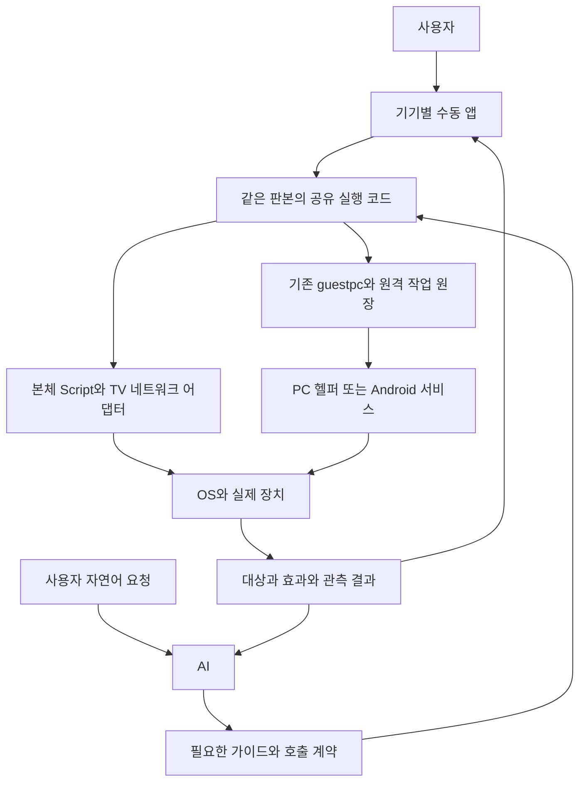

# 수동 하드웨어 앱과 AI 공유 실행 설계

작성일: 2026-10-18. 상태: **설계 완료, PC 기본 컨트롤 앱 구현**. 단계별 구현은 계속한다.

PC 첫 구현: 데스크톱 앱 모드에 맥/Windows 앱을 따로 등록하고 공통 React 화면,
`data/instruments/pc_control.py`의 prepare/decode, OS별 네이티브 스크립트를 공유한다.
출력 장치 조회·절대 음량·명시 음소거·주소 열기·원격 화면 확인·지원되는 PC의 잠금을
제공한다. 호출 계약은 [PC 컨트롤 가이드](../data/guides/pc_control.md)가 정본이다.
장치 소개의 OS→가이드 포인터는 `guide_db.json`의 `control_platforms` 데이터에서 읽는다.
유튜브 재생 세션 관리·전체 화면 확인, 기본 출력 전환, 원격 웹 런처 화면은 아직 구현하지 않았다.

2026-10-18 PC 구현 검증:
- 본체 맥과 TV1 Windows에서 실제 상태 조회, 현재 값 그대로 음량·음소거 설정 후 재조회 통과.
- TV1 원격 화면 수신과 앱 표시, 맥의 조절 불가 HDMI 버튼 비활성 확인.
- 이 가이드의 Windows IBL 예제를 수정 없이(대상 ID만 지정) 실행해 출력 장치 조회 통과.
- 관련 회귀 28개, TypeScript 검사, IBL 파생 정합 검사 통과. 선택기는 guide_registry의
  전이 소비자 657/715(92%)로 전수를 선택했고, 기본 backend 회귀는 10,570 통과·1 건너뜀.
  system 마커 묶음은 이번 검증에 포함하지 않았다.
- 웹 주소 열기·화면 잠금의 실기 실행, Windows 본체 로컬 실행, 미접속 원격 맥은 미검증.
  현재 본체 맥에서는 CGSession이 없어 잠금 버튼을 비활성화했다.

사용자가 앱으로 TV·Windows PC·맥·Android 폰을 직접 제어하면서 실행 코드를 검증하고,
AI는 필요할 때 가이드를 읽어 같은 코드를 호출한다. 앱 개발의 산출물은 화면뿐 아니라
**재사용 가능한 실행 코드, 호출 계약, 사용 가이드, 실기 검증 기록**이다.
수동 버튼은 모델 호출 없이 동작하고, AI는 대상·인수·조합을 결정한다.

이번 설계는 기존 Android 개발을 이어받고 TV 앱을 보강하며 PC 앱을 추가하기 위한 기준이다.
가이드에 없는 새로운 작업은 기존 범용 도구로 탐색할 수 있다. 반복할 가치가 확인된 방법을
공유 코드로 옮겨 다음 호출부터 재탐색과 코드 재작성을 줄인다.

## 1 설계 결정과 기존 설계의 관계

가이드 이름 조회, 등록 스크립트 계약, PC 실행 순서의 저장 함수화와 TV 등록 호출의
후속 설계는 [가이드 조회와 재사용 부품의 호출 계약 수리](CALLABLE_COMPONENT_REPAIR_DESIGN_2026_10_18.md)를
따른다. 해당 후속의 구현·배포·검증 결과는 그 문서 §8에 기록했다. 현재 공용 정본은 data/scripts/pc_control.py·tv_control.py이며 instruments의 옛 경로는 호환 입구다. 아래 최초 구현·실기 기록은 당시 관측으로 보존한다.

1. 앱과 AI가 **같은 판본의 실행 코드와 계약**을 소비한다. 화면에만 능력을 구현하지 않는다.
2. 가이드는 코드를 복제하지 않고 실행 파일 또는 등록 ID, 입력, 결과, 전제, 복구 방법을 설명한다.
3. 처음부터 모든 하드웨어를 포괄하는 실행 플랫폼을 만들지 않는다. 현재 Script·guestpc·작업 원장을
   이용해 앱 하나씩 완성하고, 실제로 공유하는 기본 동작을 추출한다.
4. TV·PC·폰의 차이는 드라이버가 맡는다. 사용자 기기 이름과 연결 관계는 개인 설정 데이터다.
5. 조회와 명시적 상태 설정을 기본으로 한다. 방향키·상대 음량·토글도 수동 조작에는 제공하되
   명시 설정과 다른 재호출 성질을 갖는다고 표시한다.
6. 전송 성공, 실행 성공, 목표 상태 확인을 구별한다. 화면과 AI에 같은 확인 수준을 전달한다.
7. 신규 IBL 액션이나 파서 분기를 전제로 하지 않는다. 기존 실행·등록·발견 경로를 먼저 사용한다.

[원자적 능력 설계](DEVICE_ATOMIC_CAPABILITIES_DESIGN_2026_10_17.md)의 자원 신원·제어 범위·
결과 확인·재시도 원칙을 계승한다. **제품 구현 순서는 이 문서의 앱 중심 단계가 우선**한다.
그 설계의 `capabilities/resources/invoke` op와 전 OS 스키마 생성기를 이번 앱 개발의 선행 조건으로
삼지 않는다. 향후 해당 통로를 구현하면 공유 스크립트 아래의 전송 어댑터를 교체한다.
앱과 가이드의 의미 계약은 유지하며 공통 원자를 앱별로 다시 구현하지 않는다.

성과 기준은 [IBL 진화 목적](IBL_EVOLUTION_PURPOSE.md)의 품질·완료 시간·전체 토큰이다.
앱 개수나 가이드 개수를 성과로 대신하지 않는다.

## 2 현재 기반과 보강 지점

2026-10-18 조사 시점의 소스 기준이다. Android 항목에는 다른 세션의 미커밋 개발분이 포함된다.
소스 존재는 APK·헬퍼 배포나 실기 인수 완료를 뜻하지 않는다.

| 대상 | 현재 기반 | 이번 설계가 잇는 지점 |
| --- | --- | --- |
| Android 앱 | `data/instruments/phone_control.yaml`, `frontend/src/components/PhoneControlInstrument.tsx`와 보조 UI | 기기 선택·음량·기본 하드웨어 조작의 기존 화면 유지 |
| Android 공유 코드 | `phone_control.py`, 개발 중인 `phone_device.py`; `frontend/src/lib/phone-control.ts`, `phone-actions.ts`에서 원문 import | 가이드와 앱이 같은 파일을 사용하되 빌드에 포함된 사본과 디스크 원본의 판본 차이를 해소 |
| Android 네이티브 동작 | `phone-companion/.../HardwareControl.kt`, `execution/RemoteDeviceCalls.kt` 등 개발 중 | 권한·지속 자원은 실제 폰 서비스가 소유. Python은 호출 어댑터 |
| Android 가이드 발견 | `data/guides/android_control.md`, `associative_recall.py`의 `control_guide` 개발분 | 필요할 때 한 번 읽는 원칙을 다른 기기에도 확장 |
| TV 앱 | 개인 파일 `data/instruments/living_tv.local.yaml`, `data/living_tv/living_tv.py` | 전원·입력·음량·TV 앱 실행을 공유 실행 계약으로 보강 |
| 원격 PC | `helper/resident_runtime.go`, `resident_execute.go`, `data/guides/guest_helper.md` | 기존 shell·화면·파일·media 전송 위에 재사용 가능한 PC 제어 코드와 앱 추가 |
| 앱·스크립트·가이드 기반 | `custom_app_instrument.md`, `script.md`, `guide_registration.md` | 기존 계기·Script 원장·guide_db·read_guide를 유지 |

TV 개인 파일은 현재 Git 추적 대상이 아니다. 공통 구현과 비밀값 없는 계약은 추적 대상으로
추출하고, 주소·MAC·페어링 정보·프로필은 비공개 설정으로 유지한다. 개인 파일을 그대로 Git에
추가하지 않는다. 이 문서에는 인증값이나 실제 기기 주소를 싣지 않는다.

### TV1 기록에서 얻은 요구

원장 `data/world_pulse.db`의 #4879는 폰 정지·TV 켜기·PC 유튜브 전체 화면에 291.001초와
16 실행 라운드를 사용했다. #4881은 다른 영상 소리 정정에 161.816초와 8라운드,
#4884는 정지에 37.035초와 3라운드를 사용했다. 이 시간은 각 요청의 경과 시간이며
장치 지연만을 뜻하지 않는다. 최초 요청과 정정의 실행 시간 합은 452.817초다.

실행 중 이미 있는 TV 스크립트를 다시 탐색했고, 전원 켜기 오류를 수정했으며, Chrome 탭을
좌표·단축키·창 제목으로 찾았다. 다음 요구가 여기서 나온다.

- 제어 방법은 기기와 연결된 가이드에서 발견한다.
- 재생 대상은 탭 번호·현재 포커스가 아니라 세션 참조로 유지한다.
- 전원·입력·브라우저·출력 장치를 별개 상태로 관측한다.
- `k` 같은 토글 전송을 명시적인 일시정지 성공으로 간주하지 않는다.

## 3 실행 구조와 책임

| 구성 | 소유하는 것 |
| --- | --- |
| 앱 화면 | 대상 선택, 입력, 버튼, 현재 상태, 진행·실패·확인 수준 표시 |
| 공유 코드 | 인수 검사, 호출 순서, OS 어댑터 선택, 효과 확인, 구조화된 결과 |
| 네이티브 공급자 | OS API, 권한 검사, 실제 재생기·센서·손전등 등 자원 수명 |
| 기존 전송·작업 원장 | 인증된 기기, 접수·결과 회수, 기존 request_id·task_ref·취소 |
| 가이드 | 작업별 진입점, 전제, 인수·결과 계약, 범위, 복구·조합 예제 |
| 개인 설정 | 별칭, 기기 연결 관계, 선택 출력, TV 입력 위치, 인증 참조 |

‘TV1’이라는 PC와 ‘거실 TV’라는 표시 장치는 서로 다른 대상이다. TV 연결 관계는
`PC 참조 → TV 참조 → 선택 입력` 데이터로 두며, 연결 설정을 현재 입력 관측으로 취급하지 않는다.
본체 맥은 로컬 실행 어댑터를 쓰고, 원격 맥은 기존 등록 손발을 쓴다. 로컬 기능을 사용하려고
본체를 가짜 원격 기기로 등록하지 않는다.

## 4 앱 하나를 만들 때 함께 완성할 묶음

| 산출물 | 필수 내용 |
| --- | --- |
| 실행 코드 | 기능별 파일 또는 모듈, 입력 검증, 상태 확인, 원천 오류 보존 |
| 호출 계약 | op·인수 타입·단위·기본값, 대상 범위, 전제, 결과, 재호출 성질 |
| 수동 앱 | 기기·자원 선택, 지원 기능만 표시, 상태·진행·실패 표시 |
| AI 가이드 | 언제 쓰는지, 코드 위치·계약, 짧은 실행 예, 실패 후 확인 방법 |
| 발견 연결 | guide_db의 기존 topic·keywords, 기기 종류에서 가이드로 가는 작은 매핑 |
| 검증 기록 | 실행 코드 판본, 설치 판본, 시험 환경, 확인한 효과와 남은 한계 |

계약의 정본은 실행 모듈에 붙은 선언 또는 기존 등록 Script의 `callable_contract` 한 곳이다.
등록 Script는 기존 `registry.yaml`을 사용하고, 원격 전용 스크립트는 모듈의 계약 선언을 사용한다.
범용 실행기를 위해 같은 입력 정의를 별도 새 원장에 복제하지 않는다. 공통화가 필요해지면
원자적 능력 설계의 정의로 옮기고 기존 선언은 참조 또는 파생물로 전환한다.

UI와 가이드의 op 표·필수 인자·판본은 같은 계약에서 생성하거나 검사로 대조한다.
사용 맥락·물리적 확인 한계·복구 설명은 사람이 읽는 산문으로 유지한다. 코드 본문을 가이드에
복사하지 않으며, 유용한 짧은 호출 예와 여러 기능을 조합하는 예는 포함한다.

### 코드 판본을 맞추는 방법

현재 Android React 앱은 `?raw`로 빌드 당시 Python을 포함하고 가이드는 디스크 원본을 읽는다.
같은 파일 경로여도 실행 바이트가 다를 수 있으므로, **중앙 실행 시점에 공통 로더가 선택한 파일**을
앱과 AI가 함께 사용하도록 보강한다. UI가 전체 소스를 받아 다시 전송하는 대신 기존 앱 실행
진입점에서 파일을 읽고 전달한다. 오프라인 번들 경로가 필요한 경우에는 번들 판본을 별도로 표시한다.

호출 계약 판본·원문 digest·요구하는 APK/헬퍼 능력·실제로 사용한 실행 판본을 기록한다.
코드 변경 뒤 설치 기기가 구버전이면 지원되는 읽기만 제공하거나 필요한 업데이트를 표시한다.
가이드의 목차 지문과 코드 지문은 목적이 다르며, 가이드가 최신이라고 바이너리도 최신인 것은 아니다.
새 계약·코드·교재를 배포 묶음으로 검사하고, 활성 코드 교체는 진행 중 작업이 참조한 판본을 보존한다.

## 5 호출과 결과의 공통 의미

새 전송 봉투를 만들지 않는다. 기존 Script·guestpc의 입력과 반환 안에 아래 의미를 맞춘다.
다음 필드는 **구현 목표**이며 현재 모든 스크립트가 제공하는 필드는 아니다.

| 의미 | 기록할 값 |
| --- | --- |
| 대상 | 고정된 기기 ID·등록 세대, 필요하면 출력·탭·세션의 수명 참조 |
| 동작 | 스크립트·계약 판본, op, 정규화한 인수, 기존 작업 식별자 |
| 효과 | 시도 여부, 요청 상태, 실제 적용 범위, 이미 목표 상태였는지 |
| 확인 | `verified`, `not_achieved`, `unknown`; 실제 값·방법·관측 시각 |
| 관측 범위 | 어떤 자원을 관측했는지, 목록의 complete·partial·unknown |
| 복구 | 재조회 방법, 남은 단계, 재호출 가능 성질, 원래 오류와 task_ref |

`verified`는 명시된 완료 조건을 관측했다는 뜻이다. 볼륨 설정값 확인은 현장 소리 측정이 아니고,
브라우저 재생 확인은 TV에 실제 영상·소리가 출력된 증거와 다르다.
신호만 보낼 수 있는 진동·리모컨 키는 요청 전송 사실을 반환하고 물리적 효과는 미확인으로 표시한다.

원격 봉투의 성공만 읽고 내부 실패를 버리지 않는다. Android의 여러 `success` 층, TV의
`ok/error`, Script의 결과 파일·실패 규칙은 전용 어댑터가 현재 계약에 맞춰 해석한다.
모든 임의 JSON에 `ok:false`를 찾는 범용 실패 추정기를 만들지 않는다. 공유 제어 계약으로
전환한 어댑터는 `not_achieved`를 기존 실패 통로에, `unknown`을 불확실한 효과의 상세와 연결한다.
단순 접수 성공으로 상위 복합 작업의 완료 조건을 충족시키지 않는다.

### 재호출과 사람의 개입

- 기기·출력·탭을 조회한 뒤에는 그 참조로 실행한다. 이름 변경·PID 재사용·탭 재생성 시 다른 대상을
  골라 계속하지 않고 오래된 참조임을 알린다.
- 같은 자원의 변경은 실행 측에서 순서를 보존한다. 슬라이더는 전송 전 대기값을 마지막 값으로
  합칠 수 있지만 이미 접수한 변경을 다른 값으로 바꾸지 않는다. UI는 늦게 온 이전 응답을 무시한다.
- 절대값 설정, 상대 조절, toggle, 일회성 효과를 구별한다. 통신 시간 초과 후에는 기존 접수증과
  현재 상태부터 확인한다. 같은 값 설정도 사용자가 그 사이 바꾼 상태를 덮을 수 있다.
- ‘복원’은 현재 값이 해당 작업이 남긴 값인지 확인한 경우에만 적용한다. 그사이 수동 변경이 있으면
  충돌을 표시한다. 외부 앱까지 포함한 원자적 비교·설정을 보장하지 못하면 그 한계를 명시한다.
- 수동 버튼과 AI 호출은 같은 권한을 적용한다. 단순 제어마다 새 승인 절차를 추가하지 않는다.
  기존 OS 권한·민감 작업 정책·로그인과 잠금 경계는 유지한다.

## 6 기기별 앱 구성과 초기 범위

앱은 기본적으로 기존 앱 모드 안에 둔다. 상태·폼·버튼으로 충분한 곳은 선언형 계기를 쓰고,
이미 개발 중인 Android 리치 UI는 유지한다. 화면에는 기기 이름, 연결·준비 상태, 마지막 관측 시각,
기능별 조작, 결과를 표시한다. 기술 계약은 펼쳐 보는 상세와 가이드에 둔다.

| 앱 | 먼저 완성할 기능 | 완료 기준과 경계 |
| --- | --- | --- |
| Android | 기존 음량·진동, 개발 중인 화면·밝기·회전·손전등·센서 | 앱과 AI가 같은 실행 코드 사용. 권한·하드웨어 부재 표시. 지속 자원은 서비스 소유 |
| TV | 전원 상태·켜기·끄기, 입력 선택, 음량·리모컨, TV 앱 실행 | 네트워크 미응답과 꺼짐 구별. 키 전송과 입력 확인 구별. TV 내장 앱과 PC 브라우저 구별 |
| Windows PC | 출력 장치·음량, 관리 재생 세션, 브라우저 영상·전체 화면, 창 선택 | 기기·출력·재생 대상 고정. 재생·일시정지·상태 조회. 일반 사용 탭과 관리 탭 범위 구별 |
| 맥 PC | 출력 장치·음량, 관리 브라우저, 지원 앱·창 제어 | 로컬·원격에서 같은 의미. 변경 불가 출력 장치와 앱 자동화 미지원 표시 |

상대 음량 버튼 등은 누를 때마다 상태가 바뀐다는 사용자 의도를 유지한다. API가 없고 키 입력만
가능한 기능은 숨기지 않되 ‘전송됨·확인 불가’로 보여준다. 로그인·권한 조치가 필요한 버튼은 이유와
필요한 사용자 동작을 제공한다. 연결만 되었다고 모든 버튼을 사용 가능으로 표시하지 않는다.

### TV 앱의 우선 보강

현재 `power_state`는 통신 예외를 `off`로 반환한다. 이를 관측 실패와 실제 전원 상태로 분리한다.
`to_pc`는 방향키 나열 후 `sent`를 반환한다. 실제 입력 조회가 불가능한 기종에서는 사용자 확인이나
다른 관측 근거를 제공하고, 메뉴 이동 완료를 입력 확인으로 승격하지 않는다.
`off`와 `mute`의 토글 방식도 명시적 설정과 구별한다. TV의 전원·입력·음량·앱 능력은 기종별로 선언한다.

상태 조회가 전원 응답 외 모든 TV 앱을 매번 조회하지 않도록 영역을 선택한다. 변경이 이미 필요한
상태를 재확인했다면 앱의 `refresh:true`로 같은 상태를 즉시 또 읽지 않는다.
고정 대기는 장치가 요구하는 최소 간격에 한정하고, 확인 가능한 상태는 제한 시간 안에서 관측한다.

### PC 브라우저 제어의 첫 구현

TV1을 첫 Windows 검증 대상으로 하고, **명시적으로 관리하는 브라우저 프로필과 탭**에서 시작한다.
공유 코드는 브라우저 세션·탭 참조와 영상 주소를 유지하고 상태를 읽는다. 재생·일시정지는 명시적
동작으로 처리하며, 전체 화면은 브라우저 창 전체 화면과 영상 전체 화면을 구별한다.

브라우저 어댑터 후보는 CDP다. CDP는 대상 생성·조회·연결을 제공한다.
[CDP Target 문서](https://chromedevtools.github.io/devtools-protocol/tot/Target/).
Chrome 136부터 기본 사용자 데이터 디렉터리에는 원격 디버깅 스위치가 적용되지 않으므로,
전용 프로필을 사용한다. 기존 개인 프로필을 복사하거나 모든 Chrome 프로세스를 종료하는 방식으로
연결하지 않는다. 디버깅 통로는 대상 PC 내부에 두고 기존 인증된 헬퍼를 통해 호출한다.
[Chrome 공식 변경 안내](https://developer.chrome.com/blog/remote-debugging-port).

전용 프로필의 로그인 상태는 별개다. 앱에서 한 번 준비하고, 로그인·자동재생 차단·광고·재생 불가·
전체 화면 요구 거절을 구분한다. 영상 ID 확인, 일시정지 상태, 재생 시간 진행, 음소거·음량,
전체 화면 상태를 가능한 범위에서 관측한다. DOM 관련 처리는 사이트 어댑터에 격리한다.
브라우저 버전·사이트 변경 시 그 어댑터의 실기 시험을 다시 수행한다.

기존 개인 브라우저에서 나는 소리는 관리 탭 밖일 수 있다. Windows OS 미디어 세션 조회·pause는
보완 후보이며, 지원 세션 범위와 확인 결과를 보고한다. `TryPauseAsync`는 선택 세션에 pause를
요청하는 API이지 임의 Chrome 탭 전체를 식별하는 API가 아니다.
[Microsoft 문서](https://learn.microsoft.com/en-us/uwp/api/windows.media.control.globalsystemmediatransportcontrolssession.trypauseasync).
접근할 수 없는 재생원은 남은 대상으로 표시하고 앱에서 직접 정리할 수 있게 한다.
관리 탭만 멈춘 상태를 ‘PC의 모든 소리가 멈춤’으로 보고하지 않는다.

## 7 AI가 가이드를 찾아 사용하는 흐름

가이드 구성은 아래를 목표로 한다. Android 파일은 개발 중인 기존 파일을 유지하고 나머지는 구현과
함께 만든다. 설계만 있는 기능을 지금 실행 가이드에 지원 기능으로 등록하지 않는다.

| 가이드 | 역할 |
| --- | --- |
| `hardware_control.md` | 대상 종류·공통 결과·기기별 가이드의 짧은 목차 |
| `android_control.md` | 폰 공유 스크립트의 실제 호출 계약과 제한 |
| `tv_control.md` | 지원 TV 드라이버·개인 설정 참조·전원·입력·리모컨 |
| `windows_control.md` | Windows 출력·세션·창 등 OS 기능 |
| `mac_control.md` | 맥 로컬·원격 실행과 지원 범위 |
| `browser_playback.md` | PC 공통 관리 브라우저·재생 세션·사이트별 제한 |

발견은 기존 `guide_db.json`·주제 목차·`read_guide`를 사용한다. 제어 가이드는 사용자가 하는 말로
검색되게 등록한다. 기기 소개에는 이름·종류·연결 상태와 관련 가이드 파일명만 넣는다.
현재 Android 전용 매핑은 기존 가이드 등록 데이터에서 기기 종류와 검증된 드라이버를 매칭하는
작은 메타데이터로 옮기는 것을 목표로 한다. TV1 같은 개인 이름을 회상 코드의 분기에 넣지 않는다.
장치가 제공한 임의 경로는 그대로 읽거나 실행하지 않고 설치된 가이드 등록과 대조한다.

AI의 정상 경로는 다음과 같다.

1. 사용자가 지정한 기기·범위를 해소한다. 명확한 대상이면 다시 묻지 않는다.
2. 현재 문맥의 가이드 판본이 맞으면 재사용하고, 없거나 바뀌었으면 관련 가이드만 읽는다.
3. 필요한 준비 상태·대상 자원을 확인하고 검증된 스크립트에 인수를 전달한다.
4. 반환된 실제 상태로 완료를 판단한다. 부족한 경우 해당 실패에 필요한 관측·복구만 수행한다.
5. 여러 동작은 기존 IBL 함수·Script로 조합한다. 반복 가치가 있으면 별도 상위 함수로 저장한다.

예를 들어 ‘음량을 낮춰’에 Windows API 검색·설치 프로그램 탐색을 반복하지 않는다.
미지원 과제에서는 가이드가 보장하지 않는 효과를 추측하지 않고 기존 범용 도구로 탐색할 수 있다.
탐색 중 얻은 코드는 검증·등록·가이드 연결 후에 재사용 가능한 기능으로 올린다.

## 8 TV1 시청 조합의 설계

초기 수동 앱은 TV와 PC를 각각 제어할 수 있게 한다. 두 앱의 기본 기능이 검증되면 상위
‘시청 시작’ 버튼과 AI 조합을 같은 함수로 연결한다. 아래는 절차 설계이며 현재 실행 코드는 아니다.

1. TV·PC·입력·출력 장치를 설정에서 해소하고 현재 연결과 준비 상태를 확인한다.
2. TV를 깨우고 관리 브라우저를 준비한다. 서로 독립인 준비만 병렬로 수행한다.
3. 요청에 포함된 기존 재생 정리를 수행한다. 관리 세션과 외부 세션의 범위를 각각 보존한다.
4. TV 입력을 PC 쪽으로 선택하고 결과를 확인한다. 확인 불가능이면 그 단계를 미확인으로 남긴다.
5. 지정 영상 또는 검색으로 선택한 영상을 관리 탭에 열고 재생·영상 전체 화면을 적용한다.
6. 같은 세션에서 영상 ID·재생 진행·음소거·전체 화면과 선택 출력 경로를 확인한다.
7. 단계별 결과와 남은 조건을 앱과 AI에 동일하게 돌려준다.

‘예나폰 음악을 멈춰’가 함께 있으면 폰의 실제 재생 소유자·대기열을 별도 단계로 처리한다.
음량을 0으로 만드는 것으로 정지를 대체하지 않는다. TV만 실패했다면 성공한 폰 정지를 반복하지
않고 TV 단계부터 복구한다. 재개 전에 기존 세션·설정이 아직 유효한지는 다시 확인한다.

TV 켜기와 영상 열기는 하나의 원자적 트랜잭션이 아니다. 실패했다고 사용자가 이미 사용 중인
TV를 자동으로 끄거나 다른 탭을 닫는 일괄 롤백을 하지 않는다. 명시적으로 시작한 자기 세션만
정리할 수 있게 소유권과 종료 수단을 남긴다. 전원 켜짐·입력·PC 재생·물리 출력의 확인 수준을
합쳐 ‘보이고 들림’이라고 부풀리지 않는다.

## 9 구현 순서와 완료 조건

각 단계는 기능·수동 화면·가이드·AI 재사용·실기 검증까지 끝낸다. 전체 기능 공통화를 기다리며
앱 개발을 중단하지 않는다. 다음 표의 새 경로·파일은 구현 후보이며 기존 파일의 이름 변경을 강제하지 않는다.

| 단계 | 작업과 구현 위치 | 완료 조건 |
| --- | --- | --- |
| 1 Android 기준 확정 | 진행 중인 phone_control/device, UI, android_control 가이드의 변경을 인수. 코드 판본과 결과 판정 보강 | 같은 폰·인수로 수동 앱과 AI 결과가 일치. 설치 APK에서 권한·실패·동시 변경 확인 |
| 2 TV 앱 보강 | 개인 living_tv 구현에서 재사용 코드를 분리. 비공개 설정 유지. tv_control 가이드 연결 | 전원 미응답을 꺼짐으로 오인하지 않음. 입력·토글·요청 전송의 한계가 화면과 AI에 동일 |
| 3 Windows PC 앱 | 기존 helper + PC 제어 모듈. TV1에서 음량·관리 브라우저·재생 참조부터 구현 | 다른 탭·포커스가 있어도 지정 세션 제어. 재생·정지·전체 화면 결과 조회. 기존 소리의 관측 범위 보고 |
| 4 맥 PC 앱 | 같은 PC 앱 구성과 OS별 공급자. 본체 로컬과 등록 원격 맥 구별 | 사용 가능한 출력·앱·브라우저를 실기 검증. 없는 기능은 미지원으로 표시 |
| 5 가이드 발견과 조합 | 기존 guide_db·회상 데이터 매핑 정리, TV1 시청 함수, 상위 버튼 | AI가 필요한 가이드만 읽고 같은 함수 호출. 부분 실패에서 성공한 부작용을 반복하지 않음 |

기기별 가이드 연결은 각 단계부터 적용한다. 단계 5는 연결을 처음 만드는 단계가 아니라 여러
기기 간 발견·조합을 정리하는 단계다. 브라우저 공통 모듈은 단계 3에서 시작해 단계 4에서 재사용한다.
TV는 중앙 Script, PC는 기존 원격 실행, Android는 원격 Python을 우선 사용한다.
원격 작업자 시작 비용이 병목이면 해당 기본 동작만 기존 네이티브 공급자로 옮긴다.

새 공통 코드는 기존 층·1500줄 규칙을 따른다. backend 추가 시 LAYERS와 Android 번들 빌드,
어휘 변경 시 소스·파생물·가이드 검사를 적용한다. 스크립트·가이드만으로 가능한 기능에
새 backend API나 새 상주 프로세스를 먼저 만들지 않는다.

## 10 검증과 인수

| 확인할 상황 | 통과 조건 |
| --- | --- |
| 앱과 AI가 같은 기능 호출 | 대상·인수·실행 코드 digest·결과 의미가 일치 |
| 앱 빌드는 오래됐고 스크립트는 새 버전 | 호환 판본으로 실행하거나 명시적으로 불일치 표시 |
| 구형 APK·헬퍼·권한 없음 | 실행 전 준비 실패 또는 지원 읽기만 제공. 거짓 성공 없음 |
| TV 미응답·다른 입력·화면만 꺼짐 | 구별 가능한 상태만 확정하고 나머지는 unknown |
| 이미 재생 중·이미 일시정지 | 명시 상태 설정이 반대로 토글되지 않음 |
| 탭 이동·재생성·여러 소리·출력 변경 | 지정 참조만 제어. stale·범위 밖 소리·경로 변경을 보고 |
| 슬라이더 연속 조작·AI와 수동 변경 경합 | 요청 순서와 최신 응답 보존. 복원이 사람 변경을 덮지 않음 |
| 적용 직후 연결 끊김 | 접수증·상태 재조회. 비반복 동작 자동 재송신 없음 |
| 장치 재부팅·헬퍼 갱신 | 이전 자원 참조를 다른 자원으로 재해석하지 않음 |
| 복합 작업의 일부 실패 | 성공·실패·미확인 단계와 안전한 재개 지점 보존 |
| 가이드 변경·삭제·미설치 드라이버 | 목차·실제 파일·지원 계약의 불일치 검출 |

수동 실기 확인은 실행 계약의 관측과 별도로 기록한다. 단위 검사는 인수·상태 판정·참조 수명·
부분 실패를 검증하고, OS·장치·사이트 동작은 실제 기기에서 확인한다. 검사 원칙은
[회귀 절차](REGRESSION_TESTING.md)를 따른다. 프론트 변경은 `npx tsc -p tsconfig.app.json`,
네이티브 변경은 해당 빌드와 설치 기기 신고 확인을 포함한다.

시간은 버튼 요청부터 확인된 결과 표시까지와 자연어 요청부터 최종 결과까지를 따로 잰다.
전송·코드 로드·작업자 시작·장치 준비·검수 비용을 구분하고, 모델 호출 수와 캐시를 포함한 토큰도
기록한다. 가이드 첫 읽기와 같은 문맥의 재사용, TV 켜짐과 꺼짐, 정상과 복구를 나눠 비교한다.
#4879의 복합 요청과 단순 재생 버튼 시간을 직접 비교해 속도 개선율을 만들지 않는다.

다음 개발의 첫 인수물은 **Android 기준 묶음과 TV 앱 보강**이다. 그다음 TV1 Windows 앱을
만들어 수동 재생·일시정지·전체 화면·상태 확인을 완성하고, 같은 코드의 AI 호출을 확인한다.
새 기능이 앱에서 검증될 때마다 대응 가이드와 재사용 가능한 실행 능력이 함께 늘어나는 것이
이 설계의 완료 방식이다.

## 구현: 손발 등록을 제어 대상의 정본으로 사용

TV를 네트워크 기기(`network-api`)로 기존 손발 목록에 통합했다. IndieBiz OS 설치 여부와 원격 하드웨어 등록을 분리한다. 연결 설정은 비공개 손발 원장, UI·AI는 공개 ID와 가이드 포인터만 공유한다. TV 앱과 AI는 `data/instruments/tv_control.py`, `tv_control.md`를 사용한다. PC의 `resident-v1`, Android의 `indiebiz-v1` 실행 경로는 유지한다. TV 입력 전환과 연결된 PC의 브라우저 제어는 별도 대상·단계다. 브라우저 재생·전체 화면 검증의 후속 범위는 PC 가이드에 명시한다.
