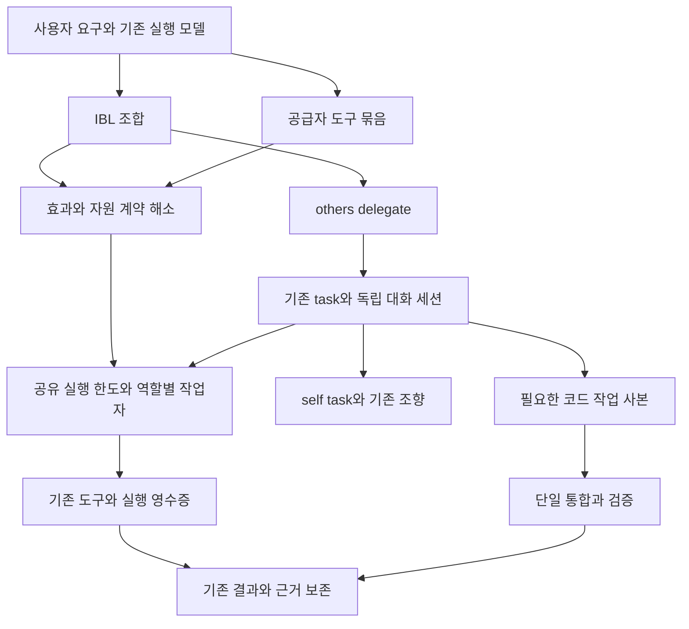

# IBL 병렬 실행과 과제별 협업 개선 설계

작성일: 2026-10-22. 상태: **설계안 — 구현 전**.
목적: 기존 IBL 조합·위임·접수증을 유지하며 독립 작업의 대기 시간을 줄이고, 과제별 실행자의 분담·개입·회수·통합을 일관되게 만든다.
기준선: 정본 `/Users/kangkukjin/Desktop/AI/indiebizOS`의 현재 코드. 구현 중 다른 변경이 들어오면 아래 소유 위치와 계약을 다시 대조한다.

상위 기준은 [IBL 진화 목적](IBL_EVOLUTION_PURPOSE.md)과 [구조 수렴 설계](IBL_SYSTEM_CONSOLIDATION_DESIGN.md)다. 결과 품질·실제 완료 시간·전체 토큰으로 효과를 평가한다. 작업자 수와 스레드 수 자체를 성과로 삼지 않는다.

## 1. 결정 요약

1. `&`, `>>`, `each`, 함수, 실패 처리, 실행 영수증의 의미를 유지한다. 새 병렬 문법이나 별도 워크플로 언어를 만들지 않는다.
2. 일반 API 모델의 도구 묶음은 공통 실행 경계에서 독립성을 확인한 호출만 병렬 실행한다. 효과 불명·공유 세션·권한 확인이 필요한 호출은 순서를 유지한다.
3. IBL 중첩 병렬의 일괄 순차화를 **전체 작업 한도 안의 실행 슬롯 배분**으로 바꾼다. 기존 역할별 풀과 문맥 전달을 유지하며, 한 전역 풀로 바꾸지 않는다.
4. 임시 실행자는 `others:delegate`의 과제 범위로 만든다. 기존 tasks와 conversation_sessions에 연결하고 `self:task`로 관찰·대기·취소한다.
5. 실행 중 지시는 기존 `steer_inbox`에 연결한다. 종료된 실행자의 후속 작업은 같은 대화 세션의 새 task로 시작한다. 접수·전달·처리 완료를 구별한다.
6. 병렬 코딩은 외부 프로젝트에서 요청된 협업에 한해 작업 사본을 만들고, 검증한 변경을 단일 통합자가 반영한다. 일반 코딩 앱의 폴더 중심 사용 경험을 유지한다.

새 노드·액션 이름은 추가하지 않지만, `others:delegate`와 `self:task`의 인자·op 확장은 **표준 기능어 계약 개정**이다. 구현 때 명세·YAML·가이드·회귀를 함께 갱신하며, “새 낱말 0”을 이유로 변경 관리에서 제외하지 않는다.

해당 단계에서 `ibl.md`의 언어 경계와 계약을 개정하고 `STANDARD_CORE_NODES`와의 일치를 확인한다. 노드 집합은 유지하므로 집합 자체를 불필요하게 바꾸지 않는다. `data/ibl_nodes_src`를 수정한 뒤 정본 빌더로 파생물·문서 마커를 생성하고 새 액션 체크리스트의 계약·교재 절차를 따른다.

## 2. 현재 능력과 정확한 공백

| 영역 | 현재 구현 | 이번 설계가 바꾸는 것 |
| --- | --- | --- |
| 명시적 병렬 | `ibl_v2_runtime.Runtime.fanout`이 결과 순서·부분 실패·실행 근거를 보존한다. `&`는 최대 8, each는 요청 폭을 사용하고 중첩 fan-out은 순차 실행한다. | 중첩 위치에서도 가용 슬롯을 사용한다. 기존 순서·실패 계약은 보존한다. |
| API 도구 묶음 | OpenAI·Anthropic·Gemini 등의 공급자 루프가 각 도구를 순차 실행한다. 공통 완료 경계는 `BaseProvider._execute_tool_to_completion`이다. | 공급자별 병렬 구현 대신 공통 묶음 실행을 둔다. |
| 위임 | `same/cross/system`의 sync·async 접수, 자식 task, 상태·취소·결과 회수, 순환 방지, 권한 축소가 있다. 같은 상주 러너의 메시지는 순차 처리한다. | 상주 역할을 복제하지 않고 과제별 독립 실행 세션을 추가한다. |
| 조향·재개 | `steer_inbox`, `dialogue_continuation`, `conversation_sessions`와 연구 대화의 조향이 이미 있다. | 이 기반을 과제별 자식 실행에 연결한다. 조향·세션 저장 자체를 다시 구현하지 않는다. |
| 코드 작업 | 현재 `coding_projects.py`는 폴더·커밋·되돌리기 방식이며 과제별 worktree 구현을 대체했다. 자기수리는 별도 REPAIR 사본을 쓴다. | 일반 프로젝트에서 한 협업 과제의 작업자별 사본과 통합 소유권을 제공한다. |
| 부분 합류 | `((A & D) >> E) & B & C`처럼 실제 선행 결과만 묶는 표현이 가능하다. 89회차 후속에서 작성·검수 지침을 보완했다. | 일반 DAG 언어나 상시 계획 AI를 추가하지 않는다. 실행 자원 때문에 생기는 추가 대기를 줄인다. |

코드 근거: [현재 실행기](../backend/ibl/ibl_v2_runtime.py), [풀의 문맥 전달](../backend/base/execution_workers.py), [공급자 완료 경계](../backend/providers/base.py), [위임 접수](../backend/cognition/system_tools_delegate.py), [위임 상태 어댑터](../backend/cognition/delegation_tasks.py), [세션](../backend/datastore/conversation_sessions.py), [조향](../backend/base/steer_inbox.py), [현재 코딩 앱](../backend/services/coding_projects.py).

이전 해부도와 10월 2일 코딩 설계의 과제별 worktree 설명은 현재 구현의 증거로 쓰지 않는다. 관련 문서의 현재 구조 설명은 코딩 단계에서 함께 정리한다. [10월 7일 코딩 전환 설계](CODING_APP_ON_IBL_PLAN_2026_10_07.md)를 참조한다.

89회차는 병렬화보다 반복 검색의 색인화에서 비용 감소를 관측했다. 해당 실험을 새 실행 계층의 성능 근거로 사용하지 않는다. [실험과 후속 수리](experiments/long_sentence_imagination/round_89/report.md).

## 3. 책임과 연결



| 책임 | 소유 위치 | 대체하거나 연결할 것 |
| --- | --- | --- |
| 효과·자원·동시 실행 가능성 | 어휘의 callable 계약, `ibl_callable_contract`, `ibl_v2_contracts/adapters` | 자동 병렬화를 위한 도구 이름별 허용 목록을 만들지 않는다. |
| 호출별 결과 봉투 | `BaseProvider`의 완료 경계와 기존 도구 전송 경계 | 공급자의 이미지·지도·오류·계측 임시 상태를 호출별로 분리한다. |
| 슬롯 입장·해제·공정성 | `base/execution_workers`의 형제 모듈로 작은 실행 한도 관리기를 추가 | 역할별 풀 생성은 유지한다. base에서 IBL·인지층을 import하지 않는다. |
| 중첩·합류·부분 실패 | 현재 IBL Runtime과 실행 저널 | `nested이면 순차` 분기를 슬롯 임대·반납으로 대체한다. |
| 자식 생성·수명·후속 | 인지층 위임 서비스와 기존 task/세션 저장소 | 임시 AIAgent를 별도 실행 루프로 돌리는 과거 방식은 부활시키지 않는다. |
| 취소·개입 | `task_cancellation`, `steer_inbox`, `dialogue_continuation` | 부모·자식의 신원과 출처를 명시해 연결한다. |
| 코드 격리·통합 | `coding_projects/coding_git`, 기존 작업 사본의 재사용 가능한 저수준 기능 | 범용 코드 통합과 RED 적용의 정책은 각각 기존 소유자가 유지한다. |
| 감독·사용자 표시 | 기존 과제·실행 사건·조종실 | 별도 팀 대시보드·상시 평가 모델은 필수로 추가하지 않는다. |

새 모듈은 1500줄 제한과 `check_backend_layers.py` 배정을 따른다. 실행 한도 관리기는 작업 상태 원장의 대체물이 아니다. 영속적인 수명·결과는 기존 저장소가 소유하고, 프로세스 안 슬롯 점유는 관측 가능한 일시 상태로 둔다.

## 4. 일반 도구 호출의 자동 병렬화

### 4.1 자동 병렬의 자격

첫 범위는 **한 모델 응답에 포함된 여러 독립 읽기·순수 호출**이다. 다음 모델 턴을 미리 추측해 실행하지 않는다. 모델 호출·쓰기·임의 셸·스크립트의 자동 병렬화는 초기 범위에서 제외한다. 이 호출들도 기존의 명시적 IBL 조합으로 실행할 수 있다.

효과 `pure/read_external`만으로 스레드 안전성을 추정하지 않는다. 읽기 도구도 전역 버퍼·브라우저 탭·DB 연결·외부 객체 세션을 공유할 수 있다. callable 계약에 다음 선택 메타데이터를 제안한다. 미선언은 기존 순차 실행이다.

```yaml
# 제안 스키마. 아직 실행 가능한 사전 설정이 아니다.
execution:
  concurrency: reentrant       # serial | reentrant | affinity
  affinity_resources: {}      # affinity일 때 기존 자원 선언 형식으로 대상 해소
```

`reentrant`는 작성자가 실제 핸들러의 재진입성과 반환 상태 격리를 검증한 선언이다. `affinity`는 같은 자원 신원의 호출을 직렬화한다. `effects`, `read_resources`, `write_resources`는 기존 계약을 재사용한다. 모델이 인자로 “안전하다”고 지정해 자격을 얻지 못한다.

`execute_ibl`은 이름으로 허용하지 않는다. 호출을 기존 컴파일·검사 경계에서 해석하고, 도달 가능한 효과·공유 핸들·모든 하위 도구의 재진입성을 요약할 수 있을 때만 후보로 삼는다. 동적 효과나 숨은 자원이 남으면 그 호출은 순차 장벽이다. 컴파일 결과는 같은 호출에서 재사용해 중복 검사를 줄인다.

이 자격은 **자동 순서 변경의 조건**이다. 이미 사용자가 `&`로 명시한 호출에 미선언 메타데이터를 이유로 새 금지를 소급하지 않는다. 기존 병렬 쓰기 충돌 검사는 그대로 거절하고, 새로운 스케줄러가 충돌을 조용히 순차화해 통과시키지 않는다.

### 4.2 실행과 결과 반환

1. 기존 인자 검사와 효과 해소를 부작용 없이 수행한다. 미리 검사한 권한은 실행 직전에도 기존 관문에서 확인한다.
2. 원래 호출 순서에서 연속한 병렬 적격 구간을 찾는다. 쓰기·효과 불명·조향/승인 경계 앞뒤로 호출을 이동하지 않는다.
3. 자원 중첩은 기존 `resource_values/resource_conflicts`와 실행 시 경로·inode 정규화 경계를 소비한다. read/write와 write/write 충돌을 함께 다루며, 별도 경로 비교기를 만들지 않는다. 불명 자원은 자동 병렬 대상에서 제외한다.
4. 호출별 불변 입력, thread-local/contextvars 문맥, 독립 결과 봉투를 만들어 공통 실행 한도 안에서 제출한다.
5. 진행 사건은 완료 순으로 내보낼 수 있지만 모델에게 주는 도구 응답은 원래 call ID와 입력 순서에 맞춘다. 성공·실패·미시작을 호출별로 반환한다.
6. 묶음 뒤의 대화 메시지·누적 계측·지도·이미지 상태는 조정자 한 곳에서 합친다. 워커가 공유 messages나 공급자 인스턴스의 `_last_tool_*`를 갱신하지 않는다.

단순히 공급자 루프를 `executor.map`으로 바꾸지 않는다. 호출별 봉투에는 값·전문 참조·이미지·UI 상세·오류·사용량·출처를 포함하고, 기존 `model_result_view` 및 전송 경계가 해석한다. MCP/IBL 직결 경로도 같은 호출별 상태 경계를 사용한다. 완료 경계의 접수증 대기 의미는 유지한다.

취소·새 지시·승인 대기가 생기면 이후 미제출 호출은 시작하지 않는다. 이미 시작한 읽기는 완료/취소 확인을 회수한다. 모델 응답 형식에 필요한 모든 call ID를 정직한 종료 또는 미시작 응답으로 닫는다. 동시 완료 때 조향을 우연히 먼저 끝난 도구 하나가 독점하지 않도록 묶음 조정자가 다음 모델 경계의 전달을 소유한다.

네이티브 CLI의 내부 도구 호출 순서는 해당 하네스가 소유한다. 이 설계의 일반 API 묶음 실행기를 CLI 바깥에서 중복 적용하지 않는다.

## 5. 중첩 병렬과 공유 실행 한도

### 5.1 한도를 세는 단위

`parallel:N`은 여전히 해당 each의 최대 활성 가지 수다. 실제 실행 폭은 가지 요청 폭, root 과제의 남은 슬롯, 몸의 전체 한도, 공급자·자원 한도의 최솟값이다. `parallel:1`은 명시적인 순차 요청으로 유지한다. 기존 숫자 범위 1~8은 첫 이행에서 늘리지 않는다.

도구 슬롯과 모델 요청 슬롯은 구분한다. 모델 슬롯은 실제 요청 중에만 점유하고, 자식 결과를 기다리는 부모는 모델 슬롯을 잡지 않는다. 모든 자식은 같은 root의 누적 시간·모델 사용량 제한과 출처를 상속하며, 생성할 때 새 예산을 발급하지 않는다. IBL steps/rows와 모델 토큰은 서로 다른 단위로 기록한다.

동시성 한도는 몸 설정과 root 실행 정책에서 정한다. 첫 기본값은 기존 IBL 폭 8을 상한으로 유지하고, API 읽기와 모델 요청의 더 낮은 초기값은 구성·시험에서 고정한다. 외부에서 전달한 root ID나 슬롯 토큰은 신뢰하지 않으며 MCP·CLI 경계의 인증된 task에서 서버가 해소한다.

API 모델 요청은 접수 직전에 예상 입력·요청 출력 상한을 root 원장에 원자적으로 예약하고 실제 사용량으로 정산한다. 공급자가 입력/추론 비용이나 네이티브 내부 요청을 보고하지 않으면 엄격한 총토큰 상한을 보장한다고 표시하지 않는다. 이 경우 실행 세션 수·마감·관측 사용량을 제한하고 추가 자식 접수를 보수적으로 멈춘다. 네이티브 하네스 자체의 자식 실행을 제어·계측할 수 있는지는 별도 capability로 검증해, IBL 자식과 내부 자식이 중복 증식하는 경로를 제한한다.

### 5.2 부모가 자식을 기다리는 방법

첫 구현은 **비차단 슬롯 임대와 현재 워커 내 실행**을 사용한다. 포화된 공용 풀에 자식을 넣고 부모가 `future.result()`로 기다리는 구조를 만들지 않는다.

- 부모가 자식 fan-out에 들어가면 현재 슬롯을 첫 자식에게 이전한다. 부모 계산 프레임은 일시 정지한다.
- 나머지 자식은 추가 슬롯을 즉시 확보한 수만 역할별 풀에 제출한다. 슬롯이 없으면 현재 워커가 아직 제출하지 않은 자식을 순차 처리한다.
- 자식들이 끝날 때까지 부모는 별도 슬롯을 보유하지 않는다. 마지막 자식의 슬롯을 부모의 후속 구간으로 이전한다. 제출된 다른 자식이 남으면 그 결과를 기다리고, 실행 중인 자식의 슬롯을 중복 반납하지 않는다.
- 같은 규칙을 중첩 깊이마다 적용한다. 대기 깊이가 스레드 수로 곱해지지 않고, 상한 1에서도 완료되어야 한다.
- 독립 root에는 공정한 입장 순서를 적용한다. root의 추가 슬롯 요청은 이미 대기 중인 다른 root의 몫을 선점하지 않는다. 제한된 제출 큐와 명시적 대기 사유로 과부하를 드러낸다.

실행 슬롯과 자원 잠금을 각각 잡은 채 상대를 기다리지 않는다. 입장 관리기가 필요한 permit을 한 번에 확보하거나 전부 반환한다. 대기 중인 다른 root가 있으면 leaf 완료 경계에서 재입장 순서를 양보한다. 이미 실행 중인 도구를 공정성 때문에 강제 선점하지 않는다. API 429의 재시도 대기 역시 실제 요청 슬롯을 반환하고 기존 재시도 횟수·마감 안에서 재입장한다.

슬롯을 실제 블로킹 작업이 살아 있는 동안 회수하지 않는다. 스레드 타임아웃은 강제 종료가 아니므로 배경 실행이 남으면 점유와 작업 신원을 계속 추적한다. 별도 프로세스의 강제 중단은 해당 어댑터가 종료를 확인했을 때만 해제한다. 입장 대기 시간·실제 실행 시간·전체 마감 시간을 분리한다.

핸들러가 추가 스레드를 만드는 경우 같은 호출의 내부 작업인지 독립 실행인지 구분한다. 모든 역할별 풀 생성자가 새 한도를 무조건 다시 잡게 해 동일 작업을 이중 계수하지 않는다. 중첩 IBL·도구 offload·공급자 요청의 입장 경계를 명시하고 context에 같은 임대 신원을 전달한다. 하위 내부 병렬을 추적하지 못하면 실측 상한 밖의 작업으로 표시하고 확장 경로는 순차로 제한한다.

### 5.3 합류와 실패

기존 source node·함수 호출 위치·행 인덱스의 실행 신원을 보존한다. 실제 실행 순서와 슬롯 번호를 영수증 신원에 넣지 않는다. 그래야 실행 폭이 달라져도 resume/reuse의 의미가 유지된다.

`&`는 해당 식의 가지를 모두 합류하고 원래 순서로 반환한다. each의 `on_error:collect`는 개별 실패를 값으로 보존한다. 중단형 실패는 해당 fan-out의 신규 제출을 멈추고 시작된 가지의 종료를 확인해 성공 값·실패·미시작 인덱스를 남긴다. 실패한 형제를 자동 재실행하거나 다른 독립 root를 취소하지 않는다.

부분 합류는 기존 식과 task 접수증으로 표현한다. 느린 C와 무관한 E는 `((A & D) >> E) & B & C`로 작성한다. 명령형 문장을 효과 분석만으로 재배치하거나 미래 변수를 추측하지 않는다. 비동기 작업의 장시간 대기는 기존 `self:task wait`의 suspend·재개 경로를 사용한다.

## 6. 과제별 임시 실행자

### 6.1 공개 계약 제안

`others:delegate`에 `scope:task`를 추가한다. 기존 `same/cross/system`의 기본값·상주 러너·sync/async 의미는 바꾸지 않는다. task 범위의 `mode`는 async/sync만 지원하고 workflow는 거절한다.

| 제안 필드 | 의미 |
| --- | --- |
| `scope:task` | 부모 과제에 속한 독립 세션을 만들거나 이어 쓴다. |
| `message`, `context`, `role`, `allowed` | 기존 인자 의미를 이어 쓴다. 역할은 프롬프트 선택이고 권한 상승 수단이 아니다. |
| `request_id` | 새 작업 접수의 멱등 키. task 범위에서 필수. |
| `worker_ref` | 생략하면 새 세션, 있으면 소유권이 확인된 같은 실행자 세션의 후속 턴. |
| `workspace` | 선택적인 서버 발급 작업 공간 참조. 임의 절대경로를 허용 범위로 승격하지 않는다. |

모델은 부모의 현재 실행 설정을 기본 상속한다. 첫 버전에는 모델별 임의 인자나 새 역할 카탈로그를 추가하지 않는다. 향후 모델 선택이 필요하면 기존 모델 기어·설정 해소 경계를 소비한다.

반환은 기존 `kind:delegation`의 `task_ref`에 `worker_ref`를 추가한다. worker_ref는 세션·수명 참조이고 task_ref는 한 실행의 접수증이다. 후속 턴은 새 task_ref를 발급한다. 끝난 task를 running으로 되돌리지 않는다. 이름이 같은 다른 실행자에게 이어 보내지 않도록 서버 발급 불투명 ID와 세대 값을 사용한다.

worker_ref는 접수증의 task_ref **옆 칸**으로 반환하며 기존 `{kind, task_id, owner}` 신원 형식은 바꾸지 않는다. 아래는 제안 계약의 사용 예이며 현재 실행 예제가 아니다. request_id는 이 예문 문자열을 반복 사용하지 않고 부모 실행과 논리 요청에 묶어 생성한다. 같은 요청의 전송 재시도에는 같은 값을 쓴다.

```text
$a = [others:delegate]{scope:"task", mode:"async", request_id:"<요청-A>",
  message:"자료 A에서 주장과 원문 근거를 정리하라", context:{source:$sourceA}}
$b = [others:delegate]{scope:"task", mode:"async", request_id:"<요청-B>",
  message:"자료 B에서 반례와 원문 근거를 정리하라", context:{source:$sourceB}}
// 위 두 호출은 접수만 하므로 긴 모델 실행을 기다리지 않는다.
$results = [self:task]{op:"wait", ref:$a.task_ref}
  & [self:task]{op:"wait", ref:$b.task_ref}
// 결과를 검토한 뒤 같은 자식의 맥락으로 다음 턴을 요청한다.
$next = [others:delegate]{scope:"task", worker_ref:$a.worker_ref,
  request_id:"<후속-A>", message:"앞서 모은 근거에서 이 반례를 다시 검토하라"}
```

wait의 시간초과·실패는 기존 계약대로 처리해야 한다. 이 예문은 접수·동시 진행·세션 후속의 관계만 보이며 전체 업무의 완료 판정과 예외 처리를 생략했다.

### 6.2 영속 소유권과 실행

저장 위치는 부모가 속한 기존 conversations DB 또는 system_ai_memory DB다. 기존 sessions/turns/events/task_links와 tasks를 사용하고, 실행자 메타데이터는 같은 DB의 보조 테이블로 둔다. 새 팀 DB나 전역 태스크 원장을 만들지 않는다.

필수 메타데이터는 root task, parent task, session, worker 세대, 설정·권한 지문, 작업 공간 참조, 수명 상태다. worker 수명은 ready/running/closed로 별도 저장하며 공통 task 상태 목록에 섞지 않는다. 각 worker에는 동시에 활성 턴 하나만 허용한다. 바쁜 worker에 후속 턴을 접수하면 그 worker 안에서 FIFO로 기다리며, 다른 worker는 실행할 수 있다.

접수 트랜잭션은 `(부모 소유 범위, request_id)`의 유일성, 요청 지문, task·session 연결과 발송 대기 사건을 함께 저장한다. 같은 키·같은 요청이면 같은 접수증, 다른 내용이면 충돌이다. 저장 후 메모리 큐에 넣기 전 죽어도 발송 대기 사건으로 회복한다. 부모의 pending 증가와 결과 감소는 task ID 기준으로 한 번만 수행한다. 다른 DB를 가로지르는 기존 cross 위임에 원자성을 새로 주장하지 않는다.

인지층은 기존 `cognitive_stream`과 공급자 공장을 사용하되, 실행자별 AIAgent·history·공급자 가변 상태를 분리한다. `AgentRunner.ai` 하나를 여러 task에서 동시에 호출하지 않는다. 회상·감독·검수는 기존 역할·정책을 따르며, 자식마다 별도 의식·평가를 의무 호출하지 않는다.

기본 전달 맥락은 작업 요구·명시된 context·필요한 자료 참조·상속해야 할 제약이다. 부모 대화 전체를 기본 복제하지 않는다. 결과는 요약과 원문·산출물·근거 참조로 회수하며, 반환 잘라내기를 성공으로 숨기지 않는다. 입력·출력·캐시·감독 비용은 root에서 중복 없이 합산한다.

### 6.3 권한과 위임 트리

새 worker는 부모의 principal·origin·허용 노드·출력/작업 공간·마감·사용량 정책을 같거나 좁게 상속한다. 부모가 사용자 요청에서 출발했어도 자식의 발화는 에이전트 위임으로 기록한다. RED 권한이나 대외 발송 권한을 재발급하지 않는다.

기존 상주 에이전트의 조상 신원 순환 방지는 그대로 둔다. task 범위에서는 동일 모델·동일 역할의 자식 생성이 가능하므로 역할 이름을 순환 신원으로 사용하지 않는다. 서버 발급 worker ID로 트리를 만들고, 최대 깊이·총 생성 수·동시 모델 요청·총사용량 한도를 함께 검사한다. 같은 역할을 새 ID로 무한 생성하는 것도 root 한도에서 막는다.

worker_ref는 비밀 토큰만 있으면 권한을 얻는 자격증이 아니다. 조회·후속·조향·취소마다 요청자의 root 소속과 제어 권한을 확인한다. 형제 간 직접 지시는 첫 버전에서 제공하지 않는다. 부모가 필요한 결과를 전달한다.

## 7. 후속 지시와 취소 및 복구

### 7.1 기존 조향의 연결

`self:task`에 선택 기능 `op:steer`를 제안한다. 인자는 기존 `ref`와 `message`, `request_id`이며 활성 실행의 정확한 task_ref를 요구한다. 이 op를 지원하지 않는 task kind는 명시적으로 거절한다. status의 추가 capability 정보로 지원 여부를 알려주고 기존 공통 필드는 유지한다.

`steer_inbox.post`를 그대로 부모 에이전트에 노출하면 안 된다. 현재 봉투와 render는 출처를 user로 표시한다. 먼저 서버가 `user/agent` 출처와 발신 주체를 인증된 문맥에서 정하고, 서로 다른 프레이밍으로 전달하도록 확장한다. 부모 에이전트의 지시를 사용자 지시보다 높은 우선순위로 표시하지 않는다.

기존 대화 사건에 accepted/delivered/처리 확정을 보존하고, 멱등 키를 영속 사건에서도 확인한다. 처리 중 종료·재기동·취소로 미전달된 지시는 유실시키거나 처리 완료로 표시하지 않는다. 이미 응답이 봉인됐으면 조향을 새 작업으로 몰래 바꾸지 않고 후속 delegate가 필요함을 반환한다. 모델 호출 중 즉시 개입을 보장하지 않으며, 공급자별 실제 전달 경계를 표시한다. Codex 네이티브 실행의 MCP 경계 같은 제한도 유지한다.

### 7.2 부모 종료와 자식 수명

기존 `self:task cancel`은 참조한 작업만 취소한다. 이를 모든 기존 위임의 재귀 취소로 바꾸지 않는다. **task 범위에서 새로 생성한 자식만 부모 소유 수명**으로 정한다.

- 부모가 정상 결과를 확정하려면 소유 자식들이 종료돼야 한다. 자식이 남으면 부모를 waiting_children으로 보존하고 전체 완료라고 닫지 않는다.
- 부모 취소는 소유 자식에 취소를 전파한다. 기존 same/cross/system 작업은 이전 계약대로 별도 제어한다.
- 개별 자식 실패는 다른 자식의 취소 명령이 아니다. 부모가 실패를 회수해 필요한 후속만 요청한다.
- 모델 슬롯 부족으로 자식이 queued이면 부모 대기는 슬롯을 반납한다. 동기 위임 제한시간 만료는 자식 실패로 바꾸지 않는다.
- 취소 요청 뒤 실제 효과가 계속되면 cancel_requested로 남긴다. 취소와 정상 완료가 경합하면 먼저 확정된 종료 기록을 보존한다.

root의 해당 실행이 끝나면 idle worker의 메모리·프로세스는 회수하되 세션·결과는 남긴다. 같은 소유자의 후속 대화는 보존된 root 연결을 통해 worker를 다시 열 수 있다. 이때 새 task와 새 제어 한도를 발급하고 현재 권한과 보존 권한의 교집합을 사용한다. 닫힌 worker의 후속을 새 세션으로 조용히 대체하지 않는다.

재기동 후 슬롯은 기존 프로세스 신원·수명 관리로 정리한다. 실행 종료가 불명인 task는 interrupted 또는 cancel_requested 등 확인된 상태로 투영한다. 외부 효과·모델 요청·코드 적용을 무조건 재전송하지 않는다. IBL은 기존 journal/resume, 공급자는 기존 세션 재개, 코딩은 적용 원장을 사용한다. 복구가 불가능하면 보존된 결과와 정확한 실패 지점을 반환한다.

## 8. 같은 프로젝트의 병렬 코드 작업

### 8.1 격리는 협업 과제 안에 둔다

현재 코딩 앱의 기본 폴더·목표 문서·기록·되돌리기를 유지한다. 여러 실행자가 같은 프로젝트를 수정하도록 분담할 때만 통합자가 기준 스냅샷과 작업자별 사본을 준비한다. AI의 `workspace` 인자는 서버가 발급한 사본 참조를 받는다.

외부 Git 프로젝트는 worktree, Git이 없거나 저장소 정책상 worktree를 쓸 수 없으면 내용 지문을 가진 격리 사본을 사용한다. dirty·미추적 파일의 포함 범위를 명시해 동일 기준을 복제한다. 시작 HEAD뿐 아니라 시작 바이트·파일 모드·추적 여부를 기준으로 삼아 중간 커밋이 변경 판정을 지우지 못하게 한다. 비밀·ignored 파일은 무차별 복제하지 않고 기존 실행 환경·인증 연결 정책을 따른다.

이 설계가 외부 Codex 세션의 indiebizOS 정본 main 직접 작업 규약을 바꾸지는 않는다. indiebizOS 자기수리 병렬 쓰기는 첫 이행에서 제외한다. 후속으로 지원하려면 기존 REPAIR root 사본 아래의 후보들을 한 후보로 통합하고 기존 적용·재기동 제어자를 통과시키는 별도 인수가 필요하다. 일반 코딩 통합기로 RED를 우회하지 않는다.

### 8.2 통합은 한 주체가 한다

1. 각 worker에 수정 담당 범위와 읽기 자료를 전달하고, 네이티브/IBL 실행 모두 같은 작업 사본에 묶는다. 파일 경계만으로 포트·DB·외부 서비스까지 격리됐다고 보지 않는다.
2. 각 worker는 변경 묶음과 검사 결과를 반환한다. 메인 프로젝트와 Git 메타데이터를 임의로 수정할 수 없도록 기존 실행 경계에서 집행한다.
3. 통합자는 같은 기준에서 나온 묶음을 통합 후보 사본에 조합한다. 서로 다른 파일도 동작 충돌이 있을 수 있으므로 통합 검사를 실행한다.
4. 동일 파일·삭제/수정·이름 변경·바이너리 충돌은 명시적으로 해결한다. 충돌 해결 후 후보 지문을 갱신하고 관련 검사를 다시 한다. 마지막 작성자 덮어쓰기로 처리하지 않는다.
5. 반영 직전 원본이 기준과 같은지 대조한다. 외부 변경이 있으면 영향을 분석해 새 후보에서 다시 통합·검증한다. 이전 검증 영수증을 새 바이트의 증거로 재사용하지 않는다.
6. 고정된 검증 바이트와 적용 manifest를 단일 적용 소유자가 반영·기록한다. 여러 파일 교체 전체의 OS 원자성을 주장하지 않으며, 단계별 적용·부분 실패·복구 상태를 남긴다. 같은 적용 요청 재전송은 원장을 회수한다.

프로젝트별 적용 잠금은 indiebizOS 안의 경쟁 반영을 막는다. 외부 편집기는 잠금을 따르지 않으므로 적용 전과 각 교체 경계의 지문 대조가 필요하다. 저장소 규약이 main 직접 커밋을 요구하면 최종 통합자는 그 규약대로 경로 한정 커밋한다. push·배포·외부 전송의 권한은 병렬 작업 접수에서 새로 생기지 않는다.

외부 편집과 파일 교체 사이의 경쟁을 지문 검사만으로 완전히 없앴다고 주장하지 않는다. 적용 전 원본 바이트를 복구 가능하게 보존하고 적용 후 다시 확인한다. 복구 때도 현재 바이트가 자신이 적용한 판본과 같은지 확인하며, 제삼자의 후속 변경을 이전 백업으로 덮어쓰지 않는다. 일치하지 않으면 부분 적용 상태와 남은 조치를 보존한다.

작업 사본은 미반영 산출물이 남은 동안 삭제하지 않는다. 완료 후 정리는 복구 기록과 보존 정책에 따르며, 일회성 백업은 기존 `data/_backups` 규약을 따른다.

## 9. 구현 순서와 단계별 완료 조건

| 단계 | 변경 | 종료 조건과 제거할 경로 |
| --- | --- | --- |
| P0 호출 경계 정리 | 호출별 결과 봉투, 재진입성 계약과 자원 해소 | 이미지·오류·계측이 격리된다. 공유 임시 버퍼에 기대는 소비자를 전환한다. 이 단계만으로 속도 개선을 주장하지 않는다. |
| P1 API 읽기 병렬 | 공통 묶음 실행, root/몸 한도의 초기 입장 관리, OpenAI·Anthropic·Gemini·OpenAI 호환 소비자 연결 | 적격 읽기는 겹치고 장벽은 유지된다. 공급자별 순차 루프는 공통 실행기의 안전한 순차 폴백을 소비한다. |
| P2 중첩 IBL | 슬롯 이전·반납·공정 배분과 현재 fanout 연결 | 상한 1/2/8에서 중첩 완료·부분 실패·취소·신원 보존. 현재 경로의 무조건 중첩 순차 분기를 제거한다. |
| P3 과제 실행자 | scope:task, 접수 멱등성, 독립 세션·실행 상태, 부모 소유 수명 | 같은 역할 두 자식이 격리 실행되고 전체 비용·권한·결과를 회수한다. 별도 임시 AI 실행 루프를 두지 않는다. |
| P4 후속과 조향 | worker_ref 후속, self:task steer, 출처·영속 사건·재기동 회복 | 자식 맥락을 이어 쓰고 에이전트 지시를 사용자로 위장하지 않는다. 종료 경합·중복 지시·미처리 지시를 검증한다. |
| P5 코드 협업 | 외부 프로젝트별 작업 사본·단일 통합·조건부 적용 | 독립 변경·충돌·외부 편집·취소·부분 적용을 검증하고 통합 결과를 실제 사용한다. 과거 코딩 설명을 현재 계약으로 갱신한다. |

P0→P1→P2→P3→P4를 기본 순서로 한다. P5는 P3의 작업 공간 신원이 고정된 뒤 연결한다. P1에서도 root 한도와 호출 상태 격리를 생략한 채 스레드만 늘리지 않는다.

각 단계의 계약을 생산자·소비자·가이드·회귀까지 닫고 다음 단계를 얹는다. 신규 표면은 실제 구현 뒤 소개한다. 구형 저장 기록은 계약 판본을 보존하며 새 실행 정책을 진행 중 작업에 소급 적용하지 않는다. 롤백 시 미지원 scope/op를 명시적으로 거절하고 저장된 결과의 조회는 유지한다.

## 10. 검증과 성과 판단

### 10.1 계약 시험

| 시험 | 반드시 확인할 것 |
| --- | --- |
| 도구 묶음 | 서로 다른 시간에 끝난 읽기의 실제 겹침, call ID·결과 순서, 하나의 실패·승인·취소 뒤 미시작 목록 |
| 상태 격리 | 서로 다른 이미지·지도·오류·trace·사용량이 바뀌지 않음, 스레드 이전 문맥 복원 |
| 자원 | 같은 파일·상하위 경로·심볼릭/하드 링크·같은 탭/세션·DB 연결의 충돌, 미상 계약의 순차 폴백 |
| 중첩 | 슬롯 1/2/8·여러 깊이·빈 목록·return·collect·외부 timeout, 실제 활성 수 상한과 완료 가능성 |
| 공정성 | 큰 fan-out 중 다른 root 시작, 제한된 대기열, provider 429/backoff 동안 슬롯 누수·과도한 재시도 없음 |
| 합류 | E가 A/D 뒤이면서 C 이전에 시작 가능한 지연 주입 시험, 실패한 가지의 결과·근거·미처리 위치 보존 |
| 임시 실행자 | 같은 역할·서로 다른 입력의 세션 격리, 바쁜 worker 후속 직렬화, 같은 요청 재접수, 저장 직후 프로세스 종료 |
| 권한 | 부모 밖 노드·경로·도구·예산 확대 거절, origin 보존, 위임 깊이·생성 수·실행 수 제한 |
| 개입 | user/agent 출처 구별, 중복 요청, 배달과 종료 경합, 재기동 뒤 미처리 지시, 지원하지 않는 kind |
| 취소 | 부모·소유 자식·기존 비소유 위임 구별, 취소 요청과 중단 확인 구별, 이미 끝난 결과 보존 |
| 코드 통합 | dirty 기준·미추적·중간 커밋·모드·rename·바이너리·동일 파일 충돌·외부 변경·부분 적용 복구 |
| 호환 | 기존 IBL 출력·scope·task 상태·resume/reuse·CLI 단독 사용·연구 대화·REPAIR 경로의 퇴행 없음 |

기존 `test_tool_completion`, `test_parallel_context_inherit`, `test_ibl_v2_core`, `test_delegation_tasks`, `test_steer`, `test_dialogue_continuation`, `test_coding_projects`를 관련 경계로 삼는다. 새 회귀는 변경 모듈 이름의 파일에 두고 실제 장애 계약을 검증한다. 검증 정책은 [REGRESSION_TESTING](REGRESSION_TESTING.md)을 따른다.

### 10.2 실제 효과 관측

같은 입력·모델·권한·완료 조건에서 순차 기준선과 각 단계를 비교한다. 외부 I/O 읽기, 긴 자료의 독립 분석, 중첩 도구 조합, 여러 프로젝트가 겹치는 부하, 병렬 코딩을 구분한다. CPU 중심 순수 계산에서는 Python 스레드의 물리 병렬 속도 향상을 전제하지 않는다.

필수 관측은 요청부터 검수·복구·통합까지의 벽시계 시간, 결과 정확성·누락·사용자 수정, 전체 모델 사용량이다. 보조 관측은 큐 대기·실행·합류 대기·최대 활성 수·모델 요청 수·재시도·복구·통합 비용이다. 기존 에피소드·사용량 원장·실행 사건에 필드를 더하며 새 분석 DB는 만들지 않는다.

도구 시간의 합을 사용자 대기 시간으로 보고하지 않고, 상태 교체 건수를 재계산 건수로 보고하지 않는다. 다중 실행자 때문에 토큰이 늘면서 빨라진 경우 상충 관계로 기록한다. 이 경우 단순 작업에 다중 실행자를 기본 적용하지 않고, 독립 분석의 규모가 협업 비용을 상쇄하는 범위에서 사용한다. 성능 측정은 구조 개선의 착수 조건이 아니지만 미측정 효과를 완료 보고에 넣지 않는다.

## 11. 이 설계의 완료 범위

이번 산출물은 실행·수명·공개 계약·코드 통합·이행·검증의 설계다. 제품 소스, 어휘 YAML, 운영 설정, 실행자 수, 조향 정책은 변경하지 않았다. 위 제안 필드와 op는 현재 실행 가능한 기능이 아니다.

첫 구현 단위는 P0와 P1이다. 새 멀티에이전트 체계를 먼저 만드는 대신, 이미 모델이 제출한 독립 읽기의 불필요한 대기를 줄이고 호출 상태를 분리한다. 이어서 같은 한도·신원 기반으로 중첩 IBL과 과제별 실행자를 연결한다.
