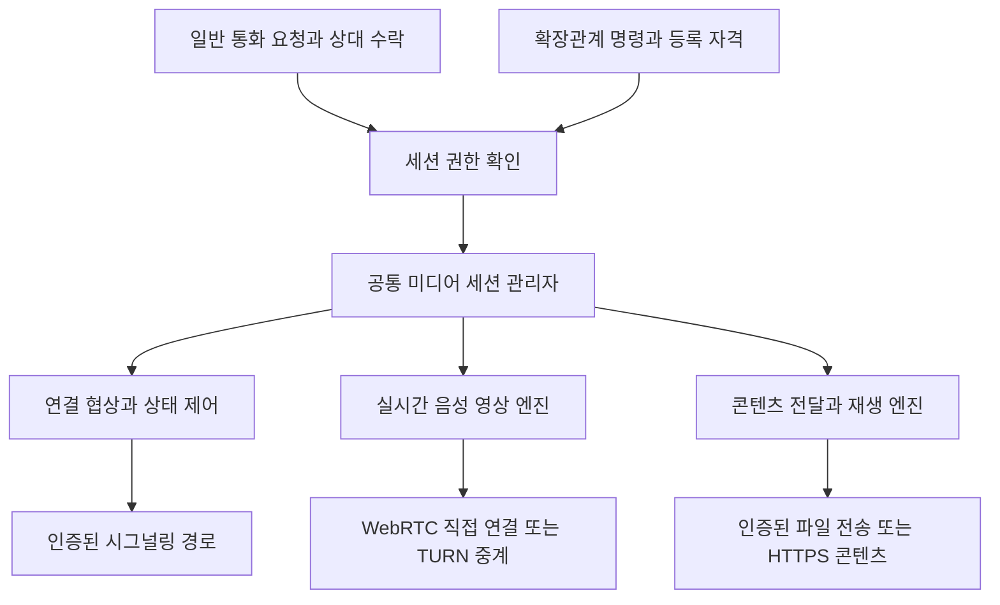

# IndieBiz OS 미디어 통신과 확장관계 연동 설계

작성일: 2026-10-13

상태: 구현 1차 반영(2026-10-13, §14 참조). 세션 API·공통 수명·시그널링·확장관계 어댑터·브라우저 엔진·폰·헬퍼 엔진은 코드와 시험으로 닫혔고,
실기기·외부망·TURN 운영·장시간 인수(§12)는 **미달**이다. 그 전까지 이 기능을 '완료'로 보고하지 않는다.

IndieBiz OS의 미디어 통신을 확장관계와 독립된 기능으로 만듭니다. 서로 다른 사용자는 자신의 PC나 스마트폰에서 음성·영상 통화를 할 수 있습니다. 확장관계에서는 중앙 PC가 같은 기능을 실행하여 주변 하드웨어를 카메라·마이크·스피커·화면으로 사용합니다.

확장관계는 **명령할 권한**을, 미디어 통신은 **영상·음성·콘텐츠를 주고받는 능력**을 담당합니다. 통화에 참여하는 것만으로 확장관계가 생기지 않으며, 확장관계에 등록했다고 미디어가 상시 전송되지도 않습니다.

이번 개발의 완료 단위는 **일상적으로 쓸 수 있는 미디어 통신 기능 전체**입니다. 구현은 내부적으로 단계별 검증을 거치지만, LAN 시연이나 첫 영상 수신을 제품 완료로 간주하지 않습니다. 통화·확장 장치 활용·외부망 연결·자동 복구·콘텐츠 전달·사용자 화면과 운영 준비를 함께 완성합니다.

## 1. 확정 요구사항과 설계 범위

### 사용자 결정

- 중앙 PC가 주변 하드웨어에 명령하는 관계의 이름은 **확장관계**입니다. 기존 코드의 `limb` 식별자는 호환성을 위해 유지합니다.
- PC는 헬퍼 설치를 통해서만 확장관계를 맺습니다. IndieBiz OS 설치만으로 다른 PC의 명령 대상이 되지 않습니다.
- 안드로이드폰은 중앙 PC에 물리적으로 연결하여 IndieBiz OS를 설치하는 과정에서 확장관계를 각인합니다. 일반 통화 화면이나 네트워크 초대로 이 관계를 만들 수 없습니다.
- 미디어 통신은 확장관계와 독립적으로 제공하며, 확장관계가 없는 사용자끼리도 음성·영상 통화를 할 수 있어야 합니다.
- 확장관계의 중앙 PC는 동일한 미디어 기능을 명령으로 실행하여 폰을 원격 카메라나 스피커로 사용할 수 있어야 합니다.
- 음악·영상은 양쪽 장치 사이에서 효율적으로 전달할 수 있어야 합니다.
- 사용자가 미완성 기능을 사용하면서 계속 보완을 요청할 필요가 없도록, 쾌적한 사용에 필요한 품질·연결·복구·조작 기능은 이번 개발의 완료 범위에 포함합니다.

### 이번 설계의 범위

이번 완료 범위는 1:1 음성·영상 통화, 확장관계의 카메라·마이크·스피커 연결, 파일·주소·재생 위치 전달, 지원 장치의 실시간 재생음 전송입니다. 직접 연결과 TURN 중계의 자동 선택, 망 변경 후 복구, 혼잡에 따른 품질 조절, A/V 동기, 에코 처리, 음소거·장치 선택·카메라 전환, 수신 알림·종료·오류 안내도 함께 포함합니다. IndieBiz OS 설치 PC·폰과 헬퍼 설치 PC를 대상으로 하며, 장치별 검증 범위는 12절에서 고정합니다.

다자 통화, 상시 녹화·검색 시스템, OS 전역의 가상 웹캠·가상 오디오 장치, 여러 스피커의 정밀 동시 재생, 중앙이 주변 장치 A와 B의 전송을 대신 지휘하는 기능은 별도 범위입니다. 이들은 현재 요청의 사용감을 완성하는 데 필수적이지 않아 제외하지만, 외부망 연결·재연결·미디어 품질·설치와 운영 준비는 후속 기능으로 넘기지 않습니다.

카메라 영상을 IndieBiz OS에서 보는 기능과 다른 화상회의 앱의 웹캠 입력으로 사용하는 기능은 다릅니다. 후자는 별도의 가상 장치 드라이버·플랫폼 연동이 필요합니다.

등록·명령 기반의 배경 자료는 작업 트리의 `docs/INDIEBIZ_BODY_AS_LIMB_DESIGN_2026_10_13.md`입니다. 작성 시점 미추적 문서이므로 이 설계의 필수 참조로 삼지 않습니다. 구현에 필요한 PC=헬퍼 설치, 폰=중앙 PC에 물리적으로 연결한 설치 각인, 일반 통화와 명령권 분리 계약은 위에 독립적으로 보존합니다. 배경 문서의 설치본 일반 등록·허브 입력 화면에 관한 초기 제안보다 위 사용자 결정이 우선합니다.

## 2. 현재 기반과 추가할 기능

아래 현황은 작성 시점 정본 작업 트리에서 확인한 내용입니다. 폰 확장관계 관련 미커밋 작업이 포함되어 있으므로 출시 완료를 뜻하지 않습니다.

| 영역 | 확인한 기반 | 추가할 내용 |
| --- | --- | --- |
| 확장관계 자격 | `backend/base/limb_keys.py`의 등록·실행 자격·폐기 | 미디어 세션에 한정한 권한 발급과 폐기 연동 |
| PC 명령 | `backend/services/resident_pcs.py`, Go 헬퍼의 명령·접수증 | 미디어 세션 실행 어댑터 |
| 폰 명령 | `backend/services/limb_client.py`의 폰 전용 아웃바운드 연결 | 네이티브 미디어 서비스와의 로컬 연결 |
| 폰 각인 | `phone-companion/scripts/provision_phone_limb.py`의 연결 장치에 실행 자격 주입 | 기존 각인을 이용한 미디어 인증 |
| 파일 전송 | 상주 장치 전송의 조각·재개·지문 검증 | 콘텐츠 재생용 참조·캐시·접근 범위 |
| 원격 PC 화면 | `resident_screen.py`의 임시 세션·프레임 전달·20초 임대 | 임대·종료 공통 부분을 추출하여 기존 화면과 미디어 양쪽에 적용. JPEG·입력 처리는 기존 화면 경로에 유지 |
| 재생 | PC 헬퍼의 플레이어 실행, 폰 `PhoneActions.kt`의 스트림 재생 | 세션 수명·일시정지·위치·오디오 포커스의 공통 계약 |
| 사용자 통신 | IndieNet/Nostr 신원·메시지 경로 | 통화 요청·수락·실시간 연결 협상 |

현재 살펴본 경로에서 공통 WebRTC 미디어 엔진은 확인되지 않았습니다. 기존 이미지 프레임 전송이나 녹음 파일 회수를 실시간 영상·음성 통신이 이미 구현된 것으로 간주하지 않습니다.

폰 확장관계의 미커밋 코드·설치 스크립트는 미디어 구현 전에 계약과 회귀를 확인하여 정본 커밋으로 확정해야 하는 선행 의존성입니다. 문서 커밋에 다른 작업의 변경을 묶어 검증 완료로 취급하지 않습니다. 구현 인계에는 실제 기반 커밋과 배포 패키지 버전을 기록합니다.

## 3. 전체 구조

미디어 서비스는 확장관계 모듈 없이도 구동할 수 있어야 합니다. 일반 통화와 확장관계 어댑터는 서로 다른 근거로 세션을 허가하지만, 허가 이후에는 동일한 세션 관리자와 장치별 미디어 엔진을 사용합니다.

제어 메시지와 미디어 바이트는 분리합니다. 통화 요청·수락·음소거·종료·재생 위치는 작은 제어 메시지입니다. 영상 프레임·음성 샘플을 IBL 결과, 작업 큐, Nostr 메시지 또는 AI 대화에 넣지 않습니다. AI는 연결 의도를 표현하고 결과 상태만 받습니다.

이 구조는 [IBL 진화 목적](IBL_EVOLUTION_PURPOSE.md)에 따라 서로 다른 작업이 같은 연결·수명·실패 처리 능력을 재사용하도록 합니다. 토큰·시간 절감은 구현 후 비교하며, 설계만으로 성능 향상을 주장하지 않습니다.

## 4. 공통 미디어 세션

### 세션이 표현하는 것

세션에는 참여 장치, 허가 근거, 입력·출력, 전송 방식, 수명이 들어갑니다. 사람의 신원과 장치의 신원은 구분합니다. 한 사용자가 여러 장치에 로그인했더라도 수락한 장치만 참여합니다.

| 항목 | 의미 |
| --- | --- |
| `session_id`, `protocol_version` | 임의 세션 식별자와 계약 버전 |
| `authorization_basis` | `accepted_call` 또는 `extension_grant` |
| `participants` | 사용자 신원과 해당 장치 신원, 참여 역할 |
| `tracks` | 송신자·수신자·카메라/마이크/재생음/화면·방향 |
| `delivery` | `realtime` 또는 `content` |
| `consent_scope` | 허용된 입력·출력과 녹화 여부 |
| `relation_generation` | 확장관계로 연 세션의 등록 세대 |
| `expires_at`, `lease` | 입장 자격 만료와 활성 세션의 갱신 조건 |
| `state`, `revision` | 현재 상태와 낡은 제어 메시지를 거절할 판본 |

위 이름은 구현용 계약 제안이며 현재 사용 가능한 API가 아닙니다. `session_id` 자체는 인증 자격이 아닙니다.

### 용도별 구성

| 용도 | 입력과 출력 | 허가 |
| --- | --- | --- |
| 음성 통화 | 양쪽 마이크 → 상대 스피커 | 요청과 수락 |
| 영상 통화 | 양쪽 카메라·마이크 → 상대 화면·스피커 | 요청과 수락 |
| 원격 CCTV 보기 | 폰 카메라 → 중앙 화면, 마이크는 선택 | 확장관계와 폰의 실행 가능한 카메라 모드 |
| 원격 마이크 | 폰 마이크 → 중앙 스피커 또는 명시한 소비자 | 확장관계와 마이크 권한 |
| 원격 스피커 | 중앙 재생음 → 폰 스피커 | 확장관계와 수신·재생 능력 |
| 재생 옮기기 | 콘텐츠 참조·위치 → 대상 플레이어 | 확장관계 또는 상대의 콘텐츠 수락 |

처음에는 영상·음성 각 1개 송신 트랙을 기본으로 제한합니다. 장치가 지원하지 않는 트랙은 명시적으로 거절하며 다른 센서로 대체하지 않습니다. 음소거된 마이크를 카메라 연결의 부수효과로 켜지 않습니다.

### 수명과 복구

일반 통화는 `inviting → ringing → accepted → connecting → active → ended`로 진행합니다. 거절·만료·오류는 사유와 함께 종료합니다. 확장관계는 `authorized → connecting`으로 진입할 수 있지만, OS 권한이 필요한 경우 `needs_local_action` 상태로 멈춥니다.

연결 단절은 `reconnecting`으로 전환하고 허가가 유효한 동안 ICE 재협상·직접 경로에서 TURN으로의 전환을 자동 수행합니다. 짧은 망 변경에 사용자가 통화를 다시 걸거나 주소를 입력하게 하지 않습니다. 복구 시간 상한 또는 임대가 먼저 만료되면 사유와 재시도 동작을 표시하고 종료합니다. 종료된 세션은 재사용하지 않습니다. 재시작 뒤에는 기존 허가의 유효성과 OS 실행 조건을 재확인하며, 로컬 종료·센서 끄기를 복구 명목으로 뒤집지 않습니다.

임대·멱등 종료의 공통 처리는 기존 `resident_screen.py`에서 분리하여 화면 공유와 미디어 양쪽이 사용합니다. 이 모듈 전체는 `resident_pcs`·원격 작업 취소·JPEG·키 입력에 결합되어 있으므로 공통 관리자로 그대로 가져오지 않습니다. 공통 수명 로직의 정본은 하나이며, 이전 화면 경로의 중복 로직도 이번 작업에서 교체하고 회귀를 확인합니다.

초기 실증은 기존 20초 임대를 기준으로, 5초 생존 확인 주기를 가진 명시적 미디어 프로필을 사용합니다. 갱신 간격·만료 시간은 공통 정책 데이터 한곳에 두고 실측으로 확정합니다. 화면과 통화가 다른 프로필을 가질 수 있지만 모듈마다 별도 상수를 만들지 않습니다. 제어권을 상실하면 양쪽이 단조 시계로 임대 만료를 계산해 독립적으로 종료합니다. 확장관계는 중앙의 유효 권한 확인으로, 일반 통화는 인증된 참가자의 생존 확인으로 갱신하며 미디어 패킷 도착만으로 임대를 연장하지 않습니다. 늦게 재전달된 과거 확인이 임대를 되살리지 않도록 갱신 세대·순번과 현재 연결의 확인 응답을 검증합니다.

`request_id`로 시작 요청을 멱등 처리합니다. 동일 요청의 내용이 다르면 충돌이며, 종료 요청의 중복은 성공으로 처리합니다. 미디어 연결 완료는 작업 큐의 접수 성공이 아니라 수신 측 첫 디코딩·출력 확인으로 판단합니다.

## 5. 일반 사용자 간 통화

1. 발신자가 연락처에서 상대와 음성·영상 종류를 선택합니다.
2. 상대의 기존 통신 신원으로 서명된 통화 초대를 보냅니다. 상대 주소나 표시 이름만으로 신원을 신뢰하지 않습니다.
3. 수신 장치는 발신자, 요청된 카메라·마이크, 수락·거절을 표시합니다. 수락 전에는 센서 캡처를 시작하지 않습니다.
4. 수락한 장치가 세션 참가 자격을 받고 SDP·ICE 정보를 교환합니다.
5. 연결이 성립하면 통화를 시작합니다. 어느 쪽에서든 종료·음소거·카메라 끄기가 가능합니다.

초대 전달과 신원 확인은 기존 IndieNet/Nostr 어댑터를 재사용합니다. 초대에는 만료·일회성 nonce·세션 식별자·참가 장치·협상 버전을 포함합니다. SDP·ICE 전달은 8절의 품질 기준에 따라 Nostr 또는 전용 WSS 어댑터를 선택하며, 선택한 경로를 이번 구현에서 운영 가능한 상태까지 완성합니다. Nostr에 실으면 암호화된 통화 제어 메시지로 구분하여 일반 채팅 이력·AI 자동응답·자연어 실행으로 보내지 않습니다.

통화 수신은 화면이 열린 상태와 폰이 잠겼거나 앱이 백그라운드인 상태를 이번 완료 범위로 검증합니다. 필요한 수신 서비스·OS 알림·푸시 연동은 같은 작업에 포함하며, 배터리를 과도하게 소모하는 상시 연결로 품질 문제를 옮기지 않습니다. 정상적인 프로세스 회수 후에도 수신 가능한 OS 지원 경로를 마련하고, 사용자의 강제 중지·알림 차단·기기 전원 꺼짐 등 수신 불가능한 상태는 정직하게 표시합니다. 메시지가 릴레이에 도착한 것을 실제 벨 울림으로 표시하지 않습니다. 수신 불가 상태를 뒤늦은 카메라 자동 시작으로 복구하지 않습니다.

여러 장치에 초대가 도착하면 첫 수락을 원자적으로 확정하고 나머지 장치의 초대를 닫습니다. 부재중·거절·차단은 서로 다른 결과로 남깁니다. 상대를 차단하면 새 초대와 현재 세션의 정책을 함께 적용합니다.

## 6. 확장관계에서 사용하는 방식

중앙 PC는 기존 인증된 명령 경로로 대상에 미디어 세션 시작을 지시합니다. 대상은 각인된 중앙의 신원·등록 세대·세션 대상·허용 트랙을 확인하고 같은 미디어 엔진을 실행합니다. 이 경로에는 일반 통화의 벨·상대 수락 화면이 필요하지 않습니다. 다만 OS 권한이나 장치의 로컬 중지 상태를 무시할 수는 없습니다.

폰의 카메라를 받는 기본 순서는 다음과 같습니다.

1. 중앙이 대상의 온라인 상태와 현재 카메라 능력·실행 가능 상태를 조회합니다.
2. 중앙이 세션을 만들고, 기존 확장관계 명령으로 그 세션에만 유효한 참가 자격을 보냅니다.
3. 폰이 권한과 카메라 서비스 상태를 확인하고 연결 협상에 참여합니다.
4. 영상은 폰에서 중앙으로 직접 전송하며, 필요할 때 TURN을 통과합니다.
5. 중앙의 종료, 폰의 로컬 중지, 관계의 중지·해제·폐기 또는 임대 만료 시 캡처와 전송을 종료합니다.

이번 범위의 확장관계 명령은 중앙과 해당 대상의 1:1 미디어 연결을 제어합니다. 주변 장치 A와 B가 일반 통화의 수락 절차로 직접 연결하는 것은 이번 범위에 포함합니다. 중앙이 두 주변 장치 사이의 연결까지 대신 지휘하는 기능은 별도 범위이며, 확장관계의 추이적 명령권을 부여하지 않습니다.

통화·미디어 API에는 확장관계 등록 기능을 넣지 않습니다. PC 헬퍼의 설치 관문과 폰의 물리적 연결·설치 관문을 유지합니다. USB 각인은 소프트웨어 자격의 초기 전달 절차이며, 하드웨어 보안칩에 의한 복제 불가능성까지 보장한다는 뜻은 아닙니다. 자격 복제 방지가 필요하면 기기 키 저장소와 설치 신원 검증을 별도 강화합니다.

## 7. 실시간 전송과 콘텐츠 전달

### 실시간 음성 영상

WebRTC를 공통 전송으로 사용합니다. SDP로 트랙·코덱을 협상하고 ICE로 경로를 선택합니다. LAN에서 가능한 직접 경로를 우선 활용하고 외부망에서는 STUN을 통한 직접 연결을 시도하며, 직접 연결이 불가능하면 TURN을 사용합니다. WebRTC의 연결 협상은 애플리케이션이 별도로 제공해야 합니다. [WebRTC 공식 연결 가이드](https://webrtc.org/getting-started/peer-connections)

첫 코덱 후보는 음성 Opus, 영상 H.264 또는 VP8입니다. 최종 선택은 양쪽의 실제 지원·하드웨어 가속 여부에 따라 협상합니다. 구형 폰은 낮은 해상도·프레임률부터 시작하고 발열·손실·혼잡에 따라 품질을 낮춥니다. 음성 통화에는 에코 제거를, 음악 전송에는 불필요한 음성 처리 억제를 적용하되 플랫폼 지원 여부를 확인합니다.

실시간 경로는 오래된 프레임을 무한히 쌓지 않습니다. 전송이 밀리면 비트레이트·해상도·프레임률을 낮추거나 오래된 프레임을 버립니다. 파일 전달은 재개·무결성이 우선이고, 실시간 전송은 지연과 연속성이 우선입니다.

### 콘텐츠 전달과 재생 이동

대상이 접근 가능한 콘텐츠는 파일 또는 주소와 재생 위치를 전달하여 대상에서 디코딩합니다. 미디어 세션이 소유하는 콘텐츠 참조를 발급하고 파일 전체 경로나 영구 자격을 상대에게 노출하지 않습니다. HTTP 기반이면 Range 요청과 중단 후 재개를 지원하고, 검증한 파일은 콘텐츠 지문으로 캐시합니다.

확장 장치에 파일을 미리 보내는 경우 기존 전송 기능을 재사용합니다. 일반 사용자 간 전송에는 상대가 수락한 콘텐츠에 한정한 전송 어댑터를 둡니다. 이것이 확장관계 파일 읽기·쓰기 권한으로 확대되어서는 안 됩니다.

콘텐츠 주소는 대상이 실제 접근할 수 있어야 합니다. 발신자 브라우저의 로그인 쿠키를 넘기거나 제3자 서비스 인증을 공유하지 않습니다. 허용된 콘텐츠를 제공할 수 없으면 `content_unavailable`로 반환하고 지원되는 실시간 공유를 별도 선택합니다.

재생 이동은 대상이 준비·재생을 확인한 뒤 원본을 멈춥니다. 준비 실패 시 원본을 유지합니다. 양쪽 재생은 명시적인 별도 선택이며, 여러 장치의 정밀 동기 재생을 기본 보장하지 않습니다. 이미 상대에게 내려받게 한 파일은 세션 종료만으로 회수할 수 없으므로 파일 공유와 일시 스트리밍을 화면에서 구분합니다.

## 8. 네트워크와 인증

### 시그널링과 중계

시그널링은 전송 방식과 무관한 세션 계약을 먼저 정의합니다. 확장관계 LAN 실증에는 기존 인증 명령·응답 경로를 이용하되 SDP·ICE·협상 판본·만료 처리를 명시적으로 추가합니다. 기존 봉투가 있다는 사실만으로 시그널링 구현이 완료된 것은 아닙니다.

일반 통화에서는 Nostr 암호화 전달과 인증된 전용 WSS 경로를 초기 구현 과정에서 평가합니다. 운영 부담을 줄이기 위해 기존 경로를 검토하되, 12절의 연결 성공률·첫 출력·복구 기준을 만족하는 것을 선택 조건으로 삼습니다. Nostr가 충족하면 재사용하고, 충족하지 못하거나 수신·복구 계약을 감당하지 못하면 전용 WSS를 이번 작업에 포함합니다. 느린 경로를 우선 제공한 뒤 사용자가 불편을 겪으면 교체하는 방식으로 출시하지 않습니다. 선택은 일반 통화 통합 이전에 확정하고, 대안 전체를 영구적으로 이중 유지할 필요는 없습니다.

Nostr 어댑터는 세션 ID·메시지 ID·협상 세대·순번·만료·중복 제거·수신 확인과 제한된 재전송을 처리합니다. ICE 후보의 선도착은 해당 협상 세대에 한정하여 버퍼링하며 종료된 세션의 늦은 초대·후보는 버립니다. NIP-17 바깥 봉투의 무작위화된 시각을 협상 순서로 사용하지 않습니다. 발신자 신원은 실제 서명 검증 결과로 확인합니다. [NIP-17 명세](https://github.com/nostr-protocol/nips/blob/master/17.md)

활성 연결의 저지연 상태 제어에는 인증된 WebRTC DataChannel을 사용할 수 있습니다. 그 채널은 세션 범위의 상태·종료·생존 확인만 담당하고, 확장관계 등록·범용 명령의 새 통로가 되지 않습니다. 연결 복구와 폐기 전달을 위한 외부 제어 경로를 함께 유지합니다.

릴레이·TURN 주소, 운영 주체, 배포 위치, 인증서·자격 갱신, 용량·사용량 제한은 설정 데이터와 운영 절차로 확정합니다. 이 세계의 명사를 엔진 코드에 고정하지 않습니다. 전용 WSS가 필요하면 양쪽 아웃바운드 접속, 인증, 재접속, 상태 확인, 설치·업데이트·장애 진단까지 제공합니다. 운영 주체나 연결할 주소가 미정인 상태는 완료가 아닙니다. 사용자는 초기 설정 후 통화마다 서버 주소·포트·경로를 직접 선택하지 않습니다.

시그널링은 초대·수락·SDP·ICE·종료만 처리하며 기본적으로 미디어를 중계하지 않습니다. 기존 HTTP 터널이 정상이라고 UDP 미디어가 통과하는 것은 아닙니다. 미디어 중계는 별도의 TURN 기능과 외부에서 접근 가능한 포트가 필요합니다. UDP가 막힌 환경을 위해 TURN/TCP·TLS 경로도 구성·시험합니다.

TURN은 이번 완료 범위의 필수 연결 기반입니다. 직접 연결 실패 뒤 사용자가 수동으로 켜는 부가 기능으로 두지 않습니다. 배포·자격 발급·자동 경로 선택·외부망 종단 시험을 함께 끝냅니다. Nostr 사용 여부는 TURN 필요성을 없애지 않습니다.

TURN은 통신 도달성을 보완하며, 상대를 초대하거나 확장관계를 만드는 권한은 없습니다. 단기 자격·사용량 한도·대역폭 관측을 적용합니다. 대략 2 Mbps 영상 한 방향은 미디어 페이로드만 시간당 약 0.9 GB입니다. 중계 서버에서는 수신과 송신이 모두 발생하며 프로토콜 오버헤드와 과금 방식이 별도로 더해집니다.

### 세션 인증

시그널링에는 TLS를, WebRTC 미디어에는 DTLS-SRTP를 사용합니다. SDP의 DTLS 인증서 지문을 인증된 참가자와 세션에 묶어야 하며, 암호화된 전송이라는 이유만으로 상대 신원을 생략하지 않습니다. [WebRTC 보안 구조 RFC 8827](https://www.rfc-editor.org/info/rfc8827/)

일반 통화에서는 기존 사용자 신원이 장치의 임시 세션 키를 승인하고, 그 키가 세션·수신자·만료·SDP 지문을 인증하는 구조를 사용합니다. 계정의 장기 개인키를 렌더러에 넘기지 않습니다. 확장관계에서는 기존 인증 경로가 양쪽의 세션 지문과 참가 자격을 전달합니다. 시그널링 릴레이가 메시지를 바꾸어도 인증 검증에 실패하도록 합니다.

입장 자격은 세션·참가 장치·역할·허용 트랙·유효기간에 묶습니다. 재접속은 새 자격을 발급하고 중복 nonce와 낡은 판본을 거절합니다. 확장관계 실행 키와 일반 통화 자격은 상호 대체할 수 없습니다. 브라우저의 페이지 원점·소유자 로그인·CSRF/웹소켓 접속 검증도 기존 표면 인증과 연결합니다.

영상·음성 원본은 기본 저장하지 않습니다. 진단에는 시작·종료 시각, 참가 장치, 허가 근거, 경로, 품질 지표, 오류만 남깁니다. 인증 토큰과 SDP·ICE 원문은 상시 로그에 남기지 않습니다. 녹화는 별도 기능·표시·허가로 설계하고 첫 구현에서는 제외합니다.

## 9. 장치별 구현과 제한

### PC의 IndieBiz OS

Electron의 Chromium WebRTC를 우선 사용하여 카메라·마이크·영상 표시를 구현합니다. 장기 통화의 엔진 소유 창을 채팅 패널과 분리하고, 통화 중 패널을 닫아도 정책에 따라 유지하거나 명시적으로 종료하도록 합니다. 앱 종료 뒤 계속 살아 있는 통화를 기본으로 만들지 않습니다.

화면·시스템 오디오 캡처는 OS 권한과 Electron 버전별 지원을 확인해 별도 능력으로 신고합니다. 카메라 통화가 된다는 이유로 시스템 소리 캡처까지 가능하다고 광고하지 않습니다.

### PC의 헬퍼

헬퍼만 설치된 PC에는 Chromium 엔진이 없을 수 있습니다. 헬퍼는 기존 등록·명령의 소유자로 남고, 필요하면 설치 패키지로 제공한 네이티브 미디어 실행 모듈을 구동합니다. 미디어 모듈에는 세션 한정 자격만 전달합니다.

WebRTC 전송 라이브러리만 추가해도 카메라 캡처·코덱·스피커 출력이 자동으로 생기는 것은 아닙니다. 모듈 선정은 OS별 캡처·재생 지원, 배포 크기, 업데이트·서명, 코덱 호환성을 함께 검증합니다. 헬퍼 전용 PC의 실시간 미디어도 이번 완료 범위에 포함합니다. 별도 내부 단계에서 구현하더라도 사용자가 네이티브 의존성을 수동으로 조립하지 않도록 설치·업데이트 경로까지 연결합니다. 기존 파일 재생 기능의 회귀도 함께 확인합니다.

### 안드로이드폰

Kotlin 네이티브 계층에 WebRTC 캡처·수신 엔진을 둡니다. Python 백엔드는 세션 제어만 맡고 영상 프레임을 Python·JSON 다리로 복사하지 않습니다. 일반 콘텐츠 재생에는 Media3의 플레이어·미디어 세션 서비스를 우선 검토합니다. 서비스 수명을 화면과 분리하면 잠금 상태의 재생을 관리할 수 있습니다. [Android 백그라운드 재생](https://developer.android.com/media/media3/session/background-playback)

기존 `AgentForegroundService`의 `specialUse` 선언만으로 카메라·마이크·미디어 재생의 실행 요건이 충족된다고 가정하지 않습니다. 목적에 맞는 foreground service 유형·권한·알림·시작 조건을 구현해야 합니다. 최신 Android의 카메라·마이크 while-in-use 제한 때문에 백그라운드 또는 부팅 시 원격 명령만으로 서비스를 시작할 수 없는 경우가 있습니다. [Android foreground service 유형](https://developer.android.com/develop/background-work/services/fgs/service-types)

CCTV는 폰에서 사용자가 시작한 카메라 모드를 유지하는 방식으로 구성합니다. 카메라 서비스가 종료된 뒤에는 필요한 로컬 행동을 중앙에 표시합니다. 단순한 '준비됨' 설정 저장만으로 나중에 백그라운드에서 카메라를 열 수 있다고 가정하지 않습니다. 화면 꺼짐·Doze·제조사 절전·통화 중 자원 충돌·재부팅은 실기기로 확인합니다.

화면 공유에는 MediaProjection의 세션별 사용자 동의가 필요합니다. 다른 앱의 재생음 캡처는 Android 10 이상에서 제공되며 대상 앱의 허용 정책 등에 제한됩니다. 자체 플레이어의 콘텐츠 전달과 시스템 전체 소리 캡처를 구분합니다. [MediaProjection](https://developer.android.com/media/grow/media-projection), [재생음 캡처](https://developer.android.com/media/platform/av-capture)

기존 작업의 구형 폰 대상은 Android 9·32비트 ABI이며, 현대적 64비트 폰과 구분해서 검증합니다. WebRTC 네이티브 라이브러리의 `armeabi-v7a` 제공·최소 OS·실제 코덱 동작을 구현 시작 단계에 확인합니다. Android 9에서 다른 앱 소리를 캡처하는 기능은 위 API로 제공할 수 없습니다. 장기 영상 운용은 발열·배터리·메모리를 측정해 지원 프로필을 정합니다.

Android 라이브러리 조달은 첫 번째 기술 관문입니다. 제3자 배포 AAR와 소스 직접 빌드를 후보로 두고, 버전·출처·라이선스·업데이트 경로·ABI·최소 OS·네이티브 의존성을 확인합니다. Maven 의존성 해석 성공만으로 통과하지 않습니다. J7 실기기에서 설치·라이브러리 로딩·카메라 인코딩·PC 수신·음성 왕복을 확인하고, 현대 64비트 폰에서도 같은 계약을 검증합니다. 실패하면 대체 빌드·코덱·가속 경로를 이번 작업에서 해결하며, J7 지원을 조용히 후속으로 넘기지 않습니다. 지원 불가능성이 확인되면 근거와 대안을 제시하고 사용자와 범위를 다시 결정하기 전까지 해당 완료 기준은 미달로 남깁니다.

## 10. 모듈과 호출 계약

다음은 책임 배치 제안입니다. 책임 구분이 곧 새 파일 생성 지시는 아닙니다. 기존 구현의 결합을 확인하여 공통 부분을 추출하고, 실제로 함께 쓰는 소비자까지 이번 작업에서 전환합니다.

| 소유 위치 | 책임 |
| --- | --- |
| 서비스 층의 공통 세션 수명 모듈 | `resident_screen.py`에서 추출한 임대·멱등 종료. 기존 화면과 미디어가 함께 사용 |
| `backend/services/media_sessions.py` | 공통 수명 위의 통화 상태·참가자·트랙·자격 범위·자원 점유 |
| `backend/services/media_signaling.py` | 참가자 인증·SDP/ICE 전달·연결 복구 |
| `backend/services/resident_pcs.py`의 미디어 어댑터 | 기존 확장관계 자격을 세션 허가로 변환·폐기 연동. 복잡도·줄 수가 요구할 때만 형제 모듈로 분리 |
| `backend/datastore/`의 미디어 기록 모듈 | 최소 이력과 설정. 활성 연결·토큰은 영속 복원 대상에서 제외 |
| `backend/surface/api_media.py` | 로그인한 사용자와 인증된 세션 참가자의 API 경계 |
| `frontend/` 통화 표면·Electron 미디어 실행부 | 통화 요청·수락·장치 선택·캡처·렌더링 |
| `phone-companion/` 네이티브 미디어 서비스 | 폰의 WebRTC·재생·OS 수명·알림 |
| `helper/` 미디어 어댑터 | 헬퍼 설치 PC의 세션 실행과 모듈 수명 |

새 backend 모듈은 저장소 층 배정과 폰 번들 파생 규약을 따릅니다. 모듈당 1500줄 제한을 유지합니다. 일반 통화 모듈은 확장관계 원장에 의존하지 않고, 확장관계 어댑터가 공통 세션 인터페이스를 호출합니다.

공통 서비스 연산은 `capabilities`, `create`, `accept`, `reject`, `signal`, `update`, `status`, `end`로 구성합니다. `create`에는 대상·허가 근거·트랙·전송 방식·요청 ID를, `update`에는 세션 ID·기대 판본·변경할 재생 상태를 전달합니다. 호출자가 보낸 `authorization_basis` 문자열을 그대로 신뢰하지 않고 서비스가 수락 사건 또는 확장관계 자격으로 검증합니다.

반환은 세션 ID·상태·실제 트랙·실패 사유를 포함합니다. IBL에 연결할 때에는 기존 `{items:[...]}` 계약을 따릅니다. `permission_required`, `needs_local_action`, `device_offline`, `device_busy`, `unsupported_track`, `relation_revoked`, `connectivity_failed`, `content_unavailable` 등의 실패를 구분합니다.

IBL 문법·파서·표준 코어는 변경하지 않습니다. 첫 단계는 서비스 API와 통화 UI를 구현하고, 기존 `self:script`로 조합 가능하게 합니다. 반복 사용 후 기존 통신·장치 패키지의 액션과 op 수용 가능성을 검토합니다. 새 `call`·`stream` 어휘가 이미 존재하는 것처럼 예제를 배포하지 않습니다. 어휘를 추가할 경우 카탈로그·핸들러·가이드·회귀와 파생 빌드를 함께 갱신합니다.

새 어휘 도입을 보류하는 것과 AI를 통한 사용을 보류하는 것은 다릅니다. 이번 완료 범위에는 기존 어휘·등록 스크립트로 통화 요청, 확장 장치 미디어 시작·상태·종료를 실행하는 경로와 사용자 UI를 함께 포함합니다. 내부 API나 수동 시험 스크립트만 제공한 상태는 완료로 보지 않습니다.

## 11. 사용자 화면

일반 사용자에게는 연락처의 '음성 통화'와 '영상 통화', 수신 시 상대와 수락·거절을 제공합니다. 통화 중에는 마이크·카메라·출력 장치·종료를 표시합니다. 재연결 중에는 멈춘 영상을 현재 영상처럼 보이지 않게 상태를 표시합니다.

확장 장치 화면에는 실제 능력에 따라 '카메라 보기', '소리 듣기', '이 장치에서 재생'을 제공합니다. 권한이 필요하면 '폰에서 CCTV 모드를 시작해 주세요'처럼 필요한 행동을 구체적으로 표시합니다. 통화 초대와 확장관계 등록을 같은 버튼으로 합치지 않습니다.

세션 상세에는 직접 연결·중계 여부, 수신 상태, 품질을 확인할 수 있게 합니다. 기본 화면에는 ICE·SDP·인증 토큰 같은 구현 세부를 노출하지 않습니다. 로컬 사용자가 센서를 끄거나 세션을 종료하는 조작은 원격 명령보다 우선합니다.

## 12. 내부 구현 순서와 전체 완료 기준

아래 단계는 위험과 의존성을 빨리 확인하기 위한 내부 순서입니다. 어느 한 단계의 통과도 전체 기능의 출시·완료를 뜻하지 않습니다. 0~6단계와 아래 인수 기준을 모두 충족한 뒤 완료로 보고합니다. 시연을 위해 먼저 보여줄 수는 있으나 미완료 항목과 구분합니다.

| 단계 | 산출물 | 내부 통과 조건 |
| --- | --- | --- |
| 0 | 기반 확정·Android 조달·장치 프로필 | 폰 확장관계 기반의 정본 커밋 확인, J7·64비트 폰의 설치·캡처·음성 왕복, PC 실행 방식·지원 행렬 고정 |
| 1 | 공통 엔진과 확장관계 LAN 실증 | 기존 인증 경로에 협상 어댑터 연결, 공통 수명 추출과 기존 화면 회귀, 카메라·마이크·스피커 실제 출력 |
| 2 | 시그널링·수신·중계 경로 확정 | Nostr/WSS 품질 평가와 경로 선택, 운영 위치·설정·자격·TURN·폰 알림 및 복구 경로 준비 |
| 3 | 독립 1:1 통화와 외부망 통합 | 확장관계 없이 PC↔PC·PC↔폰·폰↔폰 요청·수락·종료, NAT·휴대망·UDP 차단·망 변경 자동 처리 |
| 4 | 콘텐츠와 헬퍼 통합 | 파일·주소·재생 위치·실시간 재생음 전달, 헬퍼 전용 PC의 미디어 모듈 설치·업데이트·세션 연동 |
| 5 | 사용자 UI와 AI 호출 완성 | 실제 장치 선택·수신·전환·음소거·재생·종료·오류·재시도, 기존 IBL/스크립트로 동일 기능 실행 |
| 6 | 전체 인수와 배포 | 장치·네트워크 행렬, 품질·장시간·권한·기존 기능 회귀 통과, 운영 절차·배포 패키지·정본 반영 |

단계 1의 빠른 실증을 위해 세션 관리자를 확장관계에 종속시키지 않습니다. 단계 3은 동일 엔진을 확장관계 코드 없이 검증합니다. 다자 통화가 필요해질 때만 SFU와 그 신뢰 모델을 별도 설계합니다.

### 전체 인수 조건

사용자는 초기 설치·각인·OS 권한 설정 후 연락처나 장치에서 동작을 선택하면 됩니다. 통화마다 개발자 도구, 수동 서버 기동, 주소 복사, 포트 선택, 스크립트 실행 또는 재시작을 요구하면 미완료입니다. OS가 새 동의를 요구하는 화면 공유·센서 시작은 해당 장치에서 안내하고 정상 흐름으로 처리합니다.

장치 행렬은 IndieBiz OS 설치 PC, 헬퍼 전용 PC, Android 9·32비트 J7, 현대 Android·64비트 폰을 포함합니다. PC의 OS·버전·캡처 방식은 단계 0에 실제 배포 대상과 맞춰 확정하고, 각 조합의 지원 트랙·품질 프로필·제약을 기록합니다. 실패한 장치를 결과에서 빼거나 요구된 핵심 기능을 미지원으로 바꾸어 통과율을 높이지 않습니다. 실제 OS 제한으로 불가능한 기능과 구현이 덜 된 기능을 구분합니다.

시그널링·TURN·알림 경로에는 설정 검증, 인증·자격 갱신, 장애 표시, 진단 방법과 운영 책임을 갖춥니다. 전용 서버가 필요하면 실제 배포 위치와 접속 검증까지 완료합니다. 단순히 '서버를 준비하면 동작'하는 상태는 완료가 아닙니다.

### 필수 검증

- 권한: 일반 통화 자격으로 명령·파일 시스템 접근·확장관계 등록이 불가능하고, 다른 장치·세션·등록 세대의 자격이 거절되는지 확인합니다.
- 수락: 미수락·거절·만료된 초대에서 센서가 시작되지 않으며, 여러 장치의 동시 수락이 하나로 확정되는지 확인합니다.
- 종료: 중앙·주변 장치 각각의 종료, 관계 pause/revoke/remove, 제어망 단절, 앱 종료 뒤 캡처·전송·자원 점유가 해제되는지 확인합니다.
- 연결: LAN·별도 공유기·휴대망·TURN 전용·UDP 차단·Wi-Fi에서 휴대망으로 변경을 확인합니다. 자동 경로 선택·복구·품질 저하 후 회복이 사용자 조작 없이 동작해야 합니다.
- 시그널링: 중복·역순·유실·지연 메시지, 과거 초대 재전달, ICE 선도착, 동시 협상과 서명 실패를 주입하여 잘못된 연결·재활성화가 없는지 확인합니다.
- 출력: 연결됨 표시뿐 아니라 실제 수신 프레임·음성 출력, 음소거, 카메라 전환, A/V 동기와 에코를 확인합니다.
- 콘텐츠: 재개·지문·권한 만료·재생 위치·대상 재생 실패·지원하지 않는 형식을 확인합니다.
- 폰: 구형 32비트와 현대 64비트에서 화면 꺼짐·백그라운드 수신·알림·정상 프로세스 회수·서비스 종료·절전·재부팅·자원 충돌을 확인합니다. 강제 중지·알림 차단·OS 권한 부족을 정상 수신으로 표시하지 않습니다.
- 장시간: 1시간 통화와 **상시 충전 조건의 8시간 CCTV 운용**에서 메모리·발열·드롭·충전 중 잔량 추이·네트워크 사용량·연결 유지를 기록합니다. 전원 공급 조건과 절전 설정을 명시하고, 배터리만 사용하는 경우는 별도로 측정합니다. 과거 배터리 잔량을 현재 상태로 대입하지 않습니다.
- 기존 기능: 원격 화면·입력·파일 전송·재생·등록·폐기 회귀를 확인하고, 공통화 후 이전 임대·종료 처리의 중복 경로가 남지 않았는지 확인합니다.

### 쾌적한 사용감의 품질 인수 기준

아래 수치는 설계상의 인수 목표이며 아직 측정된 성능이 아닙니다. 지원 장치와 검증 망 조건에서 목표 미달이면 원인을 수정하고 재검증합니다. 미달 수치를 지우거나 '추후 최적화'로 넘겨 완료 처리하지 않습니다. 물리적·OS 제한 때문에 기준 변경이 필요하면 근거와 사용자 영향을 제시하고 사용자와 합의합니다.

| 지표 | 인수 목표 |
| --- | --- |
| 수락 후 첫 음성·영상 | LAN p95 3초 이내, 인터넷 p95 5초 이내 |
| 연결 성공률 | 장치·경로별 독립 시도 100회 이상에서 99% 이상. 사용자 거절·의도적 권한 차단은 별도 사례로 구분 |
| 실시간 종단 지연 | LAN p95 음성 200 ms·영상 400 ms 이하, 검증 인터넷망 p95 음성 300 ms·영상 500 ms 이하 |
| A/V 동기 | 오디오와 영상의 종단 시차 절댓값 p95 100 ms 이하 |
| 수신 알림 | 수신 가능한 정상 상태에서 요청 후 실제 알림 표시 p95 3초 이내. 잠금·백그라운드도 별도 측정 |
| 망 변경 후 복구 | 유효 권한 유지와 새 망 사용 가능 시점부터 실제 출력 복구 p95 5초 이내 |
| 재생 제어 | 정상 연결에서 재생·일시정지·음소거·볼륨 조작 반영 p95 300 ms 이내 |
| 명시적 종료 | 정상 제어망에서 p95 2초 이내 자원 해제 |
| 제어망 상실 | 공통 정책의 임대 만료 시 로컬 종료, 실행 가능한 프로세스에서 정리 지연 p95 2초 이내. OS 중지 사례 별도 검증 |
| 재생 이동 | 대상 출력 확인 전 원본 재생을 중단하지 않음 |

표본은 장치·해상도·코덱·망·직접/중계 경로별로 분리하며, 연결 실패를 첫 출력 시간 집계에서 숨기지 않습니다. 지연·지터·손실·대역폭의 검증 조건을 단계 0~2에 고정합니다. 혼잡 시험에서는 가용 대역폭 저하 후 음성 우선·영상 품질 조절·회복을 검증하고, 정상망의 수치를 모든 인터넷 환경에 보장한다고 표현하지 않습니다.

주관 품질도 확인합니다. 양쪽 발화에서 대화를 방해하는 에코·하울링이 없고, 선택한 음악 모드가 음성용 잡음 억제로 음악을 훼손하지 않아야 합니다. 정상 조건에서 정지·검은 화면·반복 무음이 발생하면 연결 성공 통계와 별개로 결함입니다. 부하·메모리·발열 목표는 장치 프로필과 함께 고정하고 장시간 결과로 확인합니다.

통계에는 RTT·손실·지터·비트레이트·해상도·드롭·경로를 수집합니다. WebRTC의 RTT를 사용자 체감 편도 지연으로 간주하지 않습니다. 실제 영상·음성 지연은 시각 표식과 오디오 루프 등 종단 측정으로 확인합니다. 미디어 처리 중 AI 모델의 지속 호출은 필요하지 않습니다.

## 13. 이번 구현에서 닫아야 할 결정과 완료 보고

Android ABI별 WebRTC 조달·업데이트 방식, 헬퍼 미디어 모듈, 공통 세션 수명과 소비자 전환, 시그널링 선택, TURN·수신 알림 운영, OS별 캡처 범위는 이번 개발에서 결정하고 구현할 항목입니다. 구형 폰의 품질 프로필은 실제 사용 목적을 만족하는 범위에서 조정하고, 필수 기능을 제거하거나 지원 제외로 돌리는 것은 별도 범위 변경입니다.

완료 보고에는 배포 대상·버전, 기능별 종단 결과, 장치·네트워크별 품질 수치, 장시간 결과, 기존 기능 회귀, 실제 운영 설정과 정본 커밋을 포함합니다. 알려진 제한과 미달 항목은 명시하며, 필수 기준이 남아 있으면 전체 완료로 보고하지 않습니다. 별도 기능의 경계는 1절의 명시된 제외 범위만 따릅니다.

이 문서 업데이트는 설계 변경입니다. 실행 코드·어휘·각인 규칙은 변경하지 않았으며, 미디어 기능 구현이나 위 인수 기준 통과를 의미하지 않습니다.

## 14. 구현 보고 (2026-10-13 1차, 정직 기록)

와이어 계약은 `docs/MEDIA_SESSION_CONTRACT.md` 가 정본이다(이 설계의 §3·§4·§6 을 코드가 따르는 모양). 가이드 `data/guides/media_session.md`.

### 닫힌 것(코드 + 시험으로 확인)

| 영역 | 산출물 | 확인 방법 |
| --- | --- | --- |
| 공통 수명 | `backend/services/session_lease.py` + `data/session_lease_policy.yaml`. `resident_screen`·`resident_terminal` 의 중복 임대 논리를 교체 | test_resident_screen·test_resident_terminal 회귀 통과, 모듈 상수 0 |
| 세션 관리자 | `backend/services/media_sessions.py` — 허가 2종(`accepted_call`/`extension_grant`), grant HMAC, request_id 멱등, 판본, 초대/임대/복구 만료 sweep, 관계 중지·해제·폐기 훅 | test_media_sessions(11)·test_media_two_hubs(4): 확장 카메라 세션 전 수명, 폰 봉투, 재생 전달 Range·토큰, 통화 초대(+offer)/수락(+answer)/거절/차단/만료, 위조 발신자·서명 거절 |
| 시그널링 | `backend/services/media_signaling.py` — 프레임 HMAC·세대/순번 질서·선도착 candidate 버퍼·Nostr DM 전송(태그 `indiebiz-call`)·릴레이 방/클라이언트·TURN Allocate 탐침·정책 데이터(`data/media_policy.yaml`) | 같은 시험 + 릴레이 방 중계 시험 |
| 채팅 분리 | `channel_poller._handle_nostr_giftwrap` 이 통화 제어 프레임을 채팅·트리거·시스템 AI·자동응답 앞에서 갈라내고, `indienet_social.fetch_dms_nip17` 받은편지함에서도 제외 | 코드 경로 + `is_call_frame_*` 시험 |
| API | `backend/surface/api_media.py` — REST 8종, WS 3종(브라우저·장치·릴레이), 콘텐츠 Range, `/media/health` 진단 | 공개 라우트 관문·층 관문 통과 |
| 확장관계 어댑터 | `resident_pcs.submit(allow_media)` 로만 `media_session`(헬퍼)·`media`(폰) 봉투 — 에이전트 명령으로 불가. pause/remove → 세션 종료 | 시험 |
| 폰 | `phone-companion/app/.../media/` Kotlin 엔진(webrtc-sdk 144.7559.15, armeabi-v7a·arm64 포함, BSD-3), FGS 유형(camera·microphone·mediaPlayback), CCTV 대기 모드 화면, `limb_client` op:media(다리 있을 때만 신고) | arm32·arm64 APK 컴파일 통과, test_limb_client(11) |
| 헬퍼 | `helper/media_session_*.go` + `resident_media_session.go` — pion v4.2.23 answerer, ffmpeg 캡처(RTP→pion)·ffplay 수신·mpv IPC 재생, 레거시(Go 1.22) 빌드는 `-tags legacy` 스텁 | `go test -race ./...` 통과(pion 루프백·실제 ffmpeg testsrc·가짜 허브 WS 전 수명), build.sh 6 타깃 |
| AI 호출 | 새 낱말 0. `[self:script]{op:"run", id:"미디어세션", args:{...}}` (`data/scripts/미디어세션.py`) | 등록·실행 확인(옛 허브는 `http_404` 정직 실패) |
| 브라우저 엔진·통화 창 | `frontend/src/lib/media/*`, `frontend/src/components/media/*`, `frontend/electron/media-call.js`, 손발 패널 버튼·연락처 통화 버튼·수신 배너 | §14 하단 '프런트 확인' 참조 |

설계 보충(구현 중 결정): 통화 keepalive 는 Nostr 로 보내지 않는다 — 브라우저가 DTLS 인증 DataChannel 로 상대 생존을 확인하고 `{peer_alive:true}` 를 자기 허브에 보고할 때만 임대 갱신. 초대에 발신 offer, 수락에 수신 answer 를 동봉해(`bundle_wait_s`) Nostr 왕복을 2회로 줄인다. 허브→장치 keepalive 는 장치 WS 로 sweeper 가 보낸다. 확장 경로 프레임은 mac 없이(등록 자격+grant+TLS/LAN 핀).

### 미달(실측 없음 — §12 전체 인수 기준 기준)

- **실기기 전부**: J7(Android 9·32비트)·64비트 폰의 설치·라이브러리 로딩·카메라 인코딩·PC 수신·음성 왕복, while-in-use·Doze·절전·재부팅·강제 중지, 수신 알림(잠금·백그라운드). 작성 시점 adb 연결 기기 0대.
- **헬퍼 PC 실물**: 이 맥에는 카메라가 없어 실제 캡처·스피커 출력은 미검증(루프백·testsrc 만). Windows dshow·Linux v4l2 경로는 컴파일만.
- **외부망·TURN**: TURN 주소·운영 주체·배포 위치 미정(`data/media_policy.yaml` 의 TURN 항목 비어 있음, `.env` MEDIA_TURN_SECRET 없음). `/media/health` 가 `turn_unconfigured` 로 신고한다. NAT·휴대망·UDP 차단·망 변경 복구는 미검증.
- **품질 수치**: 첫 출력 시간·종단 지연·A/V 동기·연결 성공률 100회·장시간(1h/8h) 전부 미측정.
- **Nostr 시그널링 품질 평가**(§8): 실제 릴레이 지연으로 초대→첫 출력 p95 를 재지 않았다. `signaling.route: auto` 는 공개 주소가 있으면 릴레이, 없으면 Nostr(비-trickle)이다.
- 다자 통화·녹화·가상 장치·중앙의 A↔B 지휘는 §1 대로 범위 밖.

## 15. 구현 보강 및 인수 경계 (2026-10-13)

§14의 컴파일·엔진 루프백만으로 일반 통화 완성을 판정할 수 없었습니다. 실제 세션 API와
통화 화면을 연결한 시험에서 수신자 역할 오인, 초대 동봉 offer 누락, 지연된 offer 소실,
순번 0 제어 프레임 누락, 종료 후 낡은 스냅샷 복원이 확인되어 수정했습니다.
완료 기준은 §12 그대로이며, 아래 코드 반영을 실기기·외부망 인수 완료로 간주하지 않습니다.

### 반영한 동작

- 로컬 역할은 서버의 `local_role`이 정본입니다. 상대 장치도 `device.id=local`일 수 있으므로
  장치 이름으로 역할을 추측하지 않습니다. `pending_offer`는 최상위 필드이며 늦게 열린
  수신 화면에도 남습니다. 수락 전 도착한 ICE 후보는 엔진 시작까지 보관합니다.
- 초대·수락과 후속 SDP/ICE는 발신 큐에서 순서를 보장합니다. 동봉 대기 시간이 지나면
  새 offer는 별도 전송합니다. 품질 보고는 자기 허브에만 보내며 Nostr DM을 계속 만들지 않습니다.
- 장치 WS의 인증 세션·장치 ID·역할과 매 프레임을 결속합니다. A의 자격으로 B를 종료할 수
  없습니다. 일반 통화의 상대 상태 보고는 로컬 수락을 대신하지 못합니다.
- `/media/events`가 채팅 창과 독립적으로 수신 알림과 세션 생성을 전달합니다. Electron은
  AI가 만든 발신·확장 세션도 통화 창을 엽니다. 기존 세션은 재접속 때 복원 표시합니다.
- 안드로이드는 `phone_media.py`에서 공통 API·세션 관리자를 조립합니다. `CallInbox`가
  NIP-17 수신을 계속 구독하고, `CallActivity`가 발신·수락·거절·음소거·카메라 전환·출력 전환을
  제공합니다. `CallService`는 사용자가 보이는 화면에서 시작한 통화의 수명을 유지합니다.
  `CallSession`은 확장관계 키 없이 로컬 API와 기존 `MediaEngine`을 사용합니다.
  카메라·마이크는 수락/발신 및 OS 권한 확인 뒤에만 켭니다. 확장 미디어와 일반 통화는
  같은 폰에서 동시에 센서를 차지하지 않습니다. 이력은 번들 재추출 밖의 userdata에 둡니다.
- 브라우저의 active 판정은 ICE 연결에 더해 미디어 흐름을 검사합니다. 수신 트랙이 있으면
  디코딩 프레임/오디오 샘플을 기다리고, 송신 전용이면 실제 전송 바이트를 확인합니다.
  수신 출력이 없는 연결은 15초 후 실패합니다. 폰도 통계에서 수신 디코딩/송신 바이트를 확인합니다.
  송신 전용 장치의 물리 스피커 출력까지 증명하는 것은 이 통계의 범위 밖입니다.
- 앱모드 `media_player`의 **다른 장치에서 이어 듣기**는 현재 URL·재생 위치·볼륨을 전달합니다.
  대상의 `content.playing=true` 뒤에만 원본을 멈춥니다. 실패·시간 초과·취소 시 대상 세션을
  정리하고 원본은 유지합니다. 직접 전달할 수 없는 blob/DRM 소스는 오류로 안내합니다.
- 헬퍼의 로컬 설치 화면에서 ffmpeg·ffplay·mpv 설치를 선택할 수 있습니다. 이미 갖춘 경우
  재설치하지 않습니다. Mac은 Homebrew, Windows는 winget, Linux는 시스템 패키지 관리자와
  로컬 관리자 인증을 사용합니다. 패키지 관리자 자체가 없는 PC는 그 설치가 필요합니다.
- `scripts/media_turn_setup.py`가 고정 digest의 coturn 배포 구성과 TLS/UDP/TCP 주소를 생성합니다.
  비밀 파일은 `data/media_turn_private/`에 권한 0600으로 두며 Git에서 제외합니다.
  `--apply`는 이 허브의 정책과 루트 `.env`를 설정합니다. 서버 생성·과금·원격 배포는 하지 않습니다.

### 검증 방법과 남은 인수

`backend/test_media_browser.py`는 실제 백엔드 두 개, 실제 React 통화 훅, Chromium 가상
카메라를 결합합니다. 수락 전 캡처 금지, 양쪽 영상 디코딩, 지연된 캡처, 상대방 종료를
확인합니다. Nostr 배달만 메모리 전송으로 대체하므로 외부 릴레이 성능 시험은 아닙니다.
추가 회귀는 장치 간 세션 침범 거절, 상대 상태 보고를 통한 수락 우회 거절, 독립 알림 WS,
폰 신원/주소 해석, 재생 이동의 확인·실패 복구를 다룹니다.

실기기 연결은 현재 0대이며 TURN의 실제 서버 주소·접속 정보도 제공되지 않았습니다.
따라서 J7/64비트 폰의 설치 후 라이브러리 로딩·수신 알림·잠금/백그라운드·카메라·오디오,
Windows/Linux 실제 캡처, 외부망·UDP 차단·망 전환, TURN 강제 경로, 100회 성공률과
1시간 통화·충전 중 8시간 CCTV는 미검증입니다. 빌드 성공으로 이 항목들을 통과 처리하지 않습니다.

운영 근거: [coturn 공식 Docker 구성](https://github.com/coturn/coturn/blob/master/docker/coturn/README.md),
[TURN REST 인증 설정](https://github.com/coturn/coturn/wiki/turnserver),
[Android의 센서 FGS 시작 제약](https://developer.android.com/develop/background-work/services/fgs/restrictions-bg-start).

재연결 보강: 허브의 미디어 신호·제어·keepalive는 하나의 발신 순번을 공유합니다.
ICE 재협상 시 `/media/ice-config?session_id=...`에서 TURN 단기 자격을 새로 받고,
서명한 offer에 실어 브라우저·폰·헬퍼의 ICE 설정도 갱신합니다. 다른 사용자의 허브에는
TURN 공유 비밀을 보내지 않고 세션용 자격만 전달합니다.

### 이번 보강의 검증 기록

- 미디어·폰 확장·화면/터미널 관련 회귀와 브라우저 종단 묶음: 49 통과.
- 후속 TURN 구성 생성·세션 계약·문서 일치 묶음: 42 통과(위 묶음과 중복 포함).
- `npx tsc -p tsconfig.app.json`: 통과. Node 미디어/Electron/재생 이동 시험: 11 통과.
- `go test -race ./...`: 통과. `helper/build.sh`: Windows 2종·Mac 3종·Linux 1종 빌드.
  Mac legacy는 기존과 같이 미디어 엔진 미지원 스텁이며 이를 지원 완료로 세지 않습니다.
- `:app:assembleArm32Debug :app:assembleArm64Debug`: 통과. APK는 각각
  `phone-companion/app/build/outputs/apk/arm32/debug/`, `arm64/debug/`에 있습니다.
- 종합 백엔드 회귀: 10,187 통과, 1 건너뜀, 4 실패. 실패는 이번 미디어 변경 밖의
  `test_ibl_rank_12_20_repairs::test_summarize_accepts_video_id`와
  `test_package_boundary_repairs::test_youtube_supported_modes_compile_and_dispatch`의 세 경우입니다.
  종합 회귀 뒤 추가한 순번·TURN 갱신 수정은 위 관련 묶음으로 재검증했습니다.
- 실물 부재·운영 서버 미지정으로 남은 인수 항목은 위 절과 같습니다. 이 기록은 외부망 품질
  또는 설치된 폰에서의 성공을 주장하지 않습니다.

AI 경계 보강: `미디어세션.py` 결과에서 SDP·TURN 자격·grant·토큰과 URL 질의 문자열을
제거합니다. 통화 상태·품질·콘텐츠 참조는 유지하며, 엔진용 원문은 사용자 인증 API 안에서만
사용합니다. 해당 출력 경계 회귀시험과 문서 일치 검사도 통과했습니다.

## 16. 폰의 원격 영상 재생 보완 (2026-10-13)

15절 보강 후 확인된 공백은 폰의 확장관계 영상 출력입니다. 일반 영상통화의 렌더러만 있었고,
확장관계의 수신 영상은 거절했으며 MediaPlayer 파일 재생에는 영상 Surface가 없었습니다.
이번 변경은 두 경로를 모두 미디어 화면에 연결합니다.

- 파일·URL: 기존 MediaPlayer에 TextureView Surface와 프레임 관측을 연결합니다.
  준비·탐색·재생·화면 교체·해제를 메인 루퍼에서 직렬화합니다. 실제 영상 트랙이면 화면을
  기다리고, 화면 제거·잠금 시 위치를 보존해 멈춥니다. 음악 재생은 화면 없이 유지합니다.
- 실시간: 기존 `playback`의 `delivery:realtime`으로 중앙의 동영상 재생 요소를 전송합니다.
  새 `video_receive` 능력을 확인하며, 폰의 SurfaceViewRenderer에 수신 트랙을 붙입니다.
  일반 통화의 수락·확장관계 등록 권한은 그대로 유지합니다. 새 IBL 어휘는 추가하지 않습니다.
- 표시와 성공: 표시 화면이 없으면 `display_required`로 알리고, 알림 또는 런처에서 열 수
  있습니다. 첫 프레임 표시 전에는 재생 이동의 성공 확인을 보내지 않습니다. 중앙 엔진의
  송신 성공 보고가 폰의 표시 확인을 덮어쓰지 않도록 합니다. 화면은 대기 상태로 열어 둘 수
  있으며, 콘텐츠의 재생·탐색·볼륨·종료를 폰에서도 조작합니다.

Android의 [백그라운드 Activity 시작 제한](https://developer.android.com/guide/components/activities/background-starts)을
따라 알림과 사용자가 열어 둔 화면을 사용합니다. 잠금 해제·화면 강제 전환을 가정하지 않습니다.
[MediaPlayer](https://developer.android.com/reference/android/media/MediaPlayer)의 코덱 지원 범위와
브라우저 URL의 CORS 제약은 유지됩니다. 실물 설치·A/V 동기·장시간 품질은 별도 인수 항목입니다.

검증 기록: 미디어 계약·두 허브·AI 출력 경계 26건 통과, 실제 Chromium 영상 재생 요소의
WebRTC 송수신을 포함한 브라우저 시험 3건 통과, 프런트엔드 미디어 시험 10건 통과,
TypeScript 검사 통과. Android 표시 상태 시험 2건과 arm32·arm64 APK 빌드를 통과했습니다.
종합 백엔드 회귀는 10,194건 통과·1건 건너뜀·4건 실패이며, 실패는 15절에 기록한
기존 유튜브 시험 네 건과 같습니다(`SimpleNamespace._phone` 테스트 대역 오류).
실물 폰은 연결되지 않아 새 APK의 설치 후 화면·코덱·음성 동기 시험은 아직 수행하지 못했습니다.

## 17. 메신저 통화 진입점 통합 (2026-10-14)

일반 통화의 발신 버튼은 PC·폰 모두 메신저 이웃 목록에 둔다. inbox의 `nostr_target`은
실제 Nostr 연락처에서만 얻으며, 이메일·전화번호·기본 채널의 대체 주소로 만들지 않는다.
매니페스트 `card_list.media_call`이 이 필드를 지정하고 공용 렌더 코어가 주소 형태를
확인한 행에 음성·영상 버튼을 표시한다. 주소가 없거나 제거되면 다음 목록 조회에서 사라진다.
폰은 사용자가 누른 로컬 런처의 링크만 네이티브 CallActivity로 전달하며 OS 권한 후 발신한다.
공유창고의 통화 버튼·폰 런처의 별도 통화 버튼·주소 입력 및 복사 화면은 제거한다.
카메라 대기·미디어 재생·수신/진행 중 통화 알림은 유지한다. 실물 통화·외부망 인수 경계는
15절과 같다. 새 폰 UI 연결은 APK 업데이트가 필요하다.

## 18. 삼성1 카메라 시작·종료 실기기 수리 (2026-10-14)

SM-J730K(Android 9, arm32)의 카메라 보기는 요청 접수까지 성공했으나 WebRTC 네트워크
스레드가 `ACCESS_NETWORK_STATE` 누락으로 `SecurityException`을 내고 JNI의 SIGABRT로
앱 전체를 종료했다. 허브에는 영상 0프레임과 `lease_expired`만 남았다. 앱 매니페스트에
네트워크 상태 조회 권한을 명시해 정상 설치 권한으로 받도록 했다.

영상이 흐른 뒤 창을 닫을 때에는 종료된 SignalingClient executor에 OkHttp의 늦은
onFailure/onClosed 콜백을 접수하여 `RejectedExecutionException`으로 앱이 다시 죽었다.
콜백·재접속·keepalive 접수의 executor 종료 경합만 흡수하며, 늦게 열린 소켓은 닫고
종료 뒤 메시지를 처리하지 않는다. 다른 예외는 숨기지 않는다.

검증: `:app:testArm32DebugUnitTest` 5건(종료 경합 3건·기존 표시 상태 2건)과
`:app:assembleArm32Debug` 통과. 삼성1에 데이터 유지 업데이트 설치 후
`ACCESS_NETWORK_STATE: granted=true` 확인. 중앙 카메라 세션 두 차례에서 실제 영상
품질 보고(640×480, 적응 후 480×360, 관측 3~10fps)와 active 상태, 종료·재열기를
확인했다. 두 종료 뒤 폰 프로세스 PID가 유지되었다. 검증 세션은 모두 종료했다.
외부망 TURN·장시간 안정성·일반 음성/영상 통화 및 arm64 실기기는 이번 검증 범위가 아니다.
백엔드·프런트엔드 코드는 변경하지 않았으며 백엔드 전수 회귀는 실행하지 않았다.
