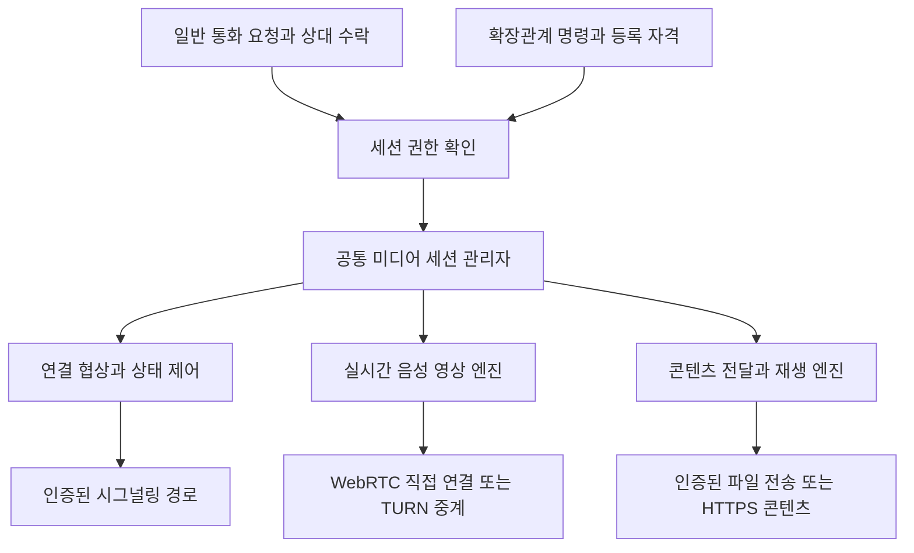

# IndieBiz OS 미디어 통신과 확장관계 연동 설계

작성일: 2026-10-13

상태: 설계안. 이 문서의 미디어 세션 API와 구성 요소는 구현 예정이며, 기존 기능과 구분합니다.

IndieBiz OS의 미디어 통신을 확장관계와 독립된 기능으로 만듭니다. 서로 다른 사용자는 자신의 PC나 스마트폰에서 음성·영상 통화를 할 수 있습니다. 확장관계에서는 중앙 PC가 같은 기능을 실행하여 주변 하드웨어를 카메라·마이크·스피커·화면으로 사용합니다.

확장관계는 **명령할 권한**을, 미디어 통신은 **영상·음성·콘텐츠를 주고받는 능력**을 담당합니다. 통화에 참여하는 것만으로 확장관계가 생기지 않으며, 확장관계에 등록했다고 미디어가 상시 전송되지도 않습니다.

## 1. 확정 요구사항과 설계 범위

### 사용자 결정

- 중앙 PC가 주변 하드웨어에 명령하는 관계의 이름은 **확장관계**입니다. 기존 코드의 `limb` 식별자는 호환성을 위해 유지합니다.
- PC는 헬퍼 설치를 통해서만 확장관계를 맺습니다. IndieBiz OS 설치만으로 다른 PC의 명령 대상이 되지 않습니다.
- 안드로이드폰은 중앙 PC에 물리적으로 연결하여 IndieBiz OS를 설치하는 과정에서 확장관계를 각인합니다. 일반 통화 화면이나 네트워크 초대로 이 관계를 만들 수 없습니다.
- 미디어 통신은 확장관계와 독립적으로 제공하며, 확장관계가 없는 사용자끼리도 음성·영상 통화를 할 수 있어야 합니다.
- 확장관계의 중앙 PC는 동일한 미디어 기능을 명령으로 실행하여 폰을 원격 카메라나 스피커로 사용할 수 있어야 합니다.
- 음악·영상은 양쪽 장치 사이에서 효율적으로 전달할 수 있어야 합니다.

### 이번 설계의 범위

첫 구현은 1:1 음성·영상 통화, 확장관계의 단방향 카메라·마이크·스피커 연결, 파일·주소 기반 재생 전달을 대상으로 합니다. 다자 통화, 상시 녹화 시스템, OS 전역의 가상 웹캠·가상 오디오 장치, 여러 스피커의 정밀 동시 재생은 후속 범위입니다.

카메라 영상을 IndieBiz OS에서 보는 기능과 다른 화상회의 앱의 웹캠 입력으로 사용하는 기능은 다릅니다. 후자는 별도의 가상 장치 드라이버·플랫폼 연동이 필요합니다.

기존 [몸을 손발로 연결하는 설계](INDIEBIZ_BODY_AS_LIMB_DESIGN_2026_10_13.md)는 등록·명령 기반의 배경 자료입니다. 그 문서의 설치본 일반 등록·허브 입력 화면에 관한 초기 제안보다 위 사용자 결정이 우선합니다. 미디어 통신의 독립성과 권한 경계는 이 문서를 따릅니다.

## 2. 현재 기반과 추가할 기능

아래 현황은 작성 시점 정본 작업 트리에서 확인한 내용입니다. 폰 확장관계 관련 미커밋 작업이 포함되어 있으므로 출시 완료를 뜻하지 않습니다.

| 영역 | 확인한 기반 | 추가할 내용 |
| --- | --- | --- |
| 확장관계 자격 | `backend/base/limb_keys.py`의 등록·실행 자격·폐기 | 미디어 세션에 한정한 권한 발급과 폐기 연동 |
| PC 명령 | `backend/services/resident_pcs.py`, Go 헬퍼의 명령·접수증 | 미디어 세션 실행 어댑터 |
| 폰 명령 | `backend/services/limb_client.py`의 폰 전용 아웃바운드 연결 | 네이티브 미디어 서비스와의 로컬 연결 |
| 폰 각인 | `phone-companion/scripts/provision_phone_limb.py`의 연결 장치에 실행 자격 주입 | 기존 각인을 이용한 미디어 인증 |
| 파일 전송 | 상주 장치 전송의 조각·재개·지문 검증 | 콘텐츠 재생용 참조·캐시·접근 범위 |
| 원격 PC 화면 | `resident_screen.py`의 임시 세션·프레임 전달 | 음성·영상용 WebRTC 세션. 기존 화면 기능은 초기 단계에 유지 |
| 재생 | PC 헬퍼의 플레이어 실행, 폰 `PhoneActions.kt`의 스트림 재생 | 세션 수명·일시정지·위치·오디오 포커스의 공통 계약 |
| 사용자 통신 | IndieNet/Nostr 신원·메시지 경로 | 통화 요청·수락·실시간 연결 협상 |

현재 살펴본 경로에서 공통 WebRTC 미디어 엔진은 확인되지 않았습니다. 기존 이미지 프레임 전송이나 녹음 파일 회수를 실시간 영상·음성 통신이 이미 구현된 것으로 간주하지 않습니다.

## 3. 전체 구조

미디어 서비스는 확장관계 모듈 없이도 구동할 수 있어야 합니다. 일반 통화와 확장관계 어댑터는 서로 다른 근거로 세션을 허가하지만, 허가 이후에는 동일한 세션 관리자와 장치별 미디어 엔진을 사용합니다.

제어 메시지와 미디어 바이트는 분리합니다. 통화 요청·수락·음소거·종료·재생 위치는 작은 제어 메시지입니다. 영상 프레임·음성 샘플을 IBL 결과, 작업 큐, Nostr 메시지 또는 AI 대화에 넣지 않습니다. AI는 연결 의도를 표현하고 결과 상태만 받습니다.

이 구조는 [IBL 진화 목적](IBL_EVOLUTION_PURPOSE.md)에 따라 서로 다른 작업이 같은 연결·수명·실패 처리 능력을 재사용하도록 합니다. 토큰·시간 절감은 구현 후 비교하며, 설계만으로 성능 향상을 주장하지 않습니다.

## 4. 공통 미디어 세션

### 세션이 표현하는 것

세션에는 참여 장치, 허가 근거, 입력·출력, 전송 방식, 수명이 들어갑니다. 사람의 신원과 장치의 신원은 구분합니다. 한 사용자가 여러 장치에 로그인했더라도 수락한 장치만 참여합니다.

| 항목 | 의미 |
| --- | --- |
| `session_id`, `protocol_version` | 임의 세션 식별자와 계약 버전 |
| `authorization_basis` | `accepted_call` 또는 `extension_grant` |
| `participants` | 사용자 신원과 해당 장치 신원, 참여 역할 |
| `tracks` | 송신자·수신자·카메라/마이크/재생음/화면·방향 |
| `delivery` | `realtime` 또는 `content` |
| `consent_scope` | 허용된 입력·출력과 녹화 여부 |
| `relation_generation` | 확장관계로 연 세션의 등록 세대 |
| `expires_at`, `lease` | 입장 자격 만료와 활성 세션의 갱신 조건 |
| `state`, `revision` | 현재 상태와 낡은 제어 메시지를 거절할 판본 |

위 이름은 구현용 계약 제안이며 현재 사용 가능한 API가 아닙니다. `session_id` 자체는 인증 자격이 아닙니다.

### 용도별 구성

| 용도 | 입력과 출력 | 허가 |
| --- | --- | --- |
| 음성 통화 | 양쪽 마이크 → 상대 스피커 | 요청과 수락 |
| 영상 통화 | 양쪽 카메라·마이크 → 상대 화면·스피커 | 요청과 수락 |
| 원격 CCTV 보기 | 폰 카메라 → 중앙 화면, 마이크는 선택 | 확장관계와 폰의 실행 가능한 카메라 모드 |
| 원격 마이크 | 폰 마이크 → 중앙 스피커 또는 명시한 소비자 | 확장관계와 마이크 권한 |
| 원격 스피커 | 중앙 재생음 → 폰 스피커 | 확장관계와 수신·재생 능력 |
| 재생 옮기기 | 콘텐츠 참조·위치 → 대상 플레이어 | 확장관계 또는 상대의 콘텐츠 수락 |

처음에는 영상·음성 각 1개 송신 트랙을 기본으로 제한합니다. 장치가 지원하지 않는 트랙은 명시적으로 거절하며 다른 센서로 대체하지 않습니다. 음소거된 마이크를 카메라 연결의 부수효과로 켜지 않습니다.

### 수명과 복구

일반 통화는 `inviting → ringing → accepted → connecting → active → ended`로 진행합니다. 거절·만료·오류는 사유와 함께 종료합니다. 확장관계는 `authorized → connecting`으로 진입할 수 있지만, OS 권한이 필요한 경우 `needs_local_action` 상태로 멈춥니다.

연결 단절은 `reconnecting`으로 전환하고 한정된 시간 동안 ICE 재협상을 시도합니다. 종료된 세션은 재사용하지 않습니다. 재시작 뒤에는 카메라·마이크를 묵시적으로 다시 켜지 않고 기존 허가의 유효성과 OS 실행 조건을 재확인합니다.

초기 제안은 제어 연결 10초 주기 생존 확인, 마지막 유효 확인 뒤 30초의 활성 임대입니다. 제어권을 상실한 실시간 세션은 임대 만료 시 양쪽이 독립적으로 종료합니다. 시간은 실측 후 조정하되 폐기·종료를 영원히 기다리는 세션은 허용하지 않습니다. 로컬 지속시간은 단조 시계로 계산합니다.

`request_id`로 시작 요청을 멱등 처리합니다. 동일 요청의 내용이 다르면 충돌이며, 종료 요청의 중복은 성공으로 처리합니다. 미디어 연결 완료는 작업 큐의 접수 성공이 아니라 수신 측 첫 디코딩·출력 확인으로 판단합니다.

## 5. 일반 사용자 간 통화

1. 발신자가 연락처에서 상대와 음성·영상 종류를 선택합니다.
2. 상대의 기존 통신 신원으로 서명된 통화 초대를 보냅니다. 상대 주소나 표시 이름만으로 신원을 신뢰하지 않습니다.
3. 수신 장치는 발신자, 요청된 카메라·마이크, 수락·거절을 표시합니다. 수락 전에는 센서 캡처를 시작하지 않습니다.
4. 수락한 장치가 세션 참가 자격을 받고 SDP·ICE 정보를 교환합니다.
5. 연결이 성립하면 통화를 시작합니다. 어느 쪽에서든 종료·음소거·카메라 끄기가 가능합니다.

초대 전달은 기존 IndieNet/Nostr 메시지 어댑터를 우선 재사용합니다. 초대에는 만료·일회성 nonce·세션 식별자·상대 신원에 묶인 시그널링 위치를 포함합니다. 모든 ICE 후보를 메시지 이력에 넣지 않고, 초대 후에는 인증된 WSS 경로로 교환합니다. 일반 AI 메시지 처리·자연어 실행과 분리한 통화 이벤트로 취급합니다.

첫 버전은 양쪽 앱 또는 통화 수신 서비스가 동작 중인 온라인 통화입니다. 앱이 종료된 스마트폰에서도 울리는 전화 수준의 수신은 OS 푸시·알림·백그라운드 실행 연동을 추가해야 합니다. 메시지가 릴레이에 도착한 것을 폰이 실제로 울린 것으로 표시하지 않습니다.

여러 장치에 초대가 도착하면 첫 수락을 원자적으로 확정하고 나머지 장치의 초대를 닫습니다. 부재중·거절·차단은 서로 다른 결과로 남깁니다. 상대를 차단하면 새 초대와 현재 세션의 정책을 함께 적용합니다.

## 6. 확장관계에서 사용하는 방식

중앙 PC는 기존 인증된 명령 경로로 대상에 미디어 세션 시작을 지시합니다. 대상은 각인된 중앙의 신원·등록 세대·세션 대상·허용 트랙을 확인하고 같은 미디어 엔진을 실행합니다. 이 경로에는 일반 통화의 벨·상대 수락 화면이 필요하지 않습니다. 다만 OS 권한이나 장치의 로컬 중지 상태를 무시할 수는 없습니다.

폰의 카메라를 받는 기본 순서는 다음과 같습니다.

1. 중앙이 대상의 온라인 상태와 현재 카메라 능력·실행 가능 상태를 조회합니다.
2. 중앙이 세션을 만들고, 기존 확장관계 명령으로 그 세션에만 유효한 참가 자격을 보냅니다.
3. 폰이 권한과 카메라 서비스 상태를 확인하고 연결 협상에 참여합니다.
4. 영상은 폰에서 중앙으로 직접 전송하며, 필요할 때 TURN을 통과합니다.
5. 중앙의 종료, 폰의 로컬 중지, 관계의 중지·해제·폐기 또는 임대 만료 시 캡처와 전송을 종료합니다.

초기 버전의 확장관계 미디어는 중앙과 해당 대상의 1:1 연결로 한정합니다. 주변 장치 A에서 B로 직접 보내는 것은 중앙이 두 장치 모두에 대해 가진 권한을 확인하는 후속 기능이며, 확장관계의 추이적 명령권을 부여하지 않습니다.

통화·미디어 API에는 확장관계 등록 기능을 넣지 않습니다. PC 헬퍼의 설치 관문과 폰의 물리적 연결·설치 관문을 유지합니다. USB 각인은 소프트웨어 자격의 초기 전달 절차이며, 하드웨어 보안칩에 의한 복제 불가능성까지 보장한다는 뜻은 아닙니다. 자격 복제 방지가 필요하면 기기 키 저장소와 설치 신원 검증을 별도 강화합니다.

## 7. 실시간 전송과 콘텐츠 전달

### 실시간 음성 영상

WebRTC를 공통 전송으로 사용합니다. SDP로 트랙·코덱을 협상하고 ICE로 경로를 선택합니다. LAN에서 가능한 직접 경로를 우선 활용하고 외부망에서는 STUN을 통한 직접 연결을 시도하며, 직접 연결이 불가능하면 TURN을 사용합니다. WebRTC의 연결 협상은 애플리케이션이 별도로 제공해야 합니다. [WebRTC 공식 연결 가이드](https://webrtc.org/getting-started/peer-connections)

첫 코덱 후보는 음성 Opus, 영상 H.264 또는 VP8입니다. 최종 선택은 양쪽의 실제 지원·하드웨어 가속 여부에 따라 협상합니다. 구형 폰은 낮은 해상도·프레임률부터 시작하고 발열·손실·혼잡에 따라 품질을 낮춥니다. 음성 통화에는 에코 제거를, 음악 전송에는 불필요한 음성 처리 억제를 적용하되 플랫폼 지원 여부를 확인합니다.

실시간 경로는 오래된 프레임을 무한히 쌓지 않습니다. 전송이 밀리면 비트레이트·해상도·프레임률을 낮추거나 오래된 프레임을 버립니다. 파일 전달은 재개·무결성이 우선이고, 실시간 전송은 지연과 연속성이 우선입니다.

### 콘텐츠 전달과 재생 이동

대상이 접근 가능한 콘텐츠는 파일 또는 주소와 재생 위치를 전달하여 대상에서 디코딩합니다. 미디어 세션이 소유하는 콘텐츠 참조를 발급하고 파일 전체 경로나 영구 자격을 상대에게 노출하지 않습니다. HTTP 기반이면 Range 요청과 중단 후 재개를 지원하고, 검증한 파일은 콘텐츠 지문으로 캐시합니다.

확장 장치에 파일을 미리 보내는 경우 기존 전송 기능을 재사용합니다. 일반 사용자 간 전송에는 상대가 수락한 콘텐츠에 한정한 전송 어댑터를 둡니다. 이것이 확장관계 파일 읽기·쓰기 권한으로 확대되어서는 안 됩니다.

콘텐츠 주소는 대상이 실제 접근할 수 있어야 합니다. 발신자 브라우저의 로그인 쿠키를 넘기거나 제3자 서비스 인증을 공유하지 않습니다. 허용된 콘텐츠를 제공할 수 없으면 `content_unavailable`로 반환하고 지원되는 실시간 공유를 별도 선택합니다.

재생 이동은 대상이 준비·재생을 확인한 뒤 원본을 멈춥니다. 준비 실패 시 원본을 유지합니다. 양쪽 재생은 명시적인 별도 선택이며, 여러 장치의 정밀 동기 재생을 기본 보장하지 않습니다. 이미 상대에게 내려받게 한 파일은 세션 종료만으로 회수할 수 없으므로 파일 공유와 일시 스트리밍을 화면에서 구분합니다.

## 8. 네트워크와 인증

### 시그널링과 중계

일반 통화에는 양쪽이 아웃바운드로 접속할 수 있는 WSS 시그널링 위치가 필요합니다. 첫 구현은 사용자 지정 또는 자체 호스팅 가능한 시그널링 릴레이를 사용하고, 접근 가능한 개인 노드가 같은 역할을 맡는 구성을 허용합니다. 통화별 조정자는 존재하지만 모든 사용자가 특정 중앙 PC의 확장 장치가 될 필요는 없습니다.

시그널링은 초대·수락·SDP·ICE·종료만 처리하며 기본적으로 미디어를 중계하지 않습니다. 기존 HTTP 터널이 정상이라고 UDP 미디어가 통과하는 것은 아닙니다. 미디어 중계는 별도의 TURN 기능과 외부에서 접근 가능한 포트가 필요합니다. UDP가 막힌 환경을 위해 TURN/TCP·TLS 경로도 구성·시험합니다.

TURN은 통신 도달성을 보완하며, 상대를 초대하거나 확장관계를 만드는 권한은 없습니다. 단기 자격·사용량 한도·대역폭 관측을 적용합니다. 대략 2 Mbps 영상 한 방향은 미디어 페이로드만 시간당 약 0.9 GB입니다. 중계 서버에서는 수신과 송신이 모두 발생하며 프로토콜 오버헤드와 과금 방식이 별도로 더해집니다.

### 세션 인증

시그널링에는 TLS를, WebRTC 미디어에는 DTLS-SRTP를 사용합니다. SDP의 DTLS 인증서 지문을 인증된 참가자와 세션에 묶어야 하며, 암호화된 전송이라는 이유만으로 상대 신원을 생략하지 않습니다. [WebRTC 보안 구조 RFC 8827](https://www.rfc-editor.org/info/rfc8827/)

일반 통화에서는 기존 사용자 신원이 장치의 임시 세션 키를 승인하고, 그 키가 세션·수신자·만료·SDP 지문을 인증하는 구조를 사용합니다. 계정의 장기 개인키를 렌더러에 넘기지 않습니다. 확장관계에서는 기존 인증 경로가 양쪽의 세션 지문과 참가 자격을 전달합니다. 시그널링 릴레이가 메시지를 바꾸어도 인증 검증에 실패하도록 합니다.

입장 자격은 세션·참가 장치·역할·허용 트랙·유효기간에 묶습니다. 재접속은 새 자격을 발급하고 중복 nonce와 낡은 판본을 거절합니다. 확장관계 실행 키와 일반 통화 자격은 상호 대체할 수 없습니다. 브라우저의 페이지 원점·소유자 로그인·CSRF/웹소켓 접속 검증도 기존 표면 인증과 연결합니다.

영상·음성 원본은 기본 저장하지 않습니다. 진단에는 시작·종료 시각, 참가 장치, 허가 근거, 경로, 품질 지표, 오류만 남깁니다. 인증 토큰과 SDP·ICE 원문은 상시 로그에 남기지 않습니다. 녹화는 별도 기능·표시·허가로 설계하고 첫 구현에서는 제외합니다.

## 9. 장치별 구현과 제한

### PC의 IndieBiz OS

Electron의 Chromium WebRTC를 우선 사용하여 카메라·마이크·영상 표시를 구현합니다. 장기 통화의 엔진 소유 창을 채팅 패널과 분리하고, 통화 중 패널을 닫아도 정책에 따라 유지하거나 명시적으로 종료하도록 합니다. 앱 종료 뒤 계속 살아 있는 통화를 기본으로 만들지 않습니다.

화면·시스템 오디오 캡처는 OS 권한과 Electron 버전별 지원을 확인해 별도 능력으로 신고합니다. 카메라 통화가 된다는 이유로 시스템 소리 캡처까지 가능하다고 광고하지 않습니다.

### PC의 헬퍼

헬퍼만 설치된 PC에는 Chromium 엔진이 없을 수 있습니다. 헬퍼는 기존 등록·명령의 소유자로 남고, 필요하면 설치 패키지로 제공한 네이티브 미디어 실행 모듈을 구동합니다. 미디어 모듈에는 세션 한정 자격만 전달합니다.

WebRTC 전송 라이브러리만 추가해도 카메라 캡처·코덱·스피커 출력이 자동으로 생기는 것은 아닙니다. 모듈 선정은 OS별 캡처·재생 지원, 배포 크기, 업데이트·서명, 코덱 호환성을 함께 검증합니다. 최초 범위는 IndieBiz OS 설치 PC와 폰이며, 헬퍼 전용 PC의 실시간 미디어는 별도 단계로 추가합니다. 그 전에도 기존 파일 재생 명령은 유지할 수 있습니다.

### 안드로이드폰

Kotlin 네이티브 계층에 WebRTC 캡처·수신 엔진을 둡니다. Python 백엔드는 세션 제어만 맡고 영상 프레임을 Python·JSON 다리로 복사하지 않습니다. 일반 콘텐츠 재생에는 Media3의 플레이어·미디어 세션 서비스를 우선 검토합니다. 서비스 수명을 화면과 분리하면 잠금 상태의 재생을 관리할 수 있습니다. [Android 백그라운드 재생](https://developer.android.com/media/media3/session/background-playback)

기존 `AgentForegroundService`의 `specialUse` 선언만으로 카메라·마이크·미디어 재생의 실행 요건이 충족된다고 가정하지 않습니다. 목적에 맞는 foreground service 유형·권한·알림·시작 조건을 구현해야 합니다. 최신 Android의 카메라·마이크 while-in-use 제한 때문에 백그라운드 또는 부팅 시 원격 명령만으로 서비스를 시작할 수 없는 경우가 있습니다. [Android foreground service 유형](https://developer.android.com/develop/background-work/services/fgs/service-types)

CCTV는 폰에서 사용자가 시작한 카메라 모드를 유지하는 방식으로 구성합니다. 카메라 서비스가 종료된 뒤에는 필요한 로컬 행동을 중앙에 표시합니다. 단순한 '준비됨' 설정 저장만으로 나중에 백그라운드에서 카메라를 열 수 있다고 가정하지 않습니다. 화면 꺼짐·Doze·제조사 절전·통화 중 자원 충돌·재부팅은 실기기로 확인합니다.

화면 공유에는 MediaProjection의 세션별 사용자 동의가 필요합니다. 다른 앱의 재생음 캡처는 Android 10 이상에서 제공되며 대상 앱의 허용 정책 등에 제한됩니다. 자체 플레이어의 콘텐츠 전달과 시스템 전체 소리 캡처를 구분합니다. [MediaProjection](https://developer.android.com/media/grow/media-projection), [재생음 캡처](https://developer.android.com/media/platform/av-capture)

기존 작업의 구형 폰 대상은 Android 9·32비트 ABI이며, 현대적 64비트 폰과 구분해서 검증합니다. WebRTC 네이티브 라이브러리의 `armeabi-v7a` 제공·최소 OS·실제 코덱 동작을 구현 시작 단계에 확인합니다. Android 9에서 다른 앱 소리를 캡처하는 기능은 위 API로 제공할 수 없습니다. 장기 영상 운용은 발열·배터리·메모리를 측정해 지원 프로필을 정합니다.

## 10. 모듈과 호출 계약

다음은 책임 배치 제안입니다. 파일명과 API의 최종 확정은 구현 단계에서 기존 모듈과 중복을 확인한 뒤 진행합니다.

| 소유 위치 | 책임 |
| --- | --- |
| `backend/services/media_sessions.py` | 세션 상태·수명·자격 범위·멱등·자원 점유 |
| `backend/services/media_signaling.py` | 참가자 인증·SDP/ICE 전달·연결 복구 |
| `backend/services/media_extension.py` | 기존 확장관계 자격을 세션 허가로 변환·폐기 연동 |
| `backend/datastore/`의 미디어 기록 모듈 | 최소 이력과 설정. 활성 연결·토큰은 영속 복원 대상에서 제외 |
| `backend/surface/api_media.py` | 로그인한 사용자와 인증된 세션 참가자의 API 경계 |
| `frontend/` 통화 표면·Electron 미디어 실행부 | 통화 요청·수락·장치 선택·캡처·렌더링 |
| `phone-companion/` 네이티브 미디어 서비스 | 폰의 WebRTC·재생·OS 수명·알림 |
| `helper/` 미디어 어댑터 | 헬퍼 설치 PC의 세션 실행과 모듈 수명 |

새 backend 모듈은 저장소 층 배정과 폰 번들 파생 규약을 따릅니다. 모듈당 1500줄 제한을 유지합니다. 일반 통화 모듈은 확장관계 원장에 의존하지 않고, 확장관계 어댑터가 공통 세션 인터페이스를 호출합니다.

공통 서비스 연산은 `capabilities`, `create`, `accept`, `reject`, `signal`, `update`, `status`, `end`로 구성합니다. `create`에는 대상·허가 근거·트랙·전송 방식·요청 ID를, `update`에는 세션 ID·기대 판본·변경할 재생 상태를 전달합니다. 호출자가 보낸 `authorization_basis` 문자열을 그대로 신뢰하지 않고 서비스가 수락 사건 또는 확장관계 자격으로 검증합니다.

반환은 세션 ID·상태·실제 트랙·실패 사유를 포함합니다. IBL에 연결할 때에는 기존 `{items:[...]}` 계약을 따릅니다. `permission_required`, `needs_local_action`, `device_offline`, `device_busy`, `unsupported_track`, `relation_revoked`, `connectivity_failed`, `content_unavailable` 등의 실패를 구분합니다.

IBL 문법·파서·표준 코어는 변경하지 않습니다. 첫 단계는 서비스 API와 통화 UI를 구현하고, 기존 `self:script`로 조합 가능하게 합니다. 반복 사용 후 기존 통신·장치 패키지의 액션과 op 수용 가능성을 검토합니다. 새 `call`·`stream` 어휘가 이미 존재하는 것처럼 예제를 배포하지 않습니다. 어휘를 추가할 경우 카탈로그·핸들러·가이드·회귀와 파생 빌드를 함께 갱신합니다.

## 11. 사용자 화면

일반 사용자에게는 연락처의 '음성 통화'와 '영상 통화', 수신 시 상대와 수락·거절을 제공합니다. 통화 중에는 마이크·카메라·출력 장치·종료를 표시합니다. 재연결 중에는 멈춘 영상을 현재 영상처럼 보이지 않게 상태를 표시합니다.

확장 장치 화면에는 실제 능력에 따라 '카메라 보기', '소리 듣기', '이 장치에서 재생'을 제공합니다. 권한이 필요하면 '폰에서 CCTV 모드를 시작해 주세요'처럼 필요한 행동을 구체적으로 표시합니다. 통화 초대와 확장관계 등록을 같은 버튼으로 합치지 않습니다.

세션 상세에는 직접 연결·중계 여부, 수신 상태, 품질을 확인할 수 있게 합니다. 기본 화면에는 ICE·SDP·인증 토큰 같은 구현 세부를 노출하지 않습니다. 로컬 사용자가 센서를 끄거나 세션을 종료하는 조작은 원격 명령보다 우선합니다.

## 12. 구현 단계와 완료 기준

| 단계 | 산출물 | 완료 기준 |
| --- | --- | --- |
| 0 | 장치 능력 조사·기술 선택 | PC와 폰 ABI별 WebRTC 빌드, 카메라·마이크·재생 기본 동작 확인 |
| 1 | 독립 1:1 통화 | 확장관계 없이 서로 다른 신원의 PC↔PC·PC↔폰·폰↔폰 요청·수락·종료 |
| 2 | 인터넷 연결 | 서로 다른 NAT·휴대망·UDP 차단에서 TURN 경로와 실패 안내 확인 |
| 3 | 확장관계 어댑터 | 중앙 명령으로 카메라·마이크·스피커 연결, 관계 폐기 시 종료 |
| 4 | 콘텐츠 재생 전달 | 파일·주소·재생 위치 전달, 대상 실패 시 원본 재생 유지 |
| 5 | 헬퍼 전용 PC | IndieBiz OS 본체 없이 헬퍼와 미디어 모듈로 참여 |

단계 1의 일반 통화는 확장관계 코드 없이 검증합니다. 단계 3에서 미디어 전송을 다시 만들지 않고 같은 엔진을 연결합니다. 다자 통화가 필요해질 때만 SFU 도입과 서버가 미디어에 접근하는 신뢰 모델을 별도 설계합니다.

### 필수 검증

- 권한: 일반 통화 자격으로 명령·파일 시스템 접근·확장관계 등록이 불가능하고, 다른 장치·세션·등록 세대의 자격이 거절되는지 확인합니다.
- 수락: 미수락·거절·만료된 초대에서 센서가 시작되지 않으며, 여러 장치의 동시 수락이 하나로 확정되는지 확인합니다.
- 종료: 중앙·주변 장치 각각의 종료, 관계 pause/revoke/remove, 제어망 단절, 앱 종료 뒤 캡처·전송·자원 점유가 해제되는지 확인합니다.
- 연결: LAN·별도 공유기·휴대망·TURN 전용·Wi-Fi에서 휴대망으로 변경·재연결을 확인합니다.
- 출력: 연결됨 표시뿐 아니라 실제 수신 프레임·음성 출력, 음소거, 카메라 전환, A/V 동기와 에코를 확인합니다.
- 콘텐츠: 재개·지문·권한 만료·재생 위치·대상 재생 실패·지원하지 않는 형식을 확인합니다.
- 폰: 구형 32비트와 현대 64비트에서 화면 꺼짐·서비스 종료·절전·재부팅·자원 충돌을 확인합니다.
- 장시간: 1시간 통화와 8시간 CCTV 모드에서 메모리·발열·드롭·배터리·네트워크 사용량을 기록합니다.

### 성능 목표와 관측

아래 수치는 초기 개발 목표이며 보장값이나 측정 결과가 아닙니다. LAN과 인터넷·중계 결과를 분리하고 기기·해상도·코덱·망 조건을 함께 기록합니다.

| 지표 | 초기 목표 |
| --- | --- |
| 수락 후 첫 음성·영상 | LAN p95 3초 이내, 인터넷 p95 5초 이내 |
| 실시간 지연 | LAN 음성 200 ms 이하, 영상 400 ms 이하를 목표로 실측 |
| 명시적 종료 | 정상 제어망에서 p95 2초 이내 자원 해제 |
| 제어망 상실 | 제안 임대 30초 만료 후 로컬 정리. 실제 스케줄링 지연 별도 기록 |
| 재생 이동 | 대상 출력 확인 전 원본 재생을 중단하지 않음 |

통계에는 RTT·손실·지터·비트레이트·해상도·드롭·경로를 수집합니다. WebRTC의 RTT를 사용자 체감 편도 지연으로 간주하지 않습니다. 실제 영상·음성 지연은 시각 표식과 오디오 루프 등 종단 측정으로 확인합니다. 미디어 처리 중 AI 모델의 지속 호출은 필요하지 않습니다.

## 13. 후속 구현에서 확정할 사항

핵심 구조는 독립 미디어 기능과 확장관계 어댑터로 정합니다. 구현 시에는 Android ABI별 WebRTC 배포 방식, 헬퍼용 네이티브 실행 모듈, 시그널링·TURN 운영 위치, OS별 시스템 오디오 캡처 범위를 실험으로 확정합니다. 구형 폰이 목표 품질을 만족하지 않으면 지원 프로필을 낮추거나 해당 트랙을 미지원으로 표시합니다.

이번 변경은 설계문서만 추가합니다. 기존 실행 코드·어휘·각인 규칙을 변경하지 않으며, 위 API·통화 UI·성능 목표의 구현과 실기기 검증은 후속 작업입니다.
