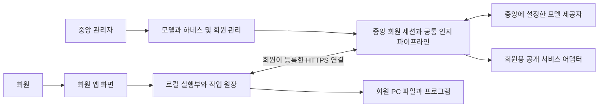

# 중앙 관리형 회원 데스크톱 설계

상태: 회원 PC 등록 관리 구현, 데스크톱 통합은 설계안. 아래 설치·실행 통합 목표를 현재 제공 기능으로 간주하지 않는다. 회원은 이웃 CRM의 사람이 아니라 중앙 하네스를 이용하도록 등록한 PC다.

가족이나 회사의 관리자가 중앙 PC에서 IndieBiz OS의 하네스·모델 연결·공통 기능을 관리한다. 구성원은 **회원 앱 하나를 설치하고 로그인한 뒤 자신의 컴퓨터에서 자연어로 일을 맡긴다.** AI가 파일을 읽고 수정하고 프로그램을 실행하고 결과를 확인하는 작업 순환을 제공한다. 코딩뿐 아니라 문서·자료 정리·분석·개인 업무가 대상이다.

제품의 기본 단위는 웹페이지가 아니라 **웹 기술로 만든 작업 화면과 로컬 실행부를 함께 배포하는 회원 데스크톱 앱**이다. 웹 접속은 설치 안내와 제한된 브라우저 이용을 계속 제공한다. 중앙 PC는 모델 자체를 반드시 로컬에서 돌리는 서버가 아니라 하네스와 모델 호출을 운영하는 허브다.

## 1. 설계 결정

1. 회원에게 별도의 helper 설치·JSON 설정·터미널 작업을 요구하지 않는다. 설치 파일에 화면과 실행부를 포함한다.
2. 기존 `MemberRunner`·`MemberSessionManager`·`client_agent`·Go 회원 실행부를 확장한다. 별도 AI 루프나 두 번째 원격 명령 엔진을 만들지 않는다.
3. 회원 작업의 기본 목적지는 요청한 회원 PC다. 중앙에서 실행할 공개 검색·문서 변환 등은 명시된 서비스 어댑터만 사용한다. 연결 실패를 중앙 PC의 파일·셸 실행으로 대체하지 않는다.
4. 회원이 고른 프로젝트·폴더와 실행 권한을 기기에 보관한다. 중앙 관리 권한과 회원의 컴퓨터 사용 권한은 별개다.
5. 중앙 관리자가 하네스·공통 도구를 갱신하면 회원은 이를 이용한다. 로컬 실행부나 승인 화면의 코드 변경은 검증된 앱 업데이트로 전달한다.
6. 직접 파일·셸 작업을 위해 새 IBL 낱말을 만들지 않는다. 직접 도구와 IBL 조합이 같은 회원 실행·권한·기록 경계를 사용한다.
7. 첫 데스크톱 출시 범위는 macOS와 Windows다. Linux는 같은 계약의 후속 배포 대상으로 두며, Android와 브라우저에 PC 셸을 약속하지 않는다.

## 2. 현재 기반과 부족한 부분

| 영역 | 확인된 현재 구현 | 통합에서 해야 할 일 |
|---|---|---|
| 회원 웹앱 | `/m/app`, IndexedDB, 가져온 파일 사본, 제한된 JS 실행 | 설치 앱 진입 안내와 연결 상태 표시, 브라우저 기능 유지 |
| PC 실행부 | `helper`의 `mode:member`, 로컬 SQLite, 선택 폴더, 승인된 셸 | 설치·자동 연결·앱 수명·업데이트·자격 보관 통합 |
| 회원 AI | 공통 AgentRunner의 회원 전용 인스턴스, API 모델, IBL과 `run_command` | 실제 기기 능력과 프로젝트 맥락 공급, 파일 도구·진행·복구 연결 |
| 전송 | 웹의 버전 1 요청과 영수증, 네이티브의 기존 `/m/run` 스트림 | 양쪽을 같은 요청 ID·작업 상태·결과 조회 계약으로 수렴 |
| 승인 | 로컬 번들 화면, op별 `auto_allow` | 프로젝트·작업·행동별 권한, 정확한 명령·변경에 묶인 승인 |
| 수명 | 네이티브 작업 고루틴, 연결 실패 시 unknown, 서버 요청 원장 RAM | 화면과 작업 수명 분리, 명령 재전송·재시작 대조 |
| 로컬 앱 | 회원용 선언형 앱과 `apps.json` | 동일한 작업·기기·권한으로 실행, 기존 앱별 전환은 계속 별도 판정 |
| 주인 원격 PC | enroll/resident 및 화면 공유·관리 기능 | 낮은 수준의 장치 어댑터만 검토 후 재사용, 회원을 resident로 등록하지 않음 |

근거: [기존 회원 설계](EXTERNAL_SERVICE_APP_HANDOFF.md), [공통 요청 구현](CLIENT_AGENT_WEBAPP_IMPLEMENTATION_2026_09_15.md), [회원 앱별 범위](CLIENT_WEBAPP_APP_AUDIT_2026_09_15.md), [helper 계약](../helper/README.md).

## 3. 회원이 경험하는 흐름

### 처음 시작

1. 관리자가 런처 안경 메뉴의 **회원 PC 관리**에서 PC 이름과 선택적인 사용자 표시명을 등록한다. 통합 설치 단계에서는 여기서 일회 초대를 만든다.
2. 회원이 링크를 열면 조직 이름과 주소, **이 컴퓨터에서 시작하기** 버튼이 보인다. OS에 맞는 설치 파일을 받는다. 브라우저로 계속하기도 제공한다.
3. 앱 설치 후 초대 링크의 **앱 열기**로 연결한다. 자동 전달이 안 되면 짧은 등록 코드를 앱에 입력한다. 영구 회원 키·서버 JSON을 복사하게 하지 않는다.
4. 앱이 연결할 조직과 등록 PC 이름을 보여주고 확인받은 뒤 기기를 등록한다.
5. 기본 작업 폴더를 만들거나 기존 폴더를 OS 선택창으로 고른다. 첫 요청부터 실제 파일을 대상으로 일한다.

초대 전송은 관리자가 링크를 복사해 전달하는 흐름이다. 메시지 자동 발송 기능은 이 설계의 전제가 아니다.

### 매일 사용

왼쪽에는 프로젝트와 작업 목록, 가운데에는 대화와 진행, 오른쪽에는 파일·미리보기·변경 내역을 둔다. 앱 기능은 같은 작업 안에서 열며 채팅과 별도 대화를 만들지 않는다. 상단에는 **조직 · 내 기기 · 작업 폴더 · 연결 상태**를 표시한다.

“이 폴더의 자료를 정리해서 보고서를 만들어 줘”라는 요청은 파일 발견 → 필요한 부분 읽기 → 계획 → 수정·계산 → 결과 확인 → 로컬 결과 열기로 이어진다. 코드 수정이라면 파일 변경과 실행 로그·테스트 결과가 같은 작업에 쌓인다. 사용자는 중간에 지시를 보태거나 중단할 수 있다.

파일 결과는 **열기 / 폴더에서 보기 / 변경 내용 / 가능한 변경 되돌리기**로 다룬다. 브라우저 버전의 다운로드는 유지하되 설치 앱에서 매번 가져오기·내려받기를 요구하지 않는다.

창을 닫으면 트레이 또는 메뉴 막대에 남고 진행 중 작업은 계속된다. 최초 닫기 때 이 동작을 안내한다. **앱 종료**는 작업 중단과 프로세스 정리를 수행한다. 절전·전원 종료·중앙 연결 중단은 지속 실행과 구분해 표시한다.

## 4. 배치와 책임

**앱 포장:** 기존 Electron 빌드 경험을 재사용하되 회원 전용 진입점·제품 ID·배포 설정을 만든다. 주인용 Electron main을 실행한 뒤 메뉴만 숨기는 방식은 쓰지 않는다. 중앙 백엔드·주인 DB·설정·모델 키는 회원 설치물에 넣지 않는다. 기본 구성은 Electron 화면, 회원용 Go 실행 바이너리, 공통 소스에서 빌드한 화면 자산이다.

**프로세스:** 회원 전용 main 프로세스가 Go 자식을 하나만 시작·감시한다. 기존 loopback 서버를 초기 내부 전송으로 재사용하고, 포트와 일회 세션 자격은 부모와 자식 사이의 전용 통로로 전달한다. 화면에는 허용된 IPC 메서드만 제공한다. 파일 선택·OS 자격 저장·업데이트는 main, 파일·셸·작업 원장은 Go가 소유한다. 화면의 새로고침과 창 닫기가 실행부를 종료하지 않는다.

**원격 콘텐츠:** 설치 앱의 권한 화면과 로컬 브리지는 검증된 로컬 번들이다. 중앙에서 내려오는 앱 선언·모델 출력·웹페이지는 데이터 또는 격리된 프레임으로 렌더한다. 외부 HTML에 Node·파일·셸 API를 주지 않는다. 기존 loopback 토큰의 renderer/sessionStorage 노출은 전용 IPC 경계로 교체한다. 외부 브라우저 호환 경로는 기존 한시 토큰과 Host·Origin 검사를 유지한다.

**통신:** 회원 PC에서 중앙으로 연결한다. 회원 PC의 외부 인바운드 포트 개방은 필요하지 않다. 기존 HTTPS `/m/*`와 회원 전용 `/limb/*` 통로를 재사용하며, 화면 조작은 아래의 별도 능력 계약을 갖춘 뒤 같은 기기 신원으로 연결한다.

## 5. 신원과 기기 등록

초대와 영구 실행 자격을 분리한다. 초대는 회원 ID·대상 허브·만료 시각에 묶인 짧은 수명의 일회 코드다. 앱은 교환 요청 ID와 기기 키를 만들고 중앙의 원자적 코드 소비를 통해 기기 자격을 받는다. 응답 유실 시 같은 교환 ID와 기기 증명을 제출해 같은 등록을 회수한다. 다른 기기의 재사용은 거절한다.

제안 API는 `/m/enroll/exchange`이며 아직 구현되지 않았다. 기존 `limb_keys` 자격 저장소와 회원 인증 서비스를 확장한다. 이웃 명부를 조회하거나 생성하지 않는다. 등록 단위는 PC이며 사용자 표시명은 설명용이다. 현재 구현은 PC별 영구 키 발급이고, 일회 초대 교환은 후속이다. 일회 코드는 서버에 해시로 저장하고 시도 횟수·만료를 제한한다. 링크 전달 시 코드를 로그·분석 URL에 남기지 않고, 앱은 임의 링크에서 받은 주소를 자동 신뢰하지 않고 연결 대상을 표시한다.

등록 PC의 `member_id`와 `device_id`는 같은 안정된 ID로 유지한다. 같은 사람이 여러 PC를 사용해도 각각 등록하며 자격·사용량·실행을 분리한다. 설치 신원은 이 PC 등록 아래에서 관리한다. 자격 갱신으로 기록 폴더가 바뀌지 않도록 현재 허브·키 해시 기반 저장 경로를 `hub_id/member_id/installation_id` 기반으로 이행한다. 영구 자격은 OS 자격 저장소에 넣고 화면·명령 인자·일반 로그·백업에서 제외한다.

기기 추가는 별도 초대와 자격을 사용한다. 탈퇴·기기 폐기는 신규 요청을 막고 활성 연결에 폐기 사건을 전달한다. 오프라인 기기의 즉시 원격 중단은 보장하지 않으며 연결 임대 만료 정책을 적용한다. 재연결 때 폐기 자격은 실행을 재개하지 못한다. 로그아웃은 실행을 중단하고 자격을 제거하되 로컬 기록 삭제는 별도 선택이다.

공용 PC의 서로 다른 OS 계정은 저장소를 분리한다. 같은 OS 계정에서 회원을 바꿀 때는 연결·권한·작업 공간을 전환하고 이전 세션을 종료한다. 이것을 같은 OS 사용자의 파일 접근 자체를 차단하는 보안 경계라고 주장하지 않는다.

## 6. 실행 계약과 권한

AI가 실행 대상을 임의로 정하지 못하게 서버가 인증된 `member_id + device_id + installation_id`를 붙인다. 로컬에서 생성한 `task_id + workspace_id + workspace_revision`에 작업을 고정한다. 폴더 선택 변경은 새 작업부터 적용하고 실행 중 작업의 목적지를 바꾸지 않는다.

요청마다 `request_id`, 실제 도구 단계마다 `operation_id`, 연결마다 `session_generation`을 사용한다. 실행 봉투는 작업 ID·작업 폴더 판본·행동·입력 지문·권한 판본·기한을 포함한다. 로컬 실행부는 등록 허브, 활성 작업, 승인 범위, 세대, 기한을 다시 검사한다. 동일 ID의 다른 입력은 거절한다. 본문에 넣은 owner·다른 device 주장으로 이 검사를 건너뛸 수 없다.

| 기능 | 기본 실행 위치 | 권한과 결과 |
|---|---|---|
| 파일 목록·검색·범위 읽기 | 회원 PC | 선택 폴더 허가, 실제 로컬 파일 메타데이터·내용 |
| 파일 생성·부분 수정·이동 | 회원 PC | 폴더 편집 허가, 충돌 검사, 변경 기록 |
| 셸·스크립트·빌드·테스트 | 회원 PC | 해당 작업의 명령 실행 허가, 프로세스·출력·종료 상태 |
| 공개 검색·원문 수집·모델 호출 | 중앙 | 회원용 어댑터, 주인 로그인·개인 기억 사용 금지 |
| 문서 변환 | 기기 능력에 따라 회원 PC 또는 기존 중앙 임시 어댑터 | 입력·결과의 소유자는 회원, 중앙 임시 처리는 표시 |
| 브라우저와 화면 조작 | 회원 PC | 명시적 연결·OS 권한, 기기 세션에 묶인 관측·조작 |

권한은 단순 모드 이름 대신 **폴더 읽기·편집 / 이 작업에서 명령 실행 / 브라우저·화면 사용**으로 보여준다. 읽기·편집을 허용한 폴더 안의 정상 작업마다 재승인을 요구하지 않는다. 명령 실행은 기본적으로 구체적 명령을 확인하고, 회원이 원하면 해당 작업 동안 허용할 수 있다. 임의 셸은 OS 사용자 권한으로 실행되며 폴더 경계가 셸 샌드박스라는 설명을 하지 않는다. 앱 UI의 작업별 명령 허용은 이 범위를 설명하고 받아야 한다.

파일 API는 경로·심볼릭 링크·경로 교체 경합까지 검증한다. 덮어쓰기는 읽은 버전/지문과 대조하고, 충돌이면 현재 내용을 다시 읽어 조정한다. 승인 이후 명령·대상·입력이 바뀌면 기존 승인을 쓰지 않는다. 삭제·권한 확장·외부 발신 등은 기존 실행 정책과 명시적 사용자 요청을 따르며 모델의 자기 승인으로 허용하지 않는다.

중앙 관리자는 모델·공통 기능·비용 한도·기기 폐기를 관리한다. 관리창에 회원 PC의 임의 셸·화면 조작을 붙이지 않는다. 원격 지원은 회원이 시작하고 범위·만료를 가진 별도 지원 세션으로 후속 제공한다. **관리자를 신뢰하지 않아도 안전한 암호학적 격리**를 약속하지 않는다. 중앙은 모델에 보내는 내용을 처리하고 명령을 제안할 수 있으므로, 회원의 로컬 권한과 승인 범위가 실제 경계다.

## 7. AI에게 제공할 로컬 작업 능력

`MemberRunner`는 회원 기기가 보고한 OS·실행 환경·권한·작업 폴더·도구 가용성으로 실제 도구 목록을 구성한다. 기기 능력 보고는 권한 부여가 아니며 실행부가 매번 다시 검사한다. 중앙 PC의 설치 프로그램·경로·기억으로 이를 채우지 않는다.

1. **발견과 편집:** 파일 목록·이름 검색·내용 검색·범위 읽기·조건부 패치·쓰기. 기존 helper 동작을 점검해 재사용하고 없는 동작만 추가한다. 큰 파일은 필요한 범위와 잘림 표시를 반환한다.
2. **실행과 검증:** 기존 `run_command`를 프로세스 시작·출력 조회·입력·중단 계약으로 확장한다. 짧은 명령은 현재 동기 형태를 유지하고 긴 작업은 process ID로 관찰한다. 개발 서버 등 장기 자식은 등록·수명·종료 버튼을 갖고 임의로 방치하지 않는다.
3. **환경 준비:** 필요한 인터프리터·도구가 없으면 구체적인 설치 계획을 제시한다. 승인 뒤 사용자 범위의 실행 환경 또는 선택 프로젝트의 환경에 설치한다. 모든 의존성을 회원이 사전에 수동 구성해야 하는 제품으로 만들지 않는다. 관리자 권한 설치는 별도 OS 승인을 따른다.
4. **도구 조합:** 직접 도구와 IBL은 같은 operation 원장과 권한 판정을 사용한다. 단독 셸 명령을 IBL로 억지 변환하지 않고 반복 절차·값 전달·실패 처리가 유리한 경우 조합한다.
5. **브라우저와 앱:** 기존 로컬 브라우저·화면 어댑터를 회원 기기에 연결하는 단계를 둔다. 접근성/DOM 등 구조화된 관측을 우선하고 화면 입력은 보완 수단으로 사용한다. 관측 대상·기기·세션이 바뀌면 이전 화면 좌표로 조작하지 않는다. 중앙의 주인 브라우저·쿠키를 대신 사용하지 않는다.

회원 모델은 중앙에 설정된 API 모델을 기본으로 유지한다. 중앙의 Claude Code/Codex CLI를 그대로 회원 러너로 바꾸면 그 CLI의 네이티브 도구가 중앙을 만질 수 있으므로 이번 통합에 포함하지 않는다. 향후 CLI 실행기를 추가하려면 모든 네이티브 도구의 실행 위치를 보장하는 별도 어댑터가 필요하다.

## 8. 작업 수명과 재연결

**로컬 작업 원장**은 요청·도구 명령·승인·결과를 실행 전에 기록한다. 명령 원장은 `received → waiting_approval → running → succeeded/failed/cancelled/unknown`을 사용한다. 같은 operation ID의 재수신은 기존 결과 또는 현재 상태를 반환하며 실행하지 않는다.

**중앙 요청 조정자**는 기존 `client_agent`를 확장한다. 요청 접수와 이벤트 구독의 수명을 분리한다. 데스크톱 경로에서 화면의 스트림 종료만으로 `MemberSessionManager.close()`를 호출하지 않는다. 명시적 취소·기기 임대 만료·예산 종료가 실행 중단 사유다. 기존 브라우저 계약은 별도로 유지한다.

제안하는 버전 2는 `/m/run` 접수, `/m/requests/{request_id}` 상태 조회, 해당 요청의 이벤트 재구독·취소, 기존 `/m/receipts` 결과 확인을 제공한다. 모든 조회·취소에 회원·기기·요청 소유권을 검사한다. 서버는 지원 판본·최소 클라이언트 판본을 공개하고, 판본 1은 기존 범위로 계속 동작한다.

중앙에는 재접수 중복 방지용 최소 메타데이터 원장(회원·기기·요청 ID·입력 지문·상태·epoch·마지막 이벤트 순번·기한)을 영속한다. 원장 쓰기 후 접수를 응답한다. 대화 원문·파일·명령 출력의 장기 정본은 기기다. 이벤트 본문의 RAM 보관이 끝났으면 순번 누락을 알리고 로컬 원장으로 대조한다. 취소된 요청과 완료 요청의 중복 방지 정보도 보존 기한을 정하고, 기한 밖의 과거 요청은 자동 실행하지 않는다.

| 사건 | 처리 |
|---|---|
| 창 닫기·화면 새로고침 | 로컬 main과 Go 실행부가 유지, 다시 열면 원장에서 복원 |
| 일시 네트워크 단절 | 새 명령 발행 중지, 실행 중 로컬 명령은 기한 안에서 결과를 저장, 연결 후 영수증 재전송 |
| 연결 임대 만료 | 신규 명령 거절, 실행부가 관리하는 작업 프로세스 중단, 확인한 결과만 기록 |
| 중앙 재시작 | epoch 변경, 기존 요청을 복구 대기로 전환, 로컬 완료 단계 대조 후 재개 요청을 받음 |
| 실행부 강제 종료·전원 종료 | 실행 중 단계는 unknown, 프로세스 존재·파일 지문 등으로 확인 후 재개 |
| 회원 중단 | 중앙의 다음 행동을 차단하고 로컬 작업 프로세스 트리 중단, 이미 발생한 변경은 보존·표시 |
| 두 창에서 같은 작업 제출 | 원장의 요청 ID와 작업 잠금으로 하나만 접수 |

임대의 초기 제안값은 15초 갱신·90초 만료이며 네트워크 시험으로 조정한다. 단절 동안 새 승인·새 명령은 실행하지 않는다. 중앙의 계획·모델 내부 상태를 완전 복원한다고 약속하지 않는다. 로컬에 보존한 원요청·완료 조건·마지막 확인 단계·산출물로 새 턴을 구성해 이어간다.

일반 셸이나 외부 서비스의 부작용과 원장 기록을 하나의 트랜잭션으로 만들 수는 없다. **결과 불명은 재실행 허가가 아니다.** 멱등성을 확인한 조회와 수신 영수증만 자동 재시도하고, 쓰기·발신·설치의 불명 단계는 사실 확인 또는 회원의 결정 뒤 이어간다.

초기에는 기기당 변경 작업 하나를 실행하며 다른 작업은 대기열에서 취소 가능하게 한다. 여러 회원 PC는 중앙 한도 내에서 병행한다. 이후 프로젝트별 동시성을 늘릴 때 공유 경로 잠금과 장치 UI 충돌을 먼저 처리한다.

## 9. 데이터와 결과의 소유

| 데이터 | 정본과 보관 |
|---|---|
| 회원 작업·대화·개인 기억·명령 원장 | 회원 기기의 SQLite, 허브·회원·설치 신원별 분리 |
| 원본·생성 파일 | 회원이 선택한 실제 폴더 |
| 변경 전 사본·파일 지문·되돌리기 정보 | 기기 앱 데이터의 해당 작업 보관소 |
| 중앙 정책·모델 자격·공통 도구 | 중앙 PC |
| 사용량·연결·재개 최소 메타데이터 | 중앙 PC, 보관 기간과 정리 정책 명시 |
| 추론에 필요한 본문·변환 임시 파일 | 처리 중 중앙과 모델 제공자에 전달, 중앙 임시 수명 제한 |

파일 도구는 조건부 쓰기와 이전 사본을 기록해 되돌리기를 제공한다. Git 프로젝트는 기존 변경을 보존한 diff를 보여준다. 사용자가 한 변경 위에 무조건 reset하지 않는다. 셸·외부 발신·설치 전체를 되돌릴 수 있다고 표시하지 않고 확인 가능한 변경만 복구 대상으로 제시한다.

완료는 응답 문장만으로 결정하지 않는다. 코드 작업이면 명령 종료·테스트 결과, 문서 작업이면 파일 저장·재읽기, 데이터 작업이면 결과 파일과 필요한 검증을 함께 남긴다. 미검증·실패·부분 완료는 구분한다. 목적에 맞는 기존 평가 경로를 사용하며 모든 파일 조회마다 별도 AI 평가를 추가하지 않는다.

기존 웹 IndexedDB의 자료는 회원이 내보내고 설치 앱이 읽는 일회 가져오기를 제공한다. 현재 웹 JSON과 네이티브 ZIP의 차이를 포맷 판본 어댑터로 흡수하며 인증 키·자동 승인·OS 권한은 가져오지 않는다. 파일 충돌은 덮어쓰지 않고 별도 폴더에 놓는다. 가져오기 전후 개수·지문과 중복 실행을 확인한다. 여러 기기의 자동 동기화는 후속이며 초기에 같은 계정이라는 이유로 기록을 합치지 않는다.

## 10. 배포와 운영

설치 앱은 화면·Go 실행부·필수 정적 자산의 일치한 릴리스로 배포한다. 중앙은 호환 릴리스와 다운로드 위치를 안내할 수 있지만 임의 바이너리·셸 스크립트를 업데이트로 실행시키지 못한다. 설치물의 배포자 신뢰와 해시·서명을 검증한다. macOS 서명·공증, Windows 서명·설치·제거를 출시 항목에 포함하며 실제 서명 자격 확보는 배포 선행 조건이다.

하네스·프롬프트·호환되는 도구 선언 변경은 중앙 배포로 반영한다. 새로운 로컬 명령·권한은 클라이언트 업데이트와 능력 협상을 거친다. 중앙이 새 버전이라는 이유로 구형 클라이언트가 모르는 작업을 성공 처리하지 않는다.

업데이트는 새 작업 접수를 잠시 멈추고 현재 작업이 끝난 뒤 진행한다. SQLite는 백업 API로 일관된 사본을 만들고 버전 이행한다. 새 실행부가 부팅 확인에 실패하면 이전 바이너리로 복구한다. DB 변경이 이전 판본과 호환되지 않으면 사전 사본 복원 또는 업데이트 중단으로 처리하며 새 기록을 조용히 버리지 않는다.

회원은 앱에서 연결 상태·중앙 주소·기기 이름·권한·시작 시 실행·저장 용량·백업·연결 종료를 다룬다. 관리자 화면은 회원·기기·클라이언트 판본·연결·사용량·호환 문제·초대 폐기를 표시한다. 진단 묶음은 회원이 내용을 확인한 뒤 내보내며 기본적으로 파일 본문·명령 비밀값·자격을 제외한다.

중앙이 꺼지면 새 AI 작업은 진행하지 못한다. 로컬 파일 열기·기록 조회·백업·진행 프로세스 중단은 가능하다. 설치가 독립적인 로컬 AI 추론을 제공한다는 표현은 쓰지 않는다.

## 11. 구현 순서와 인수 기준

| 단계 | 변경의 책임 | 통과 조건 |
|---|---|---|
| 1. 요청·실행 계약 통합 | `client_agent`, `api_member`, `member_session`, `member_bridge`, `helper/member_tasks*` | 웹/네이티브 공통 요청 ID, 로컬 기기 고정, 취소·재연결·중복·권한 검사 |
| 2. 단일 설치 제품 | 회원 전용 Electron 진입점·배포 설정, Go 수명·OS 자격 어댑터, `api_member_pcs` | 새 PC에서 설치→초대→폴더 선택→실제 파일 작업, 창 닫기/재열기·앱 종료·제거 |
| 3. 로컬 작업 완성 | `member_runner`, helper 파일/프로세스/원장, `member_workspace_ui` 공통 소스 | 검색·조건부 편집·명령·진행·검증·결과 열기·범위 내 되돌리기, 도구 설치 안내 |
| 4. 앱·브라우저 조작 | 회원 기기용 브라우저/화면 어댑터, 기존 장치 드라이버 재사용 | 허용된 회원 PC의 브라우저·앱에서 작업하고 확인, 주인/타 회원 화면 사용 차단 |
| 5. 배포 인수 | 호환 협상·서명 릴리스·업데이트·이행·진단 | 두 OS와 외부 HTTPS에서 실제 모델/기기 작업, 업데이트·실패 복구·권한 거부 |

1~3단계는 파일·명령 중심의 회원 데스크톱 베타다. 브라우저와 일반 앱까지 포함하는 본 설계의 완료는 4~5단계 인수까지다. Linux·모바일 전체 기능·기기 간 동기화·중앙 주인의 모든 앱 전환은 별도 확장이다.

기존 파일을 확장하되 새 backend 모듈은 해당 층에 배치·등록하고 파일 1500줄 제한을 지킨다. 공통 동작을 새 member 전용 사설 엔진으로 복제하지 않는다. 웹/PC/Android 화면은 같은 소스에서 능력별로 조립하고 승인 화면은 로컬 번들로 파생한다.

### 반드시 확인할 실제 시나리오

- 관리자 한 명과 회원 두 명이 서로 다른 PC에서 동시 요청한다. 상대 파일·기억·명령·승인·산출물이 섞이지 않는다.
- 문서 폴더 정리·보고서 작성, 기존 코드 오류 수정·테스트, CSV 가공·결과 파일 작성처럼 서로 다른 과제를 실제 API 모델로 완료한다.
- 새 PC에 필요한 도구가 없는 경우 설치 제안→회원 허용→설치→원작업 재개를 확인한다. 거부해도 완료로 표시하지 않는다.
- 모델이 중앙 경로·다른 회원 기기·임의 작업 ID를 제안해도 로컬과 중앙 관문이 거절한다. 회원 키로 주인 런처·resident 제어 권한을 얻지 못한다.
- 읽은 뒤 사람이 파일을 고치면 덮어쓰기를 막는다. 같은 명령 재전송, 실행 직후 응답 유실, 승인 대기 중 입력 교체를 검사한다.
- 화면 새로고침·창 닫기·앱 종료·네트워크 단절·중앙 재시작·회원 PC 재부팅을 각각 시험한다. 완료·실패·불명과 재개 조건이 원장과 일치해야 한다.
- 위치·화면·접근성 권한 거부, 클라이언트 구버전, 업데이트 중 실패, 자격 폐기, 공용 PC 회원 전환을 시험한다.
- 웹 JSON 가져오기·네이티브 DB 이행·백업 복원 후 파일 지문과 작업 소유권을 대조한다. 원본 브라우저 자료는 인수 확인 전 지우지 않는다.

자동 검사는 계약·상태 전이·격리를 검증하고, 실제 기기 인수는 설치·OS 권한·실제 로컬 산출물을 검증한다. 모델/허브 대역 시험만으로 전체 경험의 완료를 선언하지 않는다. 기존 웹앱·주인 원격 PC·Android 회원 기능의 회귀도 변경 영향 범위에 포함한다.

## 12. 전환으로 없어질 중복과 남을 경계

회원의 기본 안내에서 별도 helper ZIP·설정 파일 작성·loopback 주소 복사를 제거한다. 기존 네이티브 `/m/run`의 raw code 전송 경로는 공통 요청 전환 후 호환 어댑터로 축소하고, 지원 판본 종료 때 제거한다. 요청 상태·완료·권한 판정을 웹/Go/서버에 각각 별도 정의하지 않는다.

브라우저 전용 IndexedDB와 데스크톱 SQLite는 서로 다른 저장 어댑터로 유지한다. 주인 resident PC와 회원 PC는 신원·권한이 다르므로 합치지 않는다. 중앙 공통 서비스와 회원 로컬 도구도 실행 위치를 유지한다. 회원 앱별 어댑터가 없는 주인 개인 기능을 설치만으로 일괄 공개하지 않는다.

이 설계가 제공하려는 것은 **관리자에게는 하나의 하네스 운영, 회원에게는 자기 컴퓨터에서 일하는 하나의 AI 앱**이다. 기본 입구를 설치 앱으로 바꾸되 기존 웹 접근은 보존하고, 구현된 단계만 사용 가이드의 현재 기능으로 승격한다.

## 13. 구현된 PC 등록 관리

런처 안경 메뉴 → **회원 PC 관리**에서 PC 등록·정보 수정·연결 현황·최근 접속·오늘 사용량·처리 중 요청을 본다. 사용 중지/재개·키 재발급·등록 해제를 제공한다. 사용자 표시명은 이웃을 만들지 않으며 기존 외부사용자 관리와 주인 원격 PC는 별도다.

`/member-pcs` 관리 API는 주인 화면 인증만 받는다. `limb_keys`의 독립 `member_pc` 레코드를 사용하고 키는 발급·재발급 응답에서만 보여준다. 키를 갱신해도 PC ID·사용량 신원은 유지된다. 중지·해제·재발급은 연결 세대를 바꾸고 신규 요청과 명령 전달을 차단하며 서버 회원 세션을 종료한다. 이미 OS에서 실행된 명령의 즉시 종료는 보장하지 않는다.

회원 PC는 `member-pc-class`로 등록되어 주인용 `guest-pc-class` 실행 대상에 섞이지 않는다. 기존 이웃 연결 회원은 이전 경로에서 호환하며 이 화면으로 자동 이전하지 않는다. 브라우저 접속과 기존 회원용 PC 연결 프로그램이 새 키를 사용할 수 있다. 물리 PC 하드웨어 증명은 아직 없으므로 키를 다른 기기에 복사하지 않는 운영이 필요하다. 단일 설치 앱·일회 초대·OS 자격 저장·설치 신원 증명은 후속 단계다.
