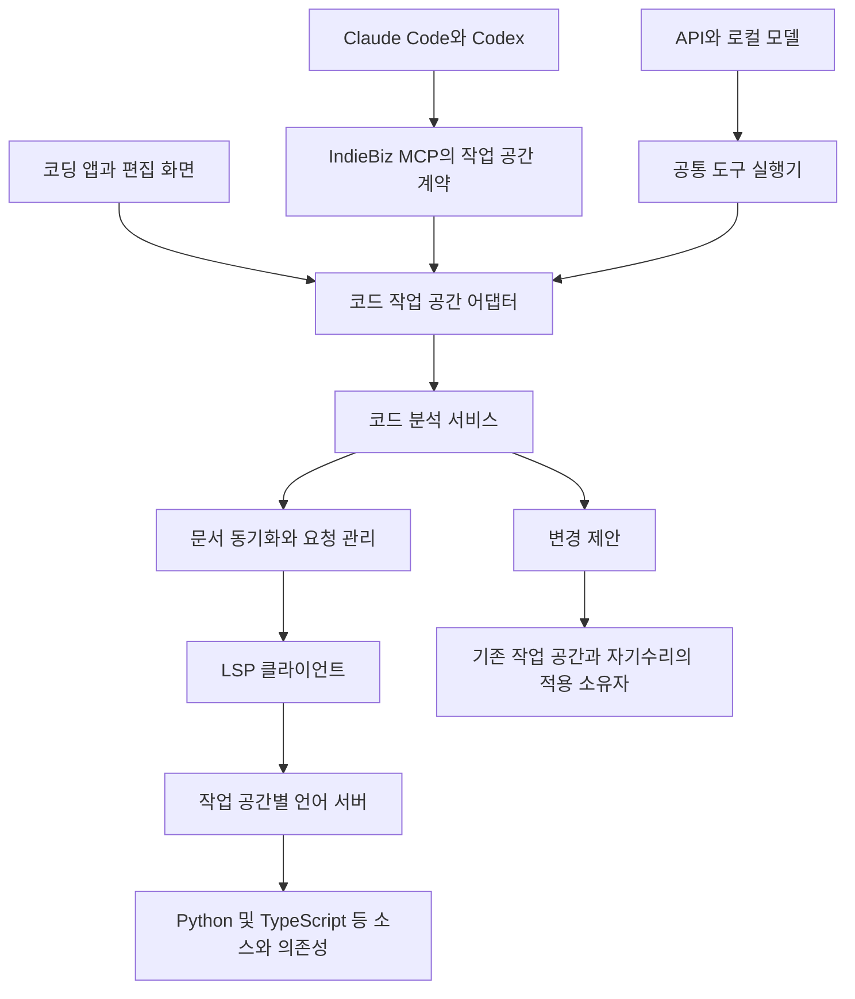

# 모델 프로바이더와 독립적인 코드 분석과 리팩터링 설계

상태: 2026-11-06 구현과 회귀 검증. 계약·실행 경로 및 검증 범위는 아래 구현 기록을 함께 본다.

## 1. 결정과 목적

**언어 서버는 모델 프로바이더가 아니라 IndieBiz OS의 코드 작업 공간이 소유한다.**
Claude Code·Codex·API 모델·로컬 모델은 같은 코드 분석 결과와 변경 제안을 사용한다.
모델 교체는 언어 서버·분석 설정·문서 판본·진행 중 요청·변경 제안의 수명을 바꾸지 않는다.

공개 입구는 기존 `[self:workspace]`의 코드 어댑터다. `read`로 의미 기반 정보를 읽고,
`propose`로 리팩터링을 준비하고, `apply`로 해당 작업 공간에 적용한다.
새 `lsp` 코어 어휘, 공급자별 분석 구현, 매 호출마다 켜지는 언어 서버는 만들지 않는다.
LSP는 내부 구현 규약이며 모델에는 작업 의도와 입력·결과 계약을 제공한다.

정의·참조 탐색뿐 아니라 지속적인 변경 동기화, 미저장 초안, 진단, 자동완성,
호출·타입 계층, 이름 변경, 코드 액션, 포매팅, 여러 파일 변경과 복구까지 이번 설계의 범위다.
아래 구현 순서는 의존관계이며, 뒤 항목을 선택적인 후속 작업으로 미루는 구분이 아니다.

품질·실제 완료 시간·전체 토큰을 평가하는 [진화 목적](IBL_EVOLUTION_PURPOSE.md)을 따른다.
정규식 검색은 문자열·설정·동적 로딩을 찾는 데 계속 사용한다. LSP의 참조 결과를
동적 언어와 플러그인을 포함한 전체 실행 관계의 완전한 증명으로 취급하지 않는다.

## 2. 현재 기반과 필요한 변경

| 현재 구현 | 설계에서의 역할 또는 변경 |
| --- | --- |
| `backend/services/workspace_sessions.py`의 Workspace·CodeAdapter | 공개 계약과 작업 공간 해소의 소유자. 코드 분석 selector와 의미 기반 제안을 연결 |
| `backend/services/coding_projects.py` | 프로젝트·파일·Git 소유 유지. 기존 단일 파일 propose/apply를 여러 파일 변경 계약으로 확장 |
| `backend/datastore/coding_store.py` | 기존 저장소 안에 분석 설정·초안 판본·변경 제안·적용 원장을 보존. 별도 LSP 업무 DB를 만들지 않음 |
| `data/packages/installed/tools/system_essentials/essentials_workspace.py` | 경로·행위자·작업 공간 관문과 op 인자 전달 유지 |
| `backend/base/runtime_work.py` | 실제 요청은 작업 수명, 대기 중 서버·수신 루프는 서비스 수명으로 관리 |
| `backend/base/coding_process.py`, `repair_process.py` | 협업 사본·자기수리의 실제 프로세스와 쓰기 경계 유지 |
| `backend/services/coding_worker_tools.py`, `backend/providers/coding_profile.py` | 제한된 코딩 실행자도 같은 읽기 계약을 받도록 연결 |
| `backend/ibl/tool_batch.py`의 checked_read_program | 코드 읽기만 허용하는 사본의 관문 유지. propose/apply를 읽기로 위장하지 않음 |
| `backend/ibl/ibl_script_session.py` | 프로세스를 IBL 실행 하나에 묶으므로 지속적인 코드 분석의 소유자로 채택하지 않음 |
| `data/scripts/targeted_code_read.py`, `대상별좁혀읽기` | LSP 위치에서 필요한 본문만 읽거나, 분석 미지원 부분의 텍스트 증거를 수집 |

현재 코드 작업 공간의 `open`은 Git 초기화·프로젝트 등록 등의 동작을 할 수 있다.
단순한 소스 분석이 이 동작을 유발해서는 안 된다. 명시적인 코드 조회 모드를 추가한다.
또한 현재 `propose/apply`는 단일 파일 지문을 확인하는 구조이므로,
기존 구현만으로 다중 파일 리팩터링이 이미 안전하게 적용된다고 가정하지 않는다.

## 3. 전체 구조와 소유권



### 작업 공간과 분석 뷰

서비스는 경로 문자열만으로 세션을 공유하지 않는다. 세션 키는 다음을 포함한다.

`몸 ID + 권한 범위 ID + 실제 작업 사본 ID + canonical root + 분석 뷰 ID + 서버/환경 지문`

- **작업 사본**은 정본·자기수리 후보·협업 사본·일반 코딩 프로젝트를 구별한다.
- **분석 뷰**는 저장된 파일 뷰와 특정 편집자가 소유한 미저장 초안을 구별한다.
- 같은 소유권·같은 뷰의 여러 AI 턴은 서버를 공유한다. 프로바이더 ID는 키에 넣지 않는다.
- 같은 파일을 서로 다르게 편집한 두 초안은 서로 다른 뷰다. 초안이 있는 뷰는
  독립 서버로 분석하여 import를 통한 미저장 내용도 서로 섞이지 않게 한다.
- 루트 경로가 같아도 작업 사본을 교체·삭제·재생성하면 workspace generation을 바꾼다.
  오래된 URI·결과·제안이 새 사본을 가리키지 않는다.

읽기 전용 코드 뷰는 기존 CodingStore에 `code_view` 레코드로 연결한다. 별도 프로젝트나
Git 저장소를 만들지 않으며, 기존 코드 프로젝트에는 별도 뷰를 중복 등록하지 않는다.
`Workspace.resolve`가 뷰와 실제 자료 소유자를 해소하고 모든 호출에서 현재 권한을 확인한다.
resource는 주소이며 권한 증표가 아니다. 단순 조회 뷰를 열었다고 편집 권한이 생기지 않는다.

### 언어 서버 수명

첫 요청에서 서버를 켜고 작업 공간이 사용되는 동안 유지한다. 인덱스·문서 상태를
모델 왕복 사이에 재사용하고, 언어별 서버 풀은 모노레포의 실제 프로젝트 루트로 나눈다.
초기화·분석 중·요청 수행·유휴·정지·실패 상태와 server generation을 기록한다.

유휴 회수와 메모리 한도는 기기 자원 정책으로 설정한다. 활성 요청·적용 중 제안을 가진
세션을 몰래 종료하지 않는다. 뷰가 사라지거나 사본이 닫히면 해당 서버와 자손을 정리한다.
백엔드 재기동 때는 현재 요청을 기존 drain으로 처리하고 서비스 종료 훅이 서버를 닫는다.
서비스가 살아 있다는 이유로 drain이 영원히 기다리지 않는다.

서버 장애 시 진행 요청을 실패 또는 부분 결과로 확정하고 새 generation으로 재초기화한다.
읽기의 재시도도 기존 실행 예산·취소를 따르고, 변경 적용은 영수증 확인 없이 재전송하지 않는다.
서버 메모리 자체는 복구 대상이 아니다. 저장된 설정·초안·판본으로 다시 동기화한다.
재기동 전 결과는 과거 증거로 남으며 최신 분석 결과로 둔갑하지 않는다.

## 4. 모델과 앱이 사용하는 계약

### 열기와 발견

다음 코드는 구현된 작업 공간 계약이다.

```ibl
$공간 = [self:workspace]{op:"open",kind:"code",mode:"inspect",path:$경로}
[self:workspace]{op:"capabilities",resource:$공간.resource}
```

`mode:"inspect"`는 분석 뷰만 연결한다. 기존 기본 `open`의 동작은 유지한다.
자기수리·협업 실행의 작업 공간은 소유자가 발행한 resource를 문맥에 전달한다.
모델이 소유자·사본 ID·쓰기 범위를 인자로 만들어 권한을 얻을 수 없다.
모델이 루트를 생략하거나 다른 경로를 요청하면 실제 실행 문맥과 대조하여 해소한다.

capabilities는 서버 이름만 나열하지 않고 기능별로
`supported / unavailable / unsupported / initializing`과 이유, 선택 서버·버전·환경·설정 출처를 준다.
설치 여부, 서버가 광고한 기능, 검증된 드라이버 지원, 현재 접근 권한을 구별한다.
프로바이더별 프롬프트에는 별도 도구 설명을 복제하지 않고 같은 계약을 소개한다.

### 읽기

```ibl
[self:workspace]{op:"read",resource:$공간.resource,
  selector:{analysis:"definition",path:"backend/services/example.py",line:40,column:9}}

[self:workspace]{op:"read",resource:$공간.resource,
  selector:{analysis:"references",target:$위치,include_declaration:false}}

[self:workspace]{op:"read",resource:$공간.resource,
  selector:{analysis:"diagnostics",paths:["frontend/src/Example.tsx"],scope:"files"}}
```

`target`은 앞선 결과가 반환한 URI·선택 범위·문서 지문을 묶은 값이다.
함수명만으로 오버로드·동명이인을 임의 선택하지 않는다. 이름으로 시작하면 symbols로
후보 위치를 얻고 그 위치를 후속 호출에 전달한다. IBL 함수로 이 조합을 보관할 수 있다.

| analysis | 의미와 표준 요청 |
| --- | --- |
| `symbols` | 파일 또는 프로젝트의 심볼. documentSymbol / workspace/symbol 및 필요한 resolve |
| `definition`, `declaration`, `type_definition`, `implementation` | 위치가 가리키는 정의·선언·타입 정의·구현 |
| `references` | 선언 포함 여부를 명시한 참조 목록 |
| `hover`, `signature` | 타입·문서·호출 인자 설명 |
| `calls`, `types` | prepare 결과의 서버 data를 보존한 호출·타입 계층 탐색 |
| `diagnostics` | 파일·프로젝트 범위의 진단과 수신·판본 상태 |
| `completion` | 위치별 완성 후보와 resolve. 추가 편집도 변경 제안으로 전달 |
| `actions` | 범위·진단에 대한 코드 액션 목록과 resolve |
| `batch` | 같은 뷰에서 여러 읽기를 실행. 항목별 성공·실패와 실제 분석 판본을 보존 |

모든 언어 서버가 모든 표준 기능을 구현한다고 가정하지 않는다. 지원 기능은 그대로
제공하고, 미지원은 능력 결과로 반환한다. grep 결과를 references 성공 결과로 바꾸지 않는다.
전송과 표준 결과 해석은 공통이며 서버별 명령·설정·특수 code action만 드라이버가 맡는다.

### 제안과 적용

아래 `$작업공간`은 편집 또는 자기수리 소유자가 발행한 변경 가능한 resource다.
앞의 inspect 뷰를 재사용해 쓰기 권한을 얻는 예제가 아니다.

```ibl
$제안 = [self:workspace]{op:"propose",resource:$작업공간.resource,
  selector:{analysis:"rename",target:$위치,new_name:"새이름"}}
[self:workspace]{op:"apply",resource:$작업공간.resource,proposal:$제안.proposal}
```

`propose`는 `rename`, `code_action`, `completion`, `format`을 받는다.
코드 액션·완성 후보는 서버 generation과 문서 판본에 결속한 참조로 선택한다.
`format`은 문서 전체 또는 범위를 명시한다. 준비된 편집은 공통 변경 제안으로 정규화한다.
읽기 전용 inspect 뷰는 제안 내용을 확인할 수 있지만 그 뷰를 통해 원본을 적용하지 못한다.
편집 가능한 작업 공간 또는 자기수리 소유자가 동일한 제안을 권한·판본 검증 후 인수한다.

새 사용자 승인 의례를 붙이지 않는다. 기존 사용자 지시·작성 창 소유권·자기수리·코딩
작업 범위를 적용한다. apply 성공과 테스트 통과, 정본 반영·Git 커밋은 별개 결과다.

## 5. 결과와 근거

결과는 기존 작업 공간 머리와 `{items:[...]}`를 유지한다. 각 위치는 다음을 포함한다.

```json
{
  "path": "backend/services/example.py",
  "uri": "file:///workspace/backend/services/example.py",
  "range": {"start":{"line":40,"column":9},"end":{"line":40,"column":13}},
  "position_encoding": "unicode_codepoint_1based",
  "document_hash": "<sha256>",
  "document_version": 12,
  "view": "saved",
  "kind": "reference"
}
```

공개 좌표는 기존 파일 읽기에 맞춘 1시작 행·열이며, 열은 Unicode 코드포인트 수다.
범위 끝은 배타적이다. LSP의 0시작 좌표와 협상한 문자 단위로의 변환은 한곳에서 한다.
탭의 표시 폭이나 결합문자의 눈에 보이는 폭을 열 번호로 쓰지 않는다.
[위치 공식 명세](https://raw.githubusercontent.com/microsoft/language-server-protocol/gh-pages/_specifications/lsp/3.17/types/position.md)

결과 전체의 `analysis`에는 다음을 싣는다.

- resource·root·view·workspace generation, 서버 ID/버전/generation, 설정·환경 지문.
- 요청 범위, 관측한 문서 판본, 동기화 확인 범위, 획득 시각과 실행한 기능.
- `complete / partial / unavailable / stale`, 사유, 건수·잘림·제외 범위.
- 진단에서는 파일별 수신 상태, 판본 대응 여부, pull/push 방식.

`complete`는 해당 요청의 응답을 손실 없이 받았다는 뜻이다. 동적 호출까지 포함한 모든
실행 관계를 파악했다는 뜻이 아니다. 빈 목록·미지원·초기화 중·시간 초과를 구별한다.
단건 호출의 실패는 기존 실패 계약을 사용한다. batch는 항목마다 결과와 실패를 보존한다.

코드 전체나 거대한 hover를 매번 보내지 않는다. 위치·짧은 설명·필요한 발췌를 반환하고,
긴 목록과 원문은 기존 결과 참조로 회수한다. 표시 한도 때문에 원문을 버리지 않는다.
별도 결과 DB나 조회 언어는 만들지 않는다. 열어 보지 않은 범위를 확인했다고 표시하지 않는다.

## 6. 문서 동기화와 최신성

코드 분석 서비스가 URI별 저장 바이트, 인코딩, 개행, 내용 해시, LSP version,
편집 뷰의 소유자를 관리한다. 외부 에디터의 미저장 내용을 안다고 가정하지 않는다.
IndieBiz 편집 뷰에서 전달받은 내용만 해당 뷰의 `draft`로 분석한다.

1. initialize 응답의 기능을 확인하고 initialized를 보낸 뒤 문서를 didOpen한다.
2. 변경은 서버의 동기화 방식에 따라 didChange로 보내고, 저장과 닫기를 별도로 통지한다.
3. IBL 편집·네이티브 CLI 편집·외부 편집기·Git 작업의 변경을 같은 관측 열에 모은다.
   내부 쓰기 통지와 파일 감시를 함께 사용해 생성·삭제·개명·미추적 파일을 관측한다.
4. 설정·lockfile·분석 환경·프로젝트 경계의 변경은 관련 서버를 재설정하거나 재생성한다.
   열린 문서뿐 아니라 import와 진단에 미치는 영향을 무효화한다.
5. 요청 전에 관측된 변경 열을 처리하고 대상 본문의 해시를 확인한다. 결과를 반환할 때도
   대상·결과 위치의 본문을 대조하고, 요청 중 변경은 stale로 표시해 필요한 범위를 재조회한다.

감시 누락·큐 overflow·절전 복귀 때는 재탐색하고 관측 세대를 갱신한다.
매 호출에 전체 저장소의 내용 해시를 다시 만들지 않고 감시와 내용 캐시로 대상을 좁힌다.
변경 적용 직전의 대상 바이트는 캐시와 무관하게 직접 확인한다.
복수 파일을 고정 상태에서 분석해야 하면 기존 작업 공간의 스냅샷으로 별도 분석 뷰를 구성한다.
라이브 감시만으로 모든 의존 파일의 원자적인 관측을 보장하지 않는다.

LSP의 일반 응답에는 분석을 마친 문서 판본이 없을 수 있다. `observed_revision`과
`server_confirmed_revision`을 구분하고, 서버가 확인하지 않은 판본을 추정으로 채우지 않는다.
설정 누락이나 비동기 인덱싱 중이라는 사실도 결과에 남긴다.
오래된 위치에 새 본문을 붙여 최신 참조 결과로 만들지 않는다.

같은 저장 뷰의 읽기는 공유하고, 쓰기·동기화는 작업 공간별로 순서를 정한다.
다른 작성자의 미저장 뷰는 합치지 않는다. 모델 교체는 이 순서와 소유권을 바꾸지 않는다.

## 7. 진단 완료의 계약

pull 진단을 제공하면 `textDocument/diagnostic`과 지원하는 workspace 진단을 사용한다.
resultId와 관련 문서를 보존하고, `unchanged`는 참조한 기존 진단 집합에 연결한다.
[Pull diagnostics 명세](https://raw.githubusercontent.com/microsoft/language-server-protocol/gh-pages/_specifications/lsp/3.17/language/pullDiagnostics.md)

push 진단은 URI별로 기존 목록을 교체한다. 빈 통지는 기존 진단을 없애라는 응답이며
아직 통지를 받지 않은 상태와 다르다. version이 있으면 보낸 문서 판본과 대조한다.
version이 없는 통지는 도착 시각만으로 최신이라 확정하지 않고, 드라이버가 확인할 수 있는
동기화·완료 근거와 함께 반환한다.
[Publish diagnostics 명세](https://raw.githubusercontent.com/microsoft/language-server-protocol/gh-pages/_specifications/lsp/3.17/language/publishDiagnostics.md)

한동안 통지가 없다는 이유로 오류 0건을 보고하지 않는다. 대상별로
`received / pending / unsupported / stale / version_unconfirmed`를 구별한다.
전체 workspace 진단 완료를 확인할 방법이 없는 서버에서는 LSP 결과를 전체 합격 판정으로 쓰지 않는다.
같은 환경의 타입 검사기와 기존 빌드 검사를 연결하고, 별도의 검증 근거로 표시한다.
IndieBiz frontend의 실제 검사는 계속 `npx tsc -p tsconfig.app.json`이다.

## 8. 복수 파일 리팩터링과 복구

언어 서버의 WorkspaceEdit 수신은 변경 완료가 아니다. 기존 CodingStore의
workspace_proposal을 확장하고, 단일 파일 제안도 같은 형식으로 정규화한다.
LSP 전용 직접 쓰기 경로나 별도 적용기를 만들지 않는다.

제안에는 다음을 보존한다.

- operation ID, 행위자·작업 공간·뷰, 원래 요청, 서버·문서 판본, 파일별 원본 바이트 해시.
- `changes`와 `documentChanges`를 정규화한 순서 있는 편집, create/rename/delete, 변경 주석.
- 변경 후 바이트, 인코딩·개행·실행 권한 등 보존할 속성, 변경 이유와 영향 파일 목록.
- resolve한 코드 액션과, 명령이 필요하면 드라이버가 선언한 입력·효과·대상 계약.

apply 전에 모든 대상의 권한·원본 해시·겹친 편집·URI·파일 작업 충돌을 검사한다.
일부 파일만 새 원문을 기준으로 고쳐 적용하지 않는다. 기존 작업 공간 잠금으로 내부 쓰기를
조정하고, 준비한 바이트와 적용 원장을 보존한 뒤 파일별 원자 교체를 한다.
다중 파일 전체가 OS에서 원자적으로 보인다고 주장하지 않는다.

중단 상태는 `prepared / applying / applied / recovery_required`로 구별한다.
복구 때 현재 바이트가 제안의 before/after와 일치하는지 파일별로 확인한다.
외부 편집을 덮어쓰지 않고 충돌로 남긴다. 같은 operation ID는 기존 결과를 회수하며
적용을 반복하지 않는다. 복구용 바이트는 기존 제안 저장소에 보존하고, 일회성 백업이
필요하면 `data/_backups/` 규약을 따른다.

미저장 뷰에는 초안 변경 집합을 적용하고 저장은 기존 작성 세션 소유자가 수행한다.
저장본과 초안을 섞어 일괄 적용하지 않는다. 다른 창의 편집을 빼앗지 않는다.
자기 코드의 변경은 수리 후보에 적용하고 기존 검사·정본 반영·재개 절차에 넘긴다.
일반 코드의 변경은 해당 코딩 작업 공간에 적용한다. 의존성 정의를 읽을 수 있다는 사실이
그 외부 라이브러리를 편집할 권한을 뜻하지 않는다. LSP는 Git 커밋 범위를 확대하지 않는다.

서버의 `workspace/applyEdit`는 현재 제안·적용 요청과 연결된 경우에만 인수한다.
읽기 중에 오는 적용 요청은 거절 응답을 보낸다. `workspace/executeCommand`를
임의의 셸 명령 입구로 공개하지 않는다. 필요한 서버 명령은 드라이버가 계약을 선언하고,
변경을 같은 적용 원장과 작업 공간 경계로 통과시킨다. 편집으로 변환하거나 효과를 통제할 수
없는 서버 고유 명령은 이유를 표시한다. 이 제한은 서버 지원 범위이며 프로바이더별 기능 차이가 아니다.

## 9. LSP 클라이언트와 언어 서버

LSP 3.17의 공통 계약을 호환 기준으로 삼는다. 최신판이라는 주장은 아니다.
JSON-RPC 요청·응답·통지를 구분하고 stdio Content-Length는 바이트로 센다.
분할 수신·여러 프레임·응답 순서 변경·서버의 역방향 요청을 수신 루프에서 처리한다.
stdout은 프로토콜, stderr는 진단 로그로 분리한다.

`workspace/configuration`, workspaceFolders, 동적 등록·해제, 진행 통지,
파일 감시 등록, diagnostic refresh 등 광고한 클라이언트 능력을 구현한다.
구현하지 않은 능력은 광고하지 않는다. 모르는 요청에는 오류 응답을 보내 교착을 막는다.
request ID·취소를 관리하고 만료·서버 세대 교체 뒤 응답을 새 요청에 혼합하지 않는다.
종료는 shutdown 응답·exit를 시도하고, 남은 서버·자손은 기존 프로세스 종료 기반으로 회수한다.
[초기화 명세](https://raw.githubusercontent.com/microsoft/language-server-protocol/gh-pages/_specifications/lsp/3.17/general/initialize.md),
[기본 전송 규약](https://github.com/microsoft/language-server-protocol/blob/gh-pages/_specifications/specification-3-14.md#base-protocol)

언어·실행 명령·설정은 `data/code_analysis/servers.yaml`의 데이터로 선언한다.
IBL 파서·프로바이더에 언어 이름이나 서버 이름에 따른 분기를 넣지 않는다.
드라이버는 표준 밖 설정·명령·진단 완료의 차이를 흡수한다. 표준 LSP 서버의 추가는
서버 선언과 계약 시험으로 가능하게 한다. 모든 언어의 특수 확장을 코어에 넣지 않는다.

| 언어 | 제공할 서버와 환경 |
| --- | --- |
| Python | Pyright 언어 서버. 프로젝트의 가상 환경·Python 버전·실행 환경·import 검색 경로 사용 |
| TypeScript·JavaScript·TSX·JSX | typescript-language-server와 프로젝트의 TypeScript. tsconfig/jsconfig와 프로젝트 참조 존중 |
| 다른 언어 | 같은 서버 선언·기능 계약으로 연결. 미등록·미지원은 명시적으로 반환 |

TypeScript의 tsserver는 LSP를 직접 받지 않으므로 LSP 어댑터를 거친다.
[typescript-language-server 공식 README](https://github.com/typescript-language-server/typescript-language-server)

도입 시 서버·드라이버·런타임 버전을 고정하고 관리된 도구 환경에 설치한다.
조회 때마다 `npx`로 내려받거나 최신판으로 자동 교체하지 않는다.
코드 분석 설정 화면에서 선택 서버·실행 환경·누락 의존성을 확인하고, 설치·업데이트는
기존 의존 관리 흐름에 연결한다. 실제 해소한 버전은 결과에 남긴다.
공유 설정에 특정 Mac의 절대 경로를 박지 않으며, 프로젝트 내 실행파일 사용은 명시적 선택으로 기록한다.

## 10. IndieBiz 자체 분석 설정

`backend/boot_paths.py`는 층 디렉터리를sys.path에 넣어 평면 import 이름을 유지한다.
일반적인 Python 패키지 구조만 가정하면 미해결 import와 부정확한 참조가 늘어난다.

- backend 분석 환경에 실제 층·공통 모듈 검색 경로를 제공한다. 층 이름은 boot_paths의
  기존 선언에서 파생하고, LSP를 위한 별도 수동 목록을 만들지 않는다.
- 임의 프로젝트를 실행·import해 검색 경로를 추측하지 않는다. 명시 설정과 정적으로 읽을 수 있는 선언을 쓴다.
- 모든 패키지 handler 폴더를 extraPaths에 한꺼번에 추가하지 않는다. 각 패키지 문맥과 동적 로딩을 구별한다.
- 수리 후보는 후보의 소스와 설정을 분석한다. 공유 가능한 의존 환경과 정본 소스는 구별한다.
- frontend는 기존 tsconfig와 로컬 TypeScript를 쓴다. 별도 느슨한 설정으로 통과시키지 않는다.
- importlib·동적 등록·IBL 문자열 관계는 기존 구조 검사·계약 검사·문자열 검색의 근거와 함께 본다.

기존 pyrightconfig.json 또는 pyproject.toml의 설정을 우선하고,
덮어쓴 항목과 출처는 capabilities에 표시한다.
[Pyright 설정 문서](https://github.com/microsoft/pyright/blob/main/docs/configuration.md)

## 11. 모든 실행 모드에 같은 능력 연결

| 실행 모드 | 연결과 권한 경계 |
| --- | --- |
| 일반 API·로컬 모델 | 기존 execute_ibl → workspace → 코드 분석 서비스 |
| 일반 Claude Code·Codex | 기존 IndieBiz MCP → 같은 workspace. 벤더 LSP·플러그인을 켜지 않음 |
| 협업 사본의 API 실행자 | 읽기는 checked_read_program. 변경은 현재 사본의 격리된 run_command로 공통 CLI 호출 |
| 협업 사본의 네이티브 실행자 | 사본에 결속된 읽기 전용 MCP, 변경은 기존 셸에서 같은 공통 CLI 호출 |
| 자기수리 실행자 | repair context가 선택한 후보 resource와 프로세스 경계에서 같은 계약 사용 |
| 코딩 앱·편집 화면 | workspace와 편집 동기화의 얇은 API. 분석·적용 로직은 서버와 공유 |

현재 coding 프로파일은 MCP를 붙이지 않고, API 측은 읽기 IBL만 허용한다.
이 차이를 연결하지 않은 상태를 전체 프로바이더 대응으로 보고하지 않는다.
읽기 전용 MCP는 기존 execute_ibl 스키마를 사용하되 발행자가 정한
작업 공간·행위자·세대에 고정한다. checked_read_program 검사와 자원 해소 후의
작업 공간 소속 검사를 모두 거친다. 임의 스크립트·저장·적용은 노출하지 않는다.
운영용 일반 MCP를 그대로 작업 사본에 연결하는 방식은 채택하지 않는다.

`backend/code_analysis_cli.py`는 같은 서비스 계약을 호출하는 터미널 클라이언트다.
JSON stdin/stdout·취소·operation ID·기존 결과 참조를 사용하고 별도 분석 구현을 갖지 않는다.
작업 시작 시 발행한 제한된 로컬 브리지를 이용한다. 브리지 자격은 실행자가 전달하는
환경·접속 설정으로 유지하고 모델이 생성하는 인자에 넣지 않는다.
허용 op·작업 공간·주체·세대·만료에 결속하고 호스트의 일반 권한을 전달하지 않는다.

브리지의 기본 전송은 부모가 소유하는 stdio MCP/요청 채널이다. 셸 클라이언트처럼 별도
프로세스가 접속해야 할 때는 작업별 runtime의 Unix socket 또는 Windows named pipe를 쓴다.
샌드박스에는 그 IPC만 허용하며 네트워크 전체나 localhost 모든 포트를 열지 않는다.
현재 native coding의 자체 샌드박스 설정과 이 통로의 결합도 구현·회귀 대상이다.
해당 플랫폼에서 IPC 권한을 좁혀 공급할 수 없으면 일반 호스트 HTTP로 우회하지 않고
작업 실행자가 소유하는 stdio 중계로 같은 요청을 전달한다.

서비스는 관리·요청·결과의 소유자다. 실제 파일 읽기·분석 서버·변경 적용 프로세스는
작업 공간의 기존 프로세스 실행 기반과 권한 아래 둔다. 서버의 캐시는 runtime에 저장한다.
서버 플러그인이 실행 코드를 로드할 수 있으므로, 읽기 메서드만 호출한다는 이유로
언어 서버 프로세스 자체를 무조건 순수하다고 선언하지 않는다.

읽기 IBL 계약은 사용자 소스 변경이 없는 분석으로 선언하되, 관측 자원은 코드 뷰·환경이다.
서버 기동·캐시 쓰기는 관리된 내부 상태다. 명시적 미지원 서버 명령은 읽기 경로에 넣지 않는다.
모든 읽기는 요청별 문서 동기화와 판본 검사를 거치며, 판본을 증명하지 못하는 결과는
새 실행의 자동 재사용 대상에서 제외한다. propose/apply는 기존 쓰기 효과와 자원 검사를 유지한다.

## 12. 책임과 파일 배치

아래는 신설 후보 이름이다. 구현 시 이름 충돌을 확인하고 파일별 1500줄 제한을 지킨다.

| 위치 | 책임 |
| --- | --- |
| `backend/base/lsp_transport.py` | stdio JSON-RPC·요청 ID·수신·취소 |
| `backend/base/lsp_positions.py` | 좌표·URI·인코딩 변환 |
| `backend/base/code_analysis_process.py` | 분석 자식·제한 IPC. coding/repair 프로세스 경계 재사용 |
| `backend/datastore/code_analysis_store.py` | CodingStore에 분석 뷰·설정·원문 참조 연결 |
| `backend/services/code_analysis.py` | 작업 공간별 세션·능력·요청과 서비스 수명 |
| `backend/services/code_analysis_documents.py` | 감시·문서 동기화·판본·진단 관측 |
| `backend/services/code_analysis_results.py` | 위치·계층·진단·후보 결과와 근거 정규화 |
| `backend/services/code_analysis_changes.py` | WorkspaceEdit 변환, 기존 적용 원장·복구 연결 |
| `backend/services/code_analysis_drivers.py` | 설정·서버 고유 계약. 커지면 책임에 따라 분리 |
| `backend/surface/api_code_analysis.py` | 편집 동기화 등 얇은 표면. 일반 작업은 workspace 사용 |
| `backend/code_analysis_cli.py` | boot_paths를 사용하는 독립 입구. 층 검사 ASSEMBLY에 등록 |
| `data/code_analysis/servers.yaml` | 언어·서버·설정 선언. 기기별 절대 경로는 실행 상태에 보관 |

층은 디렉터리에서 파생한다. base에서 services로 상향 import하지 않고 조립층에서 배선한다.
등록 스크립트·관용구가 필요한 경우에도 workspace 계약을 조합하는 얇은 표현으로 둔다.

기존 수정 대상은 workspace_sessions·coding_projects·coding_store·essentials_workspace·
ibl_actions의 원본 선언·coding_worker_tools·coding_profile·CLI 기동 배선·
서비스 종료 처리·코드 편집 화면이다. IBL 파서와 모델 공급자에 언어 분석 규칙을 넣지 않는다.
CodingStore.lock의 현재 fcntl 의존성은 Windows에서 사용할 수 없으므로,
이 공통 저장소를 이용하는 분석 뷰·적용 원장까지 포함해 플랫폼별 잠금 기반으로 연결한다.
이를 문서상 Windows 지원만 선언하고 남겨 두지 않는다.

## 13. 구현 순서와 완료 조건

다음 모두가 이번 완성형의 구현 범위다. 순서는 의존관계이며 선택적인 후속 과제가 아니다.

1. **공통 계약과 작업 공간**: inspect 뷰, selector, 결과·변경 제안, 행위자·사본 결속.
   선언·스키마·설명·가이드를 같이 갱신하고 기존 read/propose/apply의 호환성을 검사한다.
2. **서버와 지속 동기화**: 프로세스 수명, 기능 협상, 파일 감시, 초안 뷰, 취소·복구.
   Python·TypeScript 실제 서버로 프로젝트와 import 설정을 검증한다.
3. **탐색과 진단 전체 연결**: analysis 표의 기능을 연결하고 원문·계층 참조·불명 상태를 보존한다.
4. **변경과 복구**: rename·코드 액션·자동완성 편집·포매팅, 다중 파일 원장, 초안/후보 적용, 충돌·중단 복구.
5. **모든 사용 표면**: API·두 CLI·협업 샌드박스·자기수리·코딩 화면. 모델 교체와 동시 접근을 검증한다.
6. **도입과 실작업 인수**: 서버 설치·설정 진단·가이드·용례·회귀·성능 비교를 완료한다.

서버마다 존재하지 않는 기능을 구현된 것처럼 만들지는 않는다. 채택 서버의 기능 대응표를
실제 호출 결과와 맞추며, 서버가 지원하지만 아직 연결하지 않은 기능을 서버 미지원으로
표시해서 완료 범위를 축소하지 않는다. 다른 언어도 공통 계약으로 연결할 수 있어야 한다.

## 14. 검증과 평가

### 계약과 실제 서버 시험

- 분할 프레임·응답 순서·역방향 요청·취소 후 응답·비정상 종료를 모의 서버로 재현한다.
- 한글·이모지·결합문자·탭·CRLF·Windows URI·심볼릭 링크의 위치 변환을 확인한다.
- 동명이인·별칭 import·재export·오버로드·TSX·Python 층 import를 실제 서버에서 조회한다.
- 생성·삭제·개명·Git 전환·설정 수정·감시 overflow 뒤에 옛 결과가 최신으로 표시되지 않는다.
- 진단 미수신·옛 판본·빈 push·pull unchanged·관련 문서·부분 진단을 구별한다.
- 저장 뷰의 모델 교체와 서로 다른 사본·미저장 뷰의 격리를 검증한다.
- 복수 파일 rename, create/rename/delete, 중복 범위, 인코딩 보존, 적용 중 종료,
  동시 외부 수정, 재전송, 복구 실패를 재현하고 바이트·원장을 확인한다.
- 권한 밖 resource·만료된 브리지·정본/후보 혼동·서버 applyEdit·읽기 MCP의 쓰기가 경계를 넘지 않는다.
- 워커와 서버 자손의 합계 메모리, 유휴 회수, backend drain, 부모 비정상 종료에서 누수가 없다.

시험은 대응 모듈의 `backend/test_*.py`에 둔다. 버전을 고정한 실제 언어 서버와의
통합시험을 포함하고 모의 서버만으로 호환성을 선언하지 않는다.
Mac·Windows·Linux의 설치·통신·잠금·정리를 검증하고, 기존 코딩 격리의 OS 지원 범위는
별도로 보고한다. 기존에 미지원인 OS 격리를 LSP 때문에 느슨하게 바꾸지 않는다.
해당 격리 모드의 제약은 명시하고 일반 로컬 분석의 OS 지원과 혼동하지 않는다.

### 실제 작업 비교

같은 코드·의존 환경·달성 기준으로 문자열 검색만 이용한 경우와 LSP를 함께 쓴 경우를 비교한다.
프로바이더마다 명시 IBL 계약 시험과 자연어에서 도구를 선택하는 실제 작업을 구분한다.
backend 정의 추적, frontend 타입 수정, 여러 파일 이름 변경, 동적 등록이 포함된 영향 조사를 사용한다.

정의 오선택·누락·적용 결과·사용자 수정량, 완료 시간, 전체 모델 토큰,
읽은 본문량, 언어 서버의 cold/warm 비용과 메모리를 측정한다.
LSP가 추론 모델을 부르지 않아도 결과를 읽는 모델의 토큰은 계산에 포함한다.
상주 비용·인덱스 생성 비용을 숨긴 채 warm 결과만으로 성능 향상을 주장하지 않는다.
코드 작업이 없는 대화에는 서버 목록·전체 기능 설명을 주입하지 않는다. 기존 workspace
소개와 코드 능력 발견 경로로 진입하고, 필요한 기능 계약만 읽는다. 분석 모듈도 지연 로드한다.

구현 검증은 `scripts/select_tests.py`와 `docs/REGRESSION_TESTING.md`를 따른다.
어휘 선언은 `scripts/build_ibl_nodes.py`로 파생하고 `--check`로 검증한다.
backend 변경은 Android 번들 매니페스트를 재생성하되 PC 전용 분석이 폰에서 실행되는 것처럼
표시하지 않는다. frontend 변경은 `npx tsc -p tsconfig.app.json`으로 확인한다.
필요한 검증과 정본 반영·커밋까지 마친 뒤에 구현 완료를 보고한다.

## 15. 설계 판단

IndieBiz가 소유할 것은 특정 모델의 LSP 도구 복제가 아니라, **코드의 상태를 지속적으로
관측하고 의미 기반 탐색과 변경을 기존 작업 공간에 연결하는 공통 능력**이다.
언어 서버를 개인의 작업 공간·권한·원문·수리·기록과 결합한다.
모델 프로바이더는 이 능력을 사용하는 주체이며, 능력의 수명과 지원 기능을 소유하지 않는다.


## 구현 기록 — 2026-11-06

- 코어 낱말 추가 없이 workspace의 inspect/read/propose/apply/recover에 연결했다.
  일반 파일 편집도 같은 다중 파일 원장을 사용하고 apply 재호출은 기존 영수증을 회수한다.
- 저장본은 상주 서버와 파일 감시, 초안·고정 스냅샷은 독립 소스 투영과 서버로 분리했다.
  스냅샷은 원문을 고정하되 node_modules·가상 환경은 공유 읽기 의존성이다.
  결과는 개별 문서 판본의 관측을 증명하며 전체 프로젝트 그래프 완료를 주장하지 않는다.
- 실행자는 API·Claude Code·Codex 모두 읽기 IBL과 기존 OS 격리 명령으로 연결한다.
  설계의 네이티브 셸 직접 호출 대신 **네이티브 도구는 읽기로 제한하고 공통 run_command를 사용**한다.
  MCP의 execute_ibl은 읽기 전용이며 run_command의 쓰기는 기존 사본 샌드박스가 소유한다.
  CLI는 작업별 인증 Unix socket/Windows named pipe만 사용한다. macOS는 해당 소켓 경로만 추가 허용한다.
- TypeScript 명령 중 WorkspaceEdit·순수 코드 변경·리팩터링 편집 조회를 드라이버에서 변환한다.
  패키지 설치·플러그인 구성 등 효과를 제한하지 못하는 명령은 명시적으로 거절한다.
- Pyright 1.1.414, typescript-language-server 5.0.0, TypeScript 5.9.3을 고정했다.
  Node 20에 대응하는 서버 버전을 선택했고 조회 중 다운로드하지 않는다.
- 코딩 파일 화면에 분석·변경·초안 동기화·서버 설치 상태를 연결했다.
  `backend/code_analysis_cli.py`는 JSON 클라이언트 및 작업에 결속된 stdio MCP 입구다.
- 패키지의 workspace 인자 확장은 기존 소유자 관문 안에 있다. 회원 read/fill/write/script의
  선행 경로 검사와 전송 분기는 바꾸지 않았으며 패키지 감사 지문을 다시 생성했다.

검증은 실제 고정 서버의 Python/TypeScript 정의·다중 파일 rename·초안 import 격리·고정 스냅샷·
boot_paths 정적 경로 파생, 분할 JSON-RPC·역방향 요청·응답 순서·취소·프로세스 소실,
유니코드·BOM·CRLF, 진단 상태, 중단 복구·외부 변경 충돌·멱등 적용,
실제 macOS 샌드박스 안의 CLI 왕복·외부 쓰기 거절을 포함한다.
Windows named pipe와 공통 파일 잠금 경로는 구현했지만 Windows/Linux 실기기 실행은 이 Mac에서 검증하지 않았다.
모델별 자연어 과제의 비용·성능 비교는 수행하지 않았으며, 회귀 결과를 그 실험의 성과로 해석하지 않는다.

최종 검증 기록:
- system을 포함한 backend 전수: **12,693 통과·24 건너뜀·실패 0**, 487.14초.
- 이후 화면의 저장 후 초안 재생성, 고정 스냅샷 target의 변경 거절, LSP의 부분 적용 능력
  광고를 보완하고 직접 관련 **13건 통과**. 파일별 원자 교체·복구 원장에 맞춰
  `failureHandling:abort`를 광고하며 다중 파일 트랜잭션을 가장하지 않는다.
- `test_code_analysis_ui.py`는 실제 React 화면을 Chromium에서 실행해 두 파일의 초안 유지,
  이름 변경, 탐색, 전체 저장 및 저장 후 초안 종료를 검증한다. 저장소 I/O는 시험 데이터로 격리한다.
- API/JSON CLI/stdio MCP가 같은 서버 generation을 사용하는 계약 시험, 실제 macOS 격리
  명령 안의 분석 왕복과 폴더 밖 쓰기 거절을 통과했다.
- TypeScript 타입 검사, backend 층, IBL 파생물·용례 재검토, Android 번들 검사를 통과했다.
  운영 HTTP health와 설치 서버 조회를 확인했다. 최종 소스 반영 이후 프로바이더 자연어 작업은 실행하지 않았다.
- 초안 적용과 영수증은 단일 DB 트랜잭션으로 저장한다. 파일 저장 직후 중단되어도
  초안의 pending_save가 같은 적용 원장을 회수하여 다시 저장할 수 있다.
- CI의 실제 서버 설치와 변경 경로를 연결했다. 빈 임시 디렉터리의 `npm ci --ignore-scripts`로
  고정된 세 패키지의 재설치를 확인했다. GitHub 원격 CI 자체는 이 로컬 실행에 포함하지 않는다.
