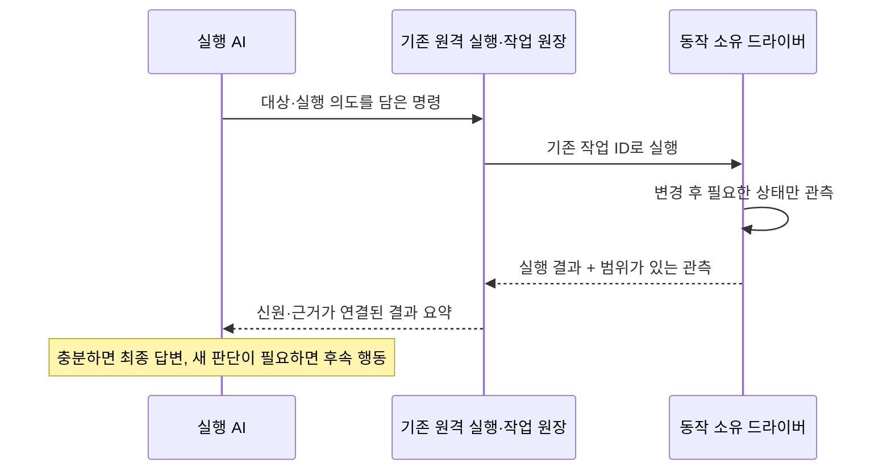

# 원격 명령의 실행 후 관측과 결과 전달 수리 설계

작성: 2026-11-08. 상태: **구현·삼성0 배포·전후 실측 완료. 확인 범위와 한계는 §13을 따른다.**
조사 기준: 정본 main의 `f582262499bcb6234e7b24b2a5d30bed766870c9`.
판단 기준은 [IBL 진화 목적](IBL_EVOLUTION_PURPOSE.md), 소유 구조는
[하드웨어 드라이버 설계](HARDWARE_DRIVER_OWNERSHIP_REPAIR_2026_11_01.md)를 따른다.

## 1. 결정과 범위

**명령을 수행하는 부품이 필요한 상태 관측까지 하고, 기존 결과 회신에 그 근거를 담는다.
공통 하네스는 원 요청과 관측을 연결해 실행 AI와 화면에 전달한다.**
실행→AI 판단→별도 상태 조회→AI 판단으로 나뉜 경계 가운데, 새 판단이 필요 없는 부분을
실행 부품 안에서 닫는다. 대상 이름이나 기종별 예외를 만들지 않는다.

공통화하는 것은 결과의 신원·범위·시점·근거·전달이다. 무엇을 어떻게 관측할지는 드라이버가
소유한다. 음악은 플레이어, 음량은 OS 설정값, 파일 전송은 목적지와 해시를 읽는다.
임의 셸 명령의 목적이나 임의 앱 화면의 업무 완료를 공통 코드가 추측하지 않는다.

첫 범위는 기존 작업 회신·상황 관측의 연결, 음악과 Android/PC 설정 제어의 적용,
기존 파일 전송 확인 결과의 호환 연결이다. 새 IBL 문법·노드·목표 DB·감독 모델·상시 폴링
서비스는 추가하지 않는다. 최종 응답 생성과 필요한 판단은 기존 실행 AI가 맡는다.
장시간 작업의 일반 자동 재개나 종료한 AI의 재호출은 이번 범위가 아니다.



## 2. 확인한 기반과 공백

| 소유 코드 | 이미 있는 것 | 수리할 공백 |
| --- | --- | --- |
| `guest-helper/handler.py::_send_wait`, `resident_store.py`, `limb_client.py` | 명령 접수, 작업 ID, 원격 result 회신·보존·동기 대기. 폰 결과 전송은 수신 long-poll과 분리 | 회신 자체를 신설할 필요 없음. 업무 효과 관측을 기존 result에 연결 |
| `base/task_receipts.py` | 작업의 접수·실행·종료, 동일 ref의 status/wait, 취소 요청과 확인 구분 | 작업 종료와 요청한 상태의 관측을 섞지 않고 확장 결과 보존 |
| `resident_store.py::_watch_situation` | 대상·등록 세대에 묶인 로컬 원장 변화 읽기, 결과의 상황 전달 | 동기 반환·뒤늦은 원장 전달을 같은 관측으로 중복 제거 |
| `datastore/situation_evidence.py::observe_result` | 구조화 결과를 출처가 있는 도구 주장으로 수집 | 현재 일반 수집은 success/state 등 제한된 필드 중심. `now_playing`, `verified`, 요청값/실제값 관계를 공통 효과 근거로 보존하지 않음 |
| `execution_situation.py`, `situation_delivery.py`, `model_result_view.py` | 판본·근거·소비자 커서, 제한된 크기의 API/MCP 문맥 전달, 원문 참조 | 짧은 효과 관측이 큰 검색 결과·중첩 봉투에 묻히지 않도록 전달·참조 연결 |
| `data/scripts/android_control.py`, `pc_control.py` | 요청과 관측값 비교, 원 준비·접수 영수증 검증, `verified`·확인 범위 | 이 검증을 재사용해 공통 관측으로 변환. 새 검증기를 중복 작성하지 않음 |
| `data/instruments/phone_*`, APK `PhoneActions.kt` | 설정 쓰기 후 해당 값 재조회, 음악의 playback_id·streamStatus | 음악 재생 결과에 실제 플레이어 상태와 곡의 결속 전달 |
| `youtube/tool_youtube.py`, `youtube_phone.py` | play/queue/skip, 폰 자체 재생, 재생 인스턴스 교체 감지 | 재생 요청 의도와 큐 추가를 명시적으로 구분하고 관측 결과 반환 |

`PhoneActions.playStream`의 `playing:true`는 준비 콜백에서 start가 오류 없이 반환된 뒤
만드는 값이다. 실제 `MediaPlayer.isPlaying`과 위치 조회는 `streamStatus`에 있다.
따라서 현재 시작 응답을 새로운 상태 재조회와 같은 근거로 승격하지 않는다.
또한 공통 큐의 `elapsed`는 재생 위치의 실측과 같다고 가정하지 않는다.

Android 설정의 기존 선례는 [중복 관측 축소](ANDROID_CONTROL_OBSERVATION_COST_2026_10_24.md),
원격 작업 수명·프로세스 비용은 [연속 제어 설계](ANDROID_CONTROL_SEQUENCE_DESIGN_2026_10_24.md),
문맥 전달은 [실행 상황 인식](EXECUTION_SITUATION_AWARENESS_DESIGN_2026_10_31.md)을 따른다.
이 설계는 연속 제어 제안 전체를 선행 구현 조건으로 삼지 않는다.

### 실제 기준 사례: 에피소드 5911

2026-11-08 01:34(KST), 요청: “삼성1에 잠자기 좋은 음악을 틀어줘 그리고 30분뒤에는 꺼줘.”
task=`task_sysai_e8c81b53`, run=`run_3b6d945ebcc489477d11`.

| 시각 | 기록된 행동·결과 |
| --- | --- |
| 01:34:17.720~25.569 | play와 30분 뒤 정지 예약. 반환은 `queued:true`이며 수면음악이 대기열에 추가됨 |
| 01:34:27.848~32.709 | 별도 원격 queue 조회. 이전 발라드 재생 중 |
| 01:34:35.509~49.766 | 원격 skip와 queue 조회. 요청한 수면음악이 현재 곡으로 반환됨 |
| 01:34:55.046 | 턴 종료. 에피소드 총 51.225초 |

분류 4,808토큰, 실행 5라운드 613,028토큰, 후처리 10,147토큰으로 기록됐다.
전체 627,983 중 캐시 읽기 483,781, 출력 1,396이다. 입력 합계에는 캐시 생성·읽기가 포함되며
별도로 다시 더하지 않는다. 실행 마지막 3라운드의 입력 합은 383,722토큰이다.
이는 절감 가능량의 확정값이 아니다. 수리 후 최종 응답에도 입력이 필요하고 초기 설명 조회도 남을 수 있다.
캐시 생성·재사용·비캐시 입력·출력을 구분하며 이 수치를 금액이나 구독 사용량으로 환산하지 않는다.

원자료는 `data/world_pulse.db`의 episode_log·trajectory_event와
`data/spill/supervision/15e6e32b0d464218a0bfb62a090e8d2d/{events.jsonl,postprocess.json}`이다.
model.usage만 합산하며 model.response_snapshot은 응답 ID로 중복 제거한 라운드 분석에만 쓴다.
실제 소리가 시작된 시각·음향은 관측되지 않았고 당시 폰의 설치 소스와 현재 정본의 바이트 일치도
이 조사에서는 확인하지 않았다. 코드 조사와 당시 실행 근거를 구분한다.

## 3. 책임 배분과 실행 위치

| 책임 | 소유자 |
| --- | --- |
| 무엇을 바꿀지, 대기열에 넣을지, 어떤 조건까지 필요한지 | 사용자 요청을 해석하는 실행 AI 및 호출 계약 |
| 변경 실행·사후 관측·등록된 조건과의 비교 | 기존 드라이버/패키지/등록 부품 |
| 요청·단계·대상·자원 판본 결속, 결과 보존·회신 | 기존 원격 실행기와 작업 원장 |
| 결과 형식 검사·정규화·출처 표시·중복 제거 | 기존 결과 어댑터와 상황 관측 |
| 결과에 따른 새 방법 선택·사용자 답변 | 기존 실행 AI |

관측은 가능한 한 변경과 같은 기기·작업 안에서 수행한다. TV처럼 허브에서 장치를 제어하는
드라이버는 허브의 해당 부품이 장치 상태를 읽는다. 기기에 에이전트를 설치해야만 적용되는 원칙이 아니다.
공통 전달 계층은 `youtube`, 삼성1 같은 내용어를 분기 조건으로 갖지 않는다.
OS 제약·사용 권한·설치 세대·원격 실행 격리는 기존 소유자가 계속 검사한다.

## 4. 결과 계약

기존 `.result.value`, success/error, task_ref와 작업 state를 유지한다. 생산 부품의 업무 결과에
판본 있는 `observation`을 추가하고, 기존 어댑터가 호출·작업 신원을 결속한다.
아래는 **신규 제안 계약**이며 현재 호출 가능한 API 예제가 아니다.

```json
{
  "observation": {
    "contract": "operation-effect/1",
    "operation_ref": {"request_id": "request-A", "step_id": "step-1"},
    "target": {"device_id": "registered-device-id", "generation": "registration-generation"},
    "resource": {"kind": "playback", "id": "playback-instance-id"},
    "status": "confirmed",
    "scope": "player_state",
    "requested": {"video_id": "requested-video", "playing": true},
    "actual": {"video_id": "requested-video", "playing": true},
    "checks": [{"name": "requested_track_playing", "matched": true}],
    "source": {"driver": "driver-id", "revision": "implementation-revision", "method": "state_readback"},
    "observed_at": "2026-11-08T01:34:49+09:00",
    "sequence": 1,
    "reason": null
  }
}
```

`operation_ref`는 실행기가 생성하고 원 호출에 연결한다. IBL의 여러 효과는 기존 호출/이벤트
좌표로 step_id를 만들고 반복의 각 회차도 구분한다. 외부 job_id 하나로 모든 조작을 동일시하지 않는다.
target은 인증된 실행 대상과 대조한다. resource의 식별·판본은 드라이버가 소유한다.
재생 인스턴스·화면 snapshot·파일 판본을 같은 의미로 취급하지 않는다. 식별할 수 없는 값은
null과 이유를 반환하고, 근거가 부족하면 confirmed로 판정하지 않는다.

기존 TurnStore의 source_ref/result_ref로 원문과 정확한 JSON 경로를 연결한다. received_at은
수신 측이 기록한다. 기기 간 시계 차이로 인과 순서나 편도 지연을 추정하지 않고, 등록 세대·
작업/단계 ID·자원 판본·sequence를 대조한다. 늦은 옛 결과를 새 명령의 증거로 사용하지 않는다.

### 관측 상태와 작업 상태

| observation.status | 의미 | 호출자의 처리 |
| --- | --- | --- |
| confirmed | 지정 조건에 해당하는 실측값을 명시한 범위·시점에서 확인 | 동일 조건의 즉시 재조회는 보통 불필요 |
| mismatch | 관측은 했으나 지정 조건과 불일치 | 실제값과 차이를 전달하고 필요한 판단 수행 |
| pending | 적용/관측이 진행 중이며 기존 작업에 계속할 책임이 있음 | 동일 task_ref로 유한 대기. 변경 재접수 금지 |
| unknown | 통신 단절·관측 실패·대상 경합 등으로 확인 불가 | 불명 범위와 가능한 읽기 경로 전달 |
| unsupported | 해당 실행부가 이 관측을 제공하지 않음 | 접수/실행 종료까지만 보고 |

이는 task_receipts.STATES에 추가하는 상태가 아니다. 작업의 succeeded는 그 작업의 종료이며
사용자 전체 목표의 달성은 아니다. 효과 확인이 없는 옛 결과를 confirmed로 바꾸지 않는다.
기존 액션의 성공 조건은 유지한다. 확인 필수 동작의 불일치·불명은 기존 실패 경로로 보내되,
관측 본문·부분 성공·task_ref를 details 또는 기존 task_observation/raw에 보존한다.
실패한 작업의 result가 null인 기존 계약이나 IBL 예외 변환 때문에 관측 근거를 잃지 않도록 한다.

공통 코드는 형식과 신원 연결을 검증한다. success:true, stdout의 성공 문구, 임의 JSON을
물리 효과의 증명으로 바꾸지 않는다. 등록된 생산자 어댑터가 구조화 관측을 발행하며, 기존
verified/readback 비교 구현을 재사용한다. 드라이버가 보고한 사실이라는 출처와 관측 방법을
보존한다. 새 범용 조건 언어·eval·자연어 완료 판정 모델을 만들지 않는다.

필수 확인 항목은 해당 액션의 기존 요청·검증 계약에서 정한다. confirmed는 그 범위의 필수
항목이 모두 관측되고 일치할 때만 가능하다. 일부 항목을 못 읽으면 matched:null과 이유를 남기고,
일부 성공을 전체 성공으로 집계하지 않는다. 요청한 조건이 아닌 다른 조건의 confirmed도 목표
달성으로 바꾸지 않는다. 등록된 생산자는 기존 호출 배선과 실행 부품 판본으로 식별하며, 결과에
써 있는 driver 문자열만으로 권위를 얻지 않는다. 별도의 생산자 등록 원장은 만들지 않는다.

## 5. 한 실행에서 관측까지 마치기

짧은 동작은 실행→필요한 값만 관측→반환을 한 호출에서 끝낸다. 기존 이벤트/API 응답에 충분한
상태가 있으면 재조회하지 않는다. 시작 접수만 있다면 상태 API를 읽는다. 반영에 시간이 필요한
동작은 기존 드라이버 대기 상한과 전체 호출의 남은 시간 중 작은 한도 안에서 기다린다.
관측 간격·횟수는 드라이버가 소유하고, 관측 실패를 이유로 변경 명령을 반복하지 않는다.

이 대기와 비교는 코드가 하므로 모델 호출이 없다. 모든 기능에 고정된 수초 대기, 전체 화면
촬영, 전체 센서 수집을 붙이지 않는다. 재생 시작 확인을 위해 곡 종료까지 기다리지 않는다.
지속 재생·실제 가청음·화면의 시각적 정확성은 해당 조건을 요청했고 관측 수단이 있을 때만 확인한다.

여러 동작은 각각의 관측을 남긴다. 뒤 단계 실패가 앞 단계의 효과를 지우지 않는다. 중간에
새로운 판단이 필요 없으면 기존 IBL/등록 부품으로 실행과 관측을 묶고, 사용자 인증·화면 해석·
다른 곡의 선택 등 의미상 판단이 필요한 경계에서 실행 AI로 돌아간다.

## 6. 음악 적용과 실행 의도

현행 play는 재생 중이면 대기열에 넣지만, youtube/ibl_actions.yaml의 설명은 ‘즉시 재생’이다.
queued는 이미 반환되므로 회신 부재만의 문제가 아니다. 설명·의도·상태 근거·소비를 함께 맞춘다.

기존 play에 `if_playing: enqueue|replace`를 추가하고 생략 시 현재 enqueue 동작을 유지하는
안을 채택한다. 기존 호출의 의미를 일괄 변경하지 않는다. 지금 곡을 바꿀 때 replace를 명시하고,
다음 곡 추가에는 기존 add를 쓴다. 선택은 실행 AI의 요청 해석이며 하네스의 키워드 분기가 아니다.
한 곡을 지정하는 호출은 count:1을 명시하고, 여러 검색 후보를 자동 추가하는 기존 count 의미를 보존한다.

- replace는 대상 곡 검색·필요한 준비를 먼저 마치고 플레이어의 기존 자원 소유권 안에서 한 번
  전환한다. 준비 실패면 기존 재생을 유지한다. 전환 뒤 실패면 현재 상태와 부분 효과를 반환하며,
  임의 재선곡이나 옛 곡 복귀를 하지 않는다. 기존 대기열은 유지하고 추가 검색 후보는 그 뒤에 둔다.
  이 큐 순서도 공개 계약과 회귀 시험에 포함한다.
- video_id와 playback_id를 연결하고 시작 뒤 동일 playback_id의 streamStatus를 관측한다.
  다른 동작이 플레이어를 교체했다면 자신의 요청이 확인된 것처럼 반환하지 않는다.
  음원 URL 등 확인에 불필요한 정보는 모델용 요약에서 제외한다.
- 확인 범위는 player_state다. isPlaying은 실제 스피커 소리나 가청성을 증명하지 않는다.
  재생 위치의 진행을 실제로 확인한 경우만 그 구간과 근거를 추가한다. 기본으로 긴 안정화 대기를 넣지 않는다.
- enqueue의 confirmed는 해당 큐 항목·순번 확인이지 재생 확인이 아니다. skip·stop도 자원 ID에
  연결된 결과를 반환한다. 외부 영상 앱을 열기만 했다면 opened 범위까지만 보고한다.
- 30분 뒤 정지 예약은 별도 효과다. 시작 확인과 예약 등록을 각각 반환하며 예약 등록을 미래의
  실제 정지 성공으로 취급하지 않는다. 상대 시간의 기산점은 기존 계약을 따르고 변경 시 명시한다.

PC ffplay는 프로세스 시작만으로 디코딩이나 음향까지 확인하지 못한다. 실제 얻은 근거를
process_started 등의 범위로 표시하고 Android isPlaying과 같은 강도로 표현하지 않는다.
이 음악 고유 처리는 공통 하네스에 넣지 않는다.

## 7. 동기·비동기와 늦은 결과

동기 호출은 기존 대기를 통해 관측을 포함한 결과를 반환한다. 비동기는 같은 task_ref에 결과를
보존하고 기존 result 이벤트로 받는다. 짧은 대기는 한 번의 self:task wait나 호출 내부 대기로
처리해 AI가 status를 반복 호출하지 않도록 한다. wait 시간 초과는 작업 실패나 변경 재송신 허가가 아니다.

진행 중인 AI에는 기존 Situation.refresh가 로컬 원장 변화만 읽고 다음 API 입력/MCP 결과 경계에서
차이를 전달한다. Codex 네이티브 도구 사이에는 실행 전 훅이 없으므로 지원하는 다음 MCP 등의
경계까지 전달이 늦을 수 있다. 모델 생성 중 즉시 개입이 가능하다고 주장하지 않는다.

AI 응답이 이미 끝났으면 결과는 원래 작업과 화면에 보존한다. 화면 갱신은 소유자의 기존 전달
경로를 연결한다. 결과 도착만으로 AI를 다시 부르거나 최종 답변을 덮어쓰지 않는다. 명시적인
알림·계속 실행 요청은 기존 예약/알림 계약을 따른다.
[종료 뒤 자동 재호출 제거](FAILURE_RECOVERY_REPAIR_DESIGN_2026_11_04.md)를 되돌리지 않는다.

접속 단절·결과 ACK 유실은 기존 request_id 중복 방지와 결과 보관/재전송을 사용한다.
결과 재전송과 실제 변경의 재실행을 구분한다. 재등록·재시작·순서 역전·중복 결과는 세대와
동작 ID로 대조하고, 모순은 원문과 함께 충돌로 남긴다. 취소 요청 뒤 성공이 도착해도 실제 효과는
보존하되, 취소된 턴이나 다른 사용자에게 실행을 이어주지 않는다.

## 8. 실행 AI와 화면의 소비

모델의 첫 결과 표시에는 대상·동작, 요청값/실측값, 관측 상태·범위·시각, 실패·남은 일과 원문
참조를 싣는다. 큰 검색 결과·긴 설명·중복된 바깥 success는 상세 참조로 보낸다. 업무 원문과
IBL 값 참조 능력은 보존한다. 생략한 확인 항목과 원문 위치를 표시해 일부 관측을 전부처럼 보이지 않는다.

동일 관측이 동기 반환·resident watcher·self:task wait로 전달되어도 동작/자원/관측 ID와 원문
대응으로 중복 제거한다. 다른 시각·자원의 같은 값은 같은 관측이 아니다. 미전달 항목을 전달했다고
기록하지 않고 기존 소비자 커서와 문맥 압축 후 재제시 계약을 사용한다. 기존 표시 예산 안에서
효과 요약을 결과와 함께 확보하며 오류 진단 등 다른 필수 정보를 밀어내지 않는다.

새 장문의 상시 프롬프트는 추가하지 않는다. 기존 실행 설명·액션 계약에 확인 범위를 연결하고,
확인된 같은 조건을 기계적으로 재조회하는 관행을 대체한다. 다른 대상·변경 후 상태·오래된 관측·
모순·더 강한 조건에는 추가 조회가 가능하다. 재조회 자체를 금지하는 필터를 만들지 않는다.
화면도 같은 구조값으로 접수·실행 종료·효과 확인을 구분하고 별도 완료 판정기를 두지 않는다.

## 9. 변경 위치와 구현 단계

| 단계 | 주요 변경 위치 | 완료 조건 |
| --- | --- | --- |
| R0 계약·관측 연결 | situation_evidence.py, execution_situation.py, 기존 생산자 어댑터. 필요하면 base의 순수 형식 검사 부품 분리 | 출처·신원·범위 연결과 실패 관측 보존. 기존 작업 state 의미 유지 |
| R1 결과 소비 | resident_store.py, guest-helper/handler.py, task_receipts.py의 확장 보존, model_result_view.py, situation_delivery.py, 기존 작업 UI | 동기/지연 결과가 해당 경계에 중복 없이 전달되고 확인값만 얻기 위한 원문 재조회가 불필요 |
| R2 생산자 적용 | YouTube handler/본체/phone, Android·PC 제어 부품, 기존 전송 완료 결과 어댑터 | 음악·설정·전송에 같은 외부 계약 적용. 관측 방법·범위는 각각 보존 |
| R3 교재·배포 | ibl_actions.yaml, 관련 함수·스크립트 계약과 가이드, 기존 빌더/업데이트 부품 | 설명·동작 일치, 구형 능력 명시, 필요한 부품 배포와 실기 활성 판본 확인 |
| R4 회귀·모델 비교 | 아래 계약 시험과 자연어 요청의 전후 비교 | 품질 유지·중복 변경 없음. 전체 토큰·AI 왕복·대기 시간을 실측 |

수신 측 R0/R1을 먼저 준비하고 R2/R3의 새 결과는 지원이 확인된 상대에 적용한다. 정규화를
새 DB·별도 결과 서비스로 만들지 않는다. 드라이버의 비교 로직을 공통 층에 복사하지 않는다.
관측 메타데이터에 적힌 임의 네트워크 API나 코드를 실행하는 기능은 추가하지 않는다.

R2는 `data/idioms/android_control*.ibl`·`pc_control*.ibl`의 준비→접수→wait→원 영수증
대조 경로까지 포함한다. 현재 Android제어도 한 호출 안에서 Android제어확인을 수행하므로
이 기존 확인을 다시 붙이지 않는다. 부품 반환을 함수가 재조립할 때 관측 필드가 사라지지 않도록
함수 결과 계약과 실패 봉투를 함께 갱신한다. 화면 연결은 `AndroidControlRecovery.tsx`,
`PhoneControlExtras.tsx` 등 해당 상태의 기존 소비자에서 확인하며 새 공통 작업 화면은 만들지 않는다.

공유 코드 변경과 기기 배포는 구분한다. 허브의 표시·수신은 허브 갱신, 전송되는 등록 부품은
다음 해당 호출, 기기 내 Python은 기존 몸 배포, Kotlin/Go 변경은 APK/헬퍼 갱신이 필요하다.
실제 변경별 로드 위치와 판본을 확인하고 중앙 파일 변경·재접속만으로 단말 반영을 주장하지 않는다.
같은 구현을 쓰는 기기는 같은 수정을 받으며, 기기 이름별 예외 패치를 만들지 않는다.

## 10. 호환·이행·실패 처리

새 관측 지원은 기존 driver/capabilities와 실제 응답 판본으로 확인한다. guide_db에 실측 판본을
복제하지 않는다. 구형 결과에도 기존 드라이버의 실제 readback이 있으면 범위와 함께 정규화할 수
있지만, 바깥 success만 있다면 unsupported/unknown이다. 필요할 때 기존 읽기 경로로 확인한다.
일반 shell/python의 stdout에 같은 키가 있다는 이유로 지원 선언을 인정하지 않는다.

수신 측이 모르는 판본은 원문을 보존하고 해석 불가를 표시한다. 기존 성공값의 뜻을 바꾸지 않는다.
pending은 계속할 주체와 task_ref가 있을 때만 허용하고, 종료한 관측을 영구 pending으로 두지 않는다.
자원을 보유한 관측이 시간 초과되면 관측만 종료·회수하며 이미 시작된 음악 등을 임의로 정지하지 않는다.

되돌리기는 새 정규화·표시와 명시 모드 선택을 기존 경로로 돌리는 방식이다. 기존 결과·동작 ID·
관측 이력은 지우지 않고 이미 일어난 효과가 취소됐다고 보고하지 않는다. 구형 수신 측에서 해석할
수 없는 새 결과는 unknown으로 보존한다. 실행파일 복원은 기존 업데이트 기구의 지원 범위를 따른다.

## 11. 검증과 개선 판정

| 검증 | 필수 사례·기준 |
| --- | --- |
| 공통 계약·신원 | 다른 동작/자원 판본/등록 세대, 옛 결과·미지원 판본, 가짜 stdout 관측, 시계 차이, 원문 보존 |
| 결과 전달 | 동기·wait·watcher·IBL 예외·부분 성공. API/MCP/Claude 훅·Codex 지원 경계, 문맥 압축·예산 부족·미전달 차이 |
| 한 번 실행 | 결과 ACK 유실, 중복 배달, 지연·단절·재등록·관측 시간 초과·취소 경합에서 변경 재실행 없음 |
| 음악 | 유휴/기존 재생, enqueue/replace/skip/stop, 곡과 playback_id 일치, 준비/전환 실패, 외부 앱, 다른 조작의 교체, 큐 보존 |
| 설정 | 요청/실측·OS 보정값·불일치·읽기 실패·부분 변경. 기존 readback의 이중 실행 없음 |
| 전송 | 목적지·size/hash·게시 완료의 기존 관측 재사용. 저장과 collect 단계 구분, 추가 해시 재계산 없음 |
| 비동기·종료 | 대기 한도와 실행 한도 분리, 종료 뒤 원 작업 표시 갱신, AI 재호출·답변 덮어쓰기·소유자 밖 전달 없음 |
| 호환·배포 | 신구 허브/단말 조합, arm32/arm64·대상 PC, 부분 갱신·공유 부품·실행 판본 확인 |

공통 검사는 test_situation_evidence.py, test_execution_situation.py, test_situation_delivery.py,
test_model_result_view.py, test_resident_pcs.py, test_task_receipts_2026_10_05.py와 기존 드라이버
시험에 둔다. 음악은 test_youtube_phone.py·test_youtube_vocab.py, 설정은 test_android_control.py·
test_pc_control.py, 전송은 test_resident_transfer_io.py 등을 확장한다.

scripts/select_tests.py와 [회귀 규약](REGRESSION_TESTING.md)에 따라 관련 소비자를 검사한다.
공통 허브 변경이면 비system 종합·관련 system, 변경한 Go/Kotlin/프런트엔드 검사를 실행한다.
어휘 변경은 원본→build_ibl_nodes, backend 변경은 Android 몸 번들을 재생성하고 층·1500줄 규칙을 지킨다.

비교는 두 층이다. 보존 입력/결과 재생으로 전달·중복·신원을 결정적으로 검사하고, 같은 모델·
동등한 세션 길이·동일 지시/기기 상태로 실제 완료 시간과 모델 호출을 비교한다. 콜드/웜 캐시를
구분하고 초기 설명 조회·실패·복구·후처리도 포함한다. 조건별 복수 실행의 원자료·개수·중앙값·범위를
보고한다. 한 번의 성공으로 일반 절감률을 주장하지 않는다. 실기 시험은 사용 중인 음악·큐를
소비하지 않는 별도 상태와 복구 가능한 설정으로 수행한다.

비교 과제는 즉시 곡 전환, 다음 곡 추가, 재생+정지 예약, 설정 변경, 파일 전송 완료, 긴 작업의
늦은 결과, 확인 미지원 앱 실행을 포함한다. 음악 한 사례로 공통 수리 전체를 완료 처리하지 않는다.

측정 항목은 입력/출력·캐시 읽기/생성, 라운드, describe/원문/상태 추가 조회, 실제 변경·관측 횟수,
접수→효과 관측→허브 수신→모델 답변→화면 완료와 후처리 시간이다. 기기 간 벽시계 차이로 지연을
계산하지 않고 같은 프로세스의 monotonic 구간 및 허브의 전체 경과 시간을 사용한다.
필요한 추가 확인과 이미 받은 동일 조건의 재조회를 구분해 집계한다.

정상 지원 동작의 목표는 **새 판단이 필요 없는 실행·확인을 한 원격 작업에 묶고, 그 결과에서
최종 답변으로 진행하는 것**이다. 최초 계약 조사까지 금지하며 2라운드로 강제하지 않는다.
품질을 유지하면서 추가 확인의 모델 왕복·전체 토큰·실제 완료 시간이 개선된 범위만 성과로 보고한다.
상태 반영·전송·필요한 판단의 시간은 남으므로 대기나 토큰이 모두 사라진다고 약속하지 않는다.

## 12. 최초 설계 단계의 산출과 미실시

이번 변경은 이 설계서·해부도의 참조·변경 이력이다. 현행 코드와 과거 에피소드를 읽기 전용으로
대조했다. 원자료 수정, 운영 기기 명령, 음악/큐 변경, 런타임 구현, APK/헬퍼 배포, 성능 전후 시험은
실시하지 않았다. 구현 시 R0부터 기존 관측·회신·소비를 연결하고 R4까지의 증거로 완료 범위를 보고한다.

설계 검증: 참조 문서·시험 파일 실존, JSON 예시 구문, 원장 토큰 합계, git diff --check를 확인했다.
build_ibl_nodes.py --check는 기존 비차단 경고와 함께 통과했다. 코드 회귀·실기 시험은 실행하지 않았다.


## 13. 구현과 인수 기록 (2026-11-08)

### 구현

- `base/operation_effects.py`: 순수 형식 검사·생산자 계약·구조화 결과 수집·신원 결속·요약.
  stdout/text의 JSON을 효과 증거로 해석하지 않는다. driver 문자열은 권한이 아니며,
  모델·상황에 `driver_report`/`tool_claim` 출처를 남긴다. 요청의 전체 목표 달성 판정은 하지 않는다.
- `resident_store.observe`: 인증된 대상·등록 세대·작업 ID·request_id·수신 시각을 결과 저장 시
  결속한다. 원 event payload는 바꾸지 않아 ACK 재전송 대조를 유지한다. target 충돌은 unknown.
  동기·wait·상황 watcher는 같은 저장 결과를 소비한다. 기존 task state·영수증과 종료 뒤 동작은 유지한다.
- `situation_evidence`, `execution_situation`, `model_result_view`: 효과의 요청값/실제값·시각·범위·
  식별자를 보존하고 동일 관측은 접는다. 큰 원문이 미리보기로 접혀도 최대 8개 요약과 정확한
  result_ref 경로를 남긴다. 생략된 요청/실제값·checks·관측 수는 표시하고 원문은 보존한다.
- `ibl_v2_adapters`: 실패 변환에서도 observation·execution_result·details를 보존한다.
  기존 성공·실패 판단을 관측 confirmed로 덮어쓰지 않는다.
- YouTube: `if_playing:enqueue|replace`(생략은 기존 enqueue), `limit/count:1` 안내,
  변경과 관측을 같은 플레이어 잠금 아래 실행. 음원 준비 실패 시 기존 곡 유지, 교체 시 기존 큐
  순서 유지, 폰은 동일 playback_id의 streamStatus 1회, PC는 소유 프로세스 상태까지 관측한다.
  stop/skip과 큐 추가도 자기 범위의 관측을 반환한다. 가청음 확인·변경 자동 재시도는 하지 않는다.
- Android/PC 설정: 원 준비·접수 영수증과 기존 readback 검증을 통과한 결과에만 공통 형식을
  붙인다. 별도 프로세스로 실행되는 등록 스크립트가 공통 stdlib 계약을 읽도록 연결했다.
  재조회는 원 생산자 관측 시각과 요청별 단계 ID를 유지한다. 새 장치 조회를 추가하지 않는다.
- 전송: collect가 이미 수행한 목적지 hash 검증·원자 게시 결과를 file_publication 관측으로
  반환한다. 중앙 staging commit과 대상 기기에의 전달을 같은 성공으로 합치지 않는다.
- 기존 Android 설정 화면은 반환 관측으로 확인 문구를 표시한다. 확인 뒤
  무조건 새 조회를 요구하던 문구를 제거했다. 화면의 별도 AI 재호출·백그라운드 감시는 추가하지 않았다.
- 어휘 원본·파생물·가이드·함수 설명 갱신. 용례 67건 검토에서 명시적인 ‘바로’ 3건과 ‘하나’
  1건을 `seed_youtube_effect_examples.py`의 add_examples_batch 경로로 고쳤다.
  기존 play 기본 동작을 유지하므로 나머지 기존 호출은 호환된다.

### 실기와 비교의 경계

삼성0(SM-A366N, Android 16, guestpc-fc7b12fba936)을 사용한다. 시험 전 재생·대기열은
모두 비어 있었다. 기준 시험은 APK 0.24에서 실행했고, 원격 자체 업데이트는 Android의
`INSTALL_FAILED_ABORTED: Self update is blocked by unknown source package`로 실패했다.
사용자가 USB를 연결하고 디버깅을 승인한 뒤 기존 데이터를 보존하는 설치를 사용했다.
전송 접수나 staged를 설치 완료로 세지 않고 실제 APK 지문과 재생 드라이버 파일 지문을 대조한다.

재생 실기 인수는 초기 정지→재생→동일 곡 큐 추가→다른 곡으로 교체(기존 큐 유지)→skip→stop의
여섯 관측을 한 원격 프로그램에서 확인한다. 각 단계 ID는 서로 다르며, requested video_id와
playback_id·playing·queue_length가 일치했다. 파일은 삼성0에 send→receive→collect로 왕복했고
49바이트와 SHA256이 일치했다. 설정·예약 및 자연어 전후 수치는 아래 최종 측정 기록에 둔다.

측정 요청은 “삼성0에서 지금 나오는 음악 대신 김지연의 찬바람이 불면을 틀어줘. 한 곡만
재생해줘.”로 고정한다. 매번 새 대화 세션, 같은 모델 설정, 사전 수면음악 재생·빈 대기열을
사용한다. 준비·실기 인수·설치 비용은 요청 처리 시간/토큰에서 제외하며, 요청 자체의 분류·
수정 실행·후처리 model.usage는 usage_id로 중복 제거해 포함한다. 캐시 입력은 총입력에 이미
포함되므로 다시 더하지 않는다. 총토큰을 요금이나 구독 사용량으로 환산하지 않는다.
기기와 허브 시계 차이로 실제 소리가 난 시각을 추정하지 않으며, 가청음은 측정하지 않았다.

수리 전 두 번은 89.781초/785872토큰, 69.901초/736491토큰이다. 첫 실행은 재시작·정지 예약
취소 등 보충 수정까지 포함해 한 곡으로 수렴했고, 두 번째는 자동 대기열 4곡과 조건부 정지
예약을 남겼다. 시험 후 해당 예약은 제거했다. 따라서 같은 품질의 성공만 비교한 표본이 아니라
실제 요청의 실패·복구 비용을 포함한 표본이다. 일반 절감률은 이 두 사례에서 추정하지 않는다.

원자료: `outputs/remote_effect_feedback_20261108/`의 세션·도구 결과·episode/usage JSON,
`data/world_pulse.db`의 episode_log 및 trajectory_event. 테스트 전체 원문에는 사용자 환경이
포함될 수 있어 커밋하지 않는다. 소스·재현 스크립트·집계 결과만 정본에 남긴다.


### 최종 전후 측정

동일 요청을 각각 2회, 새 세션으로 실행했다. 실행 모델은 두 조건 모두 `opus`, 분류 모델은
`deepseek-flash`이며 설정을 바꾸지 않았다. 0.28 APK의 설치 SHA256은
`4f9cfde6094dd24696d9ed760cd76f11d9e3e112df63a4d659766237ea64c260`이다.
폰이 신고한 설치 지문, APK 안의 공통 모듈/음악/Android 검증기 원문, 허브 활성 generation의
공통 소비자 5개 파일을 정본과 대조했다. 기기 이름별 예외 코드는 추가하지 않았다.

| 회차 | episode | 요청→최종 응답 | 입력(캐시 포함) | 출력 | 캐시 읽기 | 캐시 생성 | 총토큰 | 실행 라운드 |
| --- | ---: | ---: | ---: | ---: | ---: | ---: | ---: | ---: |
| 전 1 | 5913 | 89.781초 | 781196 | 4676 | 660704 | 115071 | 785872 | 12 |
| 전 2 | 5914 | 69.901초 | 732284 | 4207 | 661103 | 65757 | 736491 | 11 |
| 후 1 | 5916 | 37.800초 | 254297 | 1124 | 219146 | 34958 | 255421 | 4 |
| 후 2 | 5917 | 34.146초 | 248963 | 839 | 216633 | 32137 | 249802 | 4 |

2개 표본의 평균과 중앙값은 같다. 시간 79.841→35.973초(**54.94% 감소**), 총토큰
761181.5→252611.5(**66.81% 감소**), 실행 라운드 11.5→4다. 시간 범위는 전
69.901~89.781초, 후 34.146~37.800초다. 캐시를 제외한 입력(캐시 생성도 제외)은
5422.5→193, 캐시 읽기 660903.5→217889.5, 캐시 생성 90414→33547.5, 출력
4441.5→981.5였다. 캐시가 완전히 통제된 실험은 아니므로 비캐시 감소를 수리 효과나 요금
절감률로 단정하지 않는다. 모델 비결정성·검색/네트워크·누적 기억의 변동을 포함한 소표본이다.

토큰은 후처리까지 합산했다. 위 시간은 사용자 최종 응답까지이며, 마지막 후처리 usage 기록까지
같은 허브 시계로 계산하면 전 92.704/72.856초, 후 41.618/37.541초이고 평균
82.780→39.580초(**52.19% 감소**)다. 가청음 시작 시점이나 그 뒤의 음향 지연은 측정하지 않았다.

후 1은 원격 내부 IBL 헤더 누락을 고친 뒤 기본 enqueue로 요청했고, 이어 skip+queue 한 호출로
교체했다. 후 2는 정의 조회에서 replace를 선택했고 헤더 누락 1회 수정 후 **실제 변경 1회**와
그 결과의 자동 관측으로 종료했다. 두 실행 모두 별도 상태 조회만을 위한 AI 왕복·정지 예약은
없었으며, 후 1의 같은 호출 안 queue 읽기는 남았다. 모든 요청을 항상 한 번에 끝낸다는 주장은
하지 않는다. 두 후 실행의 독립 queue 확인은 원하는 video_id `jXy15NGpCSs`, 빈 대기열이었다.

추가 실기: Android제어의 원래 문맥(하드웨어 프로젝트·등록 device_id)에서 음량 `actual=4/max=15`를
읽고 같은 값으로 설정했다. 각각 completed/verified와 os_state_readback/os_setting_readback
confirmed를 반환했으며, 소리는 원래 음량을 유지했다. 별도 스크립트 자식 프로세스의 import 누락은
실기에서 발견해 보완했고, 실제 자식 프로세스 검증 회귀를 추가했다. 초기 진단의 프로젝트 문맥·
별칭·필드명 오류에서는 설정 변경이 실행되지 않았다. 이후 관측 시각/단계 ID는 원 readback에 고정했다.

예약 실기는 재생 후 10초 정지를 등록했다. `evt_da4fc9bfc702`의 예정 시각은 10:32:21.192,
실행 시작 기록은 10:32:21.200이며 단발 일정은 비활성화됐다. 이후 독립 조회에서 재생 없음·
대기열 0을 확인했다(`acceptance_schedule.json`, `schedule_record.json`, `schedule_outcome.json`).
시험 종료 후 해당 일정과 폰에 만든 49바이트 시험 파일만 제거했다. 재생·대기열은 시험 전의
빈 상태로 돌아왔고 음량은 원래 값 4를 유지했다.

### 검사 범위

- 최종 공통 실패 봉투 수리까지 포함한 비system 종합: **12547 passed, 9 skipped**, 276.08초.
- 이후 별도 프로세스 연결 보완: Android/PC 제어·공통 관측·음악·스크립트 런타임 **222 passed,
  1 skipped**. 관측 시각·단계 고정 보완의 공통 계약 **9 passed**.
- 실제 helper 프로세스의 재접속/죽음·터미널 system **2 passed**. 이는 삼성0 APK 실기와 별개다.
- IBL 원본/파생물·용례 재검토 원장, Android 엔진 번들, 층 검사, TypeScript
  `npx tsc -p tsconfig.app.json --noEmit`, arm64 APK 빌드·정본 바이트 대조 확인.
- 최초 샌드박스 전수에서 소켓·브라우저·프로세스 제한으로 실패한 항목은 권한을 갖춰 다시
  검사했다. 남은 용례 재검토 관문을 갱신한 뒤 종합 회귀를 통과했다. 실패 기록을 삭제하지 않았다.
- arm32 APK 실기, Windows/Linux 장치 실기, 실제 스피커 음향, 장시간 유지·단절 중의 물리 효과는
  이 작업에서 확인하지 않았다. 공통 코드 적용과 모든 기기의 배포 완료를 같은 것으로 보고하지 않는다.

## 14. IBL 어휘의 기존 결과 보존 수리와 실측 (2026-11-08)

앱 화면이 아니라 IBL 실행의 공통 결과 경계를 수리했다. 도구가 이미 알고 반환한 값을
실패 변환에서 버리는 문제와, 일정 수정이 저장한 값을 반환하지 않는 문제를 대상으로 한다.
기준 판본은 `6bc71d9d`이며 §13의 음악·삼성0 수치와 이번 측정을 혼합하지 않는다.

### 구현 계약

- `ibl_v2_adapters.decode_envelope`가 구조화된 도구 실패 원문을 깊은 사본으로
  `diagnostic.details.tool_result`에 보존한다. catch에서는 `$error.details.tool_result`다.
  기존 상세 필드는 호환을 위해 유지하며 액션 이름별 분기나 새 필드 허용 목록을 추가하지 않았다.
- 실패의 code/kind·catch 가능성·권한/승인/중단 의미와 명시된 `partial_value_path`는 그대로다.
  원문 보존만으로 성공·부분 성공·안전한 재실행으로 승격하지 않는다. `PARTIAL_SOURCE`도
  원 응답을 보존한다. 생산자가 애초 반환하지 않은 값이나 문자열 오류의 구조를 만들어내지 않는다.
- 기존 실행 원장·evidence 저장을 사용한다. 모델에는 크기를 제한한 `tool_failures`와
  원문 경로 `read_args`를 주고, 같은 본문의 중복 표시는 참조로 바꾼다. 상황에는
  `tool_claim`과 해당 원문 경로를 전달한다. stdout 문자열을 해석해 효과를 확정하지 않는다.
  탐색·요약 상한과 생략 표시, 기존 비밀값 가림·원문 접근 제한을 유지한다.
- `self:manage_events op:update`는 정규화·저장과 같은 잠금 안에서 확보한 사본을 `event`로
  반환한다. 기존 `update_event()`의 bool 계약은 유지하고 새 반환 경로를 공통 저장 구현으로
  연결했다. 저장 직후 다른 조회로 바뀐 판본을 읽어 영수증처럼 표시하지 않는다.
- 어휘 설명·브라우저 가이드·IBL 명세·용례 검토 원장과 파생물을 갱신했다. 새 낱말·문법이나
  기기별 예외, 별도 모델 호출·감시 루프는 만들지 않았다.

### 실제 IBL 인수

`scripts/probe_ibl_failure_feedback.py`로 운영 `/ibl/execute`와 실제 AI 대화 경로를 사용했다.
앱모드의 전용 시험 폴더와 실행 동작이 없는 시험 일정만 변경한다. 브라우저는 실제 Playwright,
복사는 실제 파일 처리, 계산은 설치된 LibreOffice다. 생산자 결과 대역은 사용하지 않았다.
하나의 IBL 프로그램에서 세 실패를 catch해 함께 반환하고 일정 수정 결과를 합친다.

| IBL 어휘와 조건 | 수리 전 빠진 값 | 수리 후 첫 결과와 독립 확인 |
| --- | --- | --- |
| `limbs:browser evaluate`, 두 다운로드 중 두 번째 목적지가 디렉터리 | downloads의 성공 경로·크기와 구체적 실패 원인 | `receipt.bin` 5바이트, 두 번째 `Is a directory` 오류. 실제 파일 크기 일치 |
| `self:copy`, 8개 중 원본 하나 없음·이름 충돌은 rename | 성공 파일 전체 items/count | `item0 (2).txt`와 item1~6, count=7. 실제 목록 일치·기존 item0.txt의 34바이트 내용 보존 |
| `self:sheet calculate`, 수식 하나가 0으로 나눔 | 계산값·오류 목록·재계산 여부 | A1=42, C1=5, B1=`#DIV/0!`, recalculated=true. 계산 결과 파일의 캐시와 일치 |
| `self:manage_events update`, 10:00→11:30 | 저장된 event | ID·2026-11-09·11:30 및 정규화된 일정. 실제 저장 JSON과 일치 |

세 실패의 원래 `TOOL/runtime` 판정은 유지됐다. 테스트는 별도로 실제 copy 실패의 원장 재개가
파일을 다시 만들지 않는 것, catch 접근, 미래의 임의 필드, 명시적 partial, 권한/승인/프로토콜
실패, 중첩·대용량·생략·비밀 마스킹·원문 회수를 확인한다. 활성 세대의 공통 모듈·어댑터·모델
표시·상황·일정 저장/핸들러 6개 파일은 정본 바이트와 일치했다. 시험 일정은 종료 후 삭제했다.
이번 실기는 Mac 허브 IBL 경로이며 삼성0 재배포·다른 OS 실기를 수행한 것은 아니다.

### 시간·토큰 비교와 답변 품질

같은 IBL 프로그램을 한 번 실행하고 다운로드·복사·계산·일정 값을 보고하도록 요청했다.
필요한 읽기는 허용하고 변경의 재실행·시험 파일 수정은 금지했다. 전후 각각 새 대화 2회,
동일 `opus` 실행/계획 및 `deepseek-flash` 분류 설정이다. 매번 파일·일정을 같은 초기 상태로
준비했으며, 준비와 회귀 검사 비용은 제외했다. 수리 후 AI 측정은 회귀 검사 종료 뒤 실행했다.
이는 프로그램을 제공한 실행·보고 과제이며 일반 자연어 계획 능력의 성능 실험은 아니다.

| 회차 | episode | 최종 응답까지 | 입력(캐시 포함) | 출력 | 캐시 읽기 | 캐시 생성 | 총토큰 | 실행 라운드 | 도구 호출 |
| --- | ---: | ---: | ---: | ---: | ---: | ---: | ---: | ---: | ---: |
| 전 1 | 5918 | 69.980초 | 579803 | 5329 | 452845 | 121898 | 585132 | 7 | 7 |
| 전 2 | 5919 | 68.823초 | 589385 | 5161 | 500807 | 85763 | 594546 | 7 | 8 |
| 후 1 | 5920 | 32.586초 | 129998 | 2867 | 72063 | 57762 | 132865 | 2 | 1 |
| 후 2 | 5921 | 66.355초 | 535629 | 5038 | 452994 | 79748 | 540667 | 7 | 7 |

평균 응답 시간 **69.4015→49.4705초(28.72% 감소)**, 총토큰 **589839→336766(42.91% 감소)**,
실행 라운드 7→4.5다. 토큰은 분류·계획·실행·검사·후처리의 `model.usage`를 usage_id로 중복
제거해 합산했다. 입력에 이미 포함된 캐시를 다시 더하지 않았다. 캐시를 뺀 입력은
3937.5→1530.0, 출력은 5245→3952.5다. 요금이나 구독 사용량 절감률로 환산하지 않는다.
마지막 후처리 usage 시점까지의 시간은 전 74.364/72.687초, 후 37.478/70.665초이며 평균
73.5255→54.0715초(26.46% 감소)다.

실제 최초 IBL 도구 호출은 전 2.275/2.370초, 후 2.029/1.944초였다. 이 네 생산자는 모델을
호출하지 않는다. 큰 비용 차이는 외부 명령 자체보다 AI의 추가 읽기·응답 왕복에서 발생했다.
별도 직접 인수 실행의 시간은 회귀 검사와 겹쳤으므로 성능 비교에 사용하지 않았다.

**품질과 남은 한계도 표본에서 제외하지 않았다.** 전 두 회는 결과 원문 회수와 폴더·셀·일정
재조회로 누락을 보충했지만 다운로드의 구체적 오류 원인은 확정하지 못했다. 후 1은 최초 결과만
받아 추가 조회 없이 끝났으나, 모델에 7개 이름과 count=7이 모두 전달됐는데도 최종 답변에서
item6을 성공 목록에서 제외해 6개라고 잘못 셌다. 이는 표시 생략이 아님을 저장된 모델 입력으로
확인했다. 후 2는 모든 값을 정확히 답했지만 사전 파일 조회 2회와 사후 폴더/셀·일정 재조회를
스스로 선택했다(미지원 get 시도와 목록 원문 회수 포함). 이미 받은 event도 재조회했다.
네 실행 모두 변경 프로그램을 한 번만 실행했다.

따라서 결과 누락과 불필요한 외부 재조회가 필요해지는 원인은 수리했지만, 모델의 임의 재검증이나
최종 산술/해석 오류를 제거했다고 주장하지 않는다. 후 1의 오답과 후 2의 재조회를 포함한 관측
평균이며 같은 품질의 성공만 비교한 보장 절감률이 아니다. 각 2회이고 캐시·모델 비결정성·누적
기억을 완전히 통제하지 않았다. 결과를 독립 검증해야 하는 새 요청은 여전히 별도 읽기를 할 수 있다.

원자료는 `outputs/ibl_failure_feedback_20261108/`의 before/after 세션·events·metrics·comparison·
실제 인수 JSON과 `data/world_pulse.db`의 해당 episode/trajectory다. 원문에는 사용자 환경이
포함돼 커밋하지 않는다. 재현 스크립트와 이 집계·한계를 정본에 보존한다.

### 회귀 검증

- 직접 소비자 관련 검사 **95 passed**. 탐색 상한 보완 후 해당 파일 **13 passed**.
- 비system 전체 **12563 passed, 9 skipped**, 277.54초, 종료 코드 0.
- Python 라이브러리/어댑터, 어휘 archive·bundle, 긴문장 6·15·3회차 저장 결과 재사용을 포함한
  관련 시스템 묶음 **84 passed**, 51.72초, 종료 코드 0.
- IBL 원본·파생물·문서 정합, backend 층 검사, Android 엔진 번들 재생성 완료.
