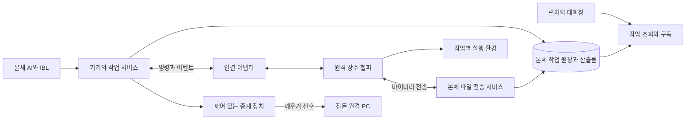

# 원격 PC 자원 활용과 상주 헬퍼 설계

작성일: 2026-10-10

상태: 2026-10-10 사용자 구현 요청에 따라 PC 상주 헬퍼를 구현했다. 아래 설계 목표와 문서 끝의 실제 제공 범위·검증 상태를 구분한다. macOS 12부터의 실기기 설치·제거·깨우기 시험은 사용자가 진행한다.

## 목적과 결정

IndieBiz OS 본체의 AI가 등록된 원격 PC를 이름으로 선택하여 파일을 보내고, 그 PC의 프로그램과 연산 자원으로 작업하고, 결과를 가져온다. 원격 PC에는 얇은 헬퍼만 설치하며 AI 모델이나 IndieBiz OS 전체 설치를 요구하지 않는다. 작업 기록의 정본은 본체에 두고, 런처·대화창·향후 전용 앱이 같은 기록을 읽는다.

사용자는 USB로 헬퍼를 가져가 임시 또는 무기한 등록할 수 있다. 설치 후 USB를 제거해도 백그라운드에서 연결을 유지하며, 본체 런처의 등록 해제는 권한 회수와 원격 설치 제거까지 이어진다. 원격 사용자도 로컬 메뉴에서 중지·해제할 수 있다.

기본 실행은 원격 사용자의 화면·키보드·클립보드를 사용하지 않는다. GUI 조작은 별도 모드이며 백그라운드 작업이 실패했다고 자동 전환하지 않는다. 잠든 PC는 지원 조건이 갖춰진 경우 대상 PC가 속한 네트워크의 깨어 있는 장치를 통해 깨운다.

본체·원격 PC·조작하는 휴대폰이 같은 집이나 같은 네트워크에 있다는 전제를 두지 않는다. 원격지 인터넷 연결이 기본 사용 범위이며, 같은 LAN의 직접 연결은 가능한 경우의 최적화다. 방마다 미니PC를 두는 구성은 여러 사용 사례 중 하나다.

### 1차 범위와 이후 확장

1차 개발 대상으로 macOS·Windows·Linux용 PC 헬퍼를 완성한다. 상주·임시 등록, 백그라운드 실행, 파일 전송·결과 회수, 중앙 기록·실시간 조회, 등록 해제·자가 제거, 지원되는 PC 깨우기와 미디어 재생을 포함한다. 구현·실기기 검증 상태는 문서 끝에 기록한다.

안드로이드폰·iPhone·iPad 등 다른 하드웨어의 신규 등록은 후속 범위다. 공통 기기 정보와 기능 협상의 확장 지점만 설계하며, 모바일 앱·PWA·기기 관리 등록·모바일 절전 및 재생 구현은 이번 PC 계획에 넣지 않는다. 기존 폰·회원 기능은 호환 대상으로 유지하며 새 하드웨어 등록이 이미 지원된 것으로 소개하지 않는다.

목적 기준은 [IBL 진화 목적](IBL_EVOLUTION_PURPOSE.md)과 [구조 수렴 설계](IBL_SYSTEM_CONSOLIDATION_DESIGN.md)를 따른다. 연결·전송·복구의 반복을 줄이되, 작업 정확성과 결과 확인을 유지한다. 성능 개선은 구현 후 측정한다.

## 현재 기반과 개발 공백

| 영역 | 현재 구현 | 추가할 능력 |
| --- | --- | --- |
| 등록 | `self:limb`로 키 발급·목록·폐기, 헬퍼의 아웃바운드 접속 | 설치 단위 기기 신원, 상주 설치, 유효기간, 자가 제거 |
| 실행 | `limbs:guestpc`의 셸·텍스트 파일·화면·입력 조작 | 작업별 환경 분리, 비간섭 실행 정책, 실행 중 취소, 산출물 회수 |
| 전달 | `phone_jobs`의 SQLite 원장, 헬퍼의 수신·결과 보존 | 등록 세대와 작업 신원 결합, 이벤트 연속 수집, 연결 복구 |
| 관측 | 진행 출력 꼬리, `self:task`, 원격 PC 관용구 네 개 | 장기 작업 이력, 원문 로그·파일 참조, 실시간 조회 |
| 파일 | 텍스트 읽기·쓰기·목록, 읽기 결과 약 200KB 제한 | 양방향 바이너리·폴더 전송, 이어받기, 해시 검증 |
| 전원 | macOS 작업 중 `caffeinate`로 유휴 절전 방지 | OS별 작업 중 절전 정책, 별도 장치를 통한 깨우기 |
| 미디어 | 회원 모드의 스트림 재생 경로 | 상주 PC의 창 없는 음악 재생, 명시적인 영상·사진 표시, 출력 장치·세션 상태 보고 |

구현 근거:

- [헬퍼 실행·접속·파일 처리](../helper/main.go), [셸 실행 환경](../helper/shell.go), [수신·결과 기록](../helper/job_delivery.go), [절전 방지](../helper/awake.go)
- [기기 API](../backend/surface/api_limb.py), [자격 원장](../backend/base/limb_keys.py), [작업 전달 원장](../backend/base/phone_jobs.py)
- [어휘 계약](../data/packages/installed/tools/guest-helper/ibl_actions.yaml), [도구 핸들러](../data/packages/installed/tools/guest-helper/handler.py), [사용 가이드](../data/guides/guest_helper.md)
- [기존 실행 통합 조회](../backend/services/execution_trace.py), [통신 구조](../data/system_docs/communication.md)

현재 일반 손발 키는 유효한 키로 접속하면 자동 승인되며 같은 키의 최신 세션이 우선한다. 이는 이동 USB 사용 계약이다. 상주 등록은 설치별 신원으로 분리하고 회원 모드의 로컬 승인 계약도 유지한다. 문서 일부의 옛 승인·무잔류 설명은 구현 전환 때 함께 정정한다.

## 사용 흐름

### USB 설치와 등록

1. USB의 등록 프로그램을 실행한다. 허브 주소와 단기 등록 초대만 전달하고 본체 로그인 비밀번호는 복사하지 않는다.
2. 등록 화면에서 기기 이름, 임시 또는 무기한 사용, 실행 계정·허용 작업 폴더, 백그라운드 자원 정책을 선택한다.
3. 설치 경로에 바이너리·제거기·설치 명세를 복사하고 해당 설치만의 기기 자격을 발급한다. 초대는 사용 후 소진한다. 같은 USB로 다음 PC를 등록할 때 새 초대를 사용한다.
4. 자동 시작을 등록하고 기능 확인을 마친 뒤 본체에 준비 상태를 보고한다. 설치 도중 실패하면 설치 명세에 따라 이번 설치분을 복구한다.
5. USB를 빼도 연결과 작업은 유지된다. USB의 원본 설치 프로그램은 원격 제거 대상이 아니다.

기본값은 일반 사용자 권한의 로그인 시 자동 시작이다. 로그인 전 연결·작업이 필요한 PC에는 설치 화면에서 시스템 서비스 모드를 별도로 선택하고 OS의 관리자 승인을 받는다. 서비스의 권한을 작업 프로세스가 자동으로 상속하지 않도록 지정 계정으로 실행한다. 시스템 서비스 설치도 잠금 화면 해제나 사용자 GUI 세션 생성을 뜻하지 않는다.

macOS·Windows·Linux의 설치 및 자동 시작 어댑터를 분리한다. 기존 휴대 실행 모드는 계속 제공하며 자동으로 설치 모드로 바꾸지 않는다. 구형 인텔 Mac은 기존 레거시 빌드 정책을 유지하고 지원 여부를 따로 검증한다.

### 작업 의뢰와 결과 회수

예: “이 데이터 폴더를 사무실PC로 보내서 변환하고 결과 ZIP을 가져와 줘.”

본체는 대상의 등록·접속·기능을 확인하고, 입력 파일 전송 → 원격 작업 실행 → 산출물 검사 → 본체로 회수 → 작업 결과 기록을 연결한다. 각 단계의 참조를 보존하여 파일 전송이 끝났는데 실행만 실패한 경우 전송부터 반복하지 않는다.

원격 PC의 GPU·프로그램·파일은 그 PC에 실제로 존재하고 실행 계정에 허용된 경우에 사용한다. 본체에만 있는 Python 라이브러리나 IBL 도구가 원격 PC에도 있다고 가정하지 않는다. PC 실행 범위는 셸·파일·등록 프로그램과 아래의 미디어 기능이며, 모든 로컬 도구의 투명한 원격 실행은 별도 확장이다.

### 휴대폰에서 원격 PC의 음악 재생

예: “작업실PC를 깨워서 중앙PC의 재즈 폴더를 재생해 줘.” 휴대폰은 기존 원격 런처로 본체에 요청하는 조작 화면이며, 신규 하드웨어로 등록할 필요가 없다.

본체는 대상의 깨우기 경로로 신호 전송 → 헬퍼 재접속 → 재생 가능 세션·출력 장치 확인 → 음악 준비 → 재생 확인을 이어 간다. 이미 연결된 PC는 깨우기를 생략한다. 대상 PC의 음악은 그곳에서 직접 읽고, 중앙PC의 음악은 인증된 스트리밍 또는 파일 전송 뒤 재생한다. 음악 데이터가 조작용 휴대폰을 경유하지 않는다.

재생·일시정지·정지·곡 변경과 상태 조회를 제공하고, 지원되는 출력 장치 선택과 재생기 음량 조절을 제공한다. 다른 프로그램의 시스템 전체 음량을 기본으로 바꾸지 않는다. 스트림은 통신 상태에 의존하고, 전송 완료된 파일은 허용된 재생 세션 동안 연결이 끊겨도 재생할 수 있다. 재접속 때 새 재생을 중복 시작하지 않고 기존 세션 상태를 회수한다.

음악은 창·포커스·키보드 조작 없이 재생한다. 동영상과 사진은 명시적으로 화면 표시를 요청한 작업에 한해 지정한 사용자 세션·화면에 표시한다. 음악의 소리와 영상·사진의 화면 점유는 사용자가 요청한 효과이며, 일반 백그라운드 작업이 임의로 발생시킬 수 없다. 원격 PC의 사용 중인 앱을 마우스로 조작하는 것을 기본 재생 방식으로 삼지 않는다.

연결 서비스와 사용자 세션의 미디어 실행부를 분리한다. 로그인한 채 절전한 PC의 복귀와 재부팅 후 로그인하지 않은 PC를 구분하며, 서비스 접속 성공만으로 오디오·화면 사용 가능을 선언하지 않는다. 로그인·출력 장치·형식 지원이 부족하면 해당 이유와 준비 상태를 반환하고 잠금 해제를 자동 수행하지 않는다. 브라우저 기반 실행부를 선택해도 재생 허용·수명 조건을 실제로 확인해야 한다.

작업 기록에는 콘텐츠 참조, 재생 세션 ID, 시작·중단·종료, 재생 위치, 출력 장치, 오류를 남기고 런처와 대화 카드에서 조회한다. 재생 명령 접수와 재생기 시작·위치 진행을 구분하며, 소프트웨어 관측을 실제 스피커의 소리 출력 확인으로 표현하지 않는다. 미디어 재생 중 필요한 절전 방지를 유지하고 종료 시 해제하되, 사용자가 진행 중인 다른 작업을 무시하고 PC를 강제로 재우지 않는다.

### 런처에서 관리

런처에 등록 PC 목록과 상세 화면을 둔다. 이름, OS, 마지막 접속, 연결 경로, 실행 중 작업, 자원 정책, 깨우기 가능 여부를 보여준다. 기기 상세에서 파일 보내기·가져오기, 작업 기록, 신규 작업 접수 중지, 깨우기, 등록 해제 및 제거를 제공한다.

연결 상태와 설치 상태는 별개다. 통신 두절을 곧 절전으로 표시하지 않으며, 깨우기 시도와 실제 헬퍼 재접속을 구분한다. 로컬 메뉴에는 연결 상태·현재 작업 수·신규 작업 접수 중지·현재 작업 취소·등록 해제 및 제거를 제공한다. 상주 동작 중 콘솔 창을 계속 띄우거나 포커스를 가져오지 않는다.

## 전체 구조와 책임

| 책임 | 소유 위치와 원칙 |
| --- | --- |
| 기기 자격·등록 세대·해제 상태 | 기존 `limb_keys` 원장 확장. 연결 프레즌스는 `device_registry`가 담당하며 권한 정본으로 사용하지 않는다. |
| 접수·전달·결과·이벤트 | 기존 `phone_jobs` 원장에 명시적 스키마 이행으로 연결. 같은 작업의 상태를 별도 관리자 DB에 다시 만들지 않는다. |
| 설치·프로세스·임시 기록 | Go 헬퍼와 OS 어댑터. 본체가 끊겨도 기기 안에서 정리·결과 보존 가능. |
| 파일 바이트와 산출물 | 본체의 비공개 저장 영역과 전송 서비스. 공개 공유창고로 자동 발행하지 않는다. |
| 통합 조회 | `execution_trace`에 원격 작업 공급자를 연결. 통합 조회 자체는 계속 읽기 전용이다. |
| 사용자 표면 | 기기·작업 서비스의 같은 조회·구독 API를 런처·대화창·후속 앱에서 사용한다. |

backend 변경은 기존 층 구조를 따른다. 원장의 영속 처리와 실행 조정·외부 API를 분리하고 새 모듈은 층 검사에 배정한다. OS 실행 어댑터는 헬퍼가 소유하며 본체가 원격 OS별 셸 문법을 연결 계층에 하드코딩하지 않는다.

### 다른 하드웨어를 위한 확장 지점

상위 자원은 등록 기기이며 PC는 이번에 제공할 기기 유형이다. 기존 기기 자격·작업·기록 원장을 재사용하고 별도 모바일 원장이나 범용 플러그인 체계를 미리 만들지 않는다. 다음은 공통 계약에 남겨 둘 논리 필드이며 최종 이름은 구현 시 기존 레지스트리와 맞춘다.

| 정보 | 역할 |
| --- | --- |
| 기기 유형과 플랫폼 | PC·폰·태블릿이라는 종류와 OS·버전을 구분. 유형만으로 권한을 부여하지 않음 |
| 실행 어댑터와 프로토콜 버전 | 이번에는 PC 헬퍼만 제공. 후속 네이티브 앱·웹 연결 어댑터를 추가할 자리 |
| 지원 기능과 적용 범위 | 셸·파일·미디어·화면·깨우기·자가 제거 등의 실제 지원과 허용 범위를 선언 |
| 기능별 준비 상태 | 지원됨과 지금 실행 가능함을 구분. 권한·사용자 세션·재생 준비 등 조건을 함께 표현 |
| 연결과 깨우기 경로 | 기기 위치·유형과 독립적으로 관리. 모든 기기에 PC의 Wake-on-LAN을 가정하지 않음 |

기기 자체의 기능 신고만으로 허브의 허용 권한을 늘리지 않는다. 실제 실행 가능 범위는 구현 지원·등록 정책·현재 준비 상태를 모두 만족해야 한다. 미지원 기능은 명시적으로 반환하고 다른 기기로 조용히 대체 실행하지 않는다.

1차 UI와 신규 등록 경로는 PC용만 제공한다. 모바일·웹 어댑터가 구현되지 않은 상태에서 사용할 수 있는 등록 버튼이나 설치 링크를 만들지 않는다. 후속 하드웨어도 작업 접수증·자원 참조·중복 억제·중앙 기록·접근 차단을 공유하되 PC의 임의 셸 실행·전체 파일 접근·무인 수신·자동 삭제를 공통 필수 능력으로 강제하지 않는다. 기존 `guestpc`의 PC 의미는 유지하며 후속 기기의 실행 어휘는 해당 단계에서 검토한다.

## 연결과 속도

기본 연결은 헬퍼에서 허브로 나가는 HTTPS이며 원격 PC에 인바운드 포트를 요구하지 않는다. 허브 주소는 기존 공개면 설정을 이용한다. Cloudflare Tunnel을 사용하는 경우에도 원격 PC마다 도메인·터널을 만들지 않는다.

명령·진행·결과에는 WebSocket을 추가하고 롱폴을 대체 경로로 유지한다. 양쪽은 같은 작업 원장과 중복 억제 계약을 사용한다. 연결이 동시에 살아 있어도 작업을 두 번 실행하지 않도록 설치 신원·접속 세대·작업 ID로 수신을 판정한다. 전송 방식 변경은 실행 권한을 바꾸지 않는다.

현재 롱폴은 명령 도착 시 깨어난다. 설정된 대기 시간을 매 명령의 지연으로 해석하지 않는다. 첫 연결 전에 수행하는 상세 환경 조사는 최소 신원 연결 뒤 비동기로 갱신하고, 기능별 준비 상태를 보여준다. 필요한 기능이 아직 미확인이면 해당 작업만 기다린다.

연결 복구는 지수 지연과 무작위 분산을 사용하고 네트워크 복귀 때 재시도한다. 이미 실행된 작업은 재발송하지 않고 수신·결과·이벤트의 확인 지점을 교환한다. 재연결은 기기의 기존 등록을 이어가며 매번 새 PC를 만들지 않는다.

파일 전송은 별도 연결과 대역폭 정책을 사용해 명령·취소·상태 보고를 굶기지 않는다. 큰 작업은 원격에서 묶어 실행하고 변경된 입력과 필요한 산출물만 전송한다.

LAN 또는 Tailscale 직접 연결은 후속 전송 어댑터다. 도달성과 상대 신원을 확인한 경로만 선택하고 실패하면 기존 경로로 복귀한다. 파일이 잠시 보관되어야 하는 비동시 접속 요구에는 R2 같은 저장소를 선택적으로 연결한다. 외부 계정 생성·요금제·공개 저장을 필수 설치 조건으로 삼지 않는다.

## 원격 사용자와 함께 쓰는 백그라운드 실행

### 실행 모드

| 모드 | 허용 동작 | 사용자와의 관계 |
| --- | --- | --- |
| `background` 기본 | 지정 폴더의 파일 처리, CLI, headless 브라우저, 독립 프로세스 | 사용자 데스크톱·클립보드·개인 브라우저 프로필을 사용하지 않음 |
| `interactive` 선택 | 기존 화면 캡처·클릭·입력 | 화면을 공유하는 작업임을 표시. 기기별 허용과 해당 작업의 명시적 선택 필요 |

명시적으로 요청한 음악 재생은 창 없는 실행이지만 소리를 내는 작업임을 표시한다. 영상·사진 표시는 `interactive`의 화면 사용 정책을 따르되, 전용 표시 기능만 실행하고 관련 없는 마우스·키보드 조작까지 허용하지 않는다.

GUI가 필요한 작업을 백그라운드 요청으로 받으면 `needs_interactive`로 대기·안내한다. 사용자 입력을 가로채거나 열린 창을 닫아 작업을 계속하지 않는다. 단순히 창을 숨기는 옵션만으로 임의 프로그램의 비간섭 실행을 보장하지 않는다. GUI를 띄울 수 있는 프로그램은 별도 세션·샌드박스 지원이 검증된 경우에만 background 능력으로 선언한다.

작업마다 별도 작업 폴더·환경변수·임시 디렉토리·프로세스 그룹을 사용한다. 필요할 때만 같은 `workspace_id`의 환경을 명시적으로 재사용한다. 현재 헬퍼의 전역 cwd·환경 기억은 새 상주 작업 계약으로 이관하고, 기존 휴대 호출은 호환 세션으로 제한한다. 병렬 작업이 서로의 venv·현재 폴더를 바꾸지 않아야 한다.

백그라운드 작업은 자체 브라우저 프로필을 사용한다. 열린 사용자 문서는 작업 사본으로 처리하고 결과를 새 파일로 낸다. 원본 교체는 예상 버전·해시를 확인하는 별도 작업으로 취급하며 충돌 시 덮어쓰지 않는다. 임의 셸의 모든 외부 부작용을 포착할 수 있다고 주장하지 않는다.

### 자원 정책

설치 기본 정책은 낮은 우선순위, 무거운 작업 동시 실행 1개, 네트워크 전송 제한이며 구체 상한은 설치 PC의 능력에 맞춘 프로필로 저장한다. CPU·메모리·디스크·GPU 제한의 요청값과 OS가 실제 적용한 값을 구별한다. 지원되지 않는 강제 제한을 적용된 것처럼 표시하지 않는다.

원격 사용자가 활동 중이면 새 무거운 작업을 대기시키거나 실행량을 줄이는 정책을 선택할 수 있다. 활동 판단에는 유휴 시간 등 최소 상태만 사용하고 키 입력 내용이나 사용자 활동 화면을 기록하지 않는다. GPU 작업도 기본적으로 독점 실행을 가정하지 않는다.

실행 중인 임의 프로세스를 무조건 일시 정지하면 잠금·파일 쓰기를 붙잡을 수 있다. 일시 정지는 지원되는 작업의 협력적 체크포인트에 한하며, 미지원 작업은 신규 접수 중지·자원 제한·명시적 취소로 다룬다. 취소는 프로세스 트리 종료와 결과 수집까지 확인한다. 신호를 보냈다는 사실만으로 취소 완료라고 하지 않는다.

작업 중에는 필요한 범위에서만 유휴 절전을 막고 화면은 켜지 않는다. 사용자 명시 절전·덮개 닫힘을 강제로 무력화하지 않는다. 상주 연결 자체만으로 PC를 항상 깨어 있게 하지 않는다.

## 파일 전달과 원격 자원 참조

작업 입력과 결과는 `resource_ref`로 연결한다. 참조에는 기기 ID, 등록 세대, 자원 ID, 파일 버전·해시, 크기, 접근 범위를 결합한다. 별칭이나 경로 문자열만으로 다른 기기의 파일을 해석하지 않는다. 본체 파일과 원격 파일의 위치를 항상 구분한다.

전송 상태는 `created → transferring → verifying → committed`이며 중단·실패·취소 상태를 별도로 기록한다. 전송 ID와 청크 범위·확인 해시로 재개하고 전체 해시 확인 후 임시 파일을 최종 경로로 원자 교체한다. 크기·mtime만으로 같은 내용이라고 판정하지 않는다. 수신 후에도 원본 버전이 바뀌었으면 충돌로 처리한다.

폴더는 파일별 상대 경로·크기·해시의 명세로 전달한다. 경로 이탈, 심볼릭 링크·Windows junction을 통한 허용 폴더 밖 접근, 압축 해제 경로 탈출을 수신 측에서도 차단한다. 대소문자·Unicode 이름 충돌은 덮어쓰지 않고 보고한다. 여유 공간을 확인하며 스트리밍 방식으로 처리해 파일 전체를 메모리나 JSON에 넣지 않는다.

전송 권한은 특정 기기·방향·자원·크기·만료에 한정한다. 같은 네트워크라는 이유로 인증을 생략하지 않는다. 중간 저장소를 쓸 때도 접근을 제한하고 보존기한을 적용한다. 파일 내용과 Base64를 AI 대화에 싣지 않고 이름·크기·해시·참조만 반환한다.

산출물 기록은 `원격 생성됨`, `원격 검사됨`, `본체 회수됨`, `본체 검증됨`을 구별한다. 작업의 완료 조건에 회수가 포함되면 원격 종료 코드 0만으로 전체 완료가 아니다. 기존 마무리 관용구의 원격 경로 목록을 실제 회수된 파일로 오인하지 않도록 반환 계약도 갱신한다.

## 작업 실행과 복구 계약

본체는 요청마다 안정된 `request_id`를 발급한다. 같은 기기·등록 세대·요청 ID와 같은 내용은 기존 작업 참조를 반환하고, 같은 ID에 다른 내용이면 거절한다. 제출 응답 유실 때 새 작업을 만들지 않는다.

| 관측 | 의미 |
| --- | --- |
| `queued` | 본체 접수, 아직 원격 전달 전 |
| `delivered` | 원격 수신 기록, 실행 시작과 구별 |
| `running` | 실행 시작 확인 |
| `cancel_requested` | 취소 요청, 종료 미확인 |
| `succeeded` 또는 `failed` | 새 계약의 실행 종료와 종료 코드·오류로 판정 |
| `cancelled` | 실행 중지 확인 또는 미전달 상태에서 취소 확정 |
| `unknown` | 실행 여부·최종 결과를 확정할 수 없음 |

전달 상태와 명령 결과를 별도 필드로 보존한다. 기존 `self:task`의 `succeeded`가 결과 회신을 뜻하는 계약은 조용히 바꾸지 않고 버전 어댑터에서 `execution_state`와 `exit_code`를 추가한다. 접수·전달·프로그램 성공·업무 목표 달성·결과 회수는 서로 다른 관측이다.

허브의 짧은 응답 대기가 끝나도 원격 실행은 계속된다. 헬퍼는 수신 기록을 먼저 영속 저장한 뒤 실행하며, 결과는 본체가 저장을 확인할 때까지 보존·재전송한다. 원격 프로세스 생존은 PID만이 아니라 프로세스 생성 신원과 실행 ID로 확인한다.

헬퍼·본체 재시작 후에는 같은 작업의 기록으로 재결합한다. 이미 외부 효과가 발생했을 수 있는 불명 작업을 자동 재실행하지 않는다. 명시적 체크포인트가 있는 작업만 해당 지점부터 재개한다. 네트워크 단절은 실행 실패나 취소로 바꾸지 않는다.

전달 전 작업 만료와 실행 제한을 별도로 둔다. 현재 큐의 10분 만료를 잠든 PC의 장기 예약에 그대로 적용하지 않는다. 깨우기 후 실행 요청에는 명시적 대기 기한과 정책을 부여하고 기존 기본값을 전역으로 늘리지 않는다.

## 본체에 남기는 작업 기록

### 기록 범위와 영속화

본체 기록은 이 시스템이 의뢰한 작업의 이력이다. 원격 사용자의 다른 활동을 상시 녹화하는 기능으로 확장하지 않는다. 기록에는 다음을 연결한다.

- 원 요청·작업 목적, 의뢰한 에이전트·대화·과제·실행 ID, 선택한 기기와 등록 세대
- 전달·시작·진행·취소·종료·연결 단절·복구·해제 사건
- 실행한 명령 또는 등록 프로그램의 버전, 작업 폴더, 적용된 자원 정책
- stdout·stderr의 로그 조각, 종료 코드, 오류, 실제 제공된 진행률과 자원 관측
- 입력·산출물의 참조·크기·해시·검사 및 회수 상태, interactive 모드의 작업별 캡처 참조

기기 자격·인증 헤더·비밀 stdin·환경변수 전체를 로그에 저장하지 않는다. 명령과 출력에 섞인 알려진 비밀값은 수집 시 가리고, 임의 프로그램이 출력하는 모든 비밀을 완벽히 감지한다고 보장하지 않는다. 원문 로그에는 본체의 소유권·대화 접근 범위를 적용한다.

각 사건은 `device_id`, `registration_generation`, `job_id`, `event_id`, `sequence`, `occurred_at`, `received_at`, `kind`, `payload_ref`를 갖는다. 기기 시각과 본체 수신 시각을 보존하고 작업 내 순서는 sequence로 정한다. 중복 사건은 한 번만 저장하고 누락 구간을 표시한다.

헬퍼는 본체 저장 확인 전 사건을 제한된 로컬 큐에 보관한다. 본체는 DB 커밋 뒤 연속 확인 지점을 응답하고 헬퍼는 확인된 임시 기록을 정리한다. 결과 사건의 재전송과 파일 로그 청크의 재전송은 서로 독립적으로 재개한다. 통신 중단 때 로컬 임시 기록도 없이 본체에만 저장하는 구성은 허용하지 않는다.

로컬 큐의 용량이 부족하면 신규 작업을 중지하고 로그 압축·흐름 제어를 적용한다. 그래도 보존 불가하면 누락 범위·바이트 수를 명시하고 terminal 결과·제거 영수증 공간을 우선 확보한다. 완전한 로그가 완료 조건인 작업은 기록 불완전으로 처리한다. 로그 과다로 시스템 디스크를 가득 채우지 않는다.

현재 결과 7일 삭제 정책과 장기 이력을 분리한다. 작업 원장의 이력 테이블과 비공개 로그·산출물 저장소는 별도 보존 정책을 가지며, 전달용 행이 정리되어도 이력과 참조가 뜻없이 사라지지 않게 한다. 초기 기본값은 작업 요약·최종 상태는 사용자 삭제까지, 상세 로그는 30일, 산출물은 작업별 보존 선택으로 제안한다. 저장 한도·만료·삭제된 본문을 UI에 표시하고 실패·미확인 작업 기록은 자동 삭제 전 보존 대상으로 둔다.

등록 해제 후에도 본체의 과거 작업 기록과 회수된 결과는 남는다. 원격 헬퍼 제거와 본체 이력 삭제는 별도 동작이다.

### 대화창과 실시간 앱

작업 조회와 cursor 기반 사건 구독을 한 서비스에서 제공한다. 초기 화면은 상태 스냅샷과 같은 기준점의 cursor를 함께 받고, 그 이후 사건을 SSE로 구독한다. 재연결하면 cursor 이후를 재생하며 보존 범위를 벗어난 cursor는 전체 상태 재조회로 안내한다. 전송 경로가 막히면 동일 API의 증분 폴링으로 대체한다.

구독자는 원장 기록을 보며 작업 상태를 별도로 생성하지 않는다. 기기·작업·대화별 권한 검사를 조회와 구독 모두에 적용한다. 작업 로그는 비신뢰 텍스트로 렌더링하고 HTML·터미널 제어문자·로그에 포함된 지시를 실행하지 않는다.

대화창에는 PC 이름, 현재 단계, 최신 로그, 경과 시간, 산출물, 기록 열기·취소 버튼을 가진 작업 카드를 표시한다. 카드 갱신은 모델을 매번 호출하지 않는다. AI는 사용자가 물었을 때 또는 완료·실패 같은 필요한 시점에 기존 기록을 요약한다. 진행률을 제공하지 않는 프로그램에는 임의 백분율을 만들지 않는다.

향후 전용 앱은 같은 API로 PC별 작업 목록·타임라인·로그·파일을 표시한다. 앱을 만들기 전에도 런처 상세와 대화 카드에서 실시간 상태를 볼 수 있다. 화면 녹화·연속 스크린샷은 기본 기록이 아니며 interactive 작업에서 필요한 관측만 별도로 남긴다.

## 등록 해제와 자가 제거

해제 요청은 본체에 먼저 영속 기록하고 새 작업을 즉시 차단한다. `detach`는 현재 연결 종료, `revoke`는 권한 회수, `uninstall`은 설치 제거로 구별한다. 런처의 “등록 해제 및 제거”는 이 중 권한 회수와 제거를 결합한 사용자 동작이다.

기본 정책은 실행 중 작업을 명시된 유예시간까지 정리하고, 초과하면 해당 작업 프로세스 트리를 취소한 뒤 제거하는 것이다. 즉시 해제는 대기 없이 취소를 요청한다. 취소 불명이나 파일 잠금이 남으면 부분 제거 상태와 원인을 보존한다. 제거 요청은 전송 중 파일에도 적용하며 미완료 전송 권한을 닫는다.

일반 명령 자격은 즉시 차단하지만, 해당 설치의 제거 지시·종료 기록 업로드·제거 영수증만 허용하는 제한된 인증 경로는 정리가 끝나거나 기한이 만료될 때까지 유지한다. 이 경로로 셸 명령·새 전송·등록 복원을 할 수 없어야 한다. 이후 재연결도 기존 해제 상태를 되돌리지 못한다.

제거 단계:

1. 헬퍼가 해제 상태를 로컬에 영속 기록하고 신규 실행을 중단한다.
2. 작업 종료·로그 전달을 시도한다. 본체 연결 실패 시 정해진 유예 이후 로컬 제거를 계속하며 기록 미전달을 구분한다.
3. 설치 때 준비한 별도 제거기가 자동 시작·서비스를 비활성화하고 헬퍼·자식 작업의 종료를 확인한다.
4. 설치 명세에 있는 바이너리·자격·전용 임시 데이터만 정리한다. 사용자 파일, 작업 결과물, 공유 런타임, USB 원본은 보존한다.
5. 제거기는 처리한 경로·남은 경로·자동 시작 해제 결과를 영수증으로 전달하고 자신도 OS가 지원하는 정리 방식으로 종료·삭제한다.

자기 종료 뒤의 처리는 살아남는 제거기가 소유한다. 재부팅이 필요한 삭제는 OS가 재시작 후 실행하도록 맡기고 “재부팅 후 정리 예정”으로 표시한다. 제거기 자체의 마지막 삭제까지 원격 관측이 불가능한 경우 `self_cleanup_unverified`를 남긴다. 연결 종료·서버 키 폐기·영수증 수신을 디스크 전체 무잔류 증명으로 표시하지 않는다. OS 감사 로그나 기존 백업까지 제거하는 기능은 포함하지 않는다.

PC가 오프라인이면 `access_blocked + removal_pending` 상태로 남긴다. 본체의 접근 차단이 이미 오프라인에서 실행 중인 프로세스를 즉시 중지시키지는 못한다. 이 작업은 미리 전달된 실행 제한·등록 만료 정책을 따르고, 재접속 시 제거 명령을 우선 받는다. 즉시 중지 보장이 필요한 작업은 통신 단절 시 중지하는 실행 임대를 별도로 선택해야 하며, 일반 장시간 작업의 연결 복구 정책과 혼동하지 않는다.

등록 유효기간을 둔 PC는 본체에 접속할 수 없어도 로컬 만료 정책으로 제거를 시작한다. 꺼진 상태에서는 실행할 수 없으므로 다음 부팅·로그인 때 정리하며 만료 여부를 판단할 수 없으면 일반 작업을 시작하지 않는다. 단순 통신 단절은 무기한 등록의 자동 제거 사유가 아니다.

등록·해제 세대는 영구 구분한다. 같은 별칭으로 재등록해도 새 설치 ID를 쓰며 이전 작업·전송·제거 지시를 새 PC에 적용하지 않는다. 기기 자격 유출 의심으로 제거 경로까지 즉시 폐기하면 원격 제거 보장이 사라진다는 상태를 표시하고 로컬 제거 경로를 제공한다.

## 잠든 PC 깨우기

깨우기는 실행 헬퍼와 별도 기능이다. 대상 PC의 네트워크에 깨어 있는 다른 등록 PC·NAS·공유기·작은 장치가 Wake-on-LAN 신호를 전송한다. 본체는 인터넷을 통해 이 장치에 인증된 요청을 보내고, 대상 헬퍼가 다시 연결되어 준비 상태를 보고했을 때 깨우기 성공으로 판정한다. 본체가 대상과 같은 LAN에 있는 경우에만 본체 직접 전송을 선택할 수 있다. 이는 최적화이며 같은 장소에 있어야 한다는 조건이 아니다.

기기 등록에는 NIC 주소, 중계 장치, 네트워크 구간, 시험한 전원 상태, 마지막 시험 결과를 저장한다. 중계 장치는 등록된 대상만 깨울 수 있게 하며 임의 네트워크 전체로 신호를 발송하는 인터페이스는 제공하지 않는다. 이동한 PC의 옛 네트워크 설정은 재확인한다.

상태는 `wake_requested → signal_sent → reconnecting → ready`로 관측하며 제한 시간 초과·미지원·중계 장치 오프라인을 구분한다. 신호 전송 성공을 부팅 성공으로 간주하지 않는다. 깨어났지만 로그인이나 디스크 잠금 해제가 필요하면 연결·작업 가능 상태를 분리한다.

Cloudflare·Tailscale은 깨어 있는 중계 장치에 접근하는 통로다. 잠든 대상 PC 안의 프로그램만으로 외부 요청을 받을 수 있다고 가정하지 않는다. BIOS·NIC·전원·유선/무선·절전 상태별 지원 차이가 있으므로 설치 과정에서 가능한 조건을 보여주고 선택적으로 실제 깨우기를 시험한다. 전원 차단·배터리 방전의 원격 복구는 이 설계에 포함하지 않는다.

일반 절전·최대 절전·종료는 별도 전원 상태로 기록한다. “동면에서 깨우기”를 모든 상태의 지원으로 해석하지 않고 기기별로 시험한 상태에서만 가능하다고 표시한다. 대상 네트워크의 중계 장치나 지원되는 다른 깨우기 경로가 없으면 원격 깨우기 불가를 표시한다. 깨어난 뒤 일반 인터넷 연결이 가능하다는 사실만으로 깨우기 자체가 가능한 것은 아니다.

## 기존 IBL과의 연결

새 노드를 만들지 않는다. 기기 관리는 `self:limb`, 실행·전송은 `limbs:guestpc`, 작업 관측은 `self:task`의 기존 책임 안에서 확장한다. 아래 이름은 구현 시 계약 검토 대상인 설계안이다.

| 기존 표면 | 설계 확장 |
| --- | --- |
| `self:limb` | 상주 등록·만료·자원 정책·깨우기 설정·제거 요청과 상태. 단순 목록과 권한 관리는 기존 의미 유지 |
| `limbs:guestpc` | 명시한 PC의 작업 workspace, background/interactive 모드, 업로드·다운로드 전송 참조. PC 미디어도 같은 기기·작업·자원 참조를 사용하고 기존 미디어 어휘와의 어댑터 책임을 구현 전에 확정 |
| `self:task` | 실행 상태·기록·전송·취소·결과 회수 관측. 접수증을 공통 반환 형식으로 유지 |
| `외부PC준비/작업실행/작업확인/작업마무리` | 전송·실행·회수 조합에 사용. 기존 호출의 반환 의미를 조용히 교체하지 않음 |

작업 대상과 OS 정보는 데이터로 전달하고 파서·엔진에 기기 이름을 넣지 않는다. 명령·전송·깨우기별로 새 동의어 액션을 늘리지 않는다. 기본 백그라운드 정책은 UI·IBL·HTTP 모두 서비스에서 집행한다.

신규 op·인자·반환 변경은 패키지 `ibl_actions.yaml`에서 정의하고 빌드로 파생물을 갱신한다. 핸들러 도움말·가이드·관용구·오류 문구·task 어댑터까지 연결하고, 은퇴 계약은 기존 은퇴 원장 절차로 관리한다.

## 구현 순서와 전환

| 단계 | 범위 | 완료 조건 |
| --- | --- | --- |
| 1 | 기기·작업·이벤트 계약, 원장 이행, 로그 수집·조회 기반 | 기존 휴대·회원·폰 작업 유지, 등록 세대와 중복 제출 검사, 본체 기록 영속화 |
| 2 | OS별 설치·자동 시작·로컬 메뉴·제거기·임시 등록 | USB 제거 후 재연결, 로컬·원격 해제, 오프라인 제거 대기·만료·부분 실패 표시 |
| 3 | background 실행, 작업별 환경·자원 정책·취소 | 사용자 화면 비간섭, 병렬 작업 환경 분리, 정책 적용 관측, 자식 프로세스 종료 검사 |
| 4 | 바이너리·폴더 전송, 검사·산출물 회수 | 끊김 후 재개, 내용 일치, 충돌 보호, 전송 후 실행·결과 회수의 전체 조합 |
| 5 | 연결 초기화 개선·WebSocket·런처 상세·대화 카드 | 재연결 시 작업·로그 연속성, 같은 조회 API의 실시간 표면, 전후 지연 측정 |
| 6 | 깨우기 중계와 실제 기기 검증 | 시험한 전원 상태에서 깨우기·재접속·작업 가능 확인 |
| 7 | PC 미디어 실행부와 원격 런처의 전체 시나리오 | 휴대폰 요청 → 원격 PC 깨우기 → 중앙 또는 원격 파일 재생 → 상태·기록 확인. 명시한 영상·사진 표시도 검증 |

단계 1부터 작업 기록을 남긴다. 1~7단계는 모두 PC의 1차 완료 범위이며 OS별 설치·실행·제거·미디어와 원격지 사용을 검증한다. 산출물만 빌드됐다는 이유로 macOS·Windows·Linux 지원 완료로 표시하지 않는다. 지원 OS 버전·아키텍처와 미검증 조합을 별도로 명시한다.

전용 실시간 앱·Tailscale 직접 경로·R2 중간 저장은 같은 계약을 소비하는 후속 확장이며 초기 상주 기능의 필수 의존성으로 두지 않는다. 안드로이드·iPhone·iPad의 네이티브 앱 또는 PWA 신규 등록은 PC 범위 완료 뒤 별도 설계·구현한다. 이번에는 위 공통 계약의 확장 지점만 남기고 모바일용 코드를 만들지 않는다.

기존 바이너리는 프로토콜·기능 협상으로 구별한다. 새 기능은 지원하는 헬퍼에만 제공하고 구형 헬퍼에 알 수 없는 op를 보내지 않는다. 업데이트는 설치 명세·기기 자격을 유지하고 실행 중 작업을 정리한 뒤 교체하며 실패 시 이전 바이너리로 복구한다. 새 정책은 기존 회원의 승인이나 휴대 모드의 사용 의미를 약화하지 않는다.

기존 중복 큐·공유 환경 경로를 유지한 채 또 다른 상주 실행 체계를 쌓지 않는다. 이행 완료 시 새 상주 작업은 공통 원장·격리 실행 경로 하나를 쓰고 구형 계약은 입구 어댑터에만 남긴다. 기존 7일 결과 정리는 장기 이력 보존과 분리한 뒤 계속 적용한다.

## 검증과 인수 기준

| 검증 | 인수 기준 |
| --- | --- |
| 설치 | 각 지원 OS에서 USB 실행 → 설치 → USB 제거 → 재로그인/재부팅 → 같은 등록으로 접속 |
| 사용자 비간섭 | 타이핑·브라우징 중 파일·CLI·headless 작업 실행, 포커스·클립보드·개인 프로필 불변. GUI 요구는 명시적 모드 없으면 실행 안 함 |
| 자원 경쟁 | 부하 작업과 사용자 작업 동시 실행, 실제 적용한 제한과 응답 지연 측정. 지원하지 않는 제한은 미지원으로 표시 |
| 작업 격리 | 서로 다른 cwd·venv·환경의 동시 작업이 결과·환경을 섞지 않음 |
| 취소 | 진행 중 명령과 자식 프로세스의 종료 확인, 미확인 상태를 성공으로 표시하지 않음 |
| 파일 | 0바이트·대용량·Unicode·동일 이름 충돌·디스크 부족·수신 중 원본 변경·경로 탈출 검사, 중단 재개 뒤 원본과 해시 일치 |
| 실행 복구 | 접수 응답 유실·실행 중 통신 단절·허브 재시작·헬퍼 종료 때 중복 효과 없음. 불명 결과와 늦은 결과의 정정 보존 |
| 기록 | 로그 중복·순서 역전·시계 차이·큐 포화·허브 장애 후 동일 이력, 누락 구간 표시, 비밀 입력 제외, 로그 출력의 비실행 렌더링 |
| 실시간 조회 | 구독 중 끊김과 cursor 만료 후 상태 복구, 다른 대화·기기의 기록 접근 차단, 카드 갱신만으로 모델 호출 없음 |
| 제거 | 온라인·오프라인·실행 중·재부팅 대기·권한 부족·보고 유실·만료 조건, 자동 시작과 자격 제거, 사용자 파일·본체 이력 보존 |
| 깨우기 | 지원 기기의 시험한 절전 상태에서 중계 요청 → 실제 재접속. 미지원·전원 차단·중계 불통을 구분 |
| 원격지 | 조작용 휴대폰·본체·대상 PC가 다른 네트워크인 조건에서 등록·실행·전송·기록 확인. 깨우기는 대상 측 중계 경로로 시험 |
| 미디어 | macOS·Windows·Linux에서 중앙 파일·원격 파일의 재생·정지·재접속·기록 확인. 로그인한 절전 복귀와 미로그인 부팅, 출력 장치 없음·형식 미지원 구분. 영상·사진은 명시적 화면 표시 요청에서만 실행 |
| 확장 경계 | 기기 유형·실행 어댑터·기능·준비 상태가 분리됨. 미구현 모바일·웹 등록을 지원 기능으로 노출하지 않으며 기존 폰 경로는 유지 |
| 호환 | 기존 휴대·회원·폰 전달, 관용구 네 개, `self:task`의 기존 반환 의미 유지 |

성능은 콜드 시작부터 명령 가능까지, 온라인 기기 짧은 명령의 왕복, 끊김 후 복구, 파일 크기별 전송률, 전체 입력 전달부터 결과 회수까지를 분리해 측정한다. 같은 장치·망·입력으로 기존 대비 p50·p95와 실패율을 비교하고 LAN·외부망·중계 경로를 섞지 않는다. 전체 작업의 모델 호출·토큰과 원격 사용자의 체감 지연도 함께 기록한다. 특정 배수 개선이나 즉시 연결을 설계만으로 약속하지 않는다.

개발 검증은 저장소의 [회귀 절차](REGRESSION_TESTING.md)를 따른다. Go 검사와 OS 실기기 시험, 영향 범위 backend 검사, frontend TypeScript 검사, 어휘·층·번들 관문을 해당 단계에 적용한다. 설치·GUI 비간섭·제거·깨우기는 모의 검사만으로 지원 완료 처리하지 않는다.

## 외부 연결과 전원 조건의 근거

아래 문서는 2026-10-10 설계에서 연결·전원 제약을 확인한 자료다. 서비스 가격·성능 수치를 계약으로 고정하지 않는다.

- [Cloudflare Tunnel](https://developers.cloudflare.com/cloudflare-one/networks/connectors/cloudflare-tunnel/): 아웃바운드 터널을 통한 허브 접근.
- [Cloudflare WebSocket](https://developers.cloudflare.com/network/websockets/): 지속 연결도 종료될 수 있으므로 응용 계층 재연결이 필요.
- [Tailscale 연결 방식](https://tailscale.com/docs/reference/connection-types): 직접 연결과 중계 경로의 구분.
- [Tailscale Wake-on-LAN 구성](https://tailscale.com/blog/wake-on-lan-tailscale-upsnap): 같은 네트워크의 깨어 있는 장치를 통한 깨우기.
- [Microsoft Wake-on-LAN 동작](https://learn.microsoft.com/en-us/troubleshoot/windows-client/setup-upgrade-and-drivers/wake-on-lan-feature): Windows 10의 전원 상태별 지원 차이. 다른 Windows 버전은 해당 기기에서 별도 검증.
- [Apple 네트워크 접근 시 깨우기](https://support.apple.com/en-nz/guide/mac-help/mh27905/mac): Mac의 관련 설정과 자원 공유 조건.
- [Windows 서비스와 사용자 세션](https://learn.microsoft.com/en-us/windows/win32/services/interactive-services), [macOS 서비스와 사용자 에이전트](https://developer.apple.com/library/archive/documentation/MacOSX/Conceptual/BPSystemStartup/Chapters/DesigningDaemons.html): 상주 연결과 사용자 세션의 미디어 실행부를 구분하는 근거.

## 구현 반영과 첫 실기기 시험 (2026-10-10)

PC 등록·원장·런처·IBL·Go 헬퍼를 연결했다. 새 모드는 `enroll → resident → cleanup`이며,
휴대 limb·회원 member 모드를 유지한다. 상주 자격은 구형 /limb/connect·poll·result로 사용하지 못한다.
초대 1회 사용, 설치 ID·등록 세대, 동일 request_id의 명령 지문 대조, 작업/이벤트 ACK 중복 억제를 둔다.

실제 제공 경로:

| 영역 | 구현 |
| --- | --- |
| 설치 | 이름·OS·기간별 ZIP, 로컬 설치 확인, 사용자 폴더 복사, Mac LaunchAgent / Windows 로그인 예약 작업 / Linux systemd 사용자 서비스 |
| 연결 | WSS 지속 연결, HTTPS 롱폴 대체, 상세 환경 조사를 최초 연결에서 분리하고 info 요청 때 실행 |
| 실행 | 작업별 폴더·환경, 동시 2개, 제한시간, 취소, worker 사망 시 감독 프로세스가 자식 종료, 재기동 뒤 불명 결과는 unknown |
| 파일 | 양방향 바이너리 청크·offset 재개·SHA-256·덮어쓰기 충돌 거절, IBL 중앙 파일 회수, 브라우저 512 MiB 상한 |
| 기록 | phone_jobs DB에 resident_tasks·resident_events·resident_transfers 추가, 미확인 로컬 이벤트 재송신, 런처 2초 간격 갱신, self:task·history 조회 |
| 해제 | 즉시 새 실행 차단, 실행 취소, 로그 전달, 독립 제거기, 로컬 제거·중지, 만료 제거; 오프라인 확인은 대기 |
| 깨우기 | 대상 LAN의 등록 중계 PC 또는 명시한 central에서 magic packet, signal_sent와 준비 완료를 구분 |
| 재생 | 원격 파일·URL, 중앙 파일은 먼저 전송, mpv 영상/사진/오디오 및 Mac afplay 로컬 오디오, 재생 작업 취소로 중지 |
| 확장 | kind=pc·adapter=resident-v1·capabilities 분리. 모바일 신규 설치·등록 경로는 제공하지 않음 |

설계 중 아직 자동 제공하지 않는 부분도 명확히 둔다. 관리자 권한의 로그인 전 서비스,
CPU·메모리 하드 제한, 폴더 자동 압축/추출, 자동 업데이트·서명/공증, 전용 대화 작업 카드는
이 배포에 포함되지 않는다. 폴더는 기존 셸로 압축하여 전송한다. 대화에서는 기존 작업 접수증과
self:task/history를 사용하고 실시간 조작은 런처에서 한다. 이 문서의 해당 목표를 구현 완료로
표시하지 않는다. 임의 셸은 OS 샌드박스가 아니므로 소유자가 실행한 프로그램의 GUI 동작까지
비간섭을 강제하지 않는다. 작업당 16 MiB 이후 로그 생략은 log_gap으로 기록한다.

### macOS 12 첫 시험

1. 중앙 IndieBiz를 켜고 외부에서 닿는 **터널 직접 HTTPS 호스트**를 준비한다. 중앙은 작업을
   중계하는 동안 켜져 있어야 한다. 폰의 원격 런처도 이 중앙에 로그인한다.
2. 런처 안경 메뉴 **원격 PC**에서 이름을 `맥12-상주`처럼 중복 없이 정한다. Mac Intel이면
   `mac-amd64`, Apple Silicon이면 `mac-arm64` ZIP을 받는다. macOS 12에는 legacy 파일이 필요 없다.
3. ZIP을 대상 Mac에서 풀고 실행한다. 실행 권한/개발자 확인을 macOS에서 허용한 뒤 로컬 설치
   화면의 등록 버튼을 누른다. 등록 목록의 연결·OS를 확인하고 USB를 분리한다.
4. `pwd; uname -s` 작업의 성공·로그를 확인한다. 이어 `sleep 60`을 접수하고 취소해 실제 취소
   상태를 확인한다. 재로그인 뒤 자동 재접속되는지도 확인한다.
5. 중앙에서 작은 바이너리 파일을 보내고 다시 받아 SHA-256이 일치하는지 확인한다. 서로 다른
   작업의 기본 cwd가 다르며 앞 작업에서 바꾼 환경변수가 다음 작업으로 새지 않는지도 본다.
6. 로컬 음원을 보내거나 원격 PC의 기존 음원 경로로 재생한다. 오디오 출력 장치를 확인한다.
   영상·사진은 mpv 설치 후 화면 사용 모드를 선택한다. 화면 캡처·입력에는 macOS 권한이 필요하다.
7. 깨우기는 별도 시험한다. Mac 전원·네트워크 설정과 유선/무선 지원을 확인하고 대상 LAN의
   켜진 중계 PC를 지정한다. 절전 상태에서 폰으로 깨우기 신호를 보내 **실제 재접속**을 확인한다.
   신호 접수만으로 성공 판정하지 않는다. 동면·완전 종료는 별도 지원 여부를 기록한다.
8. 중앙에서 등록 해제한다. 온라인은 작업 종료·로그·제거 확인을, 오프라인은 removal_pending 후
   재연결 시 제거를 확인한다. 자동 시작과 설치 실행파일이 사라지고 작업 폴더만 남는지 확인한다.
   설치한 실행파일을 다시 실행하여 여는 로컬 화면에서도 제거를 시험할 수 있다.

검증 기록은 이 절 아래에 최종 검사 결과를 추가한다. 빌드 성공을 실기기 시험 통과로 취급하지 않는다.

### 자동 검증 결과

- 상주·기존 헬퍼·phone_jobs·API 수명·관용구·단일 러너 관련 묶음: **83개 통과**.
  이후 추가한 설치 ZIP(직접 터널 주소·실행 권한·체크섬) 및 잘못된 임시 등록 기간 회귀를
  포함한 상주/러너 묶음: **20개 통과**(네이티브 system 검사는 별도 실행).
- 네이티브 Mac arm64 실행파일 ↔ 격리 FastAPI 중앙 서버 통합: **통과**.
  1,280,000바이트 파일 왕복 일치, request_id 중복 접수 억제, 헬퍼 강제 종료 후 자식 종료,
  재접속 시 unknown 기록, 390px·1280px 화면에서 오류·가로 넘침 없음.
  같은 Mac의 loopback 시험에서 첫 셸 접수→결과 관측은 약 0.56초였다. 외부 네트워크나
  macOS 12 실측값·기존 버전 대비 개선율을 뜻하지 않는다.
- Go `go test -race ./...` 통과. Windows amd64, Mac arm64·amd64, Mac Intel legacy,
  Linux amd64 실행파일 빌드 성공. Windows 상주 ZIP은 로그인 시 콘솔을 띄우지 않는 GUI-subsystem 전용 빌드를 사용한다. TypeScript 검사·Vite 빌드 성공.
- 관련 시스템 묶음(재기동·어휘 배포·async/사용자 경로 관문): **48개 통과**.
- 종합 비-system 회귀: **9,704개 통과, 1개 건너뜀, 3개 실패**. 전수 통과로 표기하지 않는다.
  실패는 `test_ibl_rank51_60_repairs.py`의 현재 앱 조회 2건(AX -25204, macOS 손쉬운 사용 권한),
  `test_episode4112_browser_refs.py`의 브라우저 시험 대역에 `active_tab_id`가 없는 1건이다.
  이 세 항목의 구현 파일은 이번 헬퍼 작업에서 수정하지 않았다.
- 어휘 파생·층 가드·폰 번들 재생성 완료. 실기기 OS 설치·자동 로그인 시작·제거·오디오 출력·
  WOL은 사용자가 macOS 12부터 시험한다. 현재 Mac에서 실행한 격리 통합 시험은 그 대체가 아니다.
