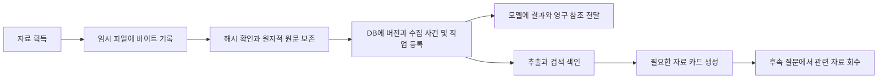

# 연구 프로젝트 설계

작성일: 2026-10-10  
상태: 첫 구현 완료. 설계 목표와 실제 지원 범위·검증 결과는 아래 §17~18을 함께 읽는다.
대상: 런처의 연구 프로젝트를 구현하고 검토할 개발자와 AI 에이전트.

연구 프로젝트는 **여러 대화에서 확보한 자료와 질문의 변화를 보존하고, 다음 대화가 그 축적 위에서 이어지는 작업 공간**이다. 런처에서 여러 개를 만들며, 각 프로젝트에는 여러 주제의 대화를 두고 대화마다 독립 자료실을 둔다. 관련 자료를 찾아 읽으면서 필요할 때 외부 조사를 이어간다. 전체 자료나 전체 대화를 매번 모델에 넣지 않는다.

첫 버전의 완료 기준은 **프로젝트 생성 → 주제 대화 → 자료 자동 보존 → 앱 재시작 → 기존 대화 재개 또는 새 대화 → 저장 자료 재사용과 추가 조사 → 당시 원문으로 인용 확인**이다. 자료가 쌓이는 UI만으로 완료하지 않는다.

## 1 제품의 범위와 기본 결정

사용자가 요청한 범위는 연구 프로젝트의 복수 생성, 주제별 대화의 생성·재개, 조사 자료의 지속 보존, 저장 자료를 참조하면서 이어가는 외부 조사다. 이를 다음과 같이 구체화한다.

| 대상 | 설계 결정 |
| --- | --- |
| 런처 | 새 프로젝트에서 일반·연구 유형 선택. 연구도 기존 폴더 배치·이동·휴지통의 대상 |
| 프로젝트 | 이름과 설명, 기본 에이전트·모델 설정, 여러 대화와 대화별 자료실 보유 |
| 대화 | 사용자가 이름을 붙이고 이어감. 주제가 바뀌어도 강제로 분리하지 않음 |
| 자료 | 프로젝트가 소유. 여러 대화에서 같은 자료를 사용하고 수집·참조 경위를 남김 |
| 연구 모드 | 저장 자료 검색과 외부 조사 가능이 기본. 매 턴 외부 검색을 강제하지 않음 |
| 제한 선택 | 필요할 때 대화에서 ‘저장 자료만 사용’ 선택. 질문별 ‘이번에는 새로 조사’도 가능 |
| 모델 | 기존 모델 기어·설정을 사용. 모델 변경이 대화나 자료의 새 출발을 뜻하지 않음 |
| 실행 | 기존 인지·도구·위임·비용 계측 경로 재사용. 별도의 연구 전용 원샷 AI를 만들지 않음 |
| 프로젝트 경계 | 다른 프로젝트의 자료는 자동으로 섞지 않음. 첫 버전은 사용자가 고른 자료를 사본으로 가져오기 |

연구 프로젝트를 만들었다고 백그라운드 조사를 무한히 지속하지 않는다. 새 조사는 사용자 대화의 요청과 실행 예산 안에서 이뤄진다. 예약 조사는 기존 스케줄러를 사용자가 요청할 때 연결하는 후속 범위다.

## 2 현재 기반과 필요한 변화

설계 근거는 현재 코드다. 오래된 노트북 설계의 수치·경로·운영 절차보다 아래 구현을 우선한다.

| 현재 기반 | 확인한 계약 | 이번 변경 |
| --- | --- | --- |
| [프로젝트 관리](../backend/datastore/project_manager.py), [런처 op](../backend/services/launcher_ops.py) | `type=project`, 이름 기반 ID·경로, 생성·복제·이름 변경·휴지통 | `project_kind`, 연구용 불변 ID, 생애주기 연동 |
| [대화 DB](../backend/datastore/conversation_db.py), [대화 API](../backend/surface/api_conversations.py) | 프로젝트별 `conversations.db`, 에이전트 쌍 중심 이력 | 주제별 `thread_id`와 이력 조회·저장 격리 |
| [다중채팅](../backend/datastore/multi_chat_db.py) | 전역 방·참여자·메시지, 여러 에이전트의 대화 | 연구 대화 저장소로 전용하지 않음 |
| [대화 실행 수명](../backend/services/chat_runs.py), [CLI 연결](../backend/providers/cli_provider.py) | 실행과 연결 수명, 제공자 세션 재개 | 연구 대화별 실행 신원·취소·재접속·세션 키 |
| [노트북 코어](../data/packages/installed/tools/notebook/notebook_core.py) | SQLite, 문서 추출·청크·FTS와 선택적 의미 검색. 파일은 경로 참조, 같은 경로는 갱신 | 검색 기반 재사용, 불변 원문·버전 보존을 앞단에 추가 |
| [노트북 핸들러](../data/packages/installed/tools/notebook/handler.py) | 소스 카드·지도, 저장 소스에만 근거하는 `ask` | 카드·검색 활용. 연구 종합 답변은 일반 실행자가 담당 |
| [이력 체크포인트](../backend/cognition/history_checkpoint.py) | 에이전트 쌍별 요약, 오래된 이력 압축 | 대화별 키, 원문 구간 추적·연속 처리·정정 이력 |
| [실행 근거 저장](../backend/datastore/supervision_store.py), [결과 조회](../backend/cognition/model_result_view.py) | 실행 결과 보관·조회·마스킹과 부분 결과 표시 | 자료 획득 시 영구 자료실로 보존. 실행 원장은 연결만 유지 |
| [선언형 계기](../frontend/src/components/GenericInstrument.tsx), [앱 구성 원칙](APP_COMPOSITION_ON_IBL_PLAN_2026_10_05.md) | 목록·폼·thread 등의 공통 표면, 기능은 IBL을 통해 조합 | 연구 계기 선언, 부족한 스트림·인용·분할 배치는 공통 표면으로 확장 |

[기존 노트북 설계](NOTEBOOK_GROUNDED_QUERY_DESIGN.md)의 전역 인지 통합 보류는 그대로 존중한다. 이번 요청은 **사용자가 만든 연구 프로젝트의 대화 안에서만** 자료 회수·보존을 연결한다. 일반 프로젝트나 시스템 AI 전체에 상시 노트북 탐색을 추가하지 않는다. [IBL 진화 목적](IBL_EVOLUTION_PURPOSE.md)에 따라 자료 보존과 회수를 공통 능력으로 만들되, 새 노드·문법은 도입하지 않는다.

## 3 화면과 사용 흐름

새 프로젝트 창에는 `유형: 일반 / 연구`, 이름, 선택 설명을 둔다. 연구의 기본 에이전트는 기존 설정을 사용하고, 여러 에이전트 구성은 생성의 선행 조건으로 만들지 않는다. 생성 후 첫 화면에서 대화 목록 아래 ‘새 대화’로 시작한다.

```text
연구 프로젝트  사회와 미래
┌────────────────┬─────────────────────────────────────────┐
│ 교육           │ 교육                             자료실 │
│ 인구 변화      │                                         │
│ 일자리         │ 사용자 질문                             │
│                │ AI 답변                                 │
│                │                                         │
│                │                                         │
│ + 새 대화      │ 첨부 · 카메라 · 질문 입력        보내기 │
│                │                                         │
└────────────────┴─────────────────────────────────────────┘
```

왼쪽은 대화 목록과 하단 생성 버튼, 오른쪽은 기존 대화와 공통 입력창이다.
‘자료실’은 선택한 대화 상단에서 열며 그 대화에 연결된 자료만 조회한다.
자료실을 닫으면 입력 중 내용과 기존 대화로 돌아온다. 주제 이름 검색과 프로젝트 상단 탭은 두지 않는다.

인용을 누르면 **답변 당시의 저장 버전과 해당 위치**를 연다. 원래 웹사이트 열기는 별도 동작이다. 자료 상세에는 제목·원래 출처·수집 시각·확보 범위·사용한 대화·버전·색인 상태가 보인다. 자료 저장 실패와 검색 준비 중을 구분하며, 정상 수집마다 팝업을 띄우지 않는다.

예를 들어 ‘교육’에서 논문을 확보한 뒤 ‘일자리’를 새로 만들면, 일자리 대화는 빈 대화와 독립 자료실로 시작한다. 교육의 논문은 일자리에서 자동 조회되지 않는다. 교육 대화의 결론을 새 대화의 합의로 자동 승계하지 않는다. 다른 대화 기록과 자료를 현재 AI 맥락에 자동으로 넣지 않는다.

## 4 식별자와 저장 책임

런처 행의 `type`은 기존 필터와 호환되도록 `project`로 유지하고 `project_kind=general|research`를 추가한다. 누락은 `general`이다. 연구 생성 시 `project_uid`를 발급하고, `projects.json`에서 표시 이름·현재 경로와 연결한다. 기존 이름 기반 `id`는 호환 별칭으로 남긴다. 자료·대화·제공자 세션의 신원에는 이름이나 절대경로를 쓰지 않는다.

```text
projects/<현재 프로젝트 이름>/
  agents.yaml / config.yaml          기존 실행 설정
  conversations.db                   메시지와 연구 메타데이터의 정본
  research/
    objects/<sha256 앞 2자>/<sha256>  원문·첨부·추출 텍스트의 불변 바이트
    index.db                        재생성 가능한 노트북 검색 색인
    staging/                        원자적 보존 전 임시 파일
  outputs/                          사용자가 요청한 보고서 등
```

자료를 관리하는 새 DB와 기존 대화 DB에 동일 메시지를 이중 저장하지 않는다. 기존 `conversations.db`에 연구 메타데이터 테이블을 추가하고 메시지에는 nullable `thread_id`를 추가한다. 정본 SQLite 연결에서 외래키 검사를 켜고 WAL·짧은 쓰기 트랜잭션을 사용한다. 색인은 별도 DB에 두며 정본과의 일치 여부를 버전으로 추적한다.

| 정본 객체 | 핵심 필드와 불변 조건 |
| --- | --- |
| `research_project` | `project_uid`, 스키마 버전, 기본 설정, `lifecycle_epoch`. 프로젝트당 한 행 |
| `research_threads` | UUID, 제목, 상태, 기본 에이전트, 조사 모드, 생성·수정 시각, revision |
| 기존 `messages` | `thread_id`, `run_id`, 대화 내 순번, 역할·발화자, 본문, 첨부 참조, 전달 상태. 원문은 요약으로 대체하지 않음 |
| `research_sources` | UUID, 종류, 제목, 출처 주소·식별자, 제외 상태. 자료의 논리적 신원 |
| `research_versions` | UUID, source_id, 원문 blob, 확보 범위, 최초 확보·발행 시각, 이전 버전. 생성 후 내용 불변 |
| `research_extractions` | UUID, version_id, revision, 추출본 blob, locator_map, 추출기 버전. 비동기 추출·OCR 교정마다 불변 판본 추가 |
| `research_blobs` | 해시, 상대 저장 경로, 크기, MIME, 무결성 상태. 소스와 첨부가 함께 참조 가능 |
| `research_captures` | UUID, thread_id, run_id, call_id, 결과 항목 번호, version_id, 수집 이유·검색어, 보존 결과. 재시도 멱등 키 고유 |
| `research_citations` | message_id, version_id, locator, 인용문 또는 범위 지문. 답변에서 실제 사용한 근거 |
| `research_notes` | 대화의 관심사·잠정 결론·반론·열린 질문·사용자 정정, 원문 메시지/자료 참조, 상태와 이전 판본 |
| `research_jobs` | 보존 후 추출·색인·카드·요약 작업, 입력 버전, 상태, 재시도·오류·lease. 같은 입력 작업은 하나 |
| `research_events` | 증가 sequence, thread_id/run_id, 사건 종류, 최소 payload. UI 재접속과 처리 상태 조회용 |

기존 실행·과제 원장의 run/task 신원을 참조하고 새 연구 실행 원장을 중복으로 만들지 않는다. 대화별 실행 잠금·멱등 요청·복구에 필요한 지속 상태는 기존 실행 저장소를 확장한다. UI 사건에는 자료 본문 전체를 중복 적재하지 않는다. 외부 원문에 토큰·자료·행 수 제한을 적용했으면 확보 범위와 잘림 정보를 저장하고, 연구 저장기가 그 일부를 전체로 승격하지 않는다.

DB의 정본 source/version 신원을 색인의 `source_id`와 혼동하지 않는다. 색인에는 `(project_uid, version_id, extraction_revision)` 매핑을 둔다. 재색인으로 청크 ID가 달라져도 인용은 같은 추출본·페이지·문단 위치를 가리킨다. 화면이나 AI가 사용하는 참조는 `project_ref`, `thread_ref`, `source_ref`, `version_ref`로 반환하며 내부 경로나 DB 번호를 추측하게 하지 않는다.

## 5 자동 보존의 범위

‘전부 저장’은 **연구 대화가 실제로 확보한 자료를 최종 답변의 채택 여부와 무관하게 남긴다**는 뜻이다. 검색 결과에 등장한 링크의 모든 원문까지 읽었다는 뜻은 아니다. 다음 등급을 명시한다.

| 획득한 것 | 보존할 것 | 표시 |
| --- | --- | --- |
| 검색 결과 | 검색어·결과 목록·제목·URL·받은 발췌 | 발견 기록, 원문 미확보 |
| 웹 본문 | 당시 반환된 본문과 위치 정보, 가능하면 받은 HTML 바이트 | 본문 확보 또는 일부 확보 |
| PDF·첨부·다운로드 | 실제 파일 바이트, 수집 경위, 추출 텍스트 | 원본 확보, 추출·색인 별도 상태 |
| API·통계 | 받은 구조화 결과와 질의 조건·단위·기준 시각, 부분 응답 정보 | 데이터 확보 또는 일부 확보 |
| 영상·음성 | 받은 자막·전사·시간 위치, 매체 주소. 실제 받은 미디어 파일만 원본 보존 | 자막 확보와 영상 확보를 구분 |
| 사용자 자료·메모 | 업로드한 바이트나 입력 원문, 제출 시점 | 사용자 제공 |
| AI 답변·분석 | 대화 또는 분석 산출물로 보존하고 근거를 연결 | AI 해석, 외부 원문과 구분 |

페이지를 나눠 읽었다면 읽은 부분과 전체 확보 여부를 기록한다. 접근 실패·로그인 벽·암호화·스캔 PDF 등은 확보·추출의 어느 단계가 실패했는지 남긴다. 원문이 있는 것과 텍스트 검색이 되는 것은 별개다. 실패한 조회도 시도 기록으로 남기되 문헌 개수에는 넣지 않는다.

같은 바이트는 프로젝트 안에서 해시로 중복 저장을 줄인다. 같은 URL의 내용이 바뀌면 새 버전이고, 바뀌지 않으면 기존 버전에 새 수집 경위만 연결한다. URL은 중복 후보를 찾는 단서이며 내용 동일성의 증명이 아니다. 질의 문자열을 무차별 제거하지 않는다. 다른 출처가 같은 내용을 제공해도 출처와 수집 사건은 각각 유지한다.

자료 원문은 일시적인 도구 결과 보관소나 spill 경로를 가리키는 링크만으로 보존하지 않는다. 정본 objects에 복사하거나 이미 보존된 해시를 참조해야 ‘저장됨’이다. 인증 토큰·쿠키·API 키·요청 헤더는 자료 메타데이터에 복사하지 않는다. 사용자 문서 안의 내용은 사용자가 제공한 자료로 보존하되 공유·공개 대상으로 자동 전환하지 않는다.

## 6 획득 시점의 보존과 복구

AI가 나중에 `save`를 호출하는 것을 보존의 조건으로 삼지 않는다. 자료 생산자가 `CapturedMaterial`을 내놓고, 연구 실행에 연결된 수집기가 이를 보존한다. 계약은 다음과 같다.

```text
CapturedMaterial
  trusted_context: project_uid, thread_id, run_id, call_id, lifecycle_epoch
  origin: kind, title, source_locator, fetched_at, published_at?
  payload: bytes | committed_file | structured_result
  coverage: full | partial | snippet | unknown
  locator_map, media_type, truncation_details, parent_capture_id?
```

실행 신원은 하네스가 주입한다. 웹 문서·모델이 반환한 `project_uid`나 파일 경로를 신뢰하여 저장 대상을 정하지 않는다. 파일 입력은 승인된 획득 경로와 확정된 바이트를 사용하며 다운로드가 끝나기 전에 색인하지 않는다.



원문 파일 확정 후 한 DB 트랜잭션에서 version/capture/job/event를 기록한다. 파일 이동 뒤 DB 기록 전 죽으면 고아 blob이 남을 수 있지만, 저장되지 않은 파일을 완료로 기록하지 않는다. 재시도는 동일 수집 키 `(run_id, call_id, item_index, artifact_role)`로 같은 영수증을 반환한다. 같은 키의 다른 바이트는 충돌로 보고한다. 고아 blob 정리는 실행 중 참조·유예기간을 확인한 뒤 처리하며, 원문 보존 기간에 따른 자동 삭제는 하지 않는다.

보존 상태는 `pending → stored | failed`, 추출은 `pending → ready | unsupported | failed`, 색인은 `pending → ready | failed`로 분리한다. `stored`는 본문 또는 파일과 정본 행이 모두 확정된 상태다. 중단한 대화에서도 이미 stored인 자료는 남는다. 프로세스 재기동 시 만료 lease를 회수해 작업을 재개하고, 삭제 epoch가 바뀐 작업은 쓰기를 거절한다.

용량 부족이나 권한 오류로 보존하지 못하면 해당 수집을 성공 처리하지 않는다. 결과가 일시적으로 읽혔더라도 응답에는 미보존으로 표시하고 추가 자동 수집을 멈춘다. 기존 저장 자료로 대화하는 것은 가능하다. 입력 메시지 자체를 저장하지 못하면 모델 실행을 시작하지 않는다. 추출·색인 실패는 원문을 유지하며 재시도할 수 있다.

## 7 실행 경로별 수집 책임

전체 IBL 프로그램의 마지막 결과만 보존하면 중간에 읽고 버린 자료가 빠진다. 수집은 개별 자료 생산 경계에서 수행하고, 도구 결과가 화면·모델용으로 축약되기 전에 연결한다. [ToolContext](../backend/ibl/tool_context.py)와 [실행 컨텍스트](../backend/base/thread_context.py)를 통해 연구 신원을 전달하고 병렬 실행·위임에도 명시적으로 상속한다.

| 경로 | 필요한 수집 지점과 출시 조건 |
| --- | --- |
| 웹·검색·논문·통계 도구 | 생산자에서 원문/결과와 출처를 수집기로 전달. 공통 결과 저장 경계는 누락 확인·일반 결과 보존의 보조 경로 |
| 브라우저 | 읽은 본문·관측한 범위와 완료된 다운로드를 사건별로 전달. 주소만 기록한 것을 본문 저장으로 세지 않음 |
| 로컬 파일·업로드 | 확정된 파일 바이트의 스냅샷. 전체 파일에 접근하지 못한 읽기는 확보 구간만 보존 |
| API 모델 | 기존 도구 실행 경계를 통해 수집. 최종 응답과 자료 인용을 같은 대화에 연결 |
| CLI 모델의 IBL 호출 | 기존 MCP/IBL 실행 경계를 통해 동일하게 수집 |
| CLI의 네이티브 검색·파일 도구 | 제공자 이벤트에 실제 원문/파일이 있을 때 어댑터로 수집. 요약 로그·URL만으로 원문 확보를 주장하지 않음 |
| 일반 셸·임의 네트워크 | 셸 출력과 실제 확보 파일의 범위만 확인 가능. 임의 외부 임시 경로·모델 내부 검색을 전부 포착한다고 가정하지 않음 |
| 위임·병렬 작업 | 부모의 project/thread와 자식 task/call을 함께 전달. 결과 요약 전 자식의 자료도 보존 |

첫 버전의 연구 프로필은 **보존이 검증된 자료 획득 도구**를 제공한다. 네이티브 획득을 관측할 수 없는 제공자는 IBL 수집 경로로 조사하게 하고, 그 도구 정책을 실제로 강제할 수 있는지 확인한다. 프롬프트에만 “그 경로를 쓰라”고 쓰는 것은 보장으로 인정하지 않는다. 강제가 불가능한 제공자는 연구 모드 지원을 완료로 표시하지 않는다. 로컬 분석·계산의 네이티브 도구 사용은 유지한다.

저장되지 않은 우회 획득이 관측되면 `capture_unverified` 사건과 획득 경로를 표시한다. 다운로드 디렉터리 사후 스캔은 누락 복구의 보조 수단이며 수집 시점 보존의 대체가 아니다. 제공자별 실제 검증 범위를 capabilities로 반환하고, 지원 범위가 아닌 선택에는 이유와 지원되는 실행 경로를 UI가 안내한다.

수집 후보를 만드는 어댑터는 자료의 형태·제공자에 둔다. IBL 파서에 교육·논문 같은 세계의 주제 이름이나 액션 이름별 예외를 넣지 않는다. 자료 안의 지시문은 원문 데이터로만 전달하며 실행 정책이나 저장 범위를 바꾸지 못한다.

## 8 질문에서 답변까지의 맥락 구성

대화 실행 시작 시 서버가 `(project_uid, thread_id, agent_id, run_id)`를 확정한다. 자료 검색 범위는 해당 프로젝트이고, 대화 이력은 해당 thread다. 한 대화의 사용자 실행은 한 번에 하나로 직렬화한다. 다른 대화는 병렬 실행할 수 있고 모델 객체·가변 프롬프트·취소 신호를 공유하지 않는다.

| 단계 | 동작과 비용 원칙 |
| --- | --- |
| 대화 맥락 | 최근 원문 + 대화 체크포인트 + 현재 사용자 정정·고정 메모. 전체 대화를 상시 주입하지 않음 |
| 자료 회수 | 현재 질문, 대화 주제·필요한 고유명으로 키워드와 의미 검색. 현재 대화 자료에 가중치를 주되 프로젝트 전체를 검색 |
| 원문 읽기 | 상위 근거와 주변 문단·표·페이지를 읽음. 문서 전체의 개요를 묻는 요청은 문서 단위 순차 읽기/기존 digest 활용 |
| 추가 조사 | 실행자가 최신성·빈 근거·반론·사용자 요청을 판단해 조사. 검색에 없다는 이유로 자료실에 없다고 단정하지 않음 |
| 답변 | 저장 자료·새 자료의 영구 인용, 자료의 주장과 AI 해석·미확인 구분 |
| 후처리 | 새 이력이 쌓였을 때만 체크포인트 갱신. 원문 보존은 이미 완료되어 있어야 함 |

검색은 별도의 계획 AI 호출 없이 결정적 조회부터 시작한다. 필요할 때 실행자가 검색어를 바꾸거나 자료 목록·대화 이력을 더 읽는다. 카드나 검색 결과는 원문 선택의 단서이며, 카드 문장을 원문 인용으로 바꾸지 않는다. 상충하는 자료는 한쪽을 삭제하지 않고 발행·수집 시각과 함께 비교한다.

첫 튜닝 값은 최근 완결 대화 6턴, 체크포인트 2천 토큰 이내, 검색 후보 최대 20건, 초기 근거 묶음 6천 토큰 이내로 둔다. 이는 성능 측정치가 아니라 구현 시작값이다. 모델별 공통 맥락 예산에서 지시·현재 질문·출력 공간을 먼저 확보하고 축소한다. 원문과 미선택 후보는 저장되어 있어 추가 조회가 가능하다. 토큰 수는 기존 계산기를 쓰고 글자 수를 실제 토큰 사용량으로 보고하지 않는다.

FTS·의미 검색의 실패와 0건을 구분한다. 임베딩을 쓸 수 없으면 키워드 검색으로 강등하고 상태를 남긴다. 색인이 밀렸다면 준비된 자료 범위와 대기 수를 알리며, 새로 확보한 자료는 같은 턴에서 직접 읽을 수 있다. ‘자료 없음’은 조회 범위와 색인 상태를 고려한 표현이어야 한다.

## 9 대화 재개와 연구 진행 상태

제공자 세션 키에는 `project_uid/thread_id/agent_id/profile_revision`을 포함한다. 기존 [CLI 세션 키](../backend/providers/cli_provider.py)의 공통 해소점에서 연구 신원을 처리하며 제공자마다 별도 규칙을 만들지 않는다. 키에는 표시 이름을 쓰지 않는다. 모델 변경·세션 만료·컨텍스트 압축 후에는 앱이 가진 이력·체크포인트·자료 참조로 재구성한다. 제공자 세션은 편의용 캐시다.

연구용 이력 조회·저장·검색·초기화·체크포인트의 모든 경로에 thread 조건을 적용한다. 기존 `thread_id IS NULL` 이력은 일반 대화 경로에 남기고 연구 대화로 암묵 편입하지 않는다. 기존 에이전트 이력 조회가 연구 메시지를 무필터로 반환하지 않게 회귀를 둔다. 기존 ‘대화 초기화’ 동작을 연구에서 전체 삭제로 연결하지 않는다.

연구 진행 상태는 다음 네 항목으로 보여준다.

- 지금 탐구하는 질문과 범위, 사용자가 바꾼 관심사.
- 현재까지의 잠정 결론과 근거, 확인되지 않은 가정.
- 반론·충돌·철회된 결론과 그 이유.
- 아직 풀지 못한 질문과 이어서 볼 자료.

사용자 결정·정정은 원문 메시지에 연결하고, AI의 요약에는 누가 언제 한 말인지 남긴다. 사용자가 고친 고정 메모를 자동 요약이 덮어쓰지 않는다. 새로운 요약은 이전 판본과 처리한 메시지 구간을 기록하며, 실패하면 이전 것을 유지한다. 오래된 미처리 구간을 뛰어넘고 최신 순번을 ‘전부 요약됨’으로 표시하지 않는다. 연속 구간을 제한된 배치로 따라잡고 지연을 표시한다.

과거 대화 검색은 자료 검색과 별도 결과 유형으로 제공한다. 새 대화가 과거 AI의 결론을 외부 사실로 재인용하지 않도록 발화자·대화·시점·원문 연결을 유지한다. 전역 심층 기억에 연구 원문을 쏟아 넣지 않는다. 과제 원장에는 실제 실행 목표·재개만 맡기고 연구 내용의 정본은 자료와 대화에 둔다.

## 10 인용과 검색 색인의 계약

인용은 `(project_uid, version_id, extraction_revision, locator)`에 고정한다. PDF는 페이지와 필요시 좌표, 텍스트·웹은 저장 문단/문자 범위, 자막은 시간, 구조화 자료는 JSON 경로·행과 질의 조건을 사용한다. 재추출·OCR 정정은 새 추출 revision을 만들며 이전 인용 위치를 변경하지 않는다.

답변의 인용 참조가 그 실행에서 읽은 자료인지, 인용문이 해당 버전의 범위에 존재하는지는 결정적으로 검증한다. 이는 주장의 참이나 논리적 함의를 자동 증명하는 검사가 아니다. 잘못된 참조는 본문을 통째로 지우지 않고 해당 인용 오류를 표시·수정한다. 핵심 근거가 없는 주장은 미확인으로 남긴다. 단순 인용 검사 때문에 모든 답변에 별도 평가 모델 호출을 추가하지 않는다.

검색의 기본 대상은 원문·추출본이고, 발견 기록과 AI 해석은 유형이 분리된다. 일반 질문에서는 논리적 소스의 최신 확보 버전을 우선하되, 과거 답변 재검토·시점 비교에서는 그때의 버전을 지정한다. 최신 버전의 색인 실패를 과거 버전으로 조용히 대체하지 않는다. 구버전 결과를 쓰면 그 사실을 표시한다.

연구용 색인은 기존 노트북의 추출·청크·검색 코드를 공통화해 사용한다. 구현 시 `notebook_core`의 전역 DB 경로를 런타임에 바꾸지 않는다. 저장소 인스턴스에 DB·자료 범위를 주입하고 기존 일반 노트북은 기본 경로와 계약을 유지한다. 일반 노트북의 같은 경로 재등록 동작도 유지하며, 연구 자료는 버전마다 별도 색인 소스로 등록한다.

노트북 UI에서는 연구 자료실을 소유 프로젝트와 함께 연결해 열 수 있다. 연구 소스를 일반 노트북의 `remove/delete`로 정본에서 직접 지우지 못하게 하고 같은 연구 자료 서비스로 라우팅한다. 색인은 다시 만들 수 있지만 원문과 사람이 쓴 메모·교정은 자동 재생성 대상으로 취급하지 않는다.

## 11 IBL과 표면의 연결

새로운 `research` 액션은 만들지 않는다. 기존 프로젝트·노트북·실행 조회 능력을 확장한다. 아래 인자와 op는 **추가할 계약**이며 아직 호출 가능한 예제가 아니다. 기존 인자의 기본 의미는 유지한다.

| 기존 액션 | 설계상의 확장 | 소유 책임 |
| --- | --- | --- |
| `self:project` | `create`의 `project_kind`, 반환 `project_ref`; 아래 `thread_*` op | 프로젝트 아래 주제 대화의 생애주기·발화·이력 |
| `self:notebook` | 기존 name 외 배타적인 `project_ref`+`thread_ref` 범위, 연구 자료용 `read/versions` op와 `source_ref/version_ref`, 기존 sources/search/add의 범위 확장 | 원문 저장·회수·버전·출처 |
| `self:task` | 기존 실행 접수증·상태·대기 계약 재사용 | 비동기 응답 수명. 연구 전용 폴링 프로토콜을 별도 생성하지 않음 |
| `self:script` 및 기존 관용구 | 검증된 검색·비교·보고서 절차 | 연구 분야별 반복 작업. 분야 이름을 코어 어휘로 늘리지 않음 |

프로젝트 CRUD는 기존 `launcher_ops`와 같은 매니저를 사용한다. 대화 op는 공통 대화 서비스에 전달하며 `thread_send`는 메시지를 저장하고 기존 실행 접수증을 반환한다. 사용자 재전송 멱등 키는 표면/호출 신원이 제공한다. 같은 키·다른 본문은 충돌이다. 쓰기 권한·영구 삭제 확인은 기존 소유자·승인 관문을 따른다.

대화 op의 최소 계약은 다음과 같다. 모든 목록 반환은 `{items, next_cursor}`이며 cursor는 범위·정렬에 묶인다. 본문은 `thread_messages/read`로 페이지 조회하고 묵시적으로 잘라 반환하지 않는다.

| op | 입력 | 결과 |
| --- | --- | --- |
| `thread_list` | project_ref, 상태, cursor | 제목·최근 활동·진행 실행·보관 상태 |
| `thread_create` | project_ref, 제목, 선택 에이전트/조사 모드 | thread_ref, revision |
| `thread_update` | thread_ref, expected_revision, 제목/모드/사용자 고정 메모 | 새 revision. 늦은 창의 덮어쓰기는 충돌 |
| `thread_archive` | thread_ref, archived | 보관 또는 해제. 이력·자료 유지 |
| `thread_messages` | thread_ref, cursor, limit | 원문 메시지·첨부·인용·전달 상태 |
| `thread_search` | project_ref, query, 선택 thread_ref, cursor | 발화자·대화·시각·발췌와 원문 메시지 참조 |
| `thread_send` | thread_ref, message, 첨부 참조, 선택 이번 요청의 조사 모드 | message_ref와 기존 task_ref. 이미 실행 중이면 busy |
| `thread_cancel` | thread_ref, task_ref | 취소 접수/완료 상태. 다른 대화 실행은 변경하지 않음 |

연구 `self:notebook`의 `sources/search`는 제목·source_ref·version_ref·확보/색인 상태·위치가 있는 items를 반환한다. `read`는 version_ref와 선택 extraction_revision/locator/cursor를 받아 고정된 본문 범위와 다음 위치를 준다. `versions`는 source_ref의 판본 목록을 준다. `add`는 업로드/확보한 payload를 공통 수집기로 보내 보존 영수증과 색인 상태를 반환한다. 일반 노트북의 기존 숫자 source_id와 연구 참조를 혼용하면 거절한다.

연구 자료의 `remove`는 기본적으로 검색 제외이며 영구 삭제는 별도 명시 모드와 기존 확인 관문을 거친다. 연구 대화의 휴지통·복구·영구 삭제도 기존 프로젝트·휴지통 생애주기 op가 `thread_ref` 대상을 받을 수 있게 확장한다. 일반 프로젝트의 project_id 계약은 유지하고 두 대상을 동시에 주면 거절한다. 자료·대화의 조작을 위한 UI 전용 우회 서비스는 두지 않는다.

공개 참조는 조회 권한을 대신하지 않는다. `project_ref`와 `name`을 함께 주면 모호한 입력으로 거절하고, thread/source가 요청 프로젝트에 속하는지 검사한다. 연구 대화 안에서는 활성 프로젝트 범위를 기본으로 해소하되 다른 프로젝트를 암묵 검색하지 않는다. 내부 수집기는 직접 공통 저장 서비스를 사용하므로 모델이 저장 도구를 호출할 필요가 없다.

화면 배치는 얇은 ResearchProjectView/ResearchConversation 어댑터가 소유하고 입력·첨부·메시지 표시는
기존 프로젝트 채팅 컴포넌트를 재사용한다. 자료실의 선언은 `data/instruments/templates/research.yaml`이며
project_ref와 thread_ref를 바인딩한 GenericInstrument로 표시한다. 새로운 채팅 입력·파일 처리 체계를
복제하지 않는다.

웹·Electron은 같은 IBL 서비스를 사용한다. HTTP는 기존 IBL 실행, 인증된 첨부 업로드/바이트 열람, 실행 사건 스트림의 전송 역할에 한정한다. 임의 파일 절대경로를 받아 반환하는 API는 만들지 않는다. 스트림 재접속은 마지막 event sequence부터 읽고, 영속 메시지 ID로 중복 표시를 막는다. 창 닫기는 실행 취소와 구분하며 ‘중단’은 해당 run에만 작용한다.

메시지 완료는 채택된 최종 본문과 인용을 저장한 뒤 전송한다. 스트림 조각에는 run/message 신원과 순번을 붙이고 기존 실행 저장 경로로 복구할 수 있게 한다. 연결이 끊기면 저장된 사건 이후부터 재생하고, 프로세스 중단 시 수신·보존된 부분 응답은 ‘중단됨’으로 남긴다. 스트림에 임시로 표시한 문구를 완료 본문으로 확정하지 않는다. 자료 뷰어는 저장 HTML의 스크립트·원격 요청을 실행하지 않는 수동 미리보기를 기본으로 한다.

## 12 모듈 책임과 의존 방향

파일명은 구현 경계의 목표이며 기존 모듈과 충돌 여부를 확인한 뒤 확정한다. 파일별 1500줄 제한을 지키고 새 backend 모듈은 층 검사 `LAYERS`에 등록한다.

| 층 | 책임 |
| --- | --- |
| base | 불변 연구 실행 문맥·자료 획득 DTO. DB·모델·패키지를 import하지 않음 |
| datastore | `research_store`, `research_blob_store`: 정본 테이블·버전·원자적 보존·작업 큐. 기존 `conversation_db`의 thread 확장 |
| datastore | 공통화한 `notebook_store/index`: 인스턴스별 색인·키워드/의미 검색. 일반 노트북과 연구가 공유 |
| services | `research_library`, `research_threads`, `research_capture`: 범위·수집·대화 생애주기. 모델 실행은 조립 루트가 주입한 인터페이스 호출 |
| cognition | `research_context`: 맥락 묶음과 대화 체크포인트. 기존 runner·인지 경로를 호출하며 새 모델 호출 체계를 만들지 않음 |
| providers 및 획득 패키지 | 실제 읽은 본문·다운로드·구조화 결과를 공통 수집 인터페이스로 전달 |
| surface 및 선언형 UI | 사용자 입력과 실행 신원 연결·업로드·열람·사건 전송. 연구 판단·저장 정책을 복제하지 않음 |

서비스에서 cognition을 직접 import하는 역방향 연결은 피하고 조립 루트의 의존성 주입을 쓴다. 자동 수집 콜백도 하부층에 상부층을 직접 import시키지 않는다. 실제 배치는 `scripts/check_backend_layers.py`를 기준으로 검증한다. 패키지가 backend 공통 코드를 사용하게 할 때 기존 패키지 파일명과의 모듈 그림자를 검사한다.

## 13 삭제와 이동과 복제

| 사용자 동작 | 결과 |
| --- | --- |
| 대화 보관 | 목록에서 접을 뿐 이력과 자료 유지. 다시 열어 계속 대화 |
| 대화 휴지통·복구 | 대화와 관련 메모의 가시성 변경. 자료실 소스는 유지 |
| 대화 영구 삭제 | 기존 확인 절차 후 이력·요약·관련 제공자 세션 제거. 공용 자료는 유지하고 수집 경위의 삭제 대화 정보는 익명화 |
| 자료를 검색에서 제외 | 원문·옛 인용 유지, 새 답변의 기본 회수에서 제외 |
| 자료 영구 삭제 | 기존 확인 절차 후 버전·색인·참조 없는 blob 삭제. 남은 답변은 ‘삭제된 자료’ 표시, 대체 출처를 꾸미지 않음 |
| 프로젝트 이름 변경·이동 | uid와 인용 유지. 경로 레지스트리 갱신, 실행 중이면 완료 후 이동하거나 명시적 중단 필요 |
| 프로젝트 휴지통 | 진행 실행·수집 작업 정리 후 프로젝트 전체를 함께 이동. 복구하면 같은 uid 유지 |
| 프로젝트 영구 삭제 | 실행 종료 확인·epoch 갱신 후 전체 제거. 늦게 도착한 색인·수집 결과가 부활시키지 못함 |
| 프로젝트 복제 | 새 project_uid, 새 thread/source/version 식별자와 내부 참조 재매핑. 기존 내용·자료는 복사, 실행 중 작업·CLI 세션은 복제하지 않음 |
| 자료 가져오기 | 선택 버전의 바이트·출처를 복사하고 원래 프로젝트 참조는 계보로 기록. 가져온 뒤 원본 프로젝트 삭제와 독립 |

첫 버전에서는 프로젝트 사이의 물리 blob 공유를 하지 않는다. 프로젝트 하나를 옮기거나 삭제할 때 다른 프로젝트가 깨지는 결합을 피한다. 프로젝트 내부 중복 제거만 적용한다. 인용된 source의 버전을 제외 상태로 만드는 것과 바이트를 영구 삭제하는 것을 UI에서 구분한다.

백업은 [백업 규약](../data/_backups/README.md)을 따른다. 라이브 SQLite는 backup/VACUUM INTO로 확정 스냅샷을 만들고, 그 DB가 참조한 불변 objects를 해시 검증해 묶는다. 복사가 끝날 때까지 해당 objects를 삭제 대상으로 만들지 않는다. 내보내기는 이 스냅샷에 상대경로 manifest·자료 출처·대화 원문을 포함하고 인증 설정·제공자 세션을 제외한다. 색인은 생략 후 재구성 가능하다. 연구 자료·DB·첨부는 Git 커밋 대상에서 제외하며 구현 시 기존 ignore/소유권 규칙에 등록한다.

## 14 구현 순서와 전환

각 단계는 다음 단계의 의존성이다. 기능을 숨긴 상태에서 작은 수직 흐름부터 통합하고, 마지막 인수 시나리오를 통과한 뒤 연구 유형을 공개한다.

1. **신원과 대화 격리**: project_kind/uid, thread 스키마, 기존 메시지 경로·체크포인트·CLI 세션 범위. 일반 프로젝트 회귀부터 확인한다.
2. **원문 보존**: objects, 버전·수집·작업 원장, 멱등·중단·재기동 복구, 출처·확보 범위. 색인 없이 저장 원문을 열 수 있어야 한다.
3. **노트북 공통화**: DB 경로 주입·추출/검색 재사용·버전별 색인·안정 인용. 기존 일반 노트북 DB는 즉시 이전하지 않고 호환 어댑터로 유지한다.
4. **실행 연결**: 기본 API 모델과 IBL 자료 경로로 자동 보존·관련 자료 회수·추가 조사의 전체 흐름을 구현한다. CLI 제공자별 보존 coverage와 격리도 확인한다.
5. **IBL과 표면**: 같은 서비스를 기존 액션 확장에 연결하고 선언형 화면·공통 스트림/인용 부품을 만든다. 새 조회/발화 기능이 UI와 AI 양쪽에서 같은 결과를 내야 한다.
6. **생애주기와 인수**: 이름 변경·복제·휴지통·복구·내보내기·대용량 처리·네트워크/저장 실패를 확인한다. 지원 범위가 확인된 제공자만 연구 프로필로 공개한다.

스키마 변경은 버전을 기록하고 반복 실행해도 안전하게 한다. 기존 메시지에는 NULL thread를 유지하고 기존 프로젝트는 일반 유형으로 해석한다. 일반 프로젝트를 연구로 자동 변환하거나 기존 노트북을 자동 편입하지 않는다. 사용자가 고른 파일·노트북 자료를 명시적으로 가져오는 흐름을 첫 버전에 포함한다.

기존 노트북의 전역 경로 사용은 공통 저장소 어댑터로 대체하되 `create/add/search/ask`의 일반 사용 계약을 보존한다. 수집·검색 규칙을 연구용으로 복사하지 않는다. 새 스키마가 만들어진 뒤 옛 코드로 되돌릴 때는 읽기 호환 여부를 확인하고, 원문을 지우는 역마이그레이션은 수행하지 않는다. 준비가 실패한 연구 생성은 임시 상태로 복구·정리하며 정상 런처 항목으로 노출하지 않는다.

## 15 검증과 완료 기준

검증은 [회귀 절차](REGRESSION_TESTING.md)를 따른다. 정본 저장·재개·격리 계약은 모델 없이 시험하고 실제 모델·브라우저를 통한 종단 검증은 별도로 기록한다.

| 시나리오 | 통과 기준 |
| --- | --- |
| 교육에서 읽은 PDF를 일자리 대화에서 재사용 | 새 대화에서도 관련 원문 회수, 수집 대화와 참조 대화가 모두 남음 |
| 문맥 창을 넘는 대화 후 재시작·모델 변경 | 원문 이력 유지, 사용자 정정·미해결 질문·자료 인용 복원 |
| 두 대화 동시 실행·창 전환·중단 | 이력·CLI 세션·취소·자료 귀속이 섞이지 않음 |
| 같은 URL의 내용 변경 | 두 버전 유지, 옛 답변의 인용은 옛 내용 |
| 같은 결과 재시도·중복 스트림 | blob/수집/메시지 중복 없이 기존 영수증·메시지 반환 |
| 임시 다운로드·spill 삭제 후 조회 | 영구 저장 원문과 인용은 그대로 열림 |
| 원문 보존 후 색인 실패·임베딩 미지원 | 원문 열람·재시도 가능, 실패와 키워드 검색 강등 표시 |
| staging/파일 확정/DB 확정/색인 중 각각 종료 | 완료를 거짓 기록하지 않고 멱등 복구, 정본 유실 없음 |
| 검색 발췌·부분 페이지·스캔 PDF | 전체 확보/읽음으로 오표시하지 않음. 스캔 원본은 보존 |
| 논문 전체 설명·과거 시점 비교 | 일부 검색 발췌만으로 전체 읽음을 주장하지 않고 버전·읽은 범위 표시 |
| AI의 잘못된 이전 결론·사용자 정정 | 외부 근거로 승격하지 않음. 정정 원문과 철회 이력 추적 |
| 네이티브 도구·IBL 중간 결과·위임 | 각 경로의 실제 자료 자동 보존 확인. 미지원 경로를 완료 범위에서 숨기지 않음 |
| 검색만 한 링크·실제 읽은 링크 | 발견 기록과 원문 확보가 분리됨 |
| 저장 공간 부족 | 저장 성공 표시 없음, 추가 수집 중단·기존 자료 대화 가능 |
| 프로젝트 이름 변경·복제·휴지통·복구 | 참조 무결성, 복제 신원 독립, 삭제 후 늦은 작업 부활 없음 |
| 노트북 일반 CRUD·ask, 일반 대화 | 기존 동작 유지, 연구 자료 무단 삭제·이력 누출 없음 |
| 다른 프로젝트 ref·경로 탈출·문서 내 지시 | 범위 검사, 안전한 원문 열람, 자료가 실행 지침으로 승격되지 않음 |
| 대표 자료 1만 건 | 전체 카드/본문 프롬프트 주입 없음, 페이지 조회와 제한 검색, 작업 backlog 관측 가능 |

정확도는 준비한 문헌·질문 집합에서 근거 회수와 인용 위치로 확인한다. 같은 질문의 첫 조사와 재질문을 비교해 추가 다운로드 횟수·완료 시간·전체 모델 토큰·색인/요약 비용·저장 용량을 기록한다. 재사용이 최신성 확인을 막지 않는지도 본다. 실제 측정 전에는 시간·토큰 절감을 성과로 선언하지 않는다.

구현 중 어휘 인자/op 변경은 원본 YAML·핸들러·교재·용례를 함께 바꾸고 `build_ibl_nodes.py --check`를 통과시킨다. backend 변경 시 Android 번들 매니페스트를 재생성하고 층/모듈 그림자 관문을 확인한다. 표면은 `npx tsc -p tsconfig.app.json`과 실제 데스크톱·원격 창의 생성→대화→자료 인용 흐름을 확인한다. 허브 변경의 회귀 범위는 선택기와 회귀 정본을 따른다.

## 16 첫 버전 이후의 범위

첫 버전에는 여러 프로젝트·대화, 자동 보존, 대화별 자료실 검색, 추가 조사, 출처 인용, 모델 변경 후 재개, 수동 자료 가져오기, 삭제·복구를 포함한다. 지원 형식은 확보 가능한 바이트의 보존과 검색 가능한 형식을 별도로 표시한다.

후속 범위는 프로젝트 간 살아 있는 자료 연결, 기존 일반 프로젝트/대화 일괄 전환, 자료 관계 그래프, 예약 조사, 자동 문헌 품질 평가, 모든 제공자의 네이티브 획득 지원, 폰의 독립 오프라인 색인이다. OCR·다국어 검색 품질 개선은 기존 추출·검색 기능을 활용해 단계적으로 확대한다. 이 기능들이 없어도 자료 보존과 대화 재개의 기본 계약은 첫 버전에서 완결되어야 한다.


## 17 구현 상태 (2026-10-10)

첫 사용 가능한 구현은 기존 `self:project`와 `self:notebook`의 op 확장으로 연결했다.
연구 창은 대화 목록과 선택한 대화를 표시하고, 일반 프로젝트의 `ChatInputArea`,
`useFileAttachments`, `MessageContent`, `CameraPreview`를 재사용한다. 새 대화는 목록 하단에,
자료실은 대화 상단에 둔다. 자료 관리·설정은 대화 신원을 바인딩한
`data/instruments/templates/research.yaml`과 GenericInstrument로 연다.
대화 원문과 첨부 참조를 DB에 보존하며 실행 중 갱신한다. 요청 신원으로 중복 전송을 막는다.

노트북 코어를 `backend/datastore/notebook_store.py`로 올리고 기존 패키지 모듈은 호환 별칭으로
유지했다. NotebookStore는 호출 문맥에 명시된 별도 index.db를 사용하므로 전역 DB 경로를
바꾸지 않는다. 원문은 해시 주소 파일, 대화·획득·판본·추출 이력·색인 작업·읽은 근거·인용은
프로젝트 conversations.db에 저장한다. 획득 결과의 표시 설정·캐시 시각이 바뀌어도 본문이
같으면 같은 판본을 사용하며 원래 결과 봉투는 획득 기록의 result_blob에 따로 남긴다.

보존 관측점은 IBL leaf 라우터 반환 직후, 통화 변환·모델 표시 축약 전이다. 도구가 반환한
전체 텍스트/구조화 결과, 읽기를 요청한 파일, 프로젝트 안 다운로드 경로, 정규 스필 경로의
source_ref/ref 원문을 보존한다. 웹 검색은 snippet, crawl은 실제 반환 플래그를 반영한
full/partial, 나머지는 unknown으로 표시한다. 도구 내부에서 이미 확보하지 못한 본문,
로그인 벽 뒤 원문, 외부 CLI의 네이티브 브라우저·셸에서만 관측된 자료까지 확보했다고
주장하지 않는다. API 모델 보조 경로를 사용하며 역할 전환 때도 이 제약을 유지한다.
저장 자료만 모드는 실행 전 관문에서 외부 획득을 거절한다.

원문 보존 뒤 추출·색인은 별도 작업이다. 실패 상태와 오류를 남기고 add+version_ref로
재시도한다. 색인 DB를 잃어도 정본으로 복원한다. 인용은 해당 실행이 실제로 반환받은
검색 발췌/원문 문단과 매칭하고 당시 추출 revision·quote를 고정한다. 이 검증은 출처와
문구의 실재성을 확인하며 주장의 의미적 타당성까지 증명하지 않는다.

이름 변경은 uid 유지, 복제는 새 uid와 SQLite 온라인 백업을 사용한다. 진행 중인 대화가
있는 프로젝트의 이동·복제·삭제는 먼저 대화를 중단하도록 한다. 작업자 epoch로 늦은
쓰기를 막고, 재시작 후 남은 실행은 interrupted로 정리한다. 기존 일반 대화·요약 경로에는
연구 메시지를 섞지 않는다. 서로 다른 프로세스에서 같은 프로젝트를 동시에 서비스하는
다중 백엔드 운영은 지원 범위가 아니다(단일 백엔드 내부 병렬 대화는 지원).

후속 확장으로 남긴 범위: CLI 네이티브 획득 연결, OCR, 프로젝트 간 자료 가져오기와
패키지 내보내기, 원문 단위 영구 삭제·보존 용량 정책, 벡터 색인 작업의 프로세스 간 임대.
대화/자료의 영구 정리는 현재 기존 프로젝트 삭제를 이용한다. 원문은 자동 TTL 삭제하지 않는다.

## 18 구현 검증 (2026-10-10)

- 연구 저장소·원문 보존·IBL 입구·실행 어댑터 전용 검사 23개를 통과했다. 추가 검사는
  요약 모델 실패가 완료된 답변을 덮지 않는지, 설치본 갱신에서 연구 템플릿을 갱신하면서
  사용자 템플릿은 보존하는지 확인한다.
- 전체 비시스템 회귀: 9,744 통과, 1 건너뜀, 3 실패. 실패는 이번에 변경하지 않은
  `test_ibl_rank51_60_repairs.py`의 화면 입력 검사 2건(AX -25204, 접근성 환경)과
  `test_episode4112_browser_refs.py`의 브라우저 참조 검사 1건(테스트 Refs에
  active_tab_id 없음)이다. 전체 통과로 간주하지 않는다. 전수 이후 실행 어댑터·요약
  오류 격리·템플릿 배포 수정은 해당 연구 검사로 재검증했다.
- 관련 시스템 회귀 102개 통과: 재시작·파이썬 라이브러리·어휘 보관과 번들 분리·긴문장
  round 3/6/15 복구 경로. 기존 노트북 검사 13개와 프로젝트 생애주기 관련 검사도 통과했다.
- TypeScript 검사와 Vite 프로덕션 빌드를 통과했다. IBL 원본/파생 검사, backend 층 검사,
  회원 셸 일치 검사를 통과하고 Android 번들 매니페스트를 재생성했다.
- 격리한 로컬 서버의 실제 프런트엔드에서 주제 생성, 전송 후 자동 갱신, 저장 답변 재열기,
  인용 근거 조회, 교육/경제 주제의 메시지 분리를 확인했다. 저장소와 IBL 경로는 실물이며
  AI 답변만 화면 검증용 모의 생성기를 썼다. 실제 외부 모델의 조사 품질·인용 정확도,
  유료 API 호출, 대규모 자료실 성능은 이번 검증에 포함하지 않았다.


## 19 대화별 자료실과 공통 채팅 입력 (2026-10-10 후속)

사용자 정정에 따라 프로젝트 공용 자료실 설계를 대화별 자료실로 바꿨다. 앞선 초안의
공용 자료와 프로젝트 상단 탭 배치는 이 절과 현재 사용 가이드로 대체된다.
획득 원장의 thread_id가 가시성의 정본이며 목록·판본·직접 읽기·검색 모두 같은 경계를 쓴다.
검색은 순위를 계산하기 전에 해당 대화의 source IDs로 제한하며, 같은 출처의 최신 판본도
대화가 실제 확보한 판본 중에서 선택한다. 검색 제외는 대화별 설정이다.
이전 미연결 공용 자료는 별도 '이전 공용 자료' 대화에 한 번 이관하며 원문은 유지한다.

첨부는 기존 업로드 입구로 전송하고 원문을 보존한 다음 메시지에 고정 참조를 저장한다.
텍스트·문서 본문과 사진 입력은 기존 인지 파이프라인에 전달한다. 사진 OCR 검색은 추가하지
않으며, 추출 실패는 원문 보존과 별도로 표시한다. 재시도 요청은 메시지와 첨부가 모두 같아야 한다.

후속 검증: 연구·첨부·직접 실행 규약 38개 통과, TypeScript 검사와 Vite 빌드 통과.
IBL Python 경계·어휘 배포·용례 검사 76개는 설명 길이 규약 보완 후 관련 묶음을 재실행해 통과했다.
전체 비시스템 회귀는 9,758 통과, 1 건너뜀, 기존 브라우저/접근성 실패 3건과 준비·정리 오류 2건을 기록했다.
준비·정리 오류는 `test_imagination_round37_repairs.py`의 dictionary changed size during iteration이며,
파일 전체를 원래 순서로 다시 실행한 30개는 통과했다. 전수 완전 통과로 간주하지 않는다.
실제 화면은 격리 서버(모델 답변만 대체)에서 첨부 버튼의 사진·텍스트 전송, 이미지 붙여넣기,
대화별 자료 목록 분리, 새 대화 생성, 재접속 후 대화·첨부 복원을 확인했다.
실 유료 모델 호출과 카메라 장치 촬영은 이번 검사에서 실행하지 않았다.
