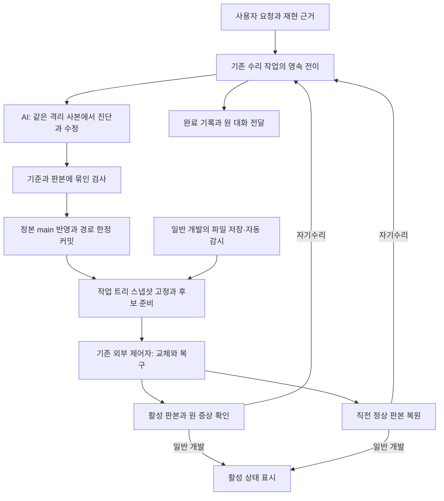

# 자기수리 전체 구조 재설계 — 고칠 수 있는 몸과 복구 가능한 실행 기반

상태: **사용자 검토를 반영한 개정 설계, 재설계 구현은 미착수.** 2026-10-27 최초 조사 뒤 Fable 의견과 사용자의 전체 완성 요구를 반영했다. 미커밋 개발·저장 후 자동 반영을 유지하면서, 불변 실행·지속 작업·요구 검증·수리 기반 갱신·종단 인수를 하나의 구현 범위로 고정한다. 이번 개정은 문서만 변경하며 운영 코드 수정, 실제 수리 실행, 재기동을 하지 않았다.

조사 기준 HEAD: `867aee439615a65b1f1d864092a8fb42584f8c46`. 기존 IBL 조합·진행 표시 등의 미커밋 변경이 함께 있었으므로 깨끗한 릴리스의 전수 감사라고 주장하지 않는다. 수리 핵심 파일의 현재 코드와 이 문서의 관측을 구분한다.

목적은 [IBL 진화 목적](IBL_EVOLUTION_PURPOSE.md)의 품질·완료 시간·전체 토큰 개선이다. 이 문서는 [10월 3일 수리 절차](SELF_REPAIR_WORKSPACE_COMPLETION_DESIGN_2026_10_03.md)와 [9월 11일 재기동 설계](RESTART_COORDINATION_DESIGN_2026_09_11.md)를 폐기하지 않는다. 이미 있는 보장을 계승하고, 그 보장들이 전체 수리의 완료로 이어지지 않는 구조를 바꾼다.

## 1. 결론

**자기수리가 전혀 불가능한 시스템은 아니다. 그러나 올바른 패치가 나오면 나머지는 신뢰할 수 있게 끝나는 시스템도 아직 아니다.** 코드 수정·시험·적용·재기동·각인·통지가 여러 수명과 판정 경계에 걸려 있으며, 그 실행 기반 자체가 편집 중인 저장소에 의존한다. 수리 과정의 장애를 다시 AI의 조사·수정 과제로 돌리는 비용도 남아 있다.

핵심 결손은 세 가지다.

1. **판본 경계:** 편집하는 정본, 검사하는 사본, 실행하는 코드, 복구할 코드가 독립된 불변 판본으로 끝까지 연결되지 않는다.
2. **판정 경계:** 실제 검사가 실행됐다는 증거와 그 검사가 원래 요구를 충분히 검증한다는 근거가 다르다. 후자는 아직 실행자의 연결 선택과 제한된 의미 심사에 의존한다.
3. **수명 경계:** 개별 단계의 소유권과 영수증은 있지만, 여러 원장을 넘는 완료·재개·통지와 수리 기반 자체의 갱신을 하나의 지속 작업으로 닫는 책임이 분산돼 있다.

따라서 다음 투자의 단위는 “실패 하나 → 예외 분기 하나”가 아니라 **요청에서 복구·완료까지 보존할 불변식과 그 단일 소유자**여야 한다. 더 긴 프롬프트, 더 많은 검수 AI, 수리 어휘 추가가 이 문제를 대신 해결하지 못한다.

### 1.1 전체 구현의 필수 완료 조건

**범위는 전체 자기수리, 단계는 안전한 구현 순서다.** 작은 단계부터 구현할 수 있지만 아래 여섯 조건은 같은 작업의 완료 기준으로 계속 유지한다. 새 사고가 나거나 사용자가 다시 요청해야 나머지를 착수하는 방식은 채택하지 않는다.

| ID | 필수 성질 | 완료를 입증할 관측 |
| --- | --- | --- |
| G1 | 편집 중에도 실행 판본의 코드·필수 의존성은 바뀌지 않는다 | 미커밋·동시 편집·지연 import·의존성 갱신 중에도 현재 세대의 바이트와 관측 신원이 유지된다. 저장 후 새 후보 준비·검사·자동 교체가 이어진다. |
| G2 | 새 후보 실패가 기존 서비스를 불필요하게 중단시키지 않는다 | 교체 전 실패는 현역 유지, 교체 후 실패는 호환 가능한 직전 정상 세대 복구. 정지 직후 변경·프로세스 사망도 실제 프로세스로 검증한다. |
| G3 | 접수된 수리의 목표·단계·근거는 실행자의 수명을 넘는다 | 접수 직후 및 각 전이 전후 사망·중복 요청에서 같은 root를 회수하고 필요한 단계만 재개한다. 지원되는 시스템 AI·프로젝트·연구 대화 입구가 모두 이를 따른다. |
| G4 | 검사·정본 반영·활성 판본이 같은 변경을 가리킨다 | 후보 교체·약화된 검사·누락된 생성물·미추적 의존·타인 dirty 변경을 관측하고, 수리 델타의 커밋과 활성 바이트를 대조한다. |
| G5 | 원 문제의 해결 여부를 확인하고 작업을 마감한다 | 원 증상 재검사·요구 범위 근거·활성 관측으로 완료하거나 원인과 재개 조건이 명시된 미완료로 닫는다. 완료 기록 후 전달 실패는 전달만 회수한다. |
| G6 | 수리 기반 자체의 갱신에도 복구 경로가 남는다 | 제어자·helper·검사 입구 갱신 실패에서도 검증된 이전 기반으로 상태 회수·기동이 가능하며, 의도적 종료는 존중한다. |

현재 G1~G6의 **개정 설계 인수는 전부 미완료**다. 기존 부분 구현·45개 검사 통과·97회차의 마지막 성공을 새 완료 기준의 통과로 소급하지 않는다. §9의 단계별 결과와 §8의 전체 인수 근거를 이 문서에 갱신한다.

설계 선택의 기준은 실패 빈도가 아니라 위 성질의 성립에 필요한가다. 파일 수·구현 규모만으로 필요한 경계를 유보하지 않는다. 동시에 전체 데이터의 자동 롤백, 무제한 자연어 정당성 증명, 두 현역의 동시 사용자 처리처럼 이 성질에 필수적이지 않은 보장은 추가하지 않는다.

## 2. 관측된 사실과 해석

### 2.1 최근 훈련은 무엇을 입증했나

| 근거 | 실제 관측 | 해석과 한계 |
| --- | --- | --- |
| [97회차 보고](experiments/long_sentence_imagination/round_97/report.md) §3–4 | 실행자는 올바른 한 줄 수정을 만들었지만 환경변수 접두 pytest를 영수증으로 인식하지 못해 적용 차단. 뒤이어 판정기를 수정하려다 범위 심사에 제지됨 | 적어도 이 사례의 병목은 함수 수정 능력이 아니라 수리 기반의 표현·실행 계약이었다. 범위 심사가 작동한 것도 성과다. |
| 같은 보고 §4, §7 | 예약 뒤 훈련자가 쓴 보고서 때문에 정본 충돌. 적용 0건인데 백엔드 약 20분 정지. 후속 지문 불일치까지 외부에서 고친 뒤 네 번째 요청에서 무개입 완료 | 마지막 실행은 성공이다. 네 번의 요청과 사이의 외부 수리를 포함한 전체 실험을 처음부터 독립 자기수리 성공으로 세면 안 된다. |
| [98회차 보고](experiments/long_sentence_imagination/round_98/report.md), [원장](LONG_SENTENCE_IMAGINATION_LEDGER.md) | 시험 약화 후보는 기계 관문·공개 pytest를 통과했지만 독립 27건 대조에서 미달. 후보 교체 뒤 옛 verified 표시, 바이트코드 캐시, 미추적 diff도 발견·수리 | 판본·시험·범위의 연결이 실제로 중요하다. 제안의 기계 통과를 전체 apply 승인과 혼동하지 않는다. 이 회차의 운영 재기동·통지 실기는 미실행이다. |
| [10월 3일 설계의 5555 후속](SELF_REPAIR_WORKSPACE_COMPLETION_DESIGN_2026_10_03.md#2026-10-27--5555-수리의-후처리거절연구-대화-인계), `0ff68597` | 예약 중 가이드 후처리 쓰기, 거절된 세션의 복구 manifest 처리, 연구 대화 재개 연결을 추가 수리 | 작업 내용을 고치는 것 외에 후처리·실행 표면별 인계가 계속 실패 경계를 만든다. 해당 수정이 없다고 주장하는 것이 아니다. |

97회차의 “수리 완료” 커밋 `e28209f4`와 후속 수정들은 실제 이력이다. 투자가 무효였다는 결론은 맞지 않는다. 격리·지문·증거 보존·정직한 거절은 이미 작동한다. 부족한 것은 이 장치들의 조합이 제공하는 **끝까지 완료되는 성질**이다.

### 2.2 조사 당시 운영 상태

2026-10-27 **13:36~13:37 KST** 읽기 전용 `backend/api.py status`와 원장을 확인했다.

- 제어자 생존 `true`, 작업자 생존 `false`, 제어 상태 `FAILED`.
- 마지막 결과는 **11:05:23 KST `artifact_changed_before_start`**.
- 해당 요청은 `operation: restart`, `files-…` 식별자의 개발 파일 변경 요청이다. 이번 정지를 `red_apply` 자기수리가 직접 일으켰다고 단정하지 않는다.
- `Controller.tick`은 개발 모드에서 파일 manifest 변화를 재기동 요청으로 만든다. DRAINING의 대조를 지난 뒤 STOPPING에서 다시 달라졌으면 작업자를 멈춘 후 FAILED로 종료한다.
- FAILED에서는 새 명시적 restart 요청만 처리한다. 제어자 부재를 감시하는 런처가 “살아 있는 제어자 + 멈춘 작업자 + FAILED”를 자동 수리하는 것과는 다르다.

당시 운영 장애는 가변 checkout 실행의 실패 모드와 일치한다. 최초 조사에서는 실제 변경 주체·파일과 모든 경과를 확정하지 않았으며 프로세스 재시작이나 상태 수정으로 관측을 덮지 않았다. 이후 사용자가 전달한 Fable 보고는 다른 세션 재기동 중 자신의 backend 편집이 닿았고 ACTIVE로 복구됐다고 설명한다. 이는 후속 제공 정보로 기록하며, 위 시각의 직접 관측과 구분한다. 이 문서의 FAILED는 현재 상태를 계속 나타내는 표시가 아니다.

상태 파일 집계는 수리 세션 200개(applied 108, staging 19, discarded 73), 인계 39개(completed 6, blocked 20, cancelled 11, continued 2)였다. **성공률 분모로 쓸 수 없다.** 제안·훈련·구정책·부모/자식·취소가 섞이고 applied도 전체 완료와 같지 않다. 현재 원장 집계만으로 “투자 대비 자기수리 성공률”을 쉽게 답할 수 없다는 점이 관측 개선 대상이다.

### 2.3 운영에 손대지 않은 재현

`TemporaryDirectory`의 `backend/app.py`와 기존 `test_restart_controller.Adapter`를 사용해 실제 `Controller.tick`을 호출했다. 프로세스 생존·종료는 시험 대역이며 운영 프로세스나 네트워크를 조작하지 않았다.

절차: ACTIVE 저장 → restart 접수 → 두 tick으로 DRAINING → 변경 시점만 달리해 `value = 1`을 `value = 2`로 변경 → 네 tick 진행.

| 변경 시점 | 마지막 결과 | 시험 작업자 생존 | stop/spawn |
| --- | --- | --- | --- |
| DRAINING에서 정지 판단 전 | deferred | true | 0 / 0 |
| DRAINING 통과 후 STOPPING 진입 직후 | artifact_changed_before_start, FAILED | false | 1 / 0 |

첫 경우는 이후 파일 감시가 다음 CHECKING으로 진행했으므로 “최종 상태 ACTIVE”라고 기록하지 않는다. 중요한 관측은 기존 작업자를 유지한다는 점이다. 둘째는 안전하게 실행할 이전 불변 판본이 없어 정지하는 경로다.

동시에 기존 `test_restart_controller.py`, `test_repair_policy.py` 비system 검사는 **45 passed, 1.41초**였다. 현재 보호 계약이 통과하는 것과 이 정지 후 회복 능력을 갖추는 것은 다른 주장이다. 전수·실모델·운영 장애 주입 검사는 하지 않았다.

## 3. 근본 원인

### A. 편집·배포·실행을 같은 가변 몸으로 다룬다

`restart_protocol.code_manifest`는 스스로 “가변 checkout의 검사 묶음, R2 불변 산출물/후보 준비는 하지 않는다”고 명시한다. 제어자가 감지·검사·부팅하는 대상은 그 사이에도 바뀔 수 있다. `repair_candidate`가 패치 바이트를 seal해도 **실행 환경 전체가 봉인된 것은 아니다**. 다른 세션 편집, 가이드 생성, 늦은 import, 공유 의존성과 설정의 변화가 남는다.

두 종류의 지문도 범위가 다르다. `repair_candidate.inventory/conflicts`는 추적·비무시 파일과 등록 산출물 전체를 비교하고, `code_manifest`는 실행 소스·일부 선언을 비교한다. 각각 목적이 있어 단순히 하나를 지우면 안 된다. 하지만 후보의 유효성, 정본 반영 가능성, 실행 판본 신원이라는 서로 다른 사실을 하나의 가변 checkout 위에서 조정하는 비용이 크다.

97회차 뒤 충돌 검사를 일부 폴더로 좁혔다가 새 `conftest.py` 누락 반례로 다시 넓힌 이력도 중요하다. **해법은 충돌 검사를 느슨하게 만드는 것이 아니다.** 무엇을 검사·실행할지 고정하고, 개발 중 변화와 서비스 생존을 분리해야 한다.

이 방향은 새 아이디어가 아니다. 9월 11일 설계 §4의 R2가 이미 코드/data root 분리·불변 산출물·부작용 없는 후보 준비를 요구한다. 문서의 R2 미착수 표기와 현재 `code_manifest` 구현을 함께 확인했다. 수리 사본·UI 판본 등 부분 기반은 있지만 backend 실행 전체의 이 경계는 아직 닫히지 않았다.

### B. 수리 기반도 같은 수리 경로에 의존한다

외부 `restart_controller`는 실행자보다 오래 산다는 점에서 옳다. 그러나 외부 **프로세스**와 독립된 **복구 판본**은 다르다. `restart_helper`는 저장소의 `restart_red`를 import하고, `red_apply._load_handler`는 저장소의 적용 handler를 적재한다. 기존 문서도 제어자 코드 수정은 워커 재기동만으로 반영되지 않아 앱 전체 재실행이 필요하다고 명시한다.

그러므로 판정기·적용기·재개기·IBL 입구 자체의 결함은 일반 기능 결함과 다르다. 그 결함을 고쳐야 할 주체가 같은 고장 난 능력을 필요로 할 수 있다. 97회차의 판정기 수정 시도는 이 순환의 실례다. 범위 위반을 막는 현재 장치를 없애면 순환이 해결되는 것이 아니라 후보가 자신의 합격 기준을 바꾸게 된다.

필요한 것은 더 높은 AI 심사자가 아니라, 현재 요청의 생존·복구를 맡는 **작고 판본이 고정된 실행 기반**이다. 그 기반도 갱신 가능하되, 새 기반이 현재 수리의 승인자이자 자기 복구자 역할을 동시에 하지 않도록 해야 한다.

### C. 검사 영수증은 요구 충족의 자동 증명이 아니다

`repair_policy.direct_framing`은 기본적으로 전체 요청을 한 workspace 조건으로 시작한다. `prepare`는 criterion ID와 검사 계획을 연결하고, 실제 시험 보고서가 통과하면 해당 criterion의 coverage를 기록한다. 명시적으로 semantic인 조건의 강등은 막지만, 일반 test 조건에서 **선택한 시험이 요구와 관련 있고 충분한지**를 기계적으로 확정하지는 않는다.

이는 “임의 패치가 반드시 운영에 통과한다”는 실증이 아니다. 실제 현재 경로의 계약 한계다. 98회차는 별도 고정 검증자를 사용해 그 차이를 드러냈고, 후속 적용 시험도 과제별 고정 범위 검사로 연결했다. 자연어 요구 전반에 대한 자동 범위 강제는 아직 구현했다고 보고하지 않았다.

실행자가 구현과 새 검사를 함께 작성하는 것은 정상 개발이다. 다만 그 검사만으로 자신이 충족할 조건의 의미·범위까지 확정하게 하면 잘못된 요구 해석, 약한 단언, 테스트 수정이 같은 방향으로 틀릴 수 있다. 서로 다른 모델을 부르는 것만으로 독립성이 생기지는 않는다. 기준·기대값·판본의 소유권이 핵심이다.

### D. 지속 작업이 여러 상태 해석의 조합이다

실제 상태 소유자는 사본 `status`, 적용 job, 제어 상태/results, red backup 결과, continuation, task DB, 평가/완료 관측, 대화 전달로 나뉜다. 저장소 수가 많다는 것 자체는 결함이 아니다. 책임이 다른 증거는 나뉘어 있어도 된다.

문제는 여러 소비자가 그 조합으로 다음 행동과 완료를 다시 판정한다는 점이다. 예를 들어 `repair_outcomes.progress`, `repair_policy.completion`, `repair_continuation.task_state`, `api_repair_continuation.process_pending`이 서로 다른 목적의 상태를 해석한다. 즉시 활성 검사는 session의 `activation_checks`, 지연 경로는 continuation의 `active_verify`도 쓴다. 이행·환경 재시도 규칙까지 각각 맞춰야 한다.

이미 중복 방지 잠금·원자 JSON·root 신원·재개 제한이 구현돼 있다. 이를 무시하고 “영속성이 없다”고 진단해서는 안 된다. 남은 문제는 **원자 저장 한 건을 넘어 여러 단계·소비자를 잇는 단일 전이 계약**과, 접수 이후 실행자가 사라져도 끝나는 진행 책임이다. 연구 대화처럼 입구가 늘 때마다 완료 경로를 보완한 이력이 이를 뒷받침한다.

### E. 안전한 거절을 늘렸지만 진행 가능성은 별도였다

무관한 파일인지 증명 못 하면 충돌로 거절하고, 적용 결과를 모르면 재실행하지 않으며, 검사 근거가 없으면 완료하지 않는 것은 옳다. 이 보장을 낮추면 안 된다. 그러나 거절 뒤 같은 후보에서 무엇을 기다리고 어느 단계만 다시 할지가 항상 닫히지 않으면 사람의 개입이 계속 필요하다.

현재 적용은 다른 활성 작업이 끝나는 조건을 기다리고, `api_repair_continuation.kick`도 ACTIVE이며 활성 root/child가 없는 때 재개한다. 지속 부하에서의 공정한 완료 기회와 상한은 별도 검증 대상이다. 무진전 3회·보완 8회 제한은 폭주를 멈추지만 수리를 완성시키는 기능은 아니다.

수리 실패, 서비스 중단, 검사 환경 실패, 전달 실패가 서로 다른 사실이어야 한다. 특히 **수리 후보를 거절하는 일은 건강한 이전 서비스를 잃을 이유가 아니다.** 현재 정지 재현은 이 성질이 없는 구간을 보여준다.

### F. 실패별 투자와 전체 능력의 검증 단위가 달랐다

기존 수리는 실제 결함을 고쳤다. 하지만 env 접두, 오류 봉투, 지문, 연구 대화, 통지 등 경계 하나를 고칠 때마다 경계들의 조합은 다시 시험해야 한다. 국소 시험의 합이 프로세스 사망·동시 변경·다른 입구를 포함한 전체 성공을 보장하지 않는다.

훈련자 IBL 성공, 시스템 AI의 수정 성공, 사본 검증, 운영 적용 완료, 외부 도움 후 성공은 각각 다른 성과다. 현 훈련 문서는 이를 상당히 정직하게 구분하고 있다. 문제는 다음 투자 결정을 할 때 마지막 성공과 검사 수가 전체 능력의 대리 지표가 되기 쉽다는 것이다.

`repair_verdict_distill`은 커밋의 판정을 포식 기억·가이드 제안으로 연결한다. 유용하지만 수리 설명을 기억하는 것과 실패를 재현하는 검사가 지속적으로 실행되는 것은 다르다. 지식 축적은 진단 보조이고, 재발 방지는 실행 가능한 계약과 전이 시험이 맡아야 한다.

## 4. 목표 구조와 책임

**정본 main은 편집·기록의 정본으로 유지한다. 서비스는 작업 트리에서 확보한 검증된 불변 실행 산출물에서 실행한다. 미커밋 개발과 파일 감시에 따른 자동 반영을 유지한다. 수리는 요청 하나를 끝까지 소유하는 지속 작업이며 AI는 그 안의 조사·수정 작업자다.** 새 clone·개발 브랜치를 만들거나 일반 개발 실행에 커밋을 강제하지 않는다.



자기수리의 정본 반영은 사전 검사를 이미 통과한 후다. 일반 개발과 자기수리는 같은 스냅샷·검사·활성화 엔진을 사용하며, 자기수리에는 원 요구·허용 범위·수리 델타의 커밋 영수증을 추가로 요구한다. 일반 개발은 저장만으로 이 경로에 진입한다. 최종 실행 산출물 자체의 검사도 필요하며, 정본 커밋이 생겼다는 이유로 서비스 활성·목표 달성을 선언하지 않는다. 두 입구의 구체적 순서는 §5에 둔다.

| 책임 | 기존 소유자에서 수렴할 곳 | 하지 않을 일 |
| --- | --- | --- |
| 요청·기준·허용 범위의 판본 | `criteria_contract` 및 수리 root | 새 요구사항 원장·매번 별도 계획 AI 추가 |
| 진단·패치·필요한 새 시험 | 기존 실행자와 수리 사본 | 적용/복구/완료의 상태 전이를 프롬프트로 직접 운전 |
| 검사 사실·판정 근거 | `repair_check_runner`, `repair_policy`, 후보 manifest | exit 0을 요구 충족과 동일시 |
| 지속 작업과 다음 행동 | 기존 repair session/continuation을 잇는 단일 전이 함수 | 새 평행 수리 엔진·중복 상태 머신 추가 |
| 코드 교체·부팅·복구 | 기존 `restart_controller`와 판본 고정 helper | 운영 코드의 새 handler를 현재 복구의 유일한 수단으로 사용 |
| 표시·대화 전달·기억 | 기존 trace/대화/증류의 읽기 투영과 전달 어댑터 | 전달 실패 때문에 개발·적용 전체 재실행 |

## 5. 판본과 반영 순서

### 5.1 실행 가능한 이전 판본부터 확보한다

운영 코드 root, 사용자 data root, 모델·인증 설정, 임시 캐시를 분리한다. 기존 `runtime_utils`, boot 경로, 동적 패키지 로더, `__file__` 기반 경로를 대상으로 한다. 패키지 구현·어휘·필수 생성물·UI 번들도 해당 실행에 필요한 범위에서 manifest에 들어가야 한다. 사용자 설치 상태와 사전 활성 정책의 호환성도 기록한다. 먼저 backend 소스 세대로 부팅하는 작은 단위를 구현할 수 있으나, 원래 checkout을 다시 읽는 실행 의존 경로가 남으면 G1 완료로 판정하지 않는다.

불변 산출물은 정본 **작업 트리의 스냅샷에서 만든 실행 데이터**다. Git 저장소 사본이나 별도 개발 정본이 아니다. 기반 commit, 포함한 미커밋/미추적 입력의 파일별 내용 지문, 생성물·의존 환경·제어 프로토콜·설정/데이터 스키마의 신원을 기록하고, 산출물 전체를 별도 ID로 식별한다. HEAD가 같아도 dirty 내용이 다르면 다른 세대다. 비밀과 라이브 DB는 산출물에 복사하지 않는다.

스냅샷은 복사 완료한 세대 폴더에서 검사·실행한다. 복사 중 파일 집합·내용이 바뀌면 그 후보를 게시하지 않고 다음 변경을 회수한다. 원천과 복사본 manifest를 대조하고, 복사본의 생성이 끝난 뒤 봉인한다. 원천을 두 번 해시한 것만으로 임의 동시 쓰기에 대한 원자 스냅샷을 주장하지 않는다. 사용할 파일시스템 스냅샷 또는 협력하는 쓰기 작업의 revision/잠금 계약과 비협력 편집 감지 범위를 구현 시 명시하고, 혼합 후보 거절·불완전 후보 무게시를 시험한다. 사용자에게 편집 중단·저장 묶기·사전 커밋을 요구하지 않는다.

의존성은 바이트를 복제하거나 내용으로 식별되는 변경 불가능한 환경을 연결한다. 모든 세대에서 재설치할 필요는 없지만 공유 `.venv`/node_modules의 가변 바이트를 lock 파일 기록만으로 고정됐다고 취급하지 않는다. 환경 갱신은 새 판본을 만들고, 현역과 복구 세대가 참조하는 환경은 유지한다. 동적 설정·사용자 데이터는 별도 가변 영역임을 명시하고 검사 입력 판본과 활성 시 호환성을 확인한다. 외부 서비스까지 고정됐다는 주장은 하지 않는다.

검증된 현재 판본과 직전 정상 판본을 보존한다. 복구에 필요한 판본·환경은 진행 중 job이 참조하는 동안 삭제하지 않는다. 코드 롤백으로 DB·외부 효과까지 돌아갔다고 하지 않는다. 비호환 데이터 변경은 자동 코드 교체에서 분리하고 가역 이행·백업·별도 권한 조건을 충족해야 한다.

### 5.2 자동 감시는 유지하고 실행 판본을 고정한다

일반 개발의 기본 흐름은 **파일 저장 → 변경 회수 → 스냅샷 → 준비·검사 → 자동 교체**다. 커밋이나 수동 배포 버튼 없이 기존 작업 방식을 이어간다. 매 파일 이벤트마다 프로세스를 죽이지 않고, 아래 계약으로 변경을 자동 처리한다.

- 이벤트는 관측 순서와 함께 회수하고 같은 내용은 합친다. 준비 중 새 저장이 들어오면 다음 후보로 기록한다. 아직 교체 요청 전인 일반 개발 후보는 더 최신 후보로 대체할 수 있다.
- 검증된 후보가 교체 대상으로 확정되면 파일 감시가 그 바이트나 교체 요청을 덮지 않는다. 이후 변경은 다음 후보가 된다. 계속 편집한다고 이미 확정한 교체가 무한히 밀리지 않아야 한다.
- 준비·검사는 현역을 유지한 채 한다. 후보가 불완전하거나 실패하면 이전 서비스를 유지하고, 실패 원인·현재 활성 판본·미반영 변경을 표시한다. 같은 입력의 실패를 무한 반복하지 않고 새 변경이나 환경 복구 뒤 재개한다.
- 지연 import, 패키지 호출, 생성물 로드는 현재 세대의 경로를 사용한다. 최초 import만 세대 폴더에서 하고 나머지는 원래 checkout에서 읽는 혼합 실행을 허용하지 않는다.
- 교체 뒤 부팅·필수 기능이 실패하면 이전 정상 세대로 복구한다. 이것이 통과해야 저장 후 자동 반영을 새 경로로 전환한다.

일반 개발 후보의 준비 기준은 변경한 실행 계약에 맞춰 정한다. 매 저장마다 자기수리의 요구 판정·전체 회귀·각인을 강제하지 않는다. 다만 불변 판본, 부팅 준비, 적용 소유권, 복구 보장은 공통으로 집행한다. 사람의 “편집은 모아서” 규율을 실패 방지 조건으로 삼지 않는다.

### 5.3 자기수리는 같은 세대 경로에 근거와 각인을 연결한다

1. 현재 활성 판본과 정본 상태를 함께 읽고 같은 수리 사본에서 재현·수정·생성한다. 요청이 겪은 현역과 개발 중 정본이 다른 경우 어느 판본의 결함인지 먼저 확인한다.
2. 기준·코드·검사·입력·환경을 고정하고 사전 검사를 수행한다. 원래 실패 재현이 불가능하면 그 사실과 대체 검증의 한계를 보존한다.
3. 짧은 정본 반영 구간에서 기대 파일 바이트를 재대조하고 수리 델타만 반영·커밋한다. 타인의 dirty/index는 보존한다. 같은 파일의 기존 미커밋 변경을 수리 소유 변경과 분리해 보존할 수 없으면 충돌로 처리하고 통째로 커밋하지 않는다. 충돌은 배포 전 실패이며 서비스는 기존 세대에서 계속 돈다.
4. **검사한 전체 실행 입력과 수리 커밋을 연결한 작업 트리 스냅샷**을 확보한다. 사전부터 존재한 타인의 미커밋 변경을 무조건 커밋시키거나 버리지 않는다. 그것이 검사 입력이었다면 정확한 바이트를 manifest에 기록한다. 수리 대상 경로의 바이트는 수리 커밋과 일치해야 하며, 그 외 미커밋 입력이 있는 세대를 순수한 해당 커밋의 실행이라고 표시하지 않는다.
5. 사본에만 있는 신규·무시 코드나 정본과 다른 의존 입력이 있으면 실제 배치 manifest로 연결하거나 재조정·재검증한다. 입력 집합이 달라졌는데 옛 시험을 재사용하지 않는다. 원래 후보를 보존하며 필요한 단계로 돌아간다.
6. 최종 세대에서 후보 준비·관련 기능 검사를 수행한다. 사전 영수증은 코드·검사·입력·환경의 등가성이 입증된 경우만 재사용한다.
7. 준비 완료한 산출물 ID와 수리 root로 drain·교체를 요청한다. 이후 편집은 다음 후보가 되며 현재 교체를 바꾸지 않는다.
8. 해당 활성 세대의 digest, 수리 델타의 실제 커밋, 원 증상에 필요한 관측을 확인하고 완료한다. 실패하면 이전 호환 세대로 복원하고 수리는 미완료로 남긴다.

자기수리는 현행 “가변 정본 적용 → 활성 → 각인”에서 **“수리 델타 반영·각인 → 연결된 세대 검증 → 활성”**로 바뀐다. 개발 일반 경로에는 이 커밋 조건을 적용하지 않는다. 수리 커밋이 생겨도 활성화에 실패할 수 있으며, 정본의 취소가 필요하면 타인 변경을 보존하는 후속 커밋을 사용한다. 자동 reset/강제 되감기는 하지 않는다.

파일 감시가 자기수리의 중간 쓰기를 일반 개발 후보로 먼저 활성화해서는 안 된다. 적용 서비스는 반영 시작 전에 수리 root·대상·예상 바이트·복구 정보를 영속 기록하고, 그 변경은 각인과 후보 인계가 완료돼야 게시한다. 그 구간의 일반 개발 후보도 해당 중간 바이트를 포함하면 게시를 보류한다. 다른 편집은 수집하되 서비스는 기존 세대로 계속 실행한다. 반영 중 사망·커밋 실패는 실제 파일·각인 상태부터 회수하고, 적용 서비스 밖의 동시 쓰기는 파일별 대조로 충돌 처리한다. 애플리케이션 잠금만으로 외부 편집기를 막았다고 가정하지 않는다.

자기수리 세대의 활성 검사·완료 기록이 끝나기 전에 일반 개발 후보가 이를 덮어 관측 대상을 바꾸지 않도록 교체 요청을 직렬화한다. 활성 관측은 제한된 검사 기한을 가지며, 실패/미확정도 기록한 뒤 다음 후보의 진행 여부를 결정한다. 완료 직후 새 세대가 활성화돼도 과거 성공을 지우지 않고 완료 당시 세대와 현재 세대를 구분한다.

### 5.4 후보 준비는 운영 부작용 없이 한다

기존 R2의 `inspect → prepare → activate → deactivate`를 구현한다. 후보 단계에는 운영 DB 쓰기·스케줄러·폴러·터널·기기 등록·자동 설치·공개물 발행 권한을 주지 않는다. 부팅 플래그만 믿지 않고 격리된 데이터·포트·파일/네트워크 관측으로 확인한다.

개발 실행자의 모델·검색 능력은 현재 권한대로 유지한다. 후보의 부팅 검사와 개발자의 조사 능력을 혼동해 수리 사본의 모든 능력을 막지 않는다. 외부 통합 검사가 필요한 경우 시험 계정·대역·명시적 실기를 따로 구분한다.

처음에는 현역 하나만 사용자 일을 한다. 기존 작업 drain → 옛 현역 종료 → 준비한 후보 활성화다. 완전한 두 세대 동시 운영은 이번 필수 범위가 아니며 기존 R3의 선행조건을 유지한다.

## 6. 기준·검사·범위 계약

진단에서는 **사용자가 겪은 원래 결함**, **수리 도중 만난 기반 장애**, **실험/관측 오류**를 별도 원인으로 연결한다. 예를 들어 함수의 None 처리 결함과 env 접두 검사 거절은 서로 다른 원인이다. 후자를 고쳤다고 원 문제가 해결된 것도 아니며, 후자가 막혔다고 함수 구현을 다시 시작할 이유도 없다. root에는 재현 조건 → 실제 관측 → 원인 가설 → 반증 결과 → 변경한 계약 → 원 증상 재검사라는 짧은 연결을 남긴다. 모델의 설명과 관측된 사실을 분리하고, 새 증거가 가설을 깨면 기존 가설을 철회한다.

진단 입력은 같은 작업의 실패 원문·실행 판본·관련 변화·계약과 소비자를 우선한다. 매번 모든 기억과 저장소를 읽는 의례를 만들지 않는다. 과거 수리 기억은 후보 가설을 찾는 데 쓰되, 현재 판본에서도 참인지는 재현으로 확인한다. 복구 경로가 완성돼도 미지의 소프트웨어 결함을 항상 진단할 수 있다는 뜻은 아니므로, 진단 실패와 적용 실패의 성과를 따로 계수한다.

기존 criteria에 최소한 다음 연결을 보존한다: 원문 요구, 재현 입력/실패 관측, 기대 동작, 검사 대상, 검사 방식, 판정 근거의 소유자·판본. 확인 불가능한 항목은 unknown으로 남기고 적용 가능성 판단과 목표 달성 판단을 구별한다.

실행자의 verification_plan은 **검사를 제안하는 것**이다. 검사 명령을 C1에 붙였다는 사실만으로 C1이 입증됐다고 해석하지 않는다.

- 기존 재현·회귀 시험은 원래 기대값과 연결한다. 새 수리에는 가능하면 수정 전 실패·수정 후 성공을 같은 시험으로 관측한다. 환경 실패를 기능 실패의 기준선으로 쓰지 않는다.
- 새 시험은 요구에서 도출한 기대값·반례·변형의 연결을 확인한다. 코드의 현재 출력에서 정답을 만들어내지 않는다. 의미 판단이 필요한 부분만 제한 검토하며 모든 수리에 새로운 AI 왕복을 추가하지 않는다.
- 시험 변경 자체를 금지하지 않는다. 오래된 계약을 고치는 일과 버그에 맞춰 기대값을 낮추는 일을 구별하고, 기존 기준 판본이 새 시험만으로 자동 소멸하지 않게 한다.
- 고정 검증자·권한/적용 정책·수리 제어 코드는 일반 패치의 자체 승인 수단이 될 수 없다. 그 변경이 필요하면 별도 의존 수리로 연결하고 현재 작업을 `blocked_on`으로 둔다. 사용자가 승인한 범위 안에서는 자동으로 의존 작업을 진행할 수 있으며 매 발견마다 재승인을 요구하지 않는다.
- 자연어 범위의 완전한 기계 판정은 약속하지 않는다. 경로·함수·보호 파일처럼 명확한 제약은 구조화하고, 애매한 의미 제약만 검토한다. 범위가 불명확한 것을 자동 허용 또는 전면 금지로 숨기지 않는다.

검증의 한계가 있다는 이유로 근거 ID 연결에서 투자를 끝내지 않는다. 원 실패의 재현, 같은 기대값의 변경 전후 대조, 기존 단언의 삭제·skip·약화 검토, 요구에서 독립적으로 만든 반례, 활성 세대의 원 증상 확인은 이번 구현·인수 범위다. 구조 검사는 변경 사실을 잡고, 의미적 동등성까지 결정하지 못하면 그 부분을 제한 검토 또는 미확인으로 남긴다. 시험 개수·문자열 정적 검사만으로 시험의 충분성을 보장하지 않는다.

검사 영수증에는 runner/protocol 판본, 실제 command/argv·cwd, 비밀을 제외한 결과 영향 설정의 판본, 코드·검사·입력·의존 환경 지문, 실행/실패/skip 수, 원문 참조가 필요하다. 현재 environment 해시는 Python 환경과 npm lock을 중심으로 하므로 모든 외부 설정·서비스가 고정됐다고 확대 해석하지 않는다. 통제하지 못한 입력이 있는 시험은 재사용 불가 또는 유효 범위를 제한한다.

목표 달성은 다음 사실의 결합이다: **원 요구의 필요한 근거 + 허용 변경 + 같은 검사 대상 + 정본 커밋 + 같은 활성 산출물 + 필요한 활성 동작 관측.** 사용자 전달의 성공 여부는 별도 필드로 보존한다. 기능은 고쳐졌는데 통지만 실패했다면 그 사실을 표현하고 전달만 재시도한다.

## 7. 지속 작업과 복구

### 7.1 한 작업의 전이와 증거 소유권

기존 session/continuation을 단일 repair root의 현재 상태와 시도 이력으로 연결한다. 모든 자료를 한 DB로 이사하는 일부터 시작하지 않는다. 먼저 **전이를 쓰는 함수 한 벌**과 그 결과를 읽는 투영을 정하고 소비자의 자체 판정을 제거한다.

논리 단계는 `진단/수정 → 준비 → 검사 → 정본 반영 → 배포 대기 → 활성 → 기능 확인 → 완료`다. 각 단계에 성공/실패/대기/효과불명 결과를 붙이고, 별도 전역 상태 목록을 무작정 늘리지 않는다. repair outcome, service health, delivery status는 직교하는 사실로 유지한다.

root에는 요청·기준 판본·후보/산출물 ID·현재 단계·단계 revision·시도 번호·소유자와 fencing token·마지막 근거·다음 행동·기한을 둔다. 여러 소비자가 갱신하려면 기대 revision을 검사한다. 이전 소유자의 늦은 응답은 새 상태를 덮지 못한다. 기존 잠금·원자 JSON을 재사용할지 DB 트랜잭션으로 옮길지는 내구성 시험 결과로 결정하되 복수 파일 갱신을 하나의 원자 연산인 것처럼 취급하지 않는다.

적용 접수와 인계 의도는 함께 영속화한다. 접수증을 반환한 뒤 원래 AI 턴이 사망해도 하네스가 해당 작업을 회수해야 한다. 단지 `do_not_wait`라는 긴 경고문을 AI가 잘 따르기를 기다리지 않고, 접수 결과가 하네스의 명시적인 턴 종료·인계 사건으로 이어지게 한다.

### 7.2 실패는 필요한 단계로만 돌아간다

| 실패 | 다음 행동 | 서비스 상태 |
| --- | --- | --- |
| 기능 시험 미달 | 같은 후보에서 원인 수정, 영향 검사 무효화 | 기존 판본 유지 |
| 근거 누락/검사 환경 장애 | 원문 회수 또는 해당 검사만 준비·재실행 | 기존 판본 유지 |
| 정본 충돌 | 충돌 근거로 후보 재조정, 필요한 검사 다시 수행 | 기존 판본 유지 |
| 배포 전 후보 부팅 실패 | 후보 거절 | 기존 판본 유지 |
| 교체 후 새 세대 실패 | 이전 호환 산출물 복구, 실패 후보 보존 | 복구 결과를 독립 관측 |
| 커밋/파일 반영의 중간 사망 | 실제 파일·커밋 영수증부터 대조, 미확정 효과 무조건 반복 금지 | 기존 산출물 유지 |
| 통지 실패 | 동일 event ID로 전달 회수/재시도 | 완료 기능 유지 |
| 수리 기반 자체의 결함 | 고정 복구 기반으로 회복, 기반 갱신 작업에 의존 연결 | 회복 불가이면 명시적 rescue 상태 |

재시도는 시간·입력·환경·소유권 변화 등 구체적인 재개 조건을 가진다. 막힌 이유가 그대로이면 모델을 다시 부르지 않는다. 같은 원인 반복 제한은 유지하되 목표 비용·전체 경과 시간도 같은 root에 누적한다.

배포 기회는 제어자가 공정하게 예약한다. 준비 전 장시간 drain을 시작하지 않고, 준비 뒤 새 작업 접수를 잠시 제한하는 기존 계약으로 진행 중 작업이 끝날 기회를 확보한다. 완료 통지·각인 같은 짧은 후처리가 모든 AI 작업이 없어질 때까지 무기한 굶지 않게 한다. 장기 작업을 강제로 죽여 시간 목표를 맞추지는 않는다.

### 7.3 제어자 자체를 고칠 수 있어야 한다

제어자·helper·프로토콜의 실행 판본을 현재 수리 job에 고정한다. 시스템 전체의 새 코드를 지우지 않고도 이전 정상 판본 기동·상태 조회·영수증 회수가 가능한 최소 복구 경로를 유지한다. OS 프로세스 실행, 파일 교체, 잠금과 호환 manifest 읽기에 의존하도록 작게 둔다. 모델·IBL·가이드 DB·업무 패키지 전체가 부팅돼야 복구할 수 있는 구조를 피한다.

**G6는 이번 구현의 필수 범위다.** 제어자 변경 빈도가 낮다는 이유로 다음 사고까지 유보하지 않는다. 다만 별도 상시 감독 데몬이나 복잡한 무중단 제어자 인계를 기본 해법으로 고정하지 않는다. 기존 런처·정상 제어 기반이 검증한 새 제어자 판본을 기동하고 실패 시 이전 판본을 다시 기동하는 최소 구조를 우선한다. 수리 기반의 신뢰를 담당하는 코드·프로토콜 범위를 명시하고 그 부분의 갱신도 기존 정상 경로로 검증한다.

새 판본은 현재 승인된 정상 기반이 검사·설치한다. 인계는 새 소유자의 프로토콜 호환·상태 해석·잠금 인수를 확인한 뒤 끝내고, 실패하면 이전 판본과 읽을 수 있는 상태를 유지한다. 새 제어자가 이전 상태를 비가역적으로 변환한 뒤 부팅에 실패하는 경우도 시험한다. 호환 이행 또는 복원 가능한 상태 사본 없이 그런 갱신을 시작하지 않는다. 사람이 앱을 재실행하는 절차는 비상 수단으로 유지하되 정상 자기수리의 필수 마지막 단계로 남기지 않는다.

초기 도입과 OS·저장장치·신뢰 기반 전체가 손상돼 복구 불가능한 경우에는 외부 도구/사람의 개입이 남는다. 어떤 손상도 전부 스스로 고친다는 무한 보장은 목표가 아니다. 이 한계와, 지원하기로 한 제어자 갱신 경로가 아직 구현되지 않은 상태를 구별한다.

## 8. 상상훈련의 역할을 정확히 놓는다

자기수리를 주제로 훈련해서 문제가 새로 생겼다고 단정할 근거는 없다. 평소 분리돼 있던 도구·검사·수명 경계를 한 과제로 연결하면서 숨어 있던 공백을 드러낸 측면이 크다. 97회차 보고서 쓰기처럼 하네스의 실제 간섭도 있었으므로 제품 결함과 실험 과실을 함께 보존한다.

긴 IBL 프로그램은 표현·조합 능력을 시험한다. 프로그램을 실행하는 몸이 재기동돼도 수리 전체가 끝나는 성질은 별도로 시험해야 한다. IBL을 더 길게 쓰는 것으로 지속 실행·배포·독립 검증이 생기지 않는다. 일반 셸·네이티브 도구도 허용한 기존 목적을 유지한다.

훈련과 인수는 다음 세 수준으로 나누어 같은 원장에 표시한다.

| 수준 | 확인할 것 | 성공으로 세지 않을 것 |
| --- | --- | --- |
| 언어/부품 | IBL 조합, 후보·검사·오류 근거 전달, 부분 재개 | 운영 수리 완료 |
| 수리 전체 시험장 | 실제 제어 프로세스와 격리 데이터, 교체·사망·복구·통지 | 실제 사용자 환경의 모든 외부 연동 |
| 승인된 운영 실기 | 원 요청부터 실제 활성·원 증상 소멸·전달 | 외부 도움을 뺀 최초 독립 성공으로 소급 계산 |

핵심 인수 행렬은 파일 수가 아니라 실패 경계다.

- 순수 backend, 패키지/어휘/생성물, UI 표시, 설정 의존, 제어자 자체의 수리.
- 시스템 AI·프로젝트·연구 대화의 같은 수리 요청과 완료 회수.
- 준비 중/봉인 후/정본 반영 중/정지 직후/부팅 후/완료 기록 후 통지 전 사망.
- 같은 크기·mtime의 다른 코드, 변경된 시험, 새 conftest, dirty 의존성, 다른 세션 편집.
- 정상 수리, 틀린 수리, 시험 약화, 전부 skip, 환경 실패, 효과불명, 취소, 중복 접수·늦은 응답.
- 고장 난 수리 검사기·IBL 입구·제어자가 있는 상태에서 기존 복구 기반으로 회복.
- 커밋 없이 저장한 변경의 자동 반영, 스냅샷 복사 중 변경, 준비 중 연속 저장, 교체 확정 후의 새 저장. 구세대의 지연 import·의존성·UI/패키지 로드가 원래 checkout 변경에 영향받지 않는지 확인.
- 자기수리 반영 중 파일 감시, 커밋 실패, 활성 검사 중 일반 개발 후보 도착. 부분 수리의 선행 활성·타인 변경의 커밋 혼입·검사 대상 세대 교체를 막고, 대기 후보가 이후 자동 진행하는지 확인.

각 전이의 전후 사망 시험은 격리 시험장에서 수행한다. 단위 대역뿐 아니라 실제 자식 프로세스·파일·임시 Git·격리 포트를 포함한다. 실제 운영 정지는 정상 배포 인수가 끝난 뒤 별도 실기 범위에서만 한다.

인수는 다음 세 층을 모두 통과해야 한다. (1) 각 불변식의 결정적 회귀·실제 프로세스 장애 시험, (2) 외부에서 중간 코드를 고쳐주지 않는 시스템 AI의 서로 다른 결함군 수리, (3) 승인된 실제 운영에서 활성·원 증상·완료 전달 확인이다. backend·패키지/어휘·UI·설정 의존·제어 기반 변경을 대표 과제로 포함하고, 각 입구는 공통 완료/재개 계약을 확인한다. 조합 전수처럼 끝없는 검사를 요구하지 않되, 선택한 조합이 각 실패 경계와 G1~G6를 어디서 확인하는지 연결표를 남긴다. 단위 대역 성공으로 실모델의 진단 성공을 대체하지 않는다.

성과는 root별 최초 무개입 완료, 외부 수정/개입 횟수, 재개 횟수, 서비스 불능 시간, 원 증상 재발, 시간·토큰·캐시 사용량으로 기록한다. 수리 성공·안전한 거절/복구·미해결을 분리하고, 취소와 권한 밖 요청을 성공률에 자의적으로 넣거나 빼지 않는다. 같은 조건의 비교와 미사용 결함군으로 일반화를 확인한다. 성능 표본 수집을 구조 개선의 선행 조건으로 삼지는 않는다.

## 9. 이행 순서와 삭제할 경로

**아래 단계는 모두 같은 전체 구현 범위이며 선택적 후속 목록이 아니다.** 변경은 검토·복구 가능한 묶음으로 나누고 각 보장이 연결된 뒤 이전 경로를 은퇴시킨다. 첫 세대 부팅 성공을 전체 자기수리 완료로 보고하지 않는다. 첫 단계의 크기는 1A/1B로 나누되, 실행 의존 범위와 복구 인수는 그대로 유지한다.

| 순서 | 실제 작업과 소유 위치 | 단계 완료 기준과 대응 목표 | 대체/은퇴 |
| --- | --- | --- | --- |
| 1A. 세대 실행을 세운다 | 기존 R2, `restart_protocol`, `restart_controller`, 경로/부팅 로더. 코드/data 분리, 작업 트리 스냅샷, 기존 제어자를 통한 세대 기동·보존 | 임시 시험장에서 미커밋 소스 세대로 실제 부팅·구세대 복귀. 실행 입력/남은 checkout 참조를 식별. **G1/G2의 부분 구현이며 운영 전환 완료 아님** | 테스트된 경로의 가변 checkout 직접 부팅 |
| 1B. 실행 경계와 자동 교체를 완성한다 | 패키지·생성물·UI·의존 환경 manifest, 후보 부작용 차단, 감시·배포 직렬화. 2단계와 공유할 수리 접수/게시 계약을 먼저 정의 | 연속 저장·복사 중 변경·정지 경계·의존 갱신·수리 중간 쓰기에서 기존 서비스 유지/복구. 수동 커밋 없이 자동 반영. **G1/G2, G4의 실행 판본 부분** | 실행 중 원래 checkout 재독, 편집 묶기 규율에 의존한 재기동, 파일 감시의 수리 관문 우회 |
| 2. 수리 작업 전이를 수렴한다 | `repair_staging`, `repair_continuation`, `repair_outcomes`, `repair_resume`, 표면 인계 | 같은 root를 즉시/예약/재개/연구 대화가 공유. 접수 직후 사망·중복 요청·완료 전달 실패를 필요한 단계에서 회수. **G3, G5의 수명 부분** | 입구별 완료 판정, 두 활성 검사 저장 방식의 독자 재시도 정책, AI 경고문에 의존한 인계 |
| 3. 요구 근거와 검사 연결을 강화한다 | `criteria_contract`, `repair_policy`, `repair_check_runner`, `repair_candidate` | 원 실패/수정 후 대조, 독립 반례, 시험 약화·무관 검사·판본 교체의 근거별 판정, 활성 원 증상 확인. 불명 근거는 unknown. **G4/G5의 검증 부분** | 명령-ID 연결만으로 조건 충족 확정, 불필요한 포괄 AI 재심사 |
| 4. 수리 기반 갱신을 완성한다 | 기존 제어자·helper·런처의 고정 판본/호환 인계. 1단계부터 구기반은 보존 | 제어자 자체 변경·새 helper 실패·입구 고장에서도 이전 기반으로 복구, 비호환 상태 변환 방지, 의도적 종료 뒤 부활 없음. **G6** | 새 checkout의 helper에 현재 복구를 맡기는 결합, 정상 수리의 필수 단계로 남은 수동 앱 재시작 |
| 5. 전체 능력을 인수한다 | 기존 회귀·훈련 원장·trace·기억 | §8의 세 층과 실패 경계, 서로 다른 수리 종류·모든 지원 입구를 확인. **G1~G6 종단 인수** | 회차 성공·검사 개수·커밋 수를 전체 자기수리 성과로 간주 |

각 묶음은 바뀐 책임·제거한 경로·관련 검사·G1~G6 중 닫힌 항목과 남은 항목을 이 문서와 커밋에 남긴다. 설계한 보장이 성립하려면 필요한 추가 작업은 같은 구현 범위에서 해결한다. 전체 미완료를 작은 패치의 완료로 바꿔 종료하지 않는다. 실험 실패나 미지원 외부 환경 때문에 끝낼 수 없다면 구체적인 차단 조건·보존 상태·다음 행동을 남기며, 전체 목표 자체를 조용히 축소하지 않는다.

본 개정은 설계 변경 요청에 대한 문서 반영이며 위 구현을 실행하지 않았다. 운영의 단발성 복구와 전체 재설계 구현은 별개다. 안정화를 위한 작은 수정이 필요할 수 있지만 그것을 전체 재설계 완료로 보고하지 않는다.

기존 진행 수리는 정책 판본을 유지한다. 적용 중/효과불명 작업은 새 체계로 즉석 재해석하지 않는다. 안전한 경계에서 원 상태·근거를 대조해 이행하고, 구정책 소비자를 없애기 전에 진행 작업의 완료·명시 종료를 확인한다.

## 10. 왜 이번에는 문서가 하나 더 생기는 데서 끝나지 않아야 하나

10월 3일 문서에도 같은 사본, 읽기 전용 검사, 영수증 완료, 실패별 재개라는 좋은 설계가 이미 있다. 이를 다시 적는 것만으로는 진전이 없다. 이번 설계의 차이는 **가변 실행 기반을 실제 산출물 경계로 바꾸고, 현재 보장하지 않는 정지 후 복구·기준의 독립성·제어자 갱신을 인수 항목으로 고정**하는 데 있다.

후속 구현은 매 묶음마다 바뀐 책임, 없어지는 경로, 생산자부터 마지막 소비자까지의 실제 시험, 남은 한계를 커밋에 남긴다. 각 단계의 검사를 연결할 때만 보호 기능을 옮기고 옛 경로를 지운다. 새 모델 역할·새 원장·새 재시도 분기를 기존 것 위에 계속 얹는 방식은 택하지 않는다. 구현 방법을 더 단순하게 바꾸는 것은 가능하지만, G1~G6와 일상 개발 방식의 보존을 약화하는 변경은 단순한 구현 선택으로 처리하지 않는다.

이 시스템에 필요한 자기수리의 기준은 **AI가 패치를 만들 수 있는가**에 더해 **수리 도중 실패해도 서비스와 근거를 보존하고, 사람의 재지시 없이 가능한 다음 단계로 진행하며, 원래 문제가 해결된 같은 판본을 확인하고 닫을 수 있는가**다. 투자 단위를 여기에 맞춰야 한다.

## 조사 재현과 검증 범위

읽은 주요 구현: `backend/base/{restart_protocol,repair_process,repair_test_results}.py`, `backend/services/{restart_controller,restart_helper}.py`, `backend/datastore/{restart_red,red_apply,repair_continuation}.py`, `backend/cognition/{repair_policy,repair_check_runner,repair_resume,repair_verdict_distill}.py`, `backend/surface/api_repair_continuation.py`, `data/packages/installed/tools/system_essentials/{repair_staging,repair_candidate,repair_outcomes}.py`.

최초 조사에서 실행한 기존 검사(이번 문서 개정에서 재실행하지 않음):

```sh
.venv/bin/python3 -m pytest backend/test_restart_controller.py backend/test_repair_policy.py -m 'not system'
```

정지 경계 탐침은 기존 시험 `setup`과 같은 임시 app/Adapter/Controller 구성을 사용한다. `request` 후 `tick` 두 번에서 DRAINING, 한 번 더에서 STOPPING임을 assert한 뒤 파일을 바꾸면 §2.3을 재현할 수 있다. 코드 변경 없이 동작을 관측한 탐침이며 제품 회귀 시험을 새로 등록하지 않았다.

미실행: 전체 회귀, 실제 모델의 신규 수리, 실제 제어자 사망 주입, 운영 복구, 새 설계 구현. 운영 원장·토큰·인증 파일 원문은 이 문서에 복제하거나 커밋하지 않았다.

개정 검증 범위: 문서 내부의 개발/수리 입구, 커밋 조건, 감시·게시·활성 검사 순서, 단계와 G1~G6의 대응, 상대 링크와 diff를 확인한다. 문서 개정으로 제품 동작을 검증했다고 주장하지 않는다.
