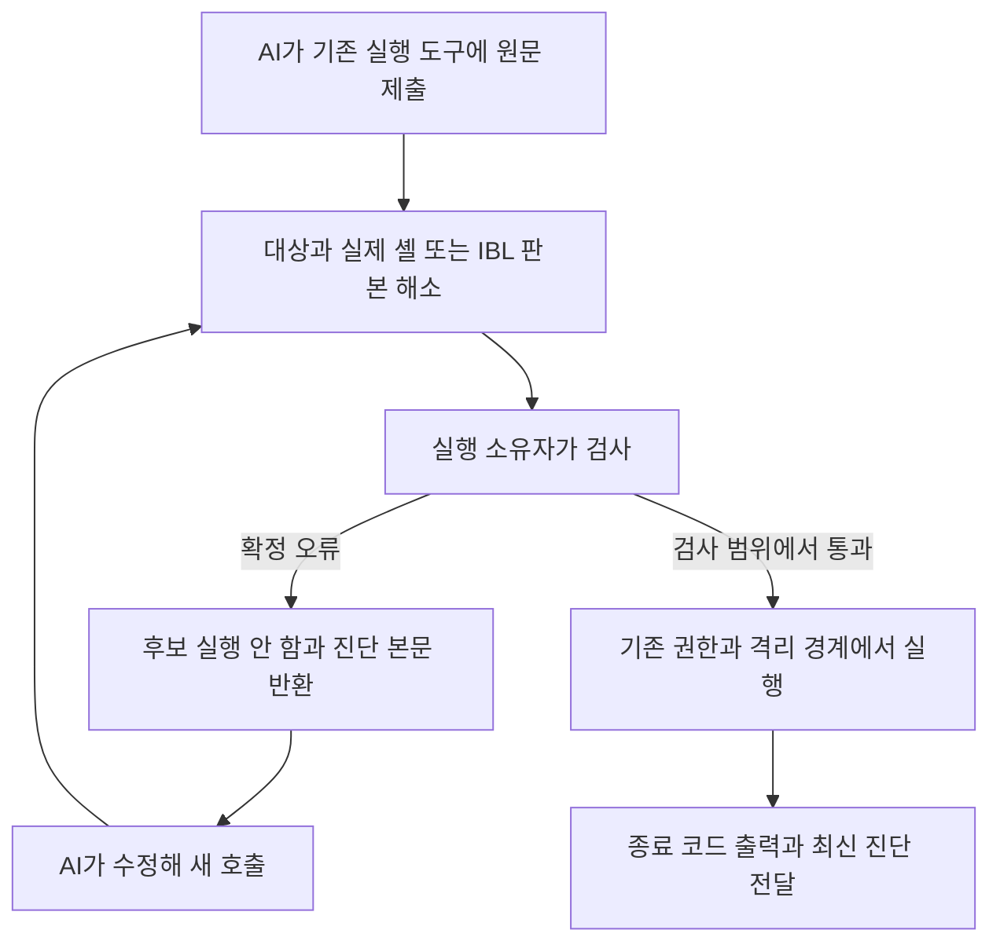

# 셸과 IBL 실행 전 진단 연결 수리 설계

상태: 운영 연결 전 설계와 실제 AI 시제품 검증. 이 문서의 구현 단계는 아직 운영 실행기에
반영하지 않았다. 기준 코드는 `24b5b08a`이며, 검증 도구는
[`probe_shell_preflight_feedback.py`](../scripts/probe_shell_preflight_feedback.py)다.

목표는 AI가 명령을 제출한 자리에서 실행 전 오류와 정확한 위치를 받아 고치게 하는 것이다.
셸은 실제 실행파일에 맞는 파서를 연결하고, IBL은 이미 실행 전에 사용하는 컴파일러 결과를
재사용한다. 추가 판단 모델, 별도 IBL 낱말, 셸을 IBL로 강제 번역하는 관문은 추가하지 않는다.
판단 기준은 [IBL 진화 목적](IBL_EVOLUTION_PURPOSE.md)과
[언어 경계 수리 설계](LANGUAGE_BOUNDARY_REPAIR_DESIGN_2026_11_02.md)를 따른다.

## 1 현재 경로와 확인된 공백

| 실행 경로 | 현재 실제 실행 방식 | 수리 지점 |
|---|---|---|
| 일반 `self:exec` 동기 호출 | `essentials_command.py`의 `subprocess.run(shell=True)` | 실행할 셸을 먼저 해소하고 동일 실행파일의 구문 검사 후 실행 |
| 로컬 프로세스 세션 | `process_sessions.start`: POSIX `/bin/sh -c`, Windows `COMSPEC /c` | 세션 생성 전 검사. 이미 접수한 request_id의 재조회에는 재실행 금지 |
| 코딩 작업자 | `code_analysis_bridge.Bridge._command`: `/bin/sh -c` | 현재 발행 사본에서 검사하고 기존 격리 실행·명령 결과에 연결 |
| 자기수리 검사 | `repair_check_runner.execute`: 확인한 pytest는 argv, 그 외 bash `-e -o pipefail` 또는 sh | 셸 문자열에만 검사. 직접 argv 호출을 셸 문자열로 바꾸지 않음 |
| 상주 원격 PC | `helper/resident_execute.go`: POSIX `/bin/sh`, Windows 기본 cmd, PS 선택 시 `powershell` | 대상 helper가 실행파일·버전을 해소하고 같은 작업 안에서 검사 |
| 휴대형 helper | `helper/shell.go`: POSIX sh, Windows PS 선택 시 pwsh 우선·powershell 대체 | 상주형과 다른 해소 규칙 및 유지되는 cwd/env를 보고 |
| 원격 대화형 터미널 | Windows ConPTY 기본 PowerShell, POSIX 대화형 셸 | 키 입력 조각을 완성된 명령으로 판정하지 않음. 초기 명령만 별도 지원 검토 |
| Claude 네이티브 Bash | `supervision_hook.py` PreToolUse, pipefail 접두부를 추가 | 최종 실행 원문으로 검사. 확정 오류 시 훅 실패로 실행 전 반환 |
| Codex 네이티브 shell | 현재 `codex exec` JSON 사건 관측 | 사전 차단 API가 확인되지 않음. 사후 관측을 사전 검사로 표시하지 않음 |
| IBL API와 MCP | `ibl_v2_entry` → `compile_program` → `Runtime._run` | 기존 컴파일 1회를 재사용하고 확정 오류·경고를 공통 진단으로 발행 |

macOS 로그인 셸이 zsh라는 사실은 일반 명령 실행기가 zsh라는 뜻이 아니다. Windows에서도
`shell: powershell`이라는 요청 이름만으로 PS 7이라고 판단할 수 없다. 조사한 상주 PC는
Windows PowerShell **5.1.26100.9711 / Desktop**이었고 PSScriptAnalyzer는 없었다.
동일 별칭을 가진 등록이 있을 수 있으므로 실험과 실행은 정확한 device_id로 묶는다.
현재 `coding_process.available()`의 쓰기 격리는 macOS만 지원한다. Windows 구문 검사 지원이
Windows 코딩 사본·자기수리 격리 지원을 새로 만들어 주지는 않는다. 실행 불가 경계는 유지한다.

현재 IBL은 컴파일 오류가 있으면 `executed:false`, `issues`, `location`, `call_path`를 반환한다.
따라서 별도 검사 후 같은 코드를 다시 컴파일하는 왕복을 기본으로 추가하지 않는다.
`check:true`는 명시적 무실행 검사에 유지한다. 일반 실행의 `precheck_warnings`도 보존한다.
공백은 셸의 공통 사전 검사 부재, 경로별 실제 셸 정보 차이, IBL 진단을 일반 도구 결과와
구분해 우선 전달하는 연결이다. `shell_shadow_gate.py`의 은퇴한 강제 번역은 복원하지 않는다.

## 2 실행할 언어와 환경을 먼저 고정한다

실행 소유자가 `Invocation`을 만들고 검사기와 실행기에 같은 값을 넘긴다. 최소 필드는
`kind(shell|argv|ibl)`, 원문/argv, 대상 device와 설치 세대, cwd, 실제 실행파일의 절대 경로,
버전·방언, 실행 옵션, stdin 사용 방식, 환경 판본, 사본/권한 범위, 호출 ID다.
로그에는 비밀 환경 값을 쓰지 않고 기존 TurnStore 마스킹과 근거 참조를 사용한다.

원문은 UTF-8 지문으로 묶고 프로필·래퍼를 포함한 실제 실행 형태도 별도 지문으로 묶는다.
검사 뒤 원문·대상·셸·옵션이 바뀌면 검사 결과를 재사용하지 않는다. 파일 실행이면 검사한
바이트와 실행 시점 바이트를 확인한다. 검사가 권한 승인이나 파일 충돌 검사 토큰을 대신하지 않는다.

| 실행 언어 | 검사 방법 | 지켜야 할 차이 |
|---|---|---|
| sh | 대상의 실제 sh에 전체 원문을 stdin으로 전달해 `-n` 검사 | Bash 확장 사용 가능 여부를 추측하지 않음. 실행 옵션·POSIX 모드 보존 |
| bash | 같은 bash의 `-n`, 선택적 ShellCheck `--shell=bash` | macOS 기본 bash와 다른 설치 버전을 구분. `BASH_ENV` 등 시작 환경은 분석 프로세스에서 통제 |
| zsh | 같은 zsh의 `-n`, 사용자 rc 로드를 줄인 분석 프로세스 | Bash/ShellCheck 결과를 zsh 합격으로 쓰지 않음. 배열·글롭·에뮬레이션 옵션 구분 |
| Windows PowerShell 5.1 | 해당 프로세스의 `Parser.ParseInput` | PS 7 문법을 5.1에 허용하지 않음. UTF-16 위치를 공통 위치와 연결 |
| PowerShell 7 | 실제 선택한 pwsh의 같은 파서 | 기본 버전을 조용히 바꾸지 않음. 설치된 경우 PSScriptAnalyzer 추가 |
| cmd / bat | 초기 지원 상태 `unsupported` | `cmd /c`는 실행이므로 검사기로 사용 금지. PowerShell로 몰래 번역하지 않음 |
| Windows의 WSL / Git Bash | 실제 하위 실행 환경에서 bash/sh 검사 | Windows 경로와 Linux 경로, 작업 디렉토리·설치 프로그램을 분리 |
| 직접 argv | 셸 구문 검사 대상 아님 | argv를 join한 뒤 셸로 재해석하지 않음 |

파서는 후보 명령을 평가하지 않아야 한다. 셸 시작 파일은 별도 문제다. zsh의 시스템
시작 파일 등까지 `-n`만으로 차단했다고 주장하지 않고, 분석 프로세스에는 기존 격리·시간·
파일 접근 범위를 적용한다. 분석을 위해 `eval`, dot-source, 프로필 실행, 자동 모듈 설치를 하지 않는다.

ShellCheck는 sh/bash/dash/ksh를 지원하며 zsh는 지원하지 않는다.
[공식 지원 범위](https://www.shellcheck.net/wiki/SC1071).
zsh는 호출 방식과 에뮬레이션 모드에 따라 동작이 달라진다.
[zsh 호출 명세](https://zsh.sourceforge.io/Doc/Release/Invocation.html).
PowerShell의 `ParseInput`은 AST·토큰·파싱 오류를 반환한다.
[파서 API](https://learn.microsoft.com/en-us/dotnet/api/system.management.automation.language.parser.parseinput?view=powershellsdk-7.4.0).
PSScriptAnalyzer는 별도 규칙 기반 분석이며 `-ScriptDefinition`을 사용할 수 있다. 초기 연결에서는
자동 수정·사용자 정의 규칙 실행·의존성 설치를 사용하지 않는다.
[분석기 명세](https://learn.microsoft.com/en-us/powershell/module/psscriptanalyzer/invoke-scriptanalyzer).
cmd의 `/c`는 명령을 실행한다.
[cmd 명세](https://learn.microsoft.com/en-us/windows-server/administration/windows-commands/cmd).

## 3 제출에서 실행까지의 흐름



1. 입력·권한·실행 대상 확인은 기존 소유자가 맡는다. 검사 때문에 승인 대상 명령을 대신
   실행하거나 새로운 권한을 발급하지 않는다.
2. 원문 전체를 한 번 검사한다. 셸은 첫 줄이 유효해도 뒤 문법 오류를 만날 수 있으므로
   줄별로 실행해 보며 검사하지 않는다. 파이프·here-doc·리다이렉션을 원문 그대로 보존한다.
3. 확정 구문 오류 또는 IBL 확정 계약 오류는 해당 후보를 실행하지 않고 진단을 반환한다.
   오류마다 AI를 새로 생성하지 않고 기존 실행 AI의 다음 입력으로 연결한다.
4. 문법 통과는 명령 존재·옵션·권한·업무 성공을 보장하지 않는다. 외부 프로그램 버전과
   파일 상태는 필요할 때 기존 조회 도구로 확인한다. 임의 `--help` 실행을 자동 탐침으로 남발하지 않는다.
5. 실행은 기존 소유자가 한다. 진단기는 retry·명령 수정·셸 교체를 하지 않는다. 접수 뒤 통신
   유실은 기존 task_ref/request_id를 관측하며 새 명령으로 재전송하지 않는다.

### 검사 상태와 실행 정책

| 진단 판정 | 기본 처리 |
|---|---|
| `invalid` 확정 문법/계약 오류 | 후보 `executed:false`, 도구 오류와 진단을 직접 반환 |
| `valid` 지원 검사 범위 내 통과 | 기존 실행 경로로 진행. 전체 성공 인증으로 표현하지 않음 |
| `incomplete` 동적 값·내부 호출 미확정 | 검사한 부분과 미확정 부분을 알리고 기존 런타임 검사를 유지 |
| 지원해야 할 구문 검사기의 `failed` / timeout | 후보 실행 전 재시도 가능한 검사 실패로 반환. 자동 우회 실행 금지 |
| 추가 린터만 미설치 | 구문 검사 결과와 `lint:unavailable`을 분리. 린터 부재만으로 기존 실행을 막지 않음 |
| 지원하지 않는 cmd·불투명 네이티브 경로 | 기존 실행 계약은 유지하되 `preflight:unsupported`를 표시. 검사 통과로 기록하지 않음 |
| 린터 경고 | 기본적으로 비차단. 명시 사전 검사에서는 먼저 반환하고 일반 실행에서는 결과에 보존 |

경고를 오류로 승격하는 기본 정책이나 새 사람 승인 단계는 추가하지 않는다. IBL 기존
`invalid/incomplete/failed` 의미도 변경하지 않는다. `bash -c` 속 동적 문자열, `eval`, PowerShell
동적 ScriptBlock, source한 다른 파일 등은 바깥 문법 검사 범위를 넘는다. 정적으로 확인 가능한
중첩 원문만 동일 분석기로 제한 깊이 안에서 검사하고, 평가로 안쪽 문자열을 만들어내지 않는다.

## 4 진단 계약과 AI 전달

공통 내부 보고서는 언어와 무관하게 다음을 담는다. 이것은 새 IBL 값 프로토콜이 아니다.

```json
{
  "phase": "preflight",
  "subject": {"invocation_id": "...", "device": "...", "language": "powershell"},
  "source_hash": "...",
  "runtime_fingerprint": "...",
  "validity": "invalid",
  "executed": false,
  "coverage": {"syntax": "checked", "lint": "unavailable", "external_commands": "not_checked"},
  "items": [{"severity": "error", "code": "MissingEndCurlyBrace", "message": "...",
             "location": {"line": 2, "column": 12}, "position_encoding": "utf16_1based"}],
  "omitted": 0,
  "source_ref": {"id": "..."}
}
```

생산자는 원문 근거를 TurnStore에 저장하고 `facet:diagnostics`, `basis:observed`로 발행한다.
IBL은 컴파일러의 `issues/warnings/guards/location/call_path`를 복사해 쓰며 메시지 문자열을
재해석해 오류 코드를 만들지 않는다. 셸 파서가 열 위치를 주지 않으면 null을 유지한다.
사용자 제출 원문과 래퍼 위치는 구분하고, 래퍼 오류는 사용자 코드 오류로 돌리지 않는다.

직접 도구 결과에 우선 진단 요약을 넣고 같은 사실을 `execution_situation`의 보호된 diagnostics
영역으로 연결한다. API의 다음 입력, MCP 결과, 가능한 Claude 훅에서 동일 판본을 받는다.
기존 [LSP 직접 전달 수리](PROVIDER_NEUTRAL_LSP_DESIGN_2026_11_06.md)의 최신 판본·미전달 커서
계약을 재사용한다. **현재 실패 호출의 오류 코드·메시지·위치·실행 여부가 근거 추가 조회 없이
보이는 것**이 인수 조건이다. 원문 참조만 넘기는 것은 직접 전달 성공으로 세지 않는다.

본문은 최근 호출을 우선하고 파일/프로그램별 900바이트 요약과 기존 총 예산을 사용한다.
여러 오류·여러 호출이 한도를 넘으면 `omitted.by_kind.diagnostics`와 원문 참조를 표시한다.
요약에 넣지 못한 사실은 전달 완료로 기록하지 않는다. 오류가 해소되면 같은 작업 대상의 최신
판본 진단을 교체해 이전 오류를 반복 주입하지 않는다. 다른 PC·셸·호출의 결과는 합치지 않는다.
파서 출력은 관측 데이터이며 명령·승인 지침으로 취급하지 않는다.

진단 판본 교체와 복구 사건 해소도 연결해야 한다. 실제 시험에서 수정된 IBL이 성공한 뒤에도
최초 `UNBOUND` 사건이 unresolved로 남아 이전 오류를 다시 조회했다. 수정 요청의 명시적
원 호출/프로그램 연결과 원문 판본 전이를 보존하고, 같은 수리 대상의 재검사 성공으로 그
진단만 해소한다. 원 실패 기록은 삭제하지 않는다. 단순히 나중 호출이 성공했다거나 오류
문구가 같다는 이유로 다른 사건을 닫지 않는다. 이 연결을 입증하지 못하면 해소 미확인으로
남기되 이미 성공한 실행을 자동으로 다시 제출하지 않는다.

## 5 경로별 구현 순서

| 단계 | 변경 위치 | 완료 조건 |
|---|---|---|
| R0 실행 정보 정규화 | `essentials_command.py`, `process_sessions.py`, `code_analysis_bridge.py`, `repair_check_runner.py` | 실제 argv/셸·cwd·입력 지문을 해소하는 공통 데이터 계약. 기존 기본 셸은 유지 |
| R1 로컬 셸 검사 | 새 `backend/services/command_preflight.py`와 하위 파서 어댑터 | sh/bash/zsh 전체 구문 검사와 bounded subprocess. 로컬 일반/세션/코딩/수리에 동일 결과 |
| R2 원격 검사 | helper `resident_execute.go`, `shell.go`, 원격 제출 봉투 | `preflight_contract` 능력 협상. 대상에서 검사와 실행을 한 job 안에 묶고 runtime 정보 회신 |
| R3 IBL 피드백 | `ibl_v2_entry.py`, `ibl_v2_runtime.py`, `situation_evidence.py`, 기존 복구 사건 연결 | 이미 계산한 진단을 공통 보고서로 발행. 수정 판본과 원 사건을 연결해 해소. `check:true`나 이중 컴파일을 강제하지 않음 |
| R4 네이티브와 화면 | `supervision_hook.py`, provider 어댑터, 기존 결과 표시 | Claude는 최종 변경 입력 검사. Codex는 실제 사전 실행 인터페이스 검증 후에만 지원 선언 |
| R5 실제 과제와 배포 | 관련 회귀·Windows helper 빌드·실기 테스트 | 본문 진단 수신→AI 수정→재검사→실행 성공, 실행 전 부작용0 및 실패 범위 구분 |

새 base 모듈이 필요하면 데이터 계약만 둔다. 검사기는 services에 두고 base 실행 상황에서
상위 서비스를 직접 import하지 않는다. 패키지는 기존 지연 연결을 사용한다. 새 backend 모듈은
층·1500줄 규칙, Android 번들, IBL 파생 문서 규약을 따른다. Android sh는 별도 능력 선언 없이는
이번 PC 지원으로 간주하지 않는다.

Codex 현행 JSON `command_execution` 사건 수신은 이미 실행된 효과를 되돌리지 못한다.
따라서 이 사건에 파서를 붙여 사전 검사를 구현했다고 보고하지 않는다. 현재 앱 소유
`run_command` 경로부터 적용하고, 네이티브 shell은 지원되는 사전 훅/API 또는 명시적으로
변경한 실행 도구 정책이 있어야 전수 보장할 수 있다. 프롬프트 권고만으로 강제 적용을 주장하지 않는다.

원격 구형 helper는 검사 능력이 없다고 보고한다. 허브의 zsh 파서로 Windows 명령을 승인하지
않는다. 배포 시 helper와 허브의 계약 버전을 협상하며, 초기에는 기능 플래그로 경로별 활성화한다.
되돌릴 때도 원문·실행 영수증·이미 실행한 job을 유지한다. PowerShell 성공 뒤 출력 성공이
외부 명령 실패를 가리지 않게 `$LASTEXITCODE`와 예외를 별도로 보존한다.

## 6 자원과 반복 정책

초기 예산안은 원문 64KiB, 로컬 구문 검사 2초, PowerShell 최초 기동 5초, 추가 린터 2초다.
프로세스·동시 작업 수와 출력 크기를 제한하고 취소 시 분석 자식도 회수한다. 예산 수치는
실기 지연 측정으로 조정한다. 장기 명령의 전체 실행 제한과 검사 제한은 분리한다.

캐시는 원문·실행파일 판본·옵션·언어·분석기/설정 지문에 묶은 구문 결과만 허용한다.
명령 존재·경로·권한·원격 연결 같은 환경 관측을 영구 캐시하지 않는다. IBL은 기존
`prepared_plan`과 함수/어휘 의존성 계약을 유지하며 별도 성공 캐시를 만들지 않는다.
같은 오류와 원문을 반복 제출하면 이전 진단 참조와 반복 횟수를 전달하고 기존 턴 예산을 따른다.
검사기가 자율 수리 루프나 추가 AI 호출을 소유하지 않는다.

## 7 인수 검사

| 사례 | 필요한 증거 |
|---|---|
| 유효한 첫 명령 뒤 문법 오류 | 앞쪽 파일 쓰기/출력도 후보 실행 전에는 발생하지 않음 |
| sh·bash·zsh 차이 | 같은 문자열의 방언별 결과, 실제 실행파일·옵션 일치 |
| PowerShell 5.1과 7 차이 | 각 실기 버전의 parser 결과. 다른 버전 결과로 대체 금지 |
| cmd / WSL / argv | unsupported 또는 정확한 하위 환경·비셸 계약 표시 |
| here-doc·중첩 인용·CRLF·한글·공백 경로 | 원문 지문 유지, 진단 위치 연결, 인용 재구성에 의한 의미 변경 없음 |
| 정적 검사 미설치·시간 초과·취소 | 오류0건으로 표시하지 않음, 고아 프로세스·자동 설치 없음 |
| IBL 구문·미등록 호출·타입·필수 인자 오류 | 같은 컴파일러 진단, 확정 오류의 잎 효과0, 미확정은 런타임 검사 유지 |
| IBL 경고와 부분 실행 실패 | 경고는 업무 실패와 구분, 이미 발생한 효과 및 resume/reuse 계약 보존 |
| 원문 수정·셸 교체·원격 재등록 | 오래된 검사 결과 재사용 거절 |
| 세션 중복·원격 결과 유실 | 기존 request_id/job 재관측, 중복 실행0 |
| 입력 예산이 찬 대화 | 최신 진단 본문 직접 전달, 생략·판본 해소 표시, read_result 강제 왕복 없음 |
| 수정 성공 뒤 복구 사건 | 원 오류만 해소하고 다른 실패 유지. 과거 진단 때문에 추가 확인·부작용 재실행하지 않음 |
| 실제 모델 | 전송된 오류를 먼저 확인하고 수정, 진단 해소와 실제 실행 결과를 별도 확인 |

성능은 동일 과제의 최초 성공까지 시간·모델 호출·전체 토큰·실패 실행 수로 비교한다.
몇 개 과제의 성공은 일반 오류 수정률이나 비용 개선을 증명하지 않는다.

## 8 시제품 검증 범위

검증 도구는 명시 실행한 실험만 검사하며 운영 `self:exec`나 네이티브 셸을 교체하지 않는다.
로컬 sh/zsh 후보는 전체 `-n` 통과 뒤 실행하고 Windows 후보는 실제 원격 PowerShell의
`ParseInput` 통과 뒤 실행한다. Windows 과제는 내장 출력 명령만 사용하므로 일반 native
프로그램의 종료 코드·파이프 실패 전파까지 검증한 것은 아니다. 린터는 설치하지 않는다.
IBL 과제는 기존 `execute_ibl`의 자동 컴파일 거절을 그대로 사용한다.

재현 준비:

```sh
.venv/bin/python3 scripts/probe_shell_preflight_feedback.py init outputs/diagnostics/새실험폴더 --windows-device 대상device_id
.venv/bin/python3 scripts/probe_shell_preflight_feedback.py run outputs/diagnostics/새실험폴더/mac_sh.json
```

생성된 JSON의 source만 AI가 수정하며, 실행 도구·대상·진단 기록은 고정한다. 각 최초 후보는
그대로 제출해 진단을 받은 뒤 수정하도록 지시한다. IBL도 원문을 처음에는 그대로 제출한다.
따라서 이 실험은 진단 수신과 수리 능력을 확인하는 유도 통합시험이다.

## 9 실제 IndieBiz OS AI 검증 결과

2026-11-07, 시스템 AI의 Codex `gpt-6-astra:high`로 에피소드 **5884**를 실행했다.
작업은 `task_sysai_ad70cba0`, run은 `run_139f5d9cbe71b5f8d601`이다. AI가 네 개의
오류 원문을 먼저 제출하고, 실제 도구 응답을 받은 뒤 원문만 수정하고 다시 제출했다.

| 과제 | 최초에 AI가 받은 진단 | AI 수정 | 재검사와 실행 |
|---|---|---|---|
| macOS `/bin/sh` | `SHELL_SYNTAX`, line 4 unexpected end of file, `executed:false` | 닫는 `fi` 추가 | valid, exit 0, `MAC_SH_OK` |
| macOS `/bin/zsh -f` | `SHELL_SYNTAX`, parse error near newline, `executed:false` | 닫는 `fi` 추가 | valid, exit 0, `MAC_ZSH_OK` |
| 실제 Windows PowerShell 5.1 | `MissingEndCurlyBrace`, 2행 12열, `executed:false` | 닫는 `}` 추가 | valid, exit 0, `WINDOWS_FIRST_EFFECT`와 `WINDOWS_PS_OK` |
| IBL edition 2 | `UNBOUND`: `$subtotal`, 3행 8열, `executed:false` | `$subtotal = 7` 정의 | `success:true`, `executed:true`, 값 **10** |

Windows는 실제 연결된 KHJoffice 상주 helper에서 검사했다. 관측 실행파일은
`C:\WINDOWS\System32\WindowsPowerShell\v1.0\powershell.exe`, 버전은
5.1.26100.9711 Desktop, OS는 Windows NT 10.0.26200.0이었다. macOS에서 Windows를
흉내 낸 결과가 아니다. 원격 검사 래퍼 자체의 종료 성공과 후보의 실행 여부를 구분했다.

첫 네 거절 뒤 수정 전 시점에서 로컬 sh/zsh 실행 흔적과 IBL 파일 쓰기는 모두 없었다.
Windows 후보 첫 줄의 출력도 거절 응답에 없었다. 수정 후 로컬 셸의 append 흔적은 각각
정확히 한 줄이었다. IBL은 원문 쓰기를 보존했고 단 한 번의 수정본 실행 영수증과 최종
`IBL_EXECUTED_ONCE` 파일을 확인했다. AI 시험 구간은 셸 거절3회·성공3회와 IBL 거절1회·성공1회다.
실험 스크립트의 SHA-256은 시험 전후 같고, 셸 후보의 대상/실행 설정은 변하지 않았다.

IBL 최초 오류는 TurnStore seq 66에 본문으로 반환되었고, 수정 성공은 seq 110에 기록됐다.
수정 전에는 오류 원문을 별도로 회수하지 않았다. 다만 성공 뒤 원 실패 사건이 unresolved로
남아 다음 확인에서 seq 122의 `read_result`로 최초 오류를 다시 읽었다. 최종 과제는 성공했고
후속 확인은 후보를 재실행하지 않았지만, **과거 오류의 해소와 추가 조회 제거는 미완료**다.
이 관측을 §4·R3·인수 검사에 반영했다. 직접 수신·수정 성공과 불필요한 후속 확인0회를
동일한 성공 지표로 뭉뚱그리지 않는다.

증거는 저장소 로컬의
[`outputs/diagnostics/2026-11-07-shell-ibl-preflight/evidence.json`](../outputs/diagnostics/2026-11-07-shell-ibl-preflight/evidence.json)에
집계했다. 같은 폴더의 `request.json`, `task-result.json`, `attempts.jsonl`, 원본/수정본,
`observed-after-first-rejections.json`을 보존했다. 원 도구 사건은
`data/spill/supervision/83e0defa0d5c4b2091ce42424f5bc21b/events.jsonl`에 있다.
증거 폴더는 실행 데이터여서 git 배포물에 포함하지 않는다. 준비 단계의 연결 실패와 과제
조정은 최종 AI 시험 건수에서 제외했다(`pre-ai-state.json`에 기록된 최초4개 셸 기록 제외).

이 결과는 **명시적으로 연결한 시제품에서 진단을 받고 고치는 흐름**의 검증이다. 운영 전체
셸에 사전 검사가 적용되었다거나, IBL 진단의 보호된 자동 피드백 배선까지 구현했다는 뜻은
아니다. bash 별도 방언, PowerShell 7, cmd, WSL/Git Bash, 린터, 대화형 터미널, 네이티브
Codex 전수 사전 차단은 이번 실기 범위 밖이다. R0~R5 구현·회귀·배포와 과거 사건 해소 후
과제 재검증이 남아 있다. 운영 코드는 바꾸지 않아 전수 backend 회귀는 수행하지 않았다.
변경 선택기가 고른 `test_lifecycle_vocab_2026_10_05.py`와 `test_program_boundary.py`는
**60통과**했다. 시제품 Python 구문·설계의 로컬 링크·git 공백 검사도 통과했다.
