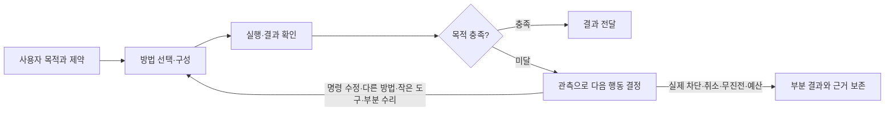

# 사용자 목적을 유지하며 방법을 바꾸는 실행과 부분 수리

작성·개정일: 2026-10-31. 상태: **첫 실행 경로·macOS 순수 부품 수리 구현. 검증 범위와 잔여는 §9**.
초안: `5121bde8`. 이 개정은 해당 커밋의 계획과 현행 실행 경로를 다시 대조했다.
목적 정본: [IBL 진화 목적](IBL_EVOLUTION_PURPOSE.md),
[vision의 진화 목적](../data/system_docs/vision.md#ibl과-주변-시스템의-진화-목적).

**에이전트의 일은 사용자의 요구를 충족하는 것이다. 어휘·관용구·도구·가이드는 바꿔 쓸 수 있는 수단이다.**
도구 호출 실패는 그 방법에 대한 관측이지 업무 종료 사유 자체가 아니다. 명령 수정, 다른 도구,
지역 함수·스크립트 작성, 도구의 작은 수리는 같은 업무 안에서 선택할 수 있는 다음 행동이다.
“다른 방법이 있다”고 설명하는 데서 끝내지 않고, 맡긴 범위와 예산 안이면 실제로 수행한다.

자기수리는 이 실행을 가능하게 하는 한 수단이다. 모든 실패를 수리 과제로 전환하지 않는다.
사용자 목적·명시적 제약·취소·권한은 유지한다. 자기 프롬프트·명령지침·평가 기준을 바꿔
성공으로 만드는 기능은 만들지 않는다. 이 문서의 지침 개정은 개발자의 정식 구현 작업이다.

기존의 도구 사용 중심 구조는 시스템 안정화 이전에 의도적으로 둔 경계였다. 이번 이행은
그 과거 판단을 오류로 취급하지 않는다. 안정된 실행 기반 위에서 방법 선택·작성·작은 수리를
업무 수행의 일부로 열되, 행동 규칙을 스스로 바꾸는 권한과 분리한다.

## 1 초안에서 바로잡는 것

초안은 목적 우선을 말했지만 구현은 수리 체계부터 시작했다. 보호 체계 정비 → 수리 진입 →
재기동 인계가 앞에 있고, 작은 기능의 무중단 수리는 뒤에 있었다. 그렇게 구현하면 여전히
손톱을 고치기 위해 전신마취를 하고, 마취에서 잘 깨어나는 것만 개선할 수 있다.

| 초안의 부족함 | 이번 결정 |
| --- | --- |
| “실행자가 다음 행동을 선택한다”는 선언에 머묾 | 실행 지침의 충돌, 도구 호출 뒤 문맥 전환, 최종 응답 채택 지점을 함께 수정한다. §3에서 종료와 계속 실행의 연결을 지정한다. |
| `self:patch op:begin`을 먼저 채택 | 새 공개 op를 전제하지 않는다. 명령·지역 함수는 기존 경로로 실행하고, 지속 코드 변경에만 기존 쓰기·수리 경로가 필요한 범위를 내부적으로 마련한다. |
| 넓은 보호 분리를 첫 단계로 요구 | 첫 대상의 작은 실행 경계만 분리한다. 일반 시도 개선을 전체 패키지 이주나 가이드 재분류 뒤로 미루지 않는다. |
| 부분 활성화를 4단계로 미룸 | 첫 배포에 응답 변환 부품 하나의 지속 수리·무재기동 활성화를 포함한다. 임시 사본 성공만으로 대체하지 않는다. |
| 설계를 “완료”로 표시 | 문제 정의와 첫 구현 계약은 정한다. 과거 사건의 원인과 실제 행동 개선은 별도 증거로 검증한다. |

### 구현 전 코드에서 확인한 것과 아직 가설인 것

| 확인한 구조 | 설계에 미치는 의미 |
| --- | --- |
| `consciousness_prompt.md`는 이미 조기 중단과 도구 호출을 목적 달성으로 착각하는 문제를 경고한다. | “포기하지 마라”를 한 문장 더 넣는 것으로 해결됐다고 할 수 없다. |
| `agent_pipeline`의 평가·재규정은 최초 의식 규정 유무에 영향을 받는다. 수리 권한은 시작 시 REPAIR/THINK 판단에서 발급된다. | 일반 EXECUTE도 다음 방법을 실행하고 필요한 작은 기능을 고칠 수 있어야 한다. 모든 실패를 THINK로 승격시키지 않는다. |
| `capability_guard`는 주로 능력 부정 문구를 검사하고, 재개 판단에 현재 native tool·사전 경로를 사용한다. 실제 실패 보고는 그 검사 대상과 다르다. | 현재 도구 목록 밖의 구성·수리를 포함하는 작업 지속을 이 가드만으로 보장할 수 없다. 가드의 능력 주장 검사 역할은 유지한다. |
| `reflex_execution`은 도구 호출 전의 문맥 요청만 전체 문맥 실행으로 전환한다. 호출 후 같은 표식은 미완료 보고로 끝낸다. | 중복 효과를 막는 이유는 타당하다. 호출 뒤에도 영수증을 넘겨 남은 일만 계속하는 경로가 필요하다. 모든 후속 도구 호출이 금지돼 있다는 뜻은 아니다. |
| `reframe`은 중도 `needs_repair`를 지우고 재명령을 안내한다. | 처음에 수리를 예상하지 못했다는 이유로 현재 업무가 끊기지 않게 해야 한다. |
| 설치 패키지는 봉인 세대에 포함되고 `_reload_triggering`도 넓은 코드 범위를 재기동 대상으로 삼는다. 로더의 변경 감지는 handler 중심이다. | 파일 하나를 수정하거나 reload를 호출하는 것만으로 하위 모듈의 부분 활성화가 되지는 않는다. |
| 파일 Script는 이미 별도 프로세스·소스 스냅샷·결과 영수증을 사용한다. | 작은 코드 작성·실행 기반을 재사용할 수 있다. 다만 별도 프로세스라는 사실만으로 권한 격리를 보장하지 않는다. |

근거: [실행 파이프라인](../backend/cognition/agent_pipeline.py),
[능력 주장 가드](../backend/cognition/capability_guard.py),
[현재 능력 조회](../backend/cognition/capability_guard_runtime.py),
[짧은 실행](../backend/cognition/reflex_execution.py), [재규정](../backend/cognition/reframe.py),
[수리 적용](../data/packages/installed/tools/system_essentials/repair_staging.py),
[도구 로더](../backend/ibl/tool_loader.py), [실행 경로](../backend/base/runtime_utils.py),
[파일 Script](../backend/base/file_script.py).

이 구조가 특정 네이버·tv1 실패의 직접 원인이었다고 확정하지 않는다. 당시의 요청·도구
결과·종료 사건을 대조해야 한다. 네이버의 정상 빈 결과, 인증·접근 실패, 응답 변환 결함,
어휘 연결 문제, IBL 문법 오류를 구별한다. tv1도 이미 수정된 Windows 문제를 현재 결함으로
다시 가정하지 않는다. 과거 사건의 재현을 모든 공통 개선의 선행 조건으로 삼지는 않는다.

## 2 실행 계약: 목적은 유지하고 방법은 교체한다

실행자는 사용자 원문과 명시적 제약에서 얻어야 할 결과를 유지한다. 별도 의식 규정이 없는
EXECUTE도 같다. 계획·가설·도구 선택·지역 함수는 바꿀 수 있다. 방법이 실패했다고 목표를
“실패 원인 설명”이나 “수리 제안”으로 낮추지 않는다. 사용자가 지정한 출처·도구 등의 제약은
대안 선택에서도 지키며, 단순한 추천 예제와 명시적 제약을 혼동하지 않는다.

실패를 만나면 현재 실행자가 결과·원문 참조·효과 영수증을 읽고 다음 행동을 선택한다.
가능한 선택지를 고정 순서로 모두 시험하거나 실패마다 별도 진단 모델을 호출하지 않는다.
입력이 틀리면 고쳐 실행하고, 필요한 변환이 없으면 작은 함수를 만들고, 구현이 틀렸으면
허용된 부분을 고쳐 쓴다. 다른 방법으로 업무를 완료할 수 있으면 먼저 그렇게 해도 된다.
사용자의 업무가 검색이라면 검색 도구 전체의 근본 수리를 끝내야만 자료를 전달할 수 있는 것은 아니다.
반대로 사용자가 도구 수리를 맡겼다면 우회 검색 성공만으로 수리 완료라고 하지 않는다.

- **정상 빈 결과**와 파싱 실패·인증 오류를 구별한다. HTTP 200·exit 0·빈 배열은 목적 달성의 증명이 아니다.
- IBL 프로그램이 오류에서 멈추는 의미는 유지한다. **프로그램 중단과 사용자의 업무 중단은 다르다.** 실행자는 관측을 받아 고친 프로그램이나 다른 방법을 선택한다.
- 명령·지역 함수·임시 Script의 수정에는 수리 세션 개설, 모델 교체, 사용자 재명령을 요구하지 않는다.
- 이미 실행한 쓰기는 영수증과 대상 상태로 확인한다. 응답이 없었다고 전체 명령을 다시 보내지 않는다.
- 예산은 진단·수리·검사·재개를 합산한다. 같은 실패를 반복하거나 새 실행 ID를 만들었다고 초기화하지 않는다.

낡은 가이드는 현재 계약·실행 관측에 맞게 고쳐 사용한다. 가이드 원본의 저장은 현재 작업
수행의 선행 조건이 아니다. 지속 교정은 근거·원문 판본·검증 예제를 붙여 사실 구간만 변경한다.
사실 설명과 보호 지침이 섞여 아직 저장 경계가 없으면 교정 후보를 남길 수 있다. 그 경우에도
틀린 예제를 반복할 필요는 없다. 자동 주입 기억에 권한 확대·검사 생략 지시를 넣는 것은 금지한다.

## 3 조기 종료를 실제 실행으로 바꾸는 변경

### 3.1 지침과 실행 문맥

기존 지침을 계속 덧붙이지 않고 아래 충돌을 고친다.

| 변경 위치 | 구체적 변경 |
| --- | --- |
| `data/common_prompts/fragments/12_ibl_only.md`, `12_ibl_compact.md` | 기존 목적 달성·분해 설명에 방법 수정·지역 함수·Script 사용을 연결한다. 현재 시도의 작은 변경은 reframe 필요조건이 아님을 명시한다. |
| `data/common_prompts/fragments/13_repair.md`, `14_consciousness_repair.md` | 명시적 수리 과제의 근본 원인 검증과 일반 업무의 방법 선택을 구별한다. 도구 수리 성공과 부모 업무 완료를 분리한다. 오류를 숨기는 값 보정은 성공으로 인정하지 않는다. |
| `data/common_prompts/consciousness_prompt.md`, `backend/cognition/reframe.py` | 재규정은 방법·가정을 바꾸고 사용자 목적은 유지한다. 재규정 횟수 제한을 목표 축소나 수리 재명령의 이유로 쓰지 않는다. |
| `backend/cognition/reflex_execution.py` | 도구 호출 뒤 문맥 부족을 만나면 실행 결과·영수증·남은 일과 함께 같은 업무의 전체 문맥으로 이어간다. 원래 요청의 처음부터 재실행은 계속 금지한다. |

REFLEX의 전환은 현재 실행이 가진 문맥과 도구 결과를 보충하는 일이다. 저장된 원격 쓰기
영수증이 불명확하면 먼저 조회하며, 문맥이 늘었다는 이유로 효과를 재전송하지 않는다.
짧은 실행과 일반 실행 모두 아래의 같은 종료·예산 경로를 통과하게 한다.

### 3.2 최종 응답 채택 전에 이어가기

`agent_pipeline`의 최초 실행 스트림 수집 뒤, 기존 최종 평가 전에 작업 지속 지점을 둔다.
`execution_turn`의 현재 실행 문맥과 도구 사건을 사용하고 별도 장기 목표 DB를 만들지 않는다.

1. 현재 실행은 원래 요청, 도구 실패와 후속 관측, 확인된 효과, 아직 적용 중인 수리,
   취소·공유 예산을 보존한다. 일반 성공 응답 전체를 별도 모델로 재심사하지 않는다.
2. **관측된 미해결 실패나 보류된 필수 단계가 있는데 실행이 끝나려는 경우** 현재 실행자에게
   이 근거와 원래 목적을 주어 다음 행동을 실행하거나 종료 근거를 밝히게 한다. 이것은 오류
   횟수만으로 재시도하는 루프가 아니다. 후속 성공·유효한 대안으로 해소된 실패는 다시 열지 않는다.
3. 선택지는 현재 사전에 있는 도구에 한정하지 않는다. 기존 권한 안의 명령 수정·구성·작은 코드
   작성·부분 수리도 포함한다. 계속 실행은 기존 실행 스트림·취소·도구 관측 경로를 재사용한다.
4. 같은 미해결 사건에 대한 하네스의 추가 재개는 한 번으로 제한한다. 그 안에서 실행자는 필요한
   도구를 연속 사용할 수 있다. 같은 원인·입력·후보를 반복해 새 사건처럼 만드는 것은 차단한다.
   다른 사건도 부모의 전체 예산을 공유한다. 끝낼 때는 달성·실제 차단·취소·무진전·예산을 구별한다.
5. 새 실행 결과까지 모은 후 기존 조건부 평가를 수행한다. 이미 최종 검수가 끝난 응답의
   `allow_resume=False`를 풀어 검수 뒤에 미검수 실행을 추가하지 않는다.

`capability_guard`의 능력 주장 검사는 유지한다. 그것의 부정 표현 정규식이나 현재 도구 목록을
새 작업 지속 판단의 입구로 사용하지 않는다. 두 경로가 같은 실패를 각각 재개하지 않도록
재개 사유·관측 지문·공유 한도를 현재 실행 문맥에서 함께 관리한다. `conscious_supervisor`는
기존 관측을 공급하되, 이 기능을 위해 모든 EXECUTE에 의식·평가를 강제하지 않는다.

기계적 사건만으로 모든 의미상 미완료를 알아낼 수는 없다. 오류가 없는데 결과가 부실하거나,
실행자가 실패를 잘못 해소했다고 판단하는 경우는 목적 확인 지침과 실제 행동 시험으로 잡는다.
따라서 “항상 대안을 발견한다”는 보장은 하지 않는다. 단순 말투 변경이나 도구 호출 수 증가를
개선으로 세지 않고, §7에서 원래 업무의 결과로 판단한다.

## 4 첫 배포에 포함할 작은 수리

### 4.1 처음부터 가능한 시도와 새로 열 경계

현재 지역 함수·파일 Script 경로를 그대로 써서 작업에 필요한 코드를 만들고 수정한다.
이는 지속적인 설치 코드 수정과 구별한다. 임시 코드로 업무를 끝냈으면 그렇게 기록하고,
설치된 도구도 고쳐졌다고 보고하지 않는다.

**첫 지속 수리 대상은 외부 응답을 정해진 항목으로 변환하는 상태 없는 부품이다.**
첫 연결 대상은 `data/packages/installed/tools/web/tool_naver_search.py`의 응답 항목 변환부로
잡는다. 기존 결함이 현재 존재한다는 주장이 아니라, 입력 형식 변화 시험을 주입할 실행 경계다.
인증·요청 전송·endpoint 선택은 호스트에 남기고 `_format_item`·날짜/HTML 정리 등 실제
변환 의존성을 따로 묶는다. 인증·네트워크 import가 있는 기존 모듈 전체를 자식에 넣지 않는다.
같은 계약을 문서·CSV 등 다른 순수 변환에도 적용할 수 있게 만든다.
부품의 진입점·의존성·계약은 등록 데이터로 두고, 코어 실행기나 IBL 파서에 네이버 이름을
조건 분기로 넣지 않는다. 호스트 어댑터는 변환 실패 시 진단 가능한 입력 참조를 남긴다.

| 부품 계약 | 첫 구현에서 고정할 내용 |
| --- | --- |
| 입력과 반환 | 호스트가 확보한 원문/항목과 변환 인자 → 기존 도구의 항목 계약. 원문 참조와 실패 사유를 보존하며 정상 빈 결과를 오류로 바꾸지 않는다. |
| 호출 경계 | 호스트는 검증된 불변 소스 묶음을 별도 자식 프로세스로 실행한다. 첫 구현은 호출별 프로세스로 충분하며 상주 작업자 풀은 필수 아님. |
| 실행 제한 | 필요한 입력·코드·런타임만 제공. 인증정보·호스트 API·임의 네트워크·저장소/지침 쓰기·호스트 프로세스 제어를 허용하지 않는다. |
| 판본 | 소스·허용 의존성·입출력 계약을 함께 고정한다. 진행 호출은 시작 판본으로 끝나고 새 호출은 선택된 새 판본을 사용한다. |
| 실패 | 후보 검사/시작/변환 실패 시 이전 판본 유지. 후보가 반환한 “성공”만으로 검사·활성 판정을 통과시키지 않는다. |

`file_script`의 스냅샷·프로세스 실행·영수증 기초를 재사용한다. 작업용 Script의 임의 경로 권한을
설치 부품의 권한으로 전용하지 않는다. `coding_process`의 기존 격리 기초를 좁은 변환 계약에
맞게 보완하고, `repair_process`의 광범위한 환경·자격증명·네트워크를 그대로 상속하지 않는다.
프로세스 분리만 해 놓고 격리됐다고 주장하지 않는다. 첫 지원 환경은 소유자의 macOS로 잡고,
다른 OS는 같은 경계 시험 통과 전까지 지원됐다고 표시하지 않는다. 일반 대안 실행은 계속 가능하다.

### 4.2 에이전트가 실제로 고쳐 쓰는 경로

모델에게 새 `begin` 명령을 외우게 하는 대신 기존 기능 파일 쓰기·수리 사본 진입 지점에서
호스트가 현재 `execution_turn`의 소유자·요청·대상·관측을 조회한다. 첫 대상에 해당하면
그 부품의 사본 수정 범위만 열고, 기존 사본·검사·`apply/status/discard` 경로에 연결한다.
명령 수정·지역 함수에는 이 경로 자체가 필요 없다. 미지원 부품은 범위와 이유를 반환하며
현재 가능한 대안까지 막지 않는다. 새 공개 op가 필요하다는 증거가 나오기 전에는 추가하지 않는다.

허용 대상과 보호 영역은 개발 시 정한 호스트 계약이며 후보 코드가 재분류하지 못한다.
수리 권한은 해당 활성 사용자 업무에 묶이고 새 업무로 전파되지 않는다. 외부 발화·회원·
예약·자가점검에 설치 코드 수정 권한을 자동 확장하지 않는다. 위임자는 후보·근거를 부모에
반환할 수 있지만 자신의 발화를 사용자 승인으로 바꾸거나 전역 권한을 발급할 수 없다.

지속 반영은 다음 순서로 한 연결을 완성한다.

1. 관측 입력과 변환 계약으로 결함을 재현하고 사본을 고친다. 기존 정상 입력·소비자 검사도 수행한다.
2. 검사한 동일 소스·의존 판본을 후보로 고정하고 실제 제한 환경에서 실행한다. 호스트의 고정
   인수 검사·권한·증거는 후보가 수정할 수 없다. 검사 후 바뀐 파일은 다시 검증한다.
3. 기존 적용 원장의 충돌 검사·반영·커밋·복구를 재사용한다. `_reload_triggering`의 광범위한
   예외를 지우지 않고 **분리된 부품만** 부분 활성화 계획으로 보낸다. 섞인 변경은 자동 승격하지 않는다.
4. 기존 세대 원장과 연결한 구성요소 판본을 원자 선택한다. 정본 파일·커밋·실행 묶음이 대응해야
   하며, 현재 백엔드가 봉인 세대의 옛 패키지만 다시 읽는 상태를 피한다. 미확인 부분 반영은
   성공 처리하지 않고 기존 원장으로 복구한다. 별도 숨은 최신 파일 저장소는 만들지 않는다.
5. 새 호출에서 새 판본을 확인하고 원래 검색을 계속해 결과를 전달한다. 다음 독립 요청과
   정상 재기동 후에도 고친 부품이 선택되는 것을 검증한다.

**첫 배포의 합격선은 재명령 0, 백엔드 재기동 0, 원래 요청 완료다.** 다른 진행 작업도
유지돼야 한다. 이 범위에서 사본 실행 성공만 있고 지속 반영·활성화가 없으면 부분 구현이다.
원래 업무가 우회로 먼저 끝났고 지속 수리는 실패했다면 두 상태를 구별해 보고한다.

## 5 수리 범위와 더 큰 변경의 처리

| 대상 | 실행·활성 방식 |
| --- | --- |
| 셸/IBL 명령·지역 함수·작업용 Script | 기존 권한으로 즉시 새 시도. 수리 의례 없음. |
| 저장 관용구 | 기존 `function_store`의 불변 판본·계약 검사·게시 경로. 백엔드 재기동 없음. |
| §4에서 분리한 순수 변환 부품 | 같은 업무에서 사본 검사·지속 반영·다음 호출 판본 교체. 백엔드 재기동 없음. |
| 다른 패키지·상태 있는 도구 | 의존성·상태 소유·진행 호출·취소·복구 계약을 정한 구성요소부터 확대. 처음부터 전부 hot reload하지 않음. |
| 공통 IBL 파서·실행기 등 미분리 기반 | 명세를 유지하는 수정은 가능. 필요한 경우 기존 외부 제어자의 세대 교체와 부모 업무 복귀 사용. |
| 자기 프롬프트·명령지침·권한/수리 경계·평가/완료 규칙 | 업무 중 자동 수정 제외. 별도로 명시된 유지보수 대상. |

코어는 `backend/`라는 경로나 파일 크기로 정하지 않는다. 허용된 기능의 구현과 행동을
통제하는 기반을 구별한다. 첫 배포는 §4의 좁은 경계를 실제로 만들며, 전체 저장소의 보호
분리가 완료돼야만 일반 명령을 고칠 수 있는 구조를 만들지 않는다. 분리되지 않은 기능을
안전하게 부분 교체할 수 있다고 과장하지도 않는다.

지속 수리에 필요한 기준은 세 가지다. **후보 준비**는 결함/새 기능 검사, **활성 확인**은 실제
사용된 판본·적용 영수증, **부모 업무 완료**는 사용자가 원한 결과다. 서로 대체할 수 없다.
일반 업무 안의 수리에서 부모 업무 전체 완료를 후보 적용의 선행 조건으로 삼는 순환도 없앤다.

재기동이 필요한 변경은 기존 `repair_root`·`repair_continuation`에 부모 요청·제약·남은 단계·
효과 영수증·취소·공유 예산을 연결한다. 사망 전에 인계를 내구성 있게 저장하고, 죽음을 넘는
제어자가 적용·복구·재개한다. 에이전트가 자신을 멈춘 다음 후속 명령을 실행한다고 계획하지 않는다.
재개는 원격 대상 상태부터 확인하고 미완료 부분을 수행한다. Git HEAD 일치나 백엔드 생존만으로
tv1 업데이트 완료를 선언하지 않는다. 실행 판본과 요청한 기능의 확인이 필요하다.

이 큰 변경 경로는 첫 무중단 부분 수리를 대신하는 선행 단계가 아니다. 별도 장기 과제 DB나
pursuit를 부활시키지 않으며, 과거 blocked/cancelled 작업을 자동 재개하지 않는다.

## 6 관용구를 실제 해결 과정에서 쓰고 축적한다

관용구가 없으면 필요한 지역 함수를 작성하고 기존 도구·관용구·Script와 조합한다.
처음부터 저장하거나 전체 일을 거대한 정적 프로그램으로 만들 필요는 없다. 새 관측이 필요한
지점에서 실행자가 판단하고 다음 조합을 작성한다. 실패한 하위 함수만 고치며 기존 IBL 수정
재개가 허용하는 유효 결과를 재사용한다. 구현이 바뀌었는데 옛 효과 영수증을 무조건 재사용하지 않는다.

원래 업무가 끝난 뒤 반복 가치가 있는 방법만 `function_store`의 기존 검사·게시 경로에 저장한다.
입력·반환·효과·적용 조건·의존 판본·실제 실행 증거를 연결한다. 단순 실패 보고나 미완료 대안을
성공 관용구로 축적하지 않는다. 다음 변형 과제에서 발견·호출·필요 부분 수정까지 확인한다.
저장 수를 늘리거나 모든 관용구를 상시 프롬프트에 싣는 것은 목표가 아니다.

## 7 구현 순서와 인수 기준

### 첫 배포: 실행 지속과 작은 무중단 수리를 함께 완성

| 작업 묶음 | 주요 변경 위치 | 완료 관측 |
| --- | --- | --- |
| A 다음 방법 실행·종료 연결 | `agent_pipeline`, `execution_turn`, `reflex_execution`, `capability_guard`와 관련 지침 | 명령 수정·다른 방법·작은 코드 작성으로 실제 요구 충족. 일반 성공에 추가 모델 호출 0. |
| B 첫 부품 경계와 중도 수정 | 네이버 응답 변환부, `file_script`/`coding_process` 기초, `red_grant`·수리 쓰기 게이트 | 일반 EXECUTE에서 분리된 변환 결함을 재명령 없이 고침. 후보가 지침·권한·호스트를 변경할 수 없음. |
| C 지속 반영과 부분 활성화 | `repair_staging`, 세대/구성요소 판본 선택, 호스트 호출 연결 | 같은 백엔드 PID에서 새 판본 사용, 원래 작업 완료, 다른 작업 지속, 다음 요청·재기동 후에도 수정 유지. |
| D 행동과 비용 검증 | 기존 모듈 시험·행동 시험·회귀 절차 | 아래 첫 배포 시험 통과와 기준선 비교. 임시 우회와 지속 수리를 구별해 결과 보고. |

A는 먼저 적용해도 되지만 B–D가 빠진 상태를 “작은 자기수리 해결”로 발표하지 않는다.
B는 첫 대상의 경계만 만든다. 대규모 패키지 작업자 전환·전역 가이드 분리·새 수리 언어는
첫 배포의 선행 작업이 아니다. 기존 중복 경로와 충돌 안내는 구현할 때 함께 정리한다.

### 첫 배포 시험

| 상황 | 통과해야 하는 행동·관측 |
| --- | --- |
| 셸 인자·IBL 연결 오류 | 사용자에게 해결법만 설명하지 않고 현재 시도를 고쳐 목적 달성. 수리 세션·모델 전환·재기동 없음. |
| 기존 도구 하나의 실패, 유효한 다른 방법 존재 | 원래 제약을 지키는 대안을 실제 실행. 수리를 하지 않았어도 목적을 달성하면 통과. |
| 필요한 도구/정답 관용구가 없음 | 지역 함수·작은 Script·기존 부품 조합으로 해결. 새 낱말 추가 없이도 가능함을 확인. |
| 낡은 가이드 | 올바른 사용법을 관측해 실행. 사실 교정 근거는 남기되 자기 행동 지침은 변경하지 않음. |
| 출처를 유지해야 하는 응답 형식 변화 | 지정 출처의 정상 원문은 존재하나 변환이 실패하도록 주입. 다른 출처로 제약을 바꾸지 않고 부품을 고쳐 결과 전달. 같은 PID·새 판본·지속 반영 확인. |
| 정상 빈 결과·인증 실패 대조군 | 근거 없이 파서를 고치거나 성공 결과를 만들어내지 않음. 다른 허용 방법 또는 구체적 차단을 판단. |
| 의식 OFF·REFLEX 도구 호출 뒤 문맥 부족 | 최초 분류와 무관하게 남은 업무를 계속함. 앞서 성공한 외부 쓰기 재전송 없음. |
| 정중한 미완료 보고·대안 설명 후 종료 | 특정 부정 단어 유무와 무관하게 최종 결과로 채점. 관측된 미해결 사건의 재개가 실제 도구 실행으로 이어짐. |
| 후보 보호 경계 | 지침/검사/권한 변경, 경로·링크 이탈, 자격증명/호스트 API 접근, 호스트 제어를 차단. 허용된 변환 수정은 성공. |
| 판본 교체·충돌·실패 | 검사 후 변조·동시 편집 감지. 이전 판본 복구, 호출 내 판본 혼합 없음. 다른 작업과 타인 변경 보존. |
| 무진전·취소·예산·효과 불명 | 반복으로 예산 초기화 없음. 취소 후 실행 없음. 효과 조회 없이 중복 쓰기 없음. 정당한 중단을 억지 수리로 연장하지 않음. |
| 정상 성공 경로 | 새 감독/평가 모델 호출 0. 결과 품질·기존 평가/취소 동작 회귀 없음. |

실제 에이전트에는 사용자 업무만 주고 수정 파일·정답 명령·관용구 이름을 알려주지 않는다.
기계적 연결 시험과 모델 행동 시험을 구별하며, 새 인수 시험은 후보 코드의 편집 범위 밖에 둔다.
말투·시도 횟수·수리 횟수가 아니라 목적 달성·결과 적합성·사용자 재명령·중복 효과로 판단한다.
네이버 외 문서/CSV 변환 등 미사용 입력도 포함해 특정 사례만 외운 개선을 구별한다.

동일 모델·기어·예산의 기준선과 비교하고 전체 시간·총토큰·캐시·불필요한 수정·재기동을 기록한다.
실패와 차단도 포함한다. 정상 경로의 추가 모델 호출 0은 기계적으로 확인하고, 실패 경로의
성공률·비용 개선은 실측값으로 보고한다. 품질 향상과 비용 증가가 함께 있으면 둘 다 표시한다.

### 이후 확대

1. 첫 부분 활성화 계약을 다른 상태 없는 부품으로 확대한다. 실제 호출 비용이 필요성을 보일 때
   상주 작업자를 도입한다. 상태 있는 도구는 상태 소유·drain·재연결을 별도 검증한다.
2. 미분리 공통 기반 수정의 부모 업무 인계를 완성한다. 원격 업데이트·응답 유실·재개 중 사망·
   취소를 주입하고 원래 대상의 실제 결과까지 확인한다.
3. 성공한 방법의 관용구 저장과 다른 세션의 변형 과제 재사용을 검증한다. 새 저장소 대신
   `function_store`·`function_revalidation`·`ibl_v2_repair`·기존 발견 경로를 개선한다.

관용구의 현재 활용은 첫 배포 A부터 포함한다. 위 3은 장기 축적·재사용의 추가 검증이다.
backend 새 모듈은 기존 층 배정·1500줄 규칙을 지킨다. `repair_staging` 등에 로직을 몰아넣지 않는다.
구현의 권한·격리·공통 실행·세대 변경은 [회귀 규약](REGRESSION_TESTING.md)의 관련 system·종합
검사를 따른다. 어휘/설명을 바꾸면 원본 YAML·교재와 빌더 산출물을 함께 갱신한다.

## 8 관련 설계와 현재 범위

기존 [자기수정 안전 바닥](SELF_MODIFICATION_SAFETY_DESIGN.md),
[사본 완료](SELF_REPAIR_WORKSPACE_COMPLETION_DESIGN_2026_10_03.md),
[재기동 인계](RESTART_COORDINATION_DESIGN_2026_09_11.md)는 구현 시 위 계약에 맞게 개정한다.
이 문서만으로 현재 운영 권한이 달라지지는 않는다.
[관용구 통합](IBL_FUNCTION_MEMORY_UNIFICATION_DESIGN_2026_10_24.md),
[작업 분해](IBL_TASK_DECOMPOSITION_DESIGN_2026_09_26.md),
[구조 수렴](IBL_SYSTEM_CONSOLIDATION_DESIGN.md)의 기존 기반을 재사용하고,
[pursuit 제거](PURSUIT_REMOVAL_PLAN_2026_10_29.md)는 유지한다.

아래 §9가 현재 구현 범위이며, 앞 절의 전체 확대 계획과 구별한다. 이 계획의 행동 인수 증거는
**에이전트가 원래 목적을 유지하면서 다음 방법을 실행하고, 작은 기능 결함은 전체를 멈추지 않고
고쳐 사용하여, 사용자에게 요청한 결과를 전달하는 실제 실행**이다.

## 9 2026-10-31 첫 구현

### 실행을 계속하는 연결

- `task_continuation`은 최종 도구 관측이 오류인데 실행자가 종료 응답을 낸 경우 같은 실행자에
  요청·제약·입력·결과를 넘겨 다음 방법을 실행하게 한다. 평가 전에 연결하며 정상 성공에는
  추가 모델 호출이 없다. 오래된 실패 뒤 후속 성공, 정상 빈 결과, 취소·예산 종료는 열지 않는다.
  이것은 목표 달성의 완전한 의미 판정기가 아니며, 일부 미완료를 남긴 성공 응답까지 검출하지 않는다.
- `execution_turn`의 한 번의 후속 실행 기회를 REFLEX 전체 문맥 인계·작업 지속·능력 주장
  교정이 공유한다. 한 실행 안의 여러 도구 사용은 가능하다. 같은 턴에서 각 가드가 연달아
  새 재개 예산을 만드는 것은 막는다. 기존 명시적 REPAIR의 재기동 인계는 그대로 둔다.
- REFLEX는 도구 호출 뒤에도 전체 문맥으로 넘어갈 수 있다. 이미 실행한 호출과 효과를 넘기며
  원래 요청을 처음부터 반복하지 않게 한다. 긴 호출 기록은 기존 턴 증거 저장소에 전문을 두고
  참조와 최근 발췌를 전달한다. 실제 외부 효과의 정확히 한 번 실행을 새로 보장하는 기능은 아니다.
- 실행·의식·재규정 지침을 같은 계약으로 맞췄다. 일반 업무의 대체 명령·스크립트·관용구 사용과
  등록 부품 수리를 새 `#repair` 재명령 뒤로 미루지 않는다. 작업 중 광역 RED 그랜트는 발급하지 않는다.

### 지속하는 작은 수리

첫 대상은 네이버 검색의 **응답→카드 순수 변환** `web.naver_response`다. 실제 과거 네이버
실패를 재현했다고 주장하지 않는다. 인증·네트워크·엔드포인트는 기존 호스트가 소유하고,
변환 코드만 별도 파일·JSON 계약으로 분리했다. 정상 빈 목록은 유효하며 구조 오류는 빈 성공으로 숨기지 않는다.

직접 사용자 업무의 소유자 실행에서 기존 파일 편집을 등록 소스에 사용하면 기존 수리 사본에
한정한다. `self:patch apply`는 보호된 기존 입출력 검사→불변 소스 객체→기존 봉인·충돌 검사→
정본 반영·경로 한정 커밋→활성 영수증을 잇는다. 적용 영수증과 부모 업무 완료를 구별하며,
수리 후 원래 입력을 다시 수행해 결과를 확인하도록 한다. 새 IBL 낱말·장기 과제 DB는 없다.

활성 포인터를 검증된 소스 객체에 연결하고 다음 호출부터 그 바이트를 쓴다. 진행 중인 호출은
자신이 읽은 바이트를 유지한다. 세대 감시자는 등록·검사된 활성 객체와 실제 정본 바이트가
일치하는 변경만 전체 재기동에서 제외한다. 원시 편집·계약 변경·다른 기반 변경은 기존 경로다.
새 전체 세대의 소스가 달라지면 오래된 부분 판본이 새 코드를 덮지 않는다.
정본을 수동으로 되돌리거나 게시 바이트와 다르게 고친 경우에도 이전 부분 판본을 실행하지
않고 현재 봉인 세대의 구현을 사용한다. 미검증 정본 바이트를 직접 실행하지 않는다.

권한 코드 감사 지문은 호스트 Python과 보호된 등록·검사 계약을 해시한다. 제한 프로세스에서만
실행되는 부품 바이트는 별도 판본 해시로 관리하므로 작은 수리마다 회원 권한 감사·어휘 빌드를
다시 요구하지 않는다. 등록 계약이나 호스트 변경에는 기존 감사 무효화가 유지된다.

현재 제한 실행은 **macOS만 지원**한다. 자식은 인증 환경을 받지 않고 호스트 파일·네트워크·
신호 전송·다른 실행을 차단한다. CPU·시간·입출력 크기를 제한한다. 다른 OS의 네이버 검색은
기존 신뢰된 변환을 사용하며, 이 자동 부품 수정 경로는 열지 않는다. 네이티브 범용 셸 전체를
새 보안 샌드박스로 바꾼 것은 아니다. 지침·권한·등록/검사·적용 원장을 수정 후보로 받아들이지 않는다.

### 검증과 잔여

직접 회귀는 다음 계약을 실행한다.

- `test_task_continuation`, `test_reflex_execution`: 실패 뒤 실행, 호출 영수증, 공유 한도,
  정상 경로 추가 호출 0, 취소·예산·기존 인계 존중, 긴 원문의 참조 보존.
- `test_component_runtime`, `test_component_registry`: 실제 제한 자식의 정상/빈 변환,
  호스트 파일·환경·네트워크·신호 차단, 손상 객체 거절, 감사 경계와 호출 중 판본 보존.
- `test_essentials_component_repair`: 임시 Git 정본에서 실패 재현→사본 수정→보호 검사→
  실제 커밋→같은 PID에서 새 형식 성공→새 요청 재사용. 잘못된 후보·혼합 변경·충돌·취소·
  적용 뒤 중단 재시도·보호 경계 거절도 포함한다.
- `test_restart_candidates`: 검증된 부분 판본은 전체 재기동을 요구하지 않고, 게시 바이트와
  다른 수정은 기존 감시 경로로 돌아간다.

실제 시스템 AI 시험(에피소드 **5640**, `origin:training`, Claude Code `opus`)에는 로컬 주문
집계 목표와 출력 위치만 주었다. 기존 도구는 `qty/price`, CSV는 `quantity/unit_price`인 상태였다.
실행자는 자료와 도구를 읽고 스스로 두 열 참조를 고친 뒤 실행·별도 검산했다. 상품별
책 36,000·펜 4,500·노트 12,000, 총 52,500의 파일을 저장했으며 재명령은 없었다.
두 도구 호출, 모델 원장 기준 분류 1회·실행 1회(내부 3라운드), 에피소드 37.005초,
입출력 합계 247,342토큰(입력에 포함된 cache_read 174,864, cache_create 69,876)이다.
정답·수정 방법을 요청에 넣지 않았고 원본·산출물·호출 결과는
`outputs/task-repair-acceptance-2026-10-31/`에 보존했다. 시험 원본은
`orders.csv`의 열과 문서에 적힌 이전 열 참조로 재구성할 수 있다.

이 모델 사례는 실패 호출 전에 결함을 발견해 작업용 도구를 고친 관측이다. 따라서 오류 뒤
추가 실행 가드가 모델의 포기를 뒤집었다거나, 설치된 네이버 부품의 자동 수리를 모델이
완주했다는 증거로 쓰지 않는다. 후자는 위 격리 Git·실제 제한 프로세스의 연결 검사로
검증했다. 기준선 비교가 없어 성공률·비용 개선을 주장하지 않는다.

검증 결과: 비-system 전체 **11,326 통과·9 건너뜀**, 관련 실제 프로세스/수리/라이브러리/
어휘 설치·배포 묶음 **107 통과**. 첫 종합 검사에서 나온 프롬프트 길이·보호 게이트 진단
우선순위·새 시험의 직접 실행 연결을 수정한 관련 묶음은 **125 통과**했다. 이어 보완한
정본 되돌림·판본/제어 기반 경계는 **25 통과**, 긴 증거 인계/REFLEX는 **19 통과**다.
IBL 파생·Android 번들·층·이식성·파일 크기·이벤트 루프 검사도 통과했다.

남은 범위: 미등록/상태 있는 도구의 부분 교체, 일반 업무에서 광역 수리로 넘어가는 영속 부모
업무 인계 확대, 프로세스 사망 후 새 업무에 작은 수리 세션 자동 연결, 실제 네이버·TV1 과거
사건 재현, 동일 기준선과 비교한 성공률·토큰·시간 측정. 첫 부품의 고정 검사 통과는 새 입력의
정답을 증명하지 않으므로 원래 업무 결과 확인이 계속 필요하다.
