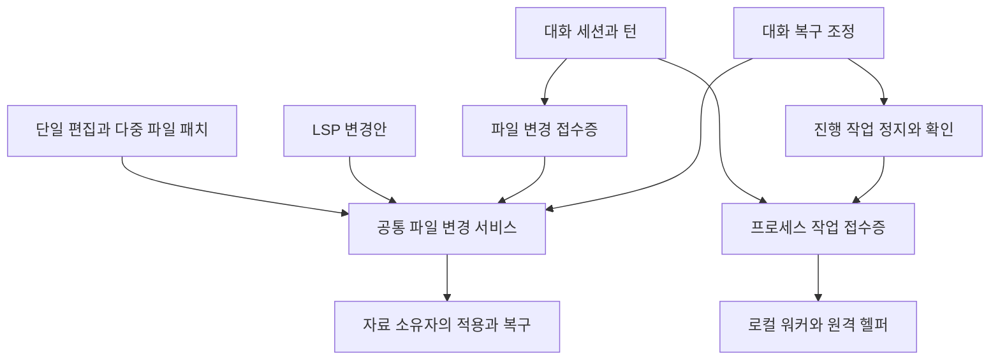

# 대화 시점별 복구와 프로세스 제어 및 다중 파일 패치 설계

작성일: 2026-11-06. 상태: 구현 전 설계. 이 문서의 새 계약과 예제는 아직 사용할 수 없다.

사용자가 대화 중 만든 변경을 특정 요청 전으로 되돌리고, AI가 실행 중인 프로그램의
출력을 읽어 다음 입력을 보내며, 여러 파일을 하나의 변경안으로 편집할 수 있게 한다.
세 기능은 모델 공급자에 종속되지 않는다. 기존 대화 세션·작업 접수증·작업 공간·자기수리의
소유권을 유지하면서 파일 변경과 프로세스 수명을 연결한다.

목적은 [IBL 진화 목적](IBL_EVOLUTION_PURPOSE.md)에 따라 결과 품질을 유지하며 완료 시간과
전체 토큰을 줄이는 것이다. 도구 이름 추가나 명령문 단축 자체를 성과로 세지 않는다.

## 결정 요약

1. 다중 파일 패치와 되돌리기는 **같은 파일 변경 서비스**를 사용한다. LSP가 만드는
   WorkspaceEdit도 이 서비스의 입력이다. 세 기능마다 별도의 백업·충돌·적용기를 만들지 않는다.
2. 프로세스는 **기존 task_ref**로 식별한다. 시작 후 출력 관측·입력·종료를 같은 실행에 연결한다.
   PID나 문자열 세션 이름만으로 다른 프로세스를 찾아 붙지 않는다.
3. 되돌리기는 **선택한 사용자 요청 직전**을 기준으로 한다. 파일과 대화를 함께 복구하거나
   각각 복구할 수 있다. 원래 대화·작업 사건·Git 이력은 지우지 않는다.
4. 문법·코어 낱말을 새로 만들지 않는다. `self:edit`, `self:workspace`, `self:task`의
   기존 책임을 확장한다. 단, `self:task control` 추가는 기능어 코어 계약의 개정이므로
   언어 명세·어휘 선언·검사·교재를 함께 바꿔야 한다.
5. 기존 권한을 되돌리기나 입력 도구로 우회하지 않는다. 정본 프로그램의 역변경도
   [자기수리 경계](SELF_REPAIR_BOUNDARIES_2026_10_31.md)의 후보·검사·반영·활성화 절차를 따른다.

## 현재 기반과 실제 공백

아래는 2026-11-06 정본 작업트리 조사다. LSP 관련 파일은 다른 작업에서 구현 중이므로
완료·배포된 기능으로 간주하지 않는다. 해당 구현과 연결하는 단계에서 계약을 다시 대조한다.

| 기반 | 현재 하는 일 | 이번 설계에서 추가할 일 |
| --- | --- | --- |
| `conversation_sessions`, `chat_session_service` | 세션·턴·작업 소속, 진행 사건, 취소·추가 지시 | 턴 시작 복구점, 복구 작업, 대화의 활성 판본 |
| `history_checkpoint` | 오래된 대화 요약 | 파일 복구점으로 재사용하지 않음. 복구 후 활성 대화 판본에 맞춘 요약 선택 |
| `write_ledger` | 성공한 쓰기 뒤에 행위자·경로 사건 기록, 부분 관측 | 복구 원문은 별도 변경 원장이 소유하고 이 원장에는 참조만 연결 |
| `code_analysis_changes` 구현 중 | before/after, 다중 파일 적용, 원장 기반 중단 복구 | 공급자 독립 변경 서비스로 책임 추출, 패치와 역변경의 공통 입력 |
| `CodingProjects.run/output/send_input/stop` | 로컬 실행 로그·한 줄 stdin·종료 | 범용 실행 수명과 AI 도구 연결, PTY 선택, 임의 바이트·EOF·신호 |
| `resident_terminal`, helper PTY/ConPTY | 사용자 원격 터미널의 출력·키·크기·종료 | 실행 권한에 묶인 AI 세션, 재연결과 중복 입력의 결과 계약 |
| `self:script` 백그라운드, `guestpc` | 진행 조회·작업 취소 | 지원하는 실행만 양방향 제어를 광고 |
| `self:patch` | 자기수리 후보와 정본 반영 | 일반 텍스트 패치의 이름으로 바꾸지 않음 |

일반 `run_command`는 `subprocess.run(capture_output=True)`로 완료 시 출력을 반환한다.
백그라운드 Script는 stderr 진행 로그와 취소가 있으나 stdout은 종료 결과이며 입력은 시작 시
JSON 한 번이다. 원격 AI 셸도 시작 시 stdin만 받는다. 사용자 원격 터미널의 기능이 있다는
이유만으로 AI가 같은 터미널을 사용할 수 있다고 판단하지 않는다.

로컬 코딩 입력은 현재 파이프 기반 한 줄·UTF-8 511바이트 제한이고 재기동 후 재연결되지 않는다.
`python_libraries`의 세션 워커는 같은 IBL 실행에서 객체를 유지하는 함수 호출 프로토콜이며,
여기에 임의 셸의 키 입력을 섞지 않는다. CLI 공급자가 자체 터미널을 제공하는 경우도 공통
IBL 능력과 구분한다.

이 조사에서 관련 검사 16개가 통과했다. 로컬 입력·출력·종료 6개, 사용자 원격 터미널 5개,
Script 진행·취소 및 원격 접수증·헬퍼 왕복 5개다. 실제 Mac 헬퍼를 격리 환경에서 실행했다.
Windows 실기기·운영 원격 PC·자연어 모델 선택은 이 증거에 포함하지 않는다.

## 공통 신원과 소유권



파일 변경과 프로세스에 다음 신원을 서버가 붙인다. AI가 전달한 owner나 경로 문자열을
권한 증거로 삼지 않는다.

| 값 | 뜻 |
| --- | --- |
| actor, session_id, turn_id | 인증된 행위자와 원래 사용자 턴 |
| task_id, parent_task_id | 위임·자기수리 자식과 원래 업무의 관계 |
| resource, resource_generation | 작업 공간 또는 원격 작업 폴더의 신원·세대 |
| change_id 또는 task_ref | 파일 변경 또는 실행의 영속 접수증 |
| request_id, payload_hash | 재전송 식별과 같은 요청 ID의 다른 내용 거절 |
| conversation_revision | 모델이 현재 사용하는 대화 판본 |

대화 원장은 세션 DB, 파일 변경은 자료 소유자의 저장소, 원격 실행은 기기의 기존 작업
원장이 소유한다. 모든 바이트를 중앙 대화 DB에 복제하지 않고 참조와 상태를 연결한다.
위임 시 원래 턴과 실행 주체를 함께 전파한다. 위임 자식의 변화가 부모 복구점에서 빠지거나
다른 대화의 변화가 합쳐지는 것을 막는다. 소속이 없는 기존 실행은 `unattributed`로 표시한다.

## 파일 변경 서비스

### 책임과 저장

`code_analysis_changes`의 순수 before/after·prepare/apply/recover 부분을
`services/file_changes.py`로 추출한다. LSP 위치·URI·WorkspaceEdit 해석은 원래 모듈에 남긴다.
저장은 기존 `CodingStore`를 사용하는 어댑터부터 연결하되, 일반 파일 작업이 코딩 프로젝트
등록이나 Git 초기화를 요구하지 않도록 자료 소유자 인터페이스를 받는다.

일반 폴더는 `self:workspace`의 새 자료 종류 `files`로 해소한다. 현재 프로젝트의 허용 루트
또는 명시적으로 연 폴더에 대한 자료 handle이며, 코딩 프로젝트 등기·Git 초기화·언어 서버
기동을 수반하지 않는다. `self:edit`의 경로 기반 호출도 내부에서 이 handle을 얻는다.
`files`의 capabilities는 read/propose/apply/recover에 한정하고 문서·시트 엔진의 저장을 대신하지 않는다.

첫 연결 생산자는 `self:write/edit/delete/move/copy`의 일반 파일 변경, 작업 공간 편집,
LSP 변경안이다. 디렉터리 재귀 작업은 파일 목록을 고정한 제한된 배치로 변환할 수 있을 때만
포함한다. 소유 관리 연산이나 아직 연결하지 않은 생산자는 원래 의미를 유지하고 coverage에 남긴다.

변경 기록은 다음을 가진다.

```text
change_id, version, owner_identity, root_identity, request_id, payload_hash
session_id, turn_id, task_id, parent_task_id, source, state
edits[] = {path, before:{exists,blob,hash,mode}, after:{exists,blob,hash,mode}}
applied_paths[], conflict_paths[], recovery, effect_receipt, created_at
```

원문은 로컬 내용 해시 기반 blob으로 보관한다. 부재와 빈 파일을 구분한다. 경로는 자료 루트
상대 경로이며 생성·삭제·개명도 정규화한 파일 상태 변화로 표현한다. 원문과 입력은 일반 로그나
모델 맥락에 자동 삽입하지 않는다. 저장소의 관리 데이터·DB·비밀 설정은 파일 바이트 복구 대상에
자동 편입하지 않고 해당 소유 연산으로 보낸다. 임시 스냅샷은 Git에 넣지 않는다.

`write_ledger`는 실패해도 본 쓰기를 깨지 않는 사후 관측 원장이다. 이를 복구의 트랜잭션
원장으로 바꾸지 않는다. 복구 가능한 새 편집은 before와 변경 의도를 내구 저장한 뒤 실행한다.
저장 실패 시 그 편집은 실행하지 않고 오류를 반환한다. 기존 미연결 쓰기는 계속 부분 관측으로
표시하며, 시스템의 모든 쓰기를 일괄 차단하는 관문을 추가하지 않는다.

### 적용과 중단 복구

`prepared → applying → applied`, 실패는 `recovery_required`, 사전 충돌은 `conflict`다.

1. 전체 경로·권한·자료 세대·예상 원문을 검증하고 수정 후 바이트를 메모리/임시 파일에 계산한다.
2. 참여하는 파일 작업의 공통 잠금을 정렬된 경로 순서로 얻는다. 루트가 겹치는 별도 자료도
   같은 실제 경로 잠금을 사용한다. 잠금 안에서 전체 before를 다시 검사한다.
3. 변경 원장을 내구 저장한 뒤 파일별 원자 교체와 상태 기록을 한다. 완료 후 사건을 공개한다.
4. 중단 후 각 파일을 before/after/그 외로 대조한다. after는 재적용하지 않고, before만 이어가며,
   그 외는 충돌로 남긴다. 자동 복구 방향은 적용 계속으로 고정하고 역변경은 별도 명시 작업이다.
5. 복구가 끝나지 않은 동일 파일의 다음 관리 편집은 보류한다. 다른 파일 작업은 계속 가능하다.

여러 파일 전체의 OS 원자성을 주장하지 않는다. 사전 검사 실패는 무변경이지만 I/O 실패나
프로세스 종료는 일부 파일 적용 상태를 남길 수 있다. 참여하는 소비자는 완료 사건을 기다리고,
외부 IDE·실행 중인 프로그램은 중간 파일을 볼 수 있다. 무중단 다중 파일 게시가 꼭 필요한
실행물은 기존 후보·세대 교체 경로를 사용한다.

경로 순회·심링크 교체·대소문자 충돌·파일과 디렉터리 충돌·하드링크를 검사한다. 첫 구현은
일반 파일만 지원하고 하드링크 다중 참조와 심링크 자체 편집은 거절한다. 외부 편집자와의
완전한 compare-and-swap은 일반 파일시스템에서 보장하지 못하므로 교체 직전 재검사와
교체 후 지문 확인을 하며, 충돌 가능성이 있는 공유 자료는 배타적 후보에서 작업한다.

## 여러 파일을 한 패치로 편집

### 공개 계약

`self:edit`에 `patch` 또는 `patch_ref`, `format`, `resource`, `expected`, `request_id`,
`preview`를 추가한다. 기존 old_string/new_string·줄 범위와 새 패치 입력은 상호 배타적이다.
기존 단일 파일 호출의 반환 계약은 유지한다. 패치 모드는 공통 변경 접수증을 반환한다.

```text
[self:edit]{resource:"자료 ID",format:"indiebiz-patch/1",
  patch:"패치 본문",request_id:"요청 ID"}
```

기본은 한 호출에서 prepare와 apply까지 수행한다. `preview:true`면 고정 proposal과 diff만
만들고 기존 `self:workspace apply`로 적용한다. 일반 파일 자료는 경로로 권한 내에서 해소하며
코딩 앱에 등록할 필요가 없다. 큰 패치는 입력 참조를 쓰고 같은 본문을 재전송하지 않는다.

반환에는 `change_id`, `state`, `applied`, `items`의 파일별 상태·전후 지문,
`diff_ref`, `recovery_required`, `conflicts`가 있다. 배열에 일부 성공이 있어도 전체 적용
성공으로 표시하지 않는다. 동일 request_id의 동일 본문은 원래 접수증으로 응답한다.
`effect_scope`로 일반 자료·수리 후보·정본을 구분한다. 후보 파일의 `applied:true`는 정본 반영,
활성화 또는 커밋 성공을 뜻하지 않으며 이 상태들은 기존 자기수리 영수증을 참조한다.

### 패치 형식

첫 공개 형식은 Add/Update/Delete/Move와 문맥 hunk를 가진 명시적 `indiebiz-patch/1`이다.
Codex CLI의 Begin/End Patch 표현은 얇은 입력 어댑터에서 이 형식으로 변환한다. OpenAI API의
V4A operation은 CLI 본문과 별도 형식으로 다룬다. 암묵적으로 모든 unified diff·Git binary
patch까지 지원한다고 광고하지 않는다.

```diff
*** Begin Patch
*** Update File: src/main.py
@@
-from old_api import run
+from new_api import run
*** Add File: src/new_api.py
+def run():
+    return 1
*** Delete File: src/old_api.py
*** End Patch
```

본문의 모든 경로는 하나의 자료 루트에 속한다. 같은 파일의 여러 hunk는 선언 순서대로 가상
원문에 적용하고 마지막 상태 하나를 만든다. 문맥 후보가 여러 곳이면 추측하지 않고 위치와
후보를 반환한다. 빈 hunk·중복 대상·경로 순환도 적용 전에 검사한다. 첫 버전은 같은 경로의
create/delete/move 재등장을 거절하며, 이동 순환은 명시적인 중간 경로를 요구한다.

삭제·덮어쓰는 이동은 `expected`의 원본 지문이 필요하다. 수정은 제공된 expected를 검사하고,
없으면 현재 원문의 유일한 정확 문맥에만 적용한다. prepare가 잡은 전체 원문 지문은 apply가
다시 검사한다. 인코딩·BOM·개행·실행 비트는 보존하고, 변환이 필요하면 별도 명시 옵션으로 한다.
바이너리 hunk는 미지원으로 응답한다. 바이트 보존 복구와 텍스트 패치 지원은 구분한다.

패치 파서는 셸을 실행하지 않는다. 정본 프로그램 경로는 기존 자기수리 사본으로 해소하고
`self:patch apply`의 반영 책임을 유지한다. 여러 자료·권한 영역에 걸친 한 패치는 분리 제안을
반환하며 임의의 부분 적용을 하지 않는다. LSP의 rename·code action도 같은 적용기에 도달한다.

## 실행 중인 프로그램 제어

### 시작과 기존 도구 호환

`run_command`에 `mode:"session"`, `io:"pipe"|"pty"`, `yield_ms`, `request_id`,
`lifetime:"task"|"session"`을 추가한다. 옵션 없는 기존 호출은 완료 후 문자열 반환을 유지한다.
새 모드만 프로세스 접수증과 최초 출력 조각을 반환한다. `yield_ms`는 응답까지 기다릴 시간이고
프로세스 실행 제한 시간과 구분한다. 기본 수명은 task, 사용자에게 넘겨 계속 유지하는 실행만
명시적으로 session 수명을 선택한다.

IBL 조합에서의 시작은 등록 Script `프로세스실행`이 같은 서비스의 승인된 시작 연산을 호출하게
한다. 별도 구현이나 셸 명령 재해석을 넣지 않는다. 원격은 기존 `limbs:guestpc`에 세션 모드를
추가하고 현재 원격 작업 원장과 기기 세대를 그대로 사용한다. 로컬 코딩 앱의 실행 버튼도
같은 서비스 어댑터로 옮긴다.

새 세션 실행은 `kind:process`의 task_ref 어댑터로 등록한다. 기존 `script`, `guestpc`,
`coding_run` 접수증은 그대로 해석하며 새 실행의 상태를 다른 원장에 중복 작성하지 않는다.
원격 process 어댑터는 기존 resident job ID·기기 세대와 출력 spool cursor를 참조한다.
기존 guestpc history의 사건 cursor와 출력 byte cursor는 별도 필드로 유지한다.

일반 셸 권한과 수리·회원·원격 실행 범위를 보존한다. 읽기 전용 실행에서 입력 가능한 셸을
열지 않는다. 대화형 셸 권한은 그 세션에서 실행할 수 있는 명령 범위의 권한이다. 무해한 시작
명령 하나의 승인만으로 뒤의 임의 명령 입력까지 허용하지 않는다. 좁은 단일 명령 승인만 있는
환경은 세션 실행을 거절하거나 해당 명령의 한정 입력 계약만 제공한다.

### 관측과 제어

`self:task status`에 선택적인 `cursor`, `limit_bytes`, `wait_ms`를 추가한다. 새
`self:task control`은 아래 제어만 맡는다. 기존 `steer`는 AI 지시·IBL 경계 변경의 의미를 유지한다.

| action | 계약 |
| --- | --- |
| input | text 또는 base64 바이트 중 하나. newline은 명시 옵션. request_id·generation 필수 |
| eof | pipe의 입력 반쪽을 닫음. 출력은 계속 읽음. PTY에서는 지원되는 제어 문자와 구분 |
| interrupt | PTY 전경 작업 또는 관리된 프로세스 그룹에 인터럽트. 종료와 다름 |
| resize | PTY 열·행 변경. pipe에서는 unsupported |

전체 실행을 끝내는 것은 기존 `self:task cancel`이다. graceful 종료 후 정책에 정한 유예가
지나면 소유 프로세스 트리를 강제 종료하고 실제 종료를 관측한다. 사용자 셸에서 Ctrl+C는
전경 프로그램만 중단하고 셸은 살아 있을 수 있다. `interrupt_sent`를 `cancelled`로 바꾸지 않는다.

```text
[self:task]{op:"status",task_ref:$실행.task_ref,cursor:0,limit_bytes:8192,wait_ms:500}
[self:task]{op:"control",task_ref:$실행.task_ref,
  generation:"실행 세대",action:"input",text:"next",newline:true,request_id:"입력 ID"}
[self:task]{op:"control",task_ref:$실행.task_ref,
  generation:"실행 세대",action:"interrupt",request_id:"중단 신호 ID"}
[self:task]{op:"cancel",task_ref:$실행.task_ref}
```

첫 응답은 실제 capabilities를 포함한다. `input`, `eof`, `interrupt`, `resize`, `reconnect`,
`io`, `output_streams`를 조회할 수 있고 단순 Script·구형 helper에는 지원하지 않는 기능을
광고하지 않는다. 모르는 request 옵션을 무시해서 성공 처리하지 않는다.

### 출력과 입력의 신뢰성

출력은 byte cursor가 있는 bounded spool에 저장한다. 반환은 `cursor_start`, `cursor_next`,
`available_from`, `gap`, `chunks`, `state`, `exit_code`를 포함한다. 같은 cursor 조회는 같은
보존 바이트를 반환한다. pipe의 stdout/stderr는 채널을 표시하고 PTY는 합쳐진 출력이라고
광고한다. UTF-8 분할과 잘못된 바이트는 원본 base64와 표시용 텍스트를 구분한다.
압축된 미리보기와 원문 참조를 제공해 매번 전체 로그를 모델에 다시 싣지 않는다.

예시 한도는 호출당 64 KiB 출력, 16 KiB 입력, 실행별 16 MiB 회전 spool이다. 구현 시 기존
기기 정책과 함께 데이터로 소유하고 한도 도달 시 `gap`·`backpressure`를 반환한다. 출력 보존
한도 때문에 child pipe 읽기를 멈춰 프로세스를 교착시키지 않는다. 입력 큐가 찼으면 일부
바이트를 몰래 버리지 않고 실제 수락 범위를 반환한다.

입력 원장은 request_id와 payload_hash를 먼저 내구 저장한 뒤 전송한다. 동일 요청은 재전송하지
않는다. `queued → delivered`는 OS 입력 채널에 기록한 바이트를 뜻하며 프로그램이 읽거나
업무를 완료했다는 뜻이 아니다. 기록과 실제 전송 사이에 프로세스가 죽으면 `delivery_unknown`을
남기며 자동 재전송하지 않는다. 부분 쓰기는 요청 ID 아래 offset으로 이어서 보내고, 복구 후
offset을 확정할 수 없으면 역시 불명이다. 일반 stdin에 exactly-once 소비를 보장하지 않는다.

일반 기록에는 입력 길이·해시·결과만 남긴다. 비밀 입력은 원문 저장·프리뷰·모델 재주입을
하지 않는다. PTY의 echo나 프로그램 출력으로 비밀이 되돌아올 수 있으므로 이를 숨긴다고
보장하지 않고, 비밀 전용 입력은 echo 제어가 확인된 연결만 지원한다.

### 수명과 운영체제

로컬 프로세스는 backend 스레드가 아니라 소유 실행 워커가 stdin·출력·PID 시작 시각·세대를
관리한다. 기존 helper의 프로세스 감독·lease를 재사용 가능한 경계로 분리한다. backend는
워커의 인증된 로컬 채널에 재접속하며 세대가 다르면 이전 task_ref로 입력하지 못한다.
워커 유실 시 프로세스가 남았는지 확인하고 `lost`/`unknown`을 반환한다. 입력을 다시 만들거나
PID만 보고 새 프로세스에 붙지 않는다. 임의의 이미 실행 중인 외부 프로그램 adopt는 범위 밖이다.

AI 턴의 완료와 task의 종료를 구분한다. task 수명은 해당 작업 소유자의 명시적 종료·취소에
연결하고, 잠깐의 모델 응답·컴팩션 때문에 죽이지 않는다. 작업이 종료되면 소유 실행을 정리한다.
session 수명은 대화 세션의 종료·유휴 정책에 연결하며 사용자 인계가 사건으로 남는다.
소유자 권한 철회는 수명과 무관하게 입력을 막고 기존 정책에 따라 정리한다.

Mac/Linux는 pipe·PTY·process group, Windows는 pipe·ConPTY·Job Object 어댑터를 사용한다.
Windows interrupt는 POSIX 신호와 동일하다고 광고하지 않는다. 원격 helper는 계약 버전을
광고하고 미지원 기기는 명확히 거절한다. 기존 macOS 코딩 격리를 다른 OS에서 조용히 해제하지
않으며, 해당 격리가 준비되지 않은 OS의 수리 실행은 계속 미지원이다.

사용자와 AI가 같은 세션에 입력할 때는 입력 주체 lease 하나를 사용한다. 출력은 함께 읽을 수
있지만 입력은 명시적인 인수·반납으로 바뀐다. 사람이 타이핑하는 동안 AI 키가 섞이지 않는다.

## 대화 시점별 변경 되돌리기

### 복구점과 범위

세션의 새 사용자 턴을 만드는 트랜잭션에서 복구점 ID, 현재 대화 판본, 메시지 상한,
변경 원장 cursor를 함께 기록한다. 복구점은 **그 요청을 처리하기 전**이다. 늦게 완료한
위임 작업도 시작 시 전파한 원래 턴에 귀속한다. 요약용 `history_checkpoint`와 별도 이름을 쓴다.

관리 편집은 첫 쓰기 전 원문을 보관하고 같은 턴의 후속 변경은 원장으로 연결한다. 대상 복구점
이후의 변경을 역순으로 계산해 파일별 목표 바이트를 만든다. 오래된 복구점에서 처음 등장하는
파일도 해당 변경의 before로 복원할 수 있다. 한 대화의 변경 사이에 다른 대화·사람의 변경이
끼면 그것을 삭제하지 않고 충돌로 분류한다. Git reset이나 저장소 전체 checkout으로 대체하지 않는다.

첫 지원 범위는 관리되는 일반 파일 편집과 작업 사본이다. 외부 전송·결제·메일·DB 변경·기기
상태·설치·배포·실행 중인 메모리는 파일 되돌리기로 취소되지 않는다. 복구 미리보기에서 이러한
관측 효과와 미관측 범위를 별도로 보여준다. 코드만 돌아갔다고 외부 작업을 다시 실행하지 않는다.

### 셸과 CLI 공급자의 변경 추적

파일 도구·LSP·공통 패치는 같은 관문을 통과한다. CLI의 직접 파일 도구는 공급자 어댑터가
동일 실행 문맥·관문을 연결할 수 있을 때만 완전한 추적을 광고한다. 사후 훅만으로는 before를
확보할 수 없으므로, 훅 존재를 복구 가능의 증거로 삼지 않는다.

관리된 후보 폴더에서의 셸은 시작 전 선언 범위의 파일 manifest와 원문을 보존하고 종료 또는
정지 후 비교할 수 있다. 그 구간은 동일 폴더의 관리 쓰기를 배타 소유한다. 장시간 프로세스의
안정 시점을 확보하지 못했거나 외부 작성자가 끼었으면 `coverage:partial`로 기록한다.
사용자 전체 홈을 스캔하거나 모든 파일 쓰기를 감시하는 데몬을 추가하지 않는다.

기본 복구 단위는 `tracked_changes`다. 표시도 “추적된 파일 변경 복구”로 한다. 범위 manifest와
배타 소유가 입증된 후보에서만 `workspace_exact`를 제공한다. 셸 전용 변경·심링크·미등록 자료·
원문 보존 실패는 coverage 사유에 남고 성공한 파일만으로 전체 상태 복구를 주장하지 않는다.

### 복구 절차

1. `preview(checkpoint, mode, paths?)`가 대상 변경·목표 지문·현재 지문·충돌·외부 효과·진행 중
   작업을 고정한 plan을 만든다. mode는 `files`, `conversation`, `both`다.
2. 사용자가 복구를 실행하면 현재 권한·대화 판본·plan hash를 검사한다. 명확한 복구 요청은
   승인으로 사용하며 불필요한 추가 승인 대화를 만들지 않는다.
3. 세션의 새 턴·쓰기 입장을 막고 현재 실행·위임·수리 인계를 정지시킨다. 관련 프로세스가
   파일을 계속 바꿀 수 있으면 그 소유자에게 종료를 요청하고 확인한다. 다른 세션의 프로세스는
   임의로 죽이지 않는다. 확인할 수 없으면 복구를 대기/거절하고 대화도 전환하지 않는다.
4. 현재 파일 상태를 새 복구점으로 보관한 뒤 공통 변경 서비스에 역변경을 적용한다.
   현재 바이트가 예상한 최신 상태와 다르면 충돌로 중단한다. 강제 덮어쓰기 옵션은 기본 제공하지 않는다.
5. 파일이 확정된 다음 대화의 활성 판본을 전환한다. 성공 사건과 실제 파일 결과를 기록한 뒤
   새 턴 입장을 연다. 복구 이전 프로세스나 중단된 도구 호출을 자동 재실행하지 않는다.

파일 변경과 대화 DB는 하나의 원자 트랜잭션이 아니다. 세션 DB에 복구 작업
`prepared → quiescing → applying_files → files_applied → conversation_switched → completed`를
기록하고 파일 변경 ID를 참조한다. 시작 시 이 원장을 회수해 이미 끝난 단계는 반복하지 않는다.
중단 상태에서 모델 실행을 열지 않는다. 파일 적용만 끝난 상태는 `files_applied`로 표시하고
전체 복구 성공을 보고하지 않는다. 명시 취소는 적용 전까지만 무효화하며 적용 후에는 현재
상태를 보존한 별도의 역변경으로 처리한다.

`files`는 대화 판본을 유지하되 복구 사건과 새 파일 판본을 다음 모델 입력에 전달한다.
`conversation`은 파일을 바꾸지 않고 현재 파일·외부 효과와 대화가 다름을 새 판본에 명시한다.
충돌 파일을 제외한 일부 복구는 별도 files plan으로만 가능하며 `both`를 몰래 부분 성공시키지 않는다.

### 대화와 기억의 일관성

원문 메시지를 삭제하지 않는다. 세션 안에 활성 대화 판본과 부모 판본·기준 메시지 cursor를
두고, 새 사용자 턴은 새 판본에 붙인다. 이는 Git 브랜치가 아니다. 선택한 사용자 요청은
입력창으로 돌려주며 자동 재전송하지 않는다. 이전 진행은 이력에서 열람할 수 있다.

시스템 AI·프로젝트 AI·위임 입력을 조립하는 모든 경로가 같은 활성 판본 선택기를 사용한다.
CLI 세션 resume ID는 복구 전 문맥을 가질 수 있으므로 끊고 선택된 문맥으로 새 세션을 연다.
요약·컴팩션 캐시는 판본 키에 묶고 잘린 이후 메시지를 포함한 요약은 사용하지 않는다.
턴 진행 카드·할 일·질문 패널도 이전 실행으로 표시하고 진행 중으로 되살리지 않는다.

장기기억·증류·해마 원장은 삭제하지 않는다. 되돌린 사건은 역사적 사실로 남고, 그 사건에서
파생한 현재 상태 주장은 source turn/revision으로 낡았음을 표시한다. 이후 회상에서 과거 적용
결과를 현재 상태로 주입하지 않도록 기존 실행 상황 인식·근거 판본 무효화에 연결한다.
출처가 없는 오래된 기억은 일괄 삭제하지 않으며 현재 파일 재관측을 우선한다.

### 보존과 화면

기본 제안은 세션당 최근 100개 복구점·30일·자료 소유자별 1 GiB 한도다. 이는 제품 정책
초기값이며 코드 상수가 아니라 보존 설정으로 둔다. 진행 중 변경·복구 plan·현재 활성 기준과
사용자 고정점이 참조하는 blob은 수거하지 않는다. 한도 도달 시 보존 실패/만료를 표시하고
복구 가능한 것처럼 버튼을 남기지 않는다. 세션 삭제·계정 삭제는 소유 저장소의 참조 수거까지 연결한다.

채팅의 사용자 요청 메뉴에서 “이 요청 전으로 되돌리기”를 제공한다. 파일만·대화만·둘 다를
선택하고 파일 diff, 충돌, 되돌릴 수 없는 효과, 종료할 실행을 보여준다. 실행 패널은 출력·입력·
인터럽트·종료를 구분한다. 다중 파일 패치는 한 변경 카드에 파일별 diff와 적용/복구 상태를 표시한다.
사용자 화면에 내부 원장명·프로토콜 버전을 요구하지 않는다.

## 공개 API와 IBL 연결

다음은 새 API 제안이다. 구현 시 기존 세션 라우터 prefix와 인증 방식을 따른다.

| 표면 | 책임 |
| --- | --- |
| 세션 `/checkpoints` 조회 | 현재 주체가 소유한 복구점과 보존·coverage 상태 |
| 세션 `/rewinds/preview`, `/rewinds` POST | plan 생성, 고정 plan 실행 및 복구 접수증 |
| 세션 `/rewinds/{id}` 조회 | 파일 적용·대화 전환·충돌·재개 상태 |
| `self:edit` 패치 입력 | 공통 prepare/apply의 한 호출 경로 |
| `self:workspace propose/apply/recover` | 고정 변경안의 검토·적용·복구 |
| `run_command mode=session` | 로컬 프로세스 시작 |
| `self:script id=프로세스실행` | 동일 시작 서비스의 IBL 조합용 등록 창구 |
| `self:task status/control/cancel` | 실행 관측·입력·신호·종료 |
| `limbs:guestpc` 세션 모드 | 지원 기기의 동일 계약 원격 시작 |

자연어 되돌리기도 등록 Script `대화복구`가 같은 세션 서비스의 preview/apply/status를 호출하게
한다. 대상은 인증 문맥의 자기 세션이며, 다른 사용자·다른 세션의 임의 ID 입력은 거절한다.
대화 전환은 도구 응답을 받을 현재 턴 자체를 닫을 수 있으므로 별도 복구 작업에 접수한 뒤
현재 턴을 종료하고 세션 제어자가 단계 수행을 맡는다. 자기 죽음 뒤의 일을 모델 계획에 남기지 않는다.

복구 작업도 `kind:rewind`의 기존 task_ref 형식으로 status/wait를 제공한다. cancel은 파일 적용
전까지만 허용하며 이후 요청에는 현재 단계와 별도 역변경 절차를 반환한다. preview에는 만료
시각·현재 대화 판본·파일 지문·진행 작업 세대를 고정하고, 실행 요청의 request_id로 중복 접수를
방지한다. plan 이후 진행 작업이 더 쓴 파일은 정지 후 재검사에서 거절하고 새 preview를 만든다.

모든 예제·tool schema·help·MCP 노출은 같은 계약에서 파생한다. CLI의 네이티브 apply_patch나
write_stdin을 가로챌 수 없는 공급자는 관리 도구로 명시 라우팅하거나 coverage를 부분으로
보고한다. 공급자 이름만 보고 완전한 추적·입력 지원을 선언하지 않는다.

## 구현 책임과 대체할 경로

| 소유 위치 | 변경 |
| --- | --- |
| `backend/base/` | 패치 해석·경로/바이트 규칙, pipe/PTY 플랫폼 어댑터, task 제어 계약 |
| `backend/datastore/` | 기존 세션·코딩 저장소의 변경 blob/복구 작업/대화 판본 저장 어댑터 |
| `backend/services/` | file_changes, 프로세스 수명 서비스, 대화 복구 조정; 기존 소유 연산 호출 |
| `backend/cognition/`, providers | 턴·위임 신원 전파, 활성 대화 판본, CLI 문맥 재생성 |
| `backend/surface/`, frontend | 기존 코딩/채팅/원격 UI와 공통 서비스 연결 |
| `system_essentials`, `guest-helper`, `helper/` | IBL·native 도구 어댑터, 원격 계약과 OS별 입력 구현 |

로컬 코딩의 별도 ACTIVE 프로세스 수명과 일반 셸의 새 세션 수명을 동시에 영구 유지하지 않는다.
코딩 API는 공통 프로세스 서비스 어댑터로 옮기고 한 줄 입력 제한은 UI 정책으로만 남긴다.
원격 터미널의 transport는 재사용하되 사용자용 생성과 AI용 생성은 인증·권한 어댑터를 구분한다.
원격 셸과 Script의 기존 단발 실행은 호환 경로로 유지한다.

LSP·일반 패치·복구에 각각 적용 루프를 복제하지 않는다. 기존 자기수리 게시·활성화와 일반
작업 폴더의 바이트 편집은 보장 범위가 다르므로 같은 이름으로 억지로 합치지 않는다.
새 backend 파일은 층 규칙·1500줄 제한과 Android 번들 조건을 따른다.

## 구현 순서와 단계별 완료 조건

| 단계 | 범위 | 완료 기준 |
| --- | --- | --- |
| R0 | 현재 LSP 계약 확정·공통 파일 변경 책임 추출, 신원 전파 | 기존 LSP/단일 편집 회귀 보존, 명시 before/after·중단 복구·다른 주체 충돌 확인 |
| R1 | 다중 파일 패치와 API/MCP/IBL 연결 | 한 호출의 여러 파일 생성·수정·삭제·이동, 모호한 hunk 무변경, 실패 위치·재개 입증 |
| R2 | 로컬 pipe 세션·작업 제어·코딩 UI 이관 | 출력 관측 후 두 번 입력·EOF·cancel·자식 정리, backend 재연결·입력 불명 판정 |
| R3 | 로컬 PTY·원격 helper·입력 주체 인계 | Mac/Linux PTY와 Windows ConPTY, Ctrl+C와 종료 구분, 단절·재전송·권한 철회 검증 |
| R4 | 관리 파일의 턴 복구점·files 복구 | 턴/위임 범위 정확, 외부 편집 보존, 복구 자체 복구점·디스크 실패 복구 |
| R5 | conversation/both·CLI·기억·UI 통합 | 이전 문맥 유입 방지, 진행 작업 정지 확인, 재기동 후 복구 단계 재개 |
| R6 | 관리 셸 coverage·모델별 종단·운영 전환 | 추적 가능 범위 실증, 비용 비교, 가이드·빌드·원격 배포와 미지원 표시 |

파일 축은 R0→R1→R4→R5, 프로세스 축은 신원 계약 확정 후 R2→R3이다. R5의 진행 작업
정지는 R2/R3의 지원 범위에 의존한다. R0부터 R6까지 구현 전이며, 이 설계 커밋을 완료 표시로
읽지 않는다. 단계 도입 시 capabilities로 활성 범위를 드러내고 기존 프로세스·과거 대화에
복구점이나 재연결 능력을 소급해서 만들어 붙이지 않는다.

## 인수 검사와 평가

| 주제 | 반드시 확인할 반례 |
| --- | --- |
| 패치 | 두 파일 이상, 생성/삭제/이동, CRLF/BOM/한글, 모호한 문맥, 사전 지문 불일치, 두 번째 파일 I/O 실패, 적용 후 응답 유실, 경로 이탈·심링크·대소문자 충돌 |
| 프로세스 | 두 번의 입력, 줄 없는 입력, 바이너리·분할 UTF-8, stdout/stderr, 출력 폭주·cursor gap, 입력 큐 포화·부분 쓰기, EOF 뒤 출력, 인터럽트 후 셸 유지, 자손 종료 |
| 재연결 | backend/워커/helper 각각의 종료, 입력 전송 직전/직후 장애, 같은 ID 다른 payload, 기기 세대 변경·PID 재사용, 권한 철회, 사용자 입력 인계 |
| 파일 복구 | 선택 턴 직전, 여러 턴·자식 위임, 생성/삭제/개명, 같은 파일의 다른 세션 편집, 셸 미추적, 저장공간 부족·blob 만료, 복구 중 재기동 |
| 대화 복구 | files/conversation/both의 차이, 요약·CLI resume·할 일·장기기억의 옛 상태 재유입, 늦은 위임 결과, 복구 응답 유실, 중복 외부 효과 금지 |
| 권한 | 소유자·회원·수리 후보·읽기 전용·원격 기기, 관리 DB/정본 프로그램을 파일 복구로 우회하지 않음 |

정적/계약 검사는 해당 모듈 옆 시험에 둔다. 실제 프로세스·OS 격리·PTY 검사는 임시 자료와
격리 허브를 사용한다. Windows·Linux는 해당 OS에서 검증하며 Mac 통과를 다른 OS의 증거로
대체하지 않는다. 원격 기기 미연결·구형 helper는 성공으로 폴백하지 않는다.

종단 과제는 다중 파일 API 개명, 대화형 디버깅, 서로 다른 두 구현 시도 후 복구,
중간 실패·사용자 수동 편집이 있는 복구로 구성한다. 기존 방식과 새 방식의 동일 모델·입력·
권한·완료 기준에서 품질, 요청부터 검증된 완료까지 시간, 전체 모델 토큰, 재시도와 사용자
개입량을 비교한다. 일부 모델의 자체 도구 사용은 별도 차선으로 기록한다.

개발 중 검사는 `scripts/select_tests.py`와 [회귀 규약](REGRESSION_TESTING.md)을 따른다.
어휘 확장 시 `ibl.md`의 기능어 계약, `new_action_checklist`, task/workspace/원격 가이드,
handler 도움말, 실제 모델 용례와 파생 빌드를 함께 갱신한다. 원격 기능은 helper 코드 작성과
기기 배포·capability 확인을 구분한다. 구현·활성화·검사·비용 개선을 각각 보고한다.

## 비교 근거

- [Claude Code checkpointing](https://code.claude.com/docs/en/checkpointing): 턴 기준 파일 추적과 파일/대화 복구 선택을 참고한다. 외부 효과 전체의 복원으로 확대 해석하지 않는다.
- [Codex prompting guide](https://developers.openai.com/cookbook/examples/gpt-5/codex_prompting_guide): 실행 세션과 추가 stdin/출력 조회의 결합을 참고한다.
- [OpenAI apply patch](https://developers.openai.com/api/docs/guides/tools-apply-patch): 생성·수정·삭제 operation과 적용기의 충돌·실패 책임을 참고한다. 여러 파일의 원자성은 이 설계에서 별도로 정의했다.
- [LSP 통합 설계](PROVIDER_NEUTRAL_LSP_DESIGN_2026_11_06.md): 진행 중인 코드 분석·다중 파일 변경의 연결 대상이다.
- [실행 상황 인식](EXECUTION_SITUATION_AWARENESS_DESIGN_2026_10_31.md): 관측 판본·효과 미확인·원문 참조의 전달을 재사용한다.
