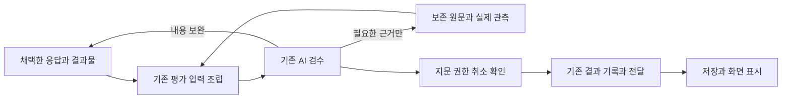

# 검수와 인용 구조 단순화 수리 설계

작성일: 2026-11-05. 상태: **설계 완료, 구현 전**.
코드 대조 기준: 정본 main `91f784256c48dd39d4e26687af3979c1c80a8ec7`.
근거: [에피소드 5845 심층연구 보고서](../data/outputs/verification_citation_research_2026-11-05/report.md).
목적: [IBL 진화 목적과 개선 판단](IBL_EVOLUTION_PURPOSE.md), [비전](../data/system_docs/vision.md#ibl과-주변-시스템의-진화-목적).

**기계는 검수할 결과와 실제 근거를 정확히 전달하고, 기존 AI 검수자는 그 의미와 목표 충족을 판단한다. 저장과 표시는 그 결과를 그대로 사용한다.** 이 역할 분담으로 검수와 인용의 반복 실패를 해결한다. 필요한 구조 수리를 이번 범위 안에서 끝내고, 동시에 판단 계층·예외 규칙·저장 체계를 늘리지 않는 것이 설계의 우선 조건이다.

R0–R5는 하나의 수리를 구현하고 검증하는 단계다. 별도의 두 번째 수리를 전제로 하지 않는다. 완료에는 모든 관련 실행 경로의 전환과 대체된 검사·프롬프트 규칙의 제거가 포함된다. 이번 작업은 그 구현을 위한 설계이며 운영 코드와 데이터는 바꾸지 않는다.

## 1 해결할 문제

심층연구는 이미지 전달 누락, 과거 인용에 대한 현재 실행 읽기 강제, 표기 예시 오검사, 검수와 저장의 서로 다른 완료 판정을 확인했다. 공통 원인은 **자료의 실제 내용과 의미를 판단할 AI 앞뒤에, 의미를 대신 추측하는 기계 규칙과 독립된 재판정이 겹쳐 있다는 것**이다. 보존·권한·무결성 검사는 필요하지만 그것을 내용의 정당성 판정으로 확대하면 안 된다.

| 확인한 경로 | 현재 마찰 | 수리 후 책임 |
| --- | --- | --- |
| `research_review.documents()`와 `final_evaluator.prepare()` | 응답에 경로가 있다는 이유로 문서 전체를 각각 제출물로 구성 | 실제 결과물 목록을 한 번 조립하여 평가와 저장이 공유 |
| `ResearchLibrary.citation_review()` | 현재 run 읽기가 없으면 과거의 유효한 인용도 실패 | 접근 가능한 실제 원문을 해소하여 AI에게 공급 |
| `research_review.claims()`와 자료실 정규식 | 표지 모양이면 실제 근거 사용으로 간주 | 표지와 주변 문맥을 후보로 전달하고 용도·타당성은 AI가 판단 |
| `_collect_visual_artifacts()` | 빈 셸 stdout에서 실제 캡처를 찾을 수 없음 | 실제 이미지 반환·명시 제출을 기존 증거에 연결 |
| `research_threads._work()` | 저장 직전에 인용을 재검사하고 본문 치환·failed 처리 | 확정된 결과와 인용 관계를 저장 |
| `TurnResearch.validate()`와 `research_task_session.session()` | 일반 연구에서도 검수 후 경고 추가와 종료 재검사 | 최종 전달 전 공통 준비, 이후에는 저장 일관성만 확인 |
| `agent_pipeline`의 검수 후 채택 | 검수한 본문과 전달 본문이 달라질 수 있음 | 내용 채택을 확정 전에 완료하고 마지막 지문 확인 |

사건 5841·5842·5844·5818은 재현 자료로 사용한다. 5807의 유효한 연속 원문 회수와 5824의 실제 미완료 차단도 함께 검사한다. 사건 번호와 특정 문장에 대한 예외를 운영 코드에 넣지 않는다. 보고서의 당시 관측과 현재 HEAD의 소스를 구분한다.

## 2 기계와 AI의 판단 경계

| 기계가 보장할 것 | 기존 AI가 판단할 것 |
| --- | --- |
| 자료 접근 권한, 프로젝트·대화 소유권 | 어떤 자료가 현재 주장에 관련되는가 |
| 원문과 보존 바이트의 일치, 판본·위치의 존재 | 그 원문이 주장을 지지·반박하거나 불충분한가 |
| 실제 전달한 구간·이미지와 생략한 범위 | 인용 표지가 실제 근거인가, 표기 설명·인용문인가 |
| 오류·취소·예산·전달 결과의 정확한 기록 | 수정 내용이 기존 결론과 모순되는가 |
| 승인 후 본문·기준·관련 입력 변경 감지 | 현재 목표에 필요한 범위를 충분히 확인했는가 |
| 이미 수행한 수치 계산·실행 검사의 원결과 | 숫자의 해석·단위·기간과 결론이 적절한가 |

권한 거절·손상 바이트·실제 없는 위치는 AI의 승인으로 존재하는 자료가 되지 않는다. 반대로 “현재 run에서 읽지 않았다”, “대괄호 모양이 맞는다”, “기존 파일이 링크됐다”는 사실만으로 내용 오류를 확정하지 않는다. 근거 미전달·평가 인프라 오류도 내용이 틀렸다는 뜻이 아니다.

AI가 실제 근거로 채택한 인용은 해당 위치의 유효한 원문에 연결돼야 한다. AI가 예시·언급으로 분류한 표지는 본문과 함께 보존하되 출처 목록에는 넣지 않는다. 이 구분은 기존 평가 호출에서 함께 수행한다. 별도의 인용 분류 AI나 재판정 AI를 추가하지 않는다.

사용자 목표와 기준의 소유권, 공개·파괴적 동작의 권한, 취소·예산은 그대로 유지한다. 기계의 명시 권한 제약과 AI의 사실 판단을 혼합하지 않는다.

## 3 단순화할 전체 흐름

추가하는 새 처리 단계가 아니라 현재 분산된 처리를 이 흐름으로 정리한다. 기계 자료 검사는 입력 조립 안에서 수행한다. 보완은 기존 감독 루프가 맡으며 독립된 인용 복구 루프를 만들지 않는다. 자료가 충분한 정상 턴의 모델 호출 수는 늘리지 않는다.

목표 평가가 없는 경로에는 이 그림의 AI 검수를 새로 삽입하지 않는다. 실행 AI가 사용한 근거와 최종 응답을 보존하고 `review_status=NOT_RUN`을 유지한다. 기계는 접근·무결성·명시 참조 연결의 결과를 기록하며, 표지 후보의 의미를 추측해 전체 응답을 실패시키지 않는다. 검증하지 않은 인용을 유효 출처로 승격하지도 않는다. 독립 의미 검수의 미실행을 사용자에게 정확히 표시한다.

### 3.1 기존 구조를 사용한다

- **입력**은 기존 평가 packet과 snapshot을 사용한다. 제출물 목록, 근거 원문 참조, 실제 전달 범위도 그 안에 둔다.
- **판정**은 기존 `review_status`, `goal_status`, reason, 근거·보완 요청을 사용한다. 새 `FinalizationReceipt`나 새 상태 기계를 만들지 않는다.
- **보존**은 기존 TurnStore·checkpoint·연구 events·messages를 사용한다. 새로운 데이터베이스나 필수 sidecar를 만들지 않는다.
- **호출**은 기존 `agent_pipeline`과 `Supervisor.finalize()`를 유지한다. 공통 함수를 분리할 수 있지만 새 감독자·상시 서비스·IBL 어휘를 도입하지 않는다.

다른 저장소에 같은 객체를 독립 정본으로 복제하지 않는다. TurnStore의 검수 기록을 연구 대화에 전달할 때는 기존 종료 event에 실제 결과와 필요한 근거 관계를 포함한다. 연구 대화의 영속 인용은 기존 자료실 원문에 연결하며, 임시 스필 경로 하나에만 의존하지 않는다.

## 4 결과물은 한 번 정한다

`supervisor_content.discover()`를 공통 후보 수집 입구로 사용하고 `research_review`는 그 결과의 순수 자료 조립을 맡는다. 최종 응답, 실제 생성·수정 반환 영수증, 전달 대기열의 초안을 사용한다. 단순 읽기 대상이나 셸 명령 속 경로는 생성 증거가 아니다.

| 입력 | 기본 취급 |
| --- | --- |
| 이번 응답과 공개 대기 초안 | 검수할 결과 |
| 이번에 생성·수정한 최종 보고서 | 검수할 결과. 짧은 답변 뒤의 파일 본문도 포함 |
| 기존 계획·자료의 참고 링크 | 참고 주소. 경로만으로 전체 재검사하지 않음 |
| 실제 읽은 자료·테스트 결과·스크린샷 | 주장을 확인할 근거 |
| 내부 작업 파일이나 역할이 모호한 후보 | 출처와 역할 미확정을 표시하여 기존 AI가 과제 문맥에서 판단 |

기존 결과를 다시 최종 산출물로 제출하는 경우도 결과물이다. 경로의 생성 시점만으로 결정하지 않는다. 필요한 역할은 기존 실행 응답·산출물 반환에 선택적으로 함께 싣고, 역할 선언만으로 실제 결과나 공개 초안을 검사에서 숨기지 못하게 한다. 새로운 역할 등록 전용 도구 호출을 매턴 요구하지 않는다.

문서 본문을 처음 읽을 때 원문 지문과 기존 증거 참조를 고정한다. 평가와 저장은 같은 목록과 판본을 사용한다. 마스킹해 모델에 보인 본문과 디스크 원문 지문은 구분한다. 공개 target과 private staged 초안도 하나의 산출물 관계로 유지한다.

파일이 없거나 읽지 못하면 조용히 제외하지 않고 그 사실을 AI에게 전달한다. AI는 사용자 목표에 필요한 결과인지 판단하여 근거 회수·내용 보완을 요청한다. 기계가 경로를 발견했다는 이유만으로 새 완료 조건을 만들지 않는다.

## 5 인용 검사는 원문 공급으로 정리한다

### 5.1 현재 실행 읽기를 합격 조건으로 쓰지 않는다

`ResearchLibrary.citation_review()`는 최종 인용의 의미 판정기가 아니라 **접근 가능한 원문과 실제 전달 범위를 해소하는 공급자**로 바꾼다. 해당 대화의 자료·추출 판본·위치와 원문 일치를 확인하는 기능은 `research_evidence`의 기존 소유 검증을 공유한다.

현재 실행이나 과거 실행의 읽기 영수증은 실제 관측 이력이다. 최종 인용을 승인하는 토큰이 아니다. 필요한 구간이 같은 대화에 보존돼 있으면 현재 run에서 다시 도구 호출을 하도록 강제하지 않고 기존 원문을 평가 입력으로 공급한다. 원문을 현재 검수 AI에게 실제 전달했는지는 평가 입력의 구간 기록으로 증명한다. 평가자가 받은 자료를 실행자의 current-run 읽기로 위장하여 `research_access`에 삽입하지 않는다.

| 상황 | 동작 |
| --- | --- |
| 현재 실행에서 읽은 원문 | 기존 참조와 실제 읽은 범위를 전달 |
| 과거 실행에서 읽고 보존한 원문 | 같은 소유 범위·판본·위치의 바이트를 해소하여 필요한 구간 전달 |
| 읽기 이력은 없지만 해당 대화가 보유한 인용 원문 | 권한 내 기존 자료 읽기 경로로 실제 회수한 뒤 전달. 관측 이력과 구별 |
| 같은 원문에 대한 새 주장 | 새 주장과 실제 원문을 AI가 다시 대조 |
| 다른 대화·폐기된 권한·없는 위치·손상 원문 | 재사용 거절 또는 회수 불가 사실을 전달. 허위로 유효 근거를 만들지 않음 |
| 과거 화면으로 현재 상태를 주장 | 촬영/관측 시점과 범위를 보여 주고 필요한 새 관측은 AI가 판단 |

질문의 `supporting`/`contradicting` 연결도 같은 원문 해소 함수를 사용한다. 질문을 작성하는 실행 AI에게 원문이 실제 제공되어야 한다는 조건은 유지한다. 기존 질문의 retained 근거는 원래 `observed_in`을 보존한다. 최종 평가자에게 실제 전달한 근거와 실행자의 읽기를 혼동하지 않으면, 소비자마다 “지금 읽었는가”라는 별도 합격 규칙을 둘 필요가 없다.

### 5.2 표지는 후보이며 진실의 증명이 아니다

표지 추출은 `research_review.claims()` 한 곳으로 모은다. 문서 경로·지문·표지 위치·주변 문맥을 담고, 같은 표지가 여러 주장에 쓰인 경우 문맥은 분리한다. 자료실에서 정규식으로 다시 추출하지 않는다. HTML/Markdown 구조가 이미 제공하는 코드·본문 정보를 함께 전달하되 별도 의미 파서를 만들지 않는다.

표기법 설명의 `[자료:판본:위치]`, 직접 인용문 속 표지, 실제 자료를 가리키는 표지 모두 문맥과 함께 전달한다. 기계는 해소 성공/실패와 원문을 공급한다. 기존 AI 검수자가 실제 근거 사용과 예시를 구분하고 주장과 대조한다. 코드 안이면 무조건 면제하거나 특정 예시 문자열만 예외 처리하는 규칙을 추가하지 않는다.

평가 결과에는 기존 결과 객체의 인용 항목으로 실제 채택한 후보 위치와 원문 참조만 돌려준다. 기계는 그 참조가 제공된 원문 목록에 있는지 확인한다. AI가 실제 근거라고 채택한 존재하지 않는 위치는 유효 인용으로 저장할 수 없다. 출력 형식 오류는 검수 프로토콜 오류이며 내용의 거짓으로 분류하지 않는다. 정상·예시·진짜 무효 인용을 한 문서에 섞은 실제 모델 시험으로 구별 능력을 확인한다.

일반 URL·각주도 동일하게 확인한 범위만 기록한다. 전용 표지가 없다는 이유로 사실 판단을 면제하지 않으며, URL이 존재한다는 사실만으로 주장 지지까지 승인하지 않는다. 목표 평가가 생략된 턴의 해소되지 않은 표지는 미확인으로 보존하고 AI 검수 완료로 표시하지 않는다.

### 5.3 과거 결과와 부분 수정

보존한 근거는 위 조건으로 재사용한다. **의미 판정은 기존 전체 snapshot과 기준이 동일할 때만 기존 checkpoint 계약으로 재사용**한다. 문서·주장·기준·관련 질문이 바뀌면 바뀐 부분과 기존 문맥을 기존 AI 검수자에게 함께 제시한다. 수정 때문에 다른 결론도 다시 봐야 하는지는 AI가 판단한다.

검수 대상은 원래 사용자 기준 전체를 유지한다. 변경 부분만 보고 나머지를 자동 합격시키지 않으며, 이미 보존된 본문은 필요할 때 기존 회수 기능으로 펼친다. 이전 판본이 없으면 현재 결과를 검토한다. 이 동작까지 이번 수리에 포함한다. 기계가 의미 의존 그래프나 주장별 승인 캐시를 만들어 AI 판단을 대신하는 구조는 도입하지 않는다.

검수 중 변경 감지는 **실제 packet이 사용한 입력**을 기준으로 한다. 응답·결과물·기준, 참조한 질문 판본과 근거의 권한·무결성을 확인한다. 다른 질문의 수정이나 사용하지 않은 읽기 영수증의 추가만으로 승인 전체를 무효화하는 `research_capture.review()`의 전역 상태 지문은 제거한다. 이미 전달한 질문이 바뀌면 이전 승인을 재사용하지 않는다. 이 목록은 실제 입력 참조에서 파생하며 별도 의존 원장을 만들지 않는다.

## 6 이미지와 텍스트를 같은 방식으로 전달한다

`supervisor_content.result_paths()`의 실행 반환 해소를 이미지에도 사용한다. 구조화된 결과, 네이티브 이미지 읽기 이벤트, 기존 작업대에 명시 제출한 파일을 기존 증거 저장소에 연결한다. 텍스트·이미지 모두 실제 바이트, 원문 참조, 판본, 관측 시점·범위와 회수 주소를 가진다. 저장소를 통합 이관하지 않고 소비 방식을 공유한다.

빈 셸 stdout나 캡처 명령의 성공은 화면 확인의 증거가 아니다. 파일을 실제 읽어 이미지 바이트를 평가자에게 공급해야 한다. 이미지의 내용과 사용자 목표 충족은 AI가 판단한다. 생산자 관측 시점이 없으면 미확인으로 두며 파일 mtime을 촬영 시각으로 승격하지 않는다.

최초 등록한 바이트를 기존 packet/TurnStore에 보존하고 `snapshot_error()`가 그 무결성을 확인한다. 이후 임시 원본이 없어져도 같은 이미지를 회수한다. 같은 경로에 새 이미지가 생겼다는 이유로 기존 관측을 바꾸지 않는다.

기존 입력 예산과 공급자 용량 제한은 유지한다. 예산상 빠진 원문·이미지는 참조와 생략 범위를 보여 주고 AI가 필요한 것을 선택해 기존 회수 경로로 받는다. 개수 한도를 초과했거나 발췌됐다는 사실 자체를 내용 실패로 만들지 않는다. 같은 빈 근거의 반복 회수는 중단하고, 새 구간은 기존 예산 안에서 회수한다. 새로운 관측이 필요하면 실행자에게 넘기되 완료된 외부 행동을 반복하지 않는다.

## 7 최종 결과를 저장까지 그대로 전달한다

### 7.1 호출과 상태

공통 입구는 `agent_pipeline`이고 연구 전용 `ResearchRunner`도 이를 사용한다. 감독 경로, 기존 비감독 목표 평가 경로, 목표 평가 없는 연구 경로에 같은 결과물·근거 준비를 연결한다. 자료실 미지원 시스템 AI·회원 경로는 기존 도구·파일 근거를 사용하고 자동 연구 자료실을 새로 붙이지 않는다.

응답 채택과 내용 수정은 확정 전에 마친다. 보완으로 본문이 바뀌면 새 본문을 기존 평가 루프로 보낸다. 확정 뒤에는 지문·권한·취소 여부만 확인한다. 상태 안내는 업무 본문을 고치는 대신 기존 상태 필드로 전달하고 텍스트 소비자는 별도 설명으로 렌더링한다.

| 관측 | 보존할 의미 |
| --- | --- |
| 실행 completed | 실행이 끝남. 검수 승인·목표 달성을 뜻하지 않음 |
| review APPROVED | 응답이 검수 기준에 맞음. 정직한 미완료 보고도 가능 |
| goal ACHIEVED/NOT_ACHIEVED/UNKNOWN | 실제 목표 판정. 응답 승인에서 계산하지 않음 |
| review NOT_RUN | 별도 의미 검수를 하지 않음 |
| review UNKNOWN | 근거 부족·평가 불가 등 이유를 보존. 자동 성공/실패로 치환하지 않음 |
| cancelled/interrupted/pending | 기존 실행·재개 상태 유지 |
| 저장·전달 실패 | 내용 판정은 보존하고 실패한 소비 동작만 재개 |

현재 enum을 사용한다. `review_status.json`, 스레드 로컬 목표 결과, 연구 종료 event가 같은 결과를 운반하고 UI도 동일 필드를 표시한다. 별도의 “전체 성공” 상태를 추가하지 않는다. `research_threads.task_status()`의 succeeded도 실행 종료의 뜻임을 유지하면서 검수·목표 결과를 같이 제공한다. 학습·증류는 기존 목표 판정 소비 경로를 점검해 completed를 목표 달성으로 승격하지 않게 한다.

### 7.2 저장과 재개

`research_threads._work()`, `TurnResearch.validate()`, `research_task_session.session()`에서 문서를 다시 모아 검사하거나 경고·치환으로 본문을 바꾸는 처리를 제거한다. 최종 결과에 포함된 본문·인용·진단을 저장한다. 자료 보존 실패나 실행 예외를 정확히 기록하는 기존 처리는 유지한다.

`ResearchStore.write_response()`는 기존 프로젝트 잠금과 DB 트랜잭션 안에서 epoch·실행 신원과 최종 응답 지문을 확인한다. 메시지·인용 요약·최종 결과 사건·과제 종료를 함께 저장한다. 같은 run·지문으로 저장을 재시도하면 기존 종료 결과를 반환하고, 다른 지문이나 다른 실행의 덮어쓰기는 거절한다. 모델 호출 중에는 저장 잠금을 유지하지 않는다.

기존 `research_citations`는 메시지·자료 판본·위치가 유일 키이므로 여러 추출 판본과 구간을 모두 표현하지 못한다. 이 테이블은 기존 표시용 요약으로 유지하고, 실제 검수에 사용한 여러 구간과 원문 관계는 기존 최종 결과 event에 보존한다. 저장 시 현재 run으로 인용을 재검색하는 `citations()` 대신 확정된 인용 결과를 투영한다.

파일·DB·외부 전달을 하나의 원자 트랜잭션이라고 가정하지 않는다. 불변 검수 본문은 기존 저장소에 보존하고, 현재 파일이 바뀌면 링크 표시에서 개정 사실을 알린다. 공개 초안은 현행 전달 대기열이 지문을 확인한 바이트만 발행한다. 전달 항목별 기존 성공 기록을 재개 시 사용하여 이미 완료한 발행을 반복하지 않는다. 성공 여부가 불명확한 알림은 자동 재전송하지 않고 미확인으로 남긴다. 이를 위한 별도 전송 서비스는 만들지 않는다.

검수 중·저장 전의 관련 입력 변경은 해당 제출을 다시 준비하게 하며, 저장 소비자가 자체적으로 내용 판정을 만들지는 않는다. 취소와 권한 회수는 마지막 확정에서도 확인한다. 과거 에피소드의 성공 상태를 소급 변경하지 않는다.

## 8 수정 소유자와 제거할 코드

| 기존 소유자 | 맡길 일 | 제거할 중복 |
| --- | --- | --- |
| `research_review`, `supervisor_content` | 결과물 후보·표지 위치를 한 번 조립 | 소비자별 경로/인용 재추출과 링크 전체 병합 |
| `research_evidence`, `research_library`, `research_capture` | 소유권·판본·원문 해소와 실제 입력 참조 | 현재-run 일괄 합격 조건, 사용하지 않은 질문·읽기 변경까지 무효화 |
| `evaluation_evidence`, `evaluation_input`, `cognitive_eval` | 텍스트·이미지의 실제 공급과 부족 범위 회수 | 매체별 상충하는 추정, 생략을 내용 실패로 처리하는 분기 |
| `final_evaluator`, `conscious_supervisor`, `agent_pipeline` | 기존 AI의 의미 판정·보완·최종 확정 | 정규식 후보 하나로 모델 판정을 일괄 REWORK로 덮기, 검수 후 본문 수정 |
| `research_context`, `research_threads`, `research_task_session` | 같은 결과 운반과 저장 | 후행 인용 재검사, 표지 치환, 경고 추가 |
| `research_store`, `supervision_store`, `repair_continuation`, `supervision_delivery` | 기존 원장의 결과 보존과 안전한 재개 | 같은 결과의 재저장/재개 때 새 내용 판정, 확인된 효과 반복 |
| `thread_context`, 연구 API, 연구 UI, 목표 결과 소비자 | 실행·검수·목표 상태의 동일한 투영 | 상태 문구의 재해석과 completed의 과잉 의미 |
| 평가 프롬프트와 연구·품질 가이드 | 기계/AI 역할과 근거 회수 설명 | current-run 강제 재읽기, 표지 자동 실패, 사건별 예외 규칙 |

주요 파일은 `backend/{base,datastore,cognition,services}/`의 동명 모듈이다. 프론트엔드는 `frontend/src/components/research/useResearchSession.ts`와 실제 상태 소비자를 포함한다. cognition에서 services를 역참조하지 않고 기존 `research_context` 콜백을 유지한다. 1500줄 제한 때문에 나누는 순수 함수는 허용하지만 새 실행 계층을 만들지 않는다.

[원문 배분 수리](RESEARCH_EVIDENCE_DELIVERY_REPAIR_PLAN_2026_11_04.md)의 불변 후보·단일 배분, [지연 수리](LATENCY_REPAIR_PLAN_2026_11_05.md)의 최초 근거 공급·부분 결과 표시를 재사용한다. 의미 판정 프롬프트는 기준·주장/근거 대조·미확인·보완이라는 공통 설명으로 정리하며 사례를 계속 덧붙이지 않는다. 사례는 행동 시험에 둔다.

## 9 구현 순서와 완료 조건

| 단계 | 구현 | 인수 조건 |
| --- | --- | --- |
| R0 | 최소 합성 fixture와 정상/오류 비교 입력 | 운영 DB 없이 보고서 사례와 유효 차단 반례 재현 |
| R1 | 결과물·인용 후보 수집 통합 | 새 결과 본문 누락 없음, 참고 링크만으로 전면 재검사 없음 |
| R2 | 원문 공급과 텍스트/이미지 관측 통일 | 과거 근거의 실제 재사용, 잘못된 권한·판본 차단, 이미지 바이트 전달 |
| R3 | 기존 AI 판단과 모든 최종 저장 경로 연결 | 예시/실제 인용 구분, 변경 문맥 판단, 상태·저장·재개 일치 |
| R4 | 대체된 검사·프롬프트·교재 규칙 제거 | 신판에서 후행 재검사·치환 0회, 새 판단 서비스·DB·어휘 0개 |
| R5 | 계약 회귀·실제 모델·UI·활성 확인 | 품질 관문과 단순화 관문 통과, 시간/토큰과 한계 보고 |

새 계약은 소비 경로가 모두 준비된 뒤 활성화한다. R4의 제거 작업까지 같은 수리에 포함하고 구 검사 위에 신 검사를 덧붙인 상태를 완료로 보지 않는다. 모델·기어를 바꿔 성능 개선으로 보고하지 않는다.

### 계약과 실제 모델 시험

| 상황 | 기대 동작 | 주요 시험 |
| --- | --- | --- |
| 빈 stdout, 명시 이미지, 임시 파일 삭제, 바이트 변조 | 실제 보존 이미지만 전달·재회수, 명령 성공만으로 승인하지 않음 | `test_cognitive_eval.py`, `test_final_evaluator.py` |
| 참고 링크, 새 보고서, 수정 계획, 외부 경로 | 실제 제출 본문 포함, 참고 전체 재검사 없음, 임의 권한 확대 없음 | `test_research_review.py`, `test_final_evaluator.py` |
| 예시·코드 속 실제 인용·없는 위치가 섞인 문서 | AI가 문맥을 구별하고 실제 무효 출처는 채택 불가 | `test_research_library.py`와 실제 모델 비교 |
| 과거 원문, 새 주장, 반대 의미, 다른 대화/판본 | 원문 실제 공급, 의미 재판단, 권한/판본 보존 | `test_research_questions.py`, `test_research_library.py` |
| 수정으로 기존 결론이 달라짐, 이전 본문 없음 | AI가 필요한 문맥 회수, 변경 부분만으로 전체 자동 승인 안 함 | `test_final_evaluator.py`와 실제 모델 비교 |
| 관련 질문 변경, 무관 질문 변경, 읽기 행 추가 | 사용한 입력 변경만 무효화, 기준·권한 변경은 반드시 감지 | `test_final_evaluator.py`, `test_research_review.py` |
| 감독/비감독/평가 생략과 연구 전용/일반 경로 | 같은 근거 해소, NOT_RUN 보존, 추가 검수 호출 없음 | `test_research_threads.py`, `test_research_task_session.py` |
| 정상적인 미완료 보고, UNKNOWN, 취소, 저장 실패 | 승인·목표·실행 독립, 원문과 원인 보존 | `test_research_store.py`, `test_research_threads.py` |
| 저장 성공 후 재시도, 충돌 판본, 부분 전달 | 중복 종료·확인된 외부 효과 반복 없음, 다른 판본 거절 | `test_research_store.py`, `test_supervision_delivery.py` |
| 구 checkpoint, 새 구간, 같은 빈 근거, 예산 소진 | 같은 자료로 재개, 진전 있는 회수만, 기존 한계 유지 | `test_repair_continuation.py`, `test_evaluation_input.py` |

시험 파일은 모두 `backend/` 아래다. 실제 모델 시험은 기계가 의미 판단을 대신하던 규칙을 제거한 결과를 확인하므로 필수다. mock 응답 통과만으로 인용 예시와 허위 인용을 구별한다고 보고하지 않는다. 정상·반대·불충분 근거를 같은 문서에 섞고, 다른 주제의 연구·문서 수정·화면 확인에도 적용한다. 주요 사례는 같은 목표·모델·자료 조건에서 전후 3쌍부터 교차 실행하여 개별 결과와 변동을 남긴다.

**품질 관문:** 심은 중대 오류의 신규 거짓 승인 0건, 유효 원문의 current-run 부재만으로 인한 실패 0건, 새 결과 본문 누락 0건, 확인된 외부 효과 반복 0건. 모든 실제 참조는 유효 원문에 연결되고, 읽지 못한 범위는 미확인으로 남아야 한다.

**단순화 관문:** 내용의 최종 판단자는 기존 AI 하나이고, 자료 해소는 한 공통 경로이며, 저장은 판정을 다시 하지 않아야 한다. 새 독립 상태 기계·의미 의존 그래프·주장별 승인 캐시·상시 서비스·IBL 어휘·DB가 없어야 한다. 대체한 실행 분기와 규정 문구의 삭제 목록을 실제 diff로 제시한다. 줄 수 감소만으로 판단하지 않고 독립 판단 지점·중복 해소 호출·사용자가 알아야 할 절차가 줄었는지 확인한다.

**효율 관측:** 기존 episode·evaluation·model.usage 사건으로 준비·검수·회수·보완·최종 저장까지 시간과 전체 토큰을 측정한다. 후처리를 포함하고 캐시를 중복 합산하지 않는다. 자료 충분한 정상 턴의 모델 호출은 증가하지 않아야 한다. 품질과 단순화 관문을 먼저 통과시키며, 시간 또는 토큰이 늘면 원인을 밝혀 실제 개선 범위를 구분한다. 측정 대기로 필요한 구조 수리를 미루지 않는다.

개발 검사는 [회귀 절차](REGRESSION_TESTING.md)의 `select_tests.py --files`를 사용한다. 최종 공통 경로 변경은 비system 전수와 관련 system 묶음을 실행한다. frontend는 `npx tsc -p tsconfig.app.json`과 실제 상태 화면, backend는 Android body manifest·층·파일 크기를 확인한다. 문구 자체를 강제하는 시험 대신 전달·판정·저장의 행동을 검사한다.

## 10 전환과 되돌리기

기존 packet의 format_version을 올려 구 checkpoint와 구별한다. 호환 처리는 기존 복원 위치에만 두고 새 판정 경로를 이중 운영하지 않는다. 진행 중 턴은 시작 판본으로 마치거나 보존 자료에서 신판 입력을 다시 준비하며 이전 승인을 무조건 계승하지 않는다. 정상 신판에서는 옛 저장 검사기를 호출하지 않는다.

구기록에 검수·목표 결과가 없으면 미확인으로 표시한다. 성공을 추정하는 데이터 이관은 하지 않는다. 관련 입력과 원문이 같아 재사용할 수 있는 것은 현재 snapshot 계약으로 확인하고, 없는 정보는 필요한 범위만 회수한다. 구판 활성 턴이 끝나고 기록 조회·복원이 확인되면 실행용 호환 분기는 제거한다. 구기록을 읽는 기능은 남긴다.

구현은 정본 main의 경로 지정 커밋으로 반영한다. 기존 재기동 제어자와 실제 적재 세대·HTTP/MCP·연구 화면을 확인한다. 수동 keeper 표식이나 별도 감시기는 만들지 않는다. 보호된 평가 구현의 개정은 사용자가 요청한 외부 개발 변경으로 수행하고 실행 중 에이전트가 자신의 승인 기준을 바꾸는 경로로 노출하지 않는다.

되돌릴 때는 해당 구현 커밋만 되돌리고 보존 원문·검수 결과를 유지한다. 구 코드가 신판을 해석하지 못하면 해당 작업을 미확인 또는 기존 재개 대기로 남기며 임의 성공·새 실패 판정을 만들지 않는다. 외부 전달 결과가 불명확하면 재전송보다 기존 효과 확인을 우선한다.

## 11 설계 반영과 구현 완료 기록

설계는 보고서와 현행 코드의 자료 전달·평가·저장 경로를 대조해 작성했다. 추가 확인한 것은 일반 연구의 검수 후 본문 변형, 인용 요약 테이블의 표현 한계, 동일 run 최종 저장 재시도 충돌이다. 운영 코드·평가 정책·DB·과거 에피소드는 변경하지 않았다.

구현자는 R0–R5별 실재 커밋, 삭제한 중복 책임, 검사 범위와 결과, 실제 모델·UI 확인, 활성 세대, 시간·전체 토큰을 기록한다. 알려진 사건만 통과시키거나 구조 제거를 후속 과제로 남기면 완료가 아니다. 모든 경로에서 **실제 자료 공급 → 기존 AI 판단 → 동일 결과 저장**이 성립하고 위 품질·단순화 관문을 통과해야 수리를 완료한다.
