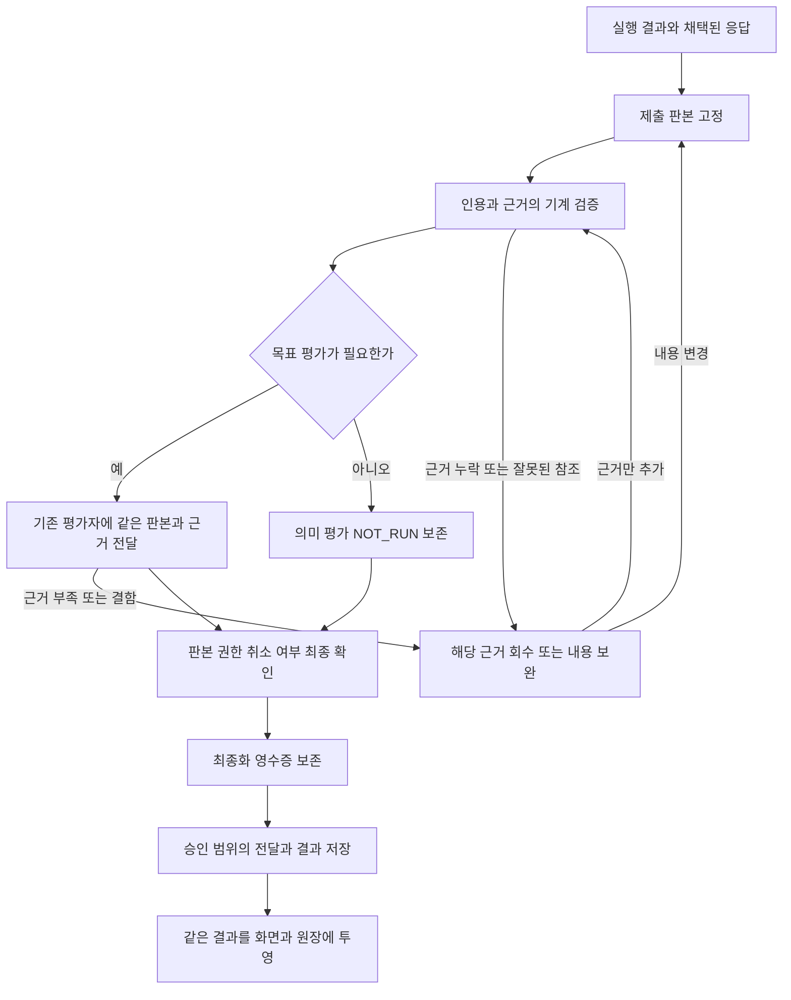

# 검수와 인용 구조 단순화 수리 설계

작성일: 2026-11-05. 상태: **설계 완료, 구현 전**.
코드 대조 기준: 정본 main `91f784256c48dd39d4e26687af3979c1c80a8ec7`.
출발 근거: [에피소드 5845 심층연구 보고서](../data/outputs/verification_citation_research_2026-11-05/report.md).
목적: [IBL 진화 목적과 개선 판단](IBL_EVOLUTION_PURPOSE.md), [비전](../data/system_docs/vision.md#ibl과-주변-시스템의-진화-목적).

**제출 대상을 한 번 정하고, 관측한 근거를 판본과 함께 이어 쓰며, 최종화 결과를 모든 저장·표시 경로가 공유하도록 수리한다.** 새 검수자·상시 감시·IBL 어휘를 추가하지 않는다. 기존 자료실, TurnStore, 평가 입력 배분기, 최종 평가와 전달 대기열의 경계를 정리한다. 교체한 검사와 설명은 함께 제거한다.

이 수리로 강화할 일반 능력은 이전 결과를 보존한 부분 수정, 텍스트와 이미지의 관측 전달, 실행 중단 후 검수만 재개하는 능력이다. 연구 보고서 외에도 코드 검사 결과, 문서 개정, 화면 확인에 같은 계약을 적용한다. 품질을 유지하면서 완료 시간과 전체 토큰을 줄이는 것이 목적이며, 절감량은 구현 후 측정한다. 이번 변경은 설계 문서에 한정한다.

R0–R5는 한 수리의 구현·검증 단계다. 모두 마치면 이 설계의 수리는 완료되며, 별도의 두 번째 수리를 전제로 하지 않는다.

## 1 현행 결함과 수리 경계

보고서의 사건 판단은 당시 보존 입력에 관한 것이다. 아래 함수는 설계 기준 HEAD에서 다시 대조했다. 당시 실행 프로세스가 적재한 바이트와 현재 파일이 모두 같았다는 뜻은 아니다.

| 경계 | 현행 동작과 문제 | 수리 책임 |
| --- | --- | --- |
| 제출 범위 | `research_review.documents()`가 응답의 파일 경로를 읽어 전체 본문을 합침. `final_evaluator.prepare()`도 별도로 경로를 추정 | 공통 제출 목록에서 이번 결과·수정 대상·참고 문서의 역할과 판본을 고정 |
| 인용 읽기 | `ResearchLibrary.citation_review()`와 `citations()`는 현재 run의 읽기만 조회 | 실제 읽기 영수증을 판본·범위·소유 대화와 함께 해소. 기존 연결과 새 주장을 구분 |
| 기존 근거 | `research_evidence.validate_reference()`는 retained 근거의 `observed_in`을 유지 | 이 소유 검증을 재사용하고 최종 인용에 사설 수명 규칙을 두지 않음 |
| 표지 해석 | `research_review.claims()`와 자료실 검사가 각각 정규식으로 표지를 추출 | 문서 위치를 가진 occurrence 목록 한 벌에서 검사·표시·저장을 파생 |
| 시각 자료 | `cognitive_eval._collect_visual_artifacts()`가 별도로 경로를 추정. 빈 셸 stdout에는 실제 이미지가 없음 | 생성·읽기 결과의 매체 영수증에서 실제 바이트를 보존하고 동일 참조로 전달 |
| 연구 전용 저장 | `research_threads._work()`가 다시 문서를 모으고 인용 실패 시 본문을 치환한 뒤 failed 저장 | 최종화 결과의 판본·권한만 확인하고 원문과 진단을 따로 저장 |
| 일반 연구 저장 | `TurnResearch.validate()`가 검수 후 본문에 경고를 추가하고 `research_task_session.session()`이 종료 시 다시 검사 | 검수를 최종 전달 전으로 모으고 두 후처리 재검사를 제거 |
| 최종 전달 | `agent_pipeline`의 검수 후 `adopt_response()`가 본문을 바꾸면 판정을 UNKNOWN으로 돌림 | 채택·내용 수정은 확정 전에 완료. 확정 후 변경은 새 제출 판본으로 처리 |
| 상태 | 스트림 completed, 응답 APPROVED, 목표 ACHIEVED가 별개인데 저장과 UI가 일부만 소비 | 한 최종화 영수증에서 실행·검수·목표·전달 상태를 각각 표시 |

에피소드 5841은 이미지 등록 누락, 5842·5844는 과거 계획과 현재 실행 읽기 조건의 충돌, 5818은 표기 예시의 오인이다. 5807의 유효한 연속 원문 회수와 5824의 실제 미완료 차단은 유지할 반례다. 사건 번호를 운영 코드의 예외 조건으로 넣지 않는다.

수리 범위에는 감독 평가 경로, 감독 없이 기존 목표 평가를 사용하는 경로, 목표 평가를 생략하는 연구 경로, 두 연구 저장 경로가 포함된다. 자료실이 연결되지 않는 시스템 AI·회원 실행은 기존 실행 근거만 사용한다. 이 수리로 자료실 자동 연결 범위나 권한을 넓히지 않는다.

## 2 유지할 보증과 줄일 책임

다음 보증은 공통 계약의 인수 조건이다.

- 목표·달성 기준은 사용자와 의식의 현행 소유권을 유지한다. 근거 부족을 이유로 기준을 새로 만들거나 면제하지 않는다.
- 읽기·관측 사실, 주장을 지지하는지의 의미 판단, 원래 목표 달성을 구분한다.
- 자료 소유 범위·판본·추출 판본·읽은 구간·관측 시점을 보존한다. 다른 대화의 읽기나 과거 이미지를 현재 관측으로 승격하지 않는다.
- 새 보고서 본문도 검사한다. 짧은 최종 답변이나 참고 역할 지정으로 제출물의 잘못된 인용을 숨길 수 없어야 한다.
- 취소·예산·실제 결함 보완 횟수·공개 권한은 유지한다. 근거 보완은 이미 끝난 외부 행동을 다시 실행하는 허가가 아니다.

줄이는 것은 같은 문서의 재발견, 현재 run만을 근거로 삼는 일괄 조건, 저장 단계의 내용 재판정·치환이다. 모든 질문 변경 시 무효화하는 현재 보호, 이미지 개수·크기 한도, 주장 주변 발췌 예산은 이번 수리에서 완화하지 않는다. 근거 부족은 명시하고 기존 배분·회수 경로로 해결한다.

## 3 한 번의 최종화 흐름

‘한 번’은 검수 모델 호출을 항상 1회로 제한한다는 뜻이 아니다. 한 제출 판본의 검사 책임과 결과를 하나로 만들고, 새로운 원문 회수나 내용 보완으로 필요해진 재검수는 그 판본과 후속 관계를 명시한다. 저장 소비자는 새로운 의미 판정을 하지 않는다.

공통 흐름의 호출자는 `agent_pipeline`이다. `ResearchRunner`도 이 파이프라인을 사용하므로 연구 전용 실행기를 따로 만들지 않는다. `Supervisor.finalize()`는 기존 모델·보완·예산 제어를 유지하되 공통 제출 판본과 결과를 사용한다. supervisor 없는 목표 평가 경로도 같은 제출 준비와 기계 검사를 거친 뒤 기존 모델 호출을 사용한다. 평가 없는 연구 턴에는 기계 검사만 수행하며 추가 모델 호출을 만들지 않는다.

초기 도구 스트림과 부분 결과는 잠정 상태로 계속 표시한다. 새 계약의 최종 event는 확정된 본문과 영수증 ID를 함께 운반한다. `review_status.json`, 스레드 로컬 목표 결과, 연구 메시지의 종료 상태는 이 영수증의 투영이다. 설명 문장을 파싱해 상태를 재구성하지 않는다.

## 4 제출 대상과 판본

### 4.1 제출 목록의 소유권

`research_review`의 순수 계약과 `supervisor_content.discover()`의 파일 수집을 분리한다. 파일 수집은 후보를 만들고, 제출 목록 조립이 역할을 결정한다. 최종 평가·인용 검사·저장은 고정된 목록을 사용한다.

기존 산출물·실행 영수증과 전달 manifest를 입력으로 사용한다. 구조는 기존 packet의 `context.research_submissions`를 일반화하며, 파일별 장식용 sidecar나 새 데이터베이스를 만들지 않는다.

| 항목 | 최소 필드와 뜻 |
| --- | --- |
| 실행 신원 | project·thread·run과 현재 소유권 epoch. 실행 문맥에서만 부여 |
| 응답 | 응답 판본, 원문 지문, TurnStore 참조 |
| 문서 | 정규화한 경로 또는 기존 artifact ID, 원문 지문, 보존 본문 참조, 역할, 생산·수정 호출 참조 |
| 역할 | `submission`은 결과물, `reference`는 참고, `evidence`는 관측 근거. 역할은 접근 권한이나 내용 승인이 아님 |
| 개정 정보 | 확보된 이전 판본 참조와 실제 diff. 이전 판본이 없으면 없다고 기록 |
| 의존 | 현행 완료 기준 지문, 연구 상태 지문, 전달 manifest 지문 |

제출 지문은 파일의 표시 순서와 무관한 정규 직렬화로 계산한다. 원문 바이트 지문과 마스킹해 모델에 제공한 본문 지문을 분리한다. 마스킹 본문을 디스크 원문과 비교해 변경으로 오인하는 과거 결함을 재도입하지 않는다.

### 4.2 역할 결정과 누락 방지

1. 응답 본문과 전달 대기열의 초안은 반드시 제출 대상이다. 공개 target과 private staged 파일은 같은 산출물의 관계로 보존한다.
2. 이번 실행에서 생성·수정한 파일은 기본적으로 제출 후보다. 단순 읽기·검색 입력 경로는 근거 또는 참고다. 실패한 호출의 경로만으로 생성 성공을 추정하지 않는다.
3. 기존 계획·자료 링크는 참조만으로 새 제출물이 되지 않는다. 다만 실행 영수증이 이번 수정을 입증하면 링크 역할만으로 검사에서 제외하지 않는다.
4. 중간 스크립트·임시 조사 파일은 반환 영수증에서 내부 작업물임을 알 수 있을 때 제외한다. 역할 충돌은 조립 단계에서 진단하고 보수적으로 제출 범위에 남긴다.
5. 옛 도구의 경로 문자열은 후보 발견용 호환 입력으로만 사용한다. 생성 이력이나 명시 제출을 해소하지 못하면 파일을 조용히 통과시키지 않고 `scope_unresolved`를 남긴다. 필요한 역할 보완은 기존 실행 반환·작업대의 선택적 메타데이터로 받으며 새 어휘나 매턴 전용 호출을 요구하지 않는다.

생산자 메타데이터는 에이전트의 제안이다. 사용자 과제, 실제 쓰기·전달 영수증과 충돌하는 `reference` 선언으로 검사 범위를 줄이지 않는다. 소유 경계 밖 파일은 임의로 읽지 않으며 기존 파일·공개 권한을 그대로 적용한다.

### 4.3 수정 문서의 검토 범위

**이번 수리는 수정된 제출 문서 전체를 의미 검토한다.** 이전 읽기 근거는 재사용하지만 문서 일부가 같다는 이유로 기존 의미 승인을 자동 계승하지 않는다. 문맥 변경이 결론에 미치는 영향을 추측하는 새 의존 그래프를 만들지 않는다.

변경하지 않은 참고 문서는 검사 대상에서 제외하고, 이번 응답이 그 문서의 주장을 다시 채택하면 그 주장은 응답 occurrence로 검사한다. 이전 판본과 검증 결과가 연결되지 않는 문서도 처음 제출할 때는 전체 필요한 범위를 확인한다. 부분 의미 검수 캐시는 이번 수리에 필요하지 않아 범위에서 제외한다. 이를 추가하지 않아도 보고서에서 확인한 제출 범위·근거 수명·최종화 중복 문제를 해결할 수 있다.

## 5 인용과 과거 근거의 연결

### 5.1 occurrence를 한 번 만든다

`research_review.claims()`를 문서 형식별 구조 읽기로 확장한다. Markdown·HTML은 기존 파서가 제공하는 본문/코드/인용 위치를 사용하고, 일반 텍스트에는 보수적인 표지 추출을 사용한다. 문서 지문, 위치 좌표의 단위, 표지, 주장 문맥, 역할을 함께 저장한다. Markdown 원문 좌표와 HTML 파싱 후 텍스트 좌표는 섞지 않는다.

자료실은 이 occurrence 목록을 받아 표지의 판본·위치를 해소한다. 자체 정규식으로 표지를 다시 수집하지 않는다. 같은 표지라도 서로 다른 주장에 붙으면 별도 occurrence이며, 원문 바이트만 공유한다.

표기 설명의 `[자료:판본:위치]`처럼 식별자 자리가 명시된 코드 예시는 설명 노드로 남긴다. 코드 안의 실제 판본 ID·위치는 자동 면제하지 않는다. 미등록 실제 참조는 unresolved 또는 invalid로 남긴다. 에이전트가 임의로 example 태그를 붙였다는 이유로 실질 주장의 근거 검사를 건너뛰지 않는다. 문서 형식상 예시인지 불분명하면 그 occurrence를 보완 대상으로 남기고 전체 인용을 생략하지 않는다.

기계 검사는 참조 연결의 유효성을 판정한다. 인용 표지가 없는 주장이나 예시로 위장한 실질 주장의 타당성은 활성화된 기존 의미 평가가 담당한다. 목표 평가가 없는 턴에는 의미 검토를 했다고 기록하지 않는다. URL·일반 각주도 자료실 영수증과 연결되지 않았다는 사실을 보존하며 자동 승인하지 않는다.

### 5.2 근거 해소 순서

`research_evidence`가 소유한 판본·대화·원문 대조를 공통 함수로 분리하고 `ResearchLibrary.citation_review()`가 재사용한다. retained 입력은 호출자가 임의로 만든 사전이 아니라 같은 대화의 저장된 질문 판본·최종화 영수증에서 서버가 읽은 연결만 인정한다.

| 상황 | 읽기 근거 처리 | 의미 판단 |
| --- | --- | --- |
| 현재 실행에서 실제 반환한 구간 | 기존 research_access를 연결 | 현재 주장에 대해 평가 |
| 기존 질문·제출 판본에 귀속된 과거 근거 | 동일 대화·자료/추출 판본·위치·원문 범위를 검증하고 원래 observed_in 유지 | 현재 제출 주장에 다시 평가 |
| 같은 과거 원문으로 새 주장 작성 | 필요한 원문을 기존 읽기 경로로 실행자에게 실제 전달하고 그 반환을 기록 | 새 주장·문맥을 평가. 과거 읽기만으로 승인하지 않음 |
| 과거 읽기는 있지만 주장·판본 연결 없음 | 자동 계승하지 않고 현재 제출에 필요한 원문을 회수 | 연결이 확인되기 전 unreviewed |
| 판본·추출·범위 불일치 또는 권한 폐기 | 해당 참조를 재사용하지 않음 | 불일치·미확인을 표시하고 필요한 범위만 보완 |

run ID가 달라졌다는 이유만으로 실패하지 않지만, 과거 모든 run을 뒤져 첫 일치 행을 승인하는 방식도 쓰지 않는다. 이전 문서 본문·지문과 실제 읽기 영수증으로 연결을 복원할 수 있을 때만 계승한다. 자동 복원이 안 되는 구기록에는 가짜 현재 읽기 영수증을 만들지 않는다.

근거 참조는 기존 `evidence_id`에 소유 대화, 원천 판본/추출 revision, locator, 실제 읽은 quote 또는 구간, 관측 실행을 연결한다. research_access는 현재 정확한 전역 문자 좌표를 모두 저장하지 않으므로 quote를 원문 전체 읽기로 확대하지 않는다. 동일 문구의 위치가 모호하면 locator와 읽은 quote 범위만 인정하고, 정확한 좌표가 필요한 회수는 실제로 다시 읽어 확보한다.

`citations()`의 저장용 현재-run 재검색은 제거한다. 최종화에서 검증한 occurrence와 근거 목록을 저장 입력으로 사용한다. 기존 `research_citations`의 유일 키는 메시지·판본·위치만 담으므로 여러 추출 판본·읽기 구간·주장 관계의 정본으로 사용할 수 없다. 그 테이블은 기존 UI용 요약 투영을 유지하고, 전체 관계는 최종화 영수증이 보존한다. 중복 행을 INSERT OR IGNORE로 잃어버린 뒤 검증 완료로 간주하지 않는다.

### 5.3 회수와 오류의 구분

기계 검사는 잘못된 자료/위치, 읽기 근거 부족, 권한 불일치, 저장소 오류를 구조화해 반환한다. 보존 원문이 없거나 저장소를 읽지 못한 경우를 거짓 인용으로 단정하지 않는다.

검증 가능한 기존 근거의 부족은 기존 `evaluation_input` 회수 경로로 연결한다. 현재 목록에 없는 임의 ID·파일을 평가자가 요구해도 읽지 않는다. 실제 새 관측이 필요하면 실행자에게 원래 권한·예산 안에서 넘긴다. 동일 영수증의 동일 빈 구간 회수는 진전이 아니며 재호출을 멈춘다. 새 구간을 얻은 경우는 기존 예산 안에서 연속 회수할 수 있다.

## 6 텍스트와 이미지의 동일한 증거 참조

공통화 대상은 소비 계약이다. 자료실 blob과 TurnStore를 하나의 새 저장소로 이사하지 않는다.

| 필드 | 계약 |
| --- | --- |
| source | 기존 저장소의 회수 ID와 소유 범위. 임의 로컬 경로를 읽기 권한으로 사용하지 않음 |
| revision | 텍스트 원문/추출 판본 또는 이미지 바이트 지문 |
| media | text/image 등 기존 매체와 MIME |
| observation | 실제 관측 실행·시각, 관측 대상·범위. 모르는 값은 미확인 |
| coverage | 반환한 텍스트 구간, 이미지가 보여주는 화면 범위. 명령 성공과 구별 |
| retrieval | 기존 읽기/이미지 packet 회수 주소. 바이트를 실제 소비자에 전달해야 함 |

`supervisor_content.result_paths()`의 실행 영수증 해소를 텍스트와 이미지가 공유하도록 한다. 구조화된 결과, 네이티브 이미지 읽기 이벤트, 기존 작업대에 명시 제출한 파일을 성공·권한·존재·MIME·디코딩 검사 후 보존한다. 셸 명령 문자열을 분석해 출력 파일을 추정하지 않는다. 빈 stdout는 이미지가 아니다.

명시 이미지 제출은 새 스크린샷을 자동 촬영하지 않는다. 기존 이미지를 읽고 보존한다. 생산자 관측 시점이 없으면 파일 mtime을 촬영 시각으로 단정하지 않는다. 화면의 현재 상태를 주장하려면 과제 기준에 맞는 새 관측이 필요하다. 생성한 이미지가 원하는 화면을 담았는지는 평가자의 기존 시각 판단이 맡는다.

바이트는 최초 등록 시 기존 TurnStore 증거 또는 보존 packet에 고정한다. 임시 원본이 없어져도 보존 바이트를 회수한다. `snapshot_error()`의 기존 이미지 무결성 검사를 유지하고 경로가 아닌 증거 ID로 연결한다. 입력 예산에서 빠진 이미지는 누락 참조를 남기며 조용히 검수 완료로 처리하지 않는다. 이미지 수·용량 한도와 비전 모델 선택은 유지한다.

## 7 최종화 결과와 저장

### 7.1 결과 계약

새 내부 객체의 이름은 `FinalizationReceipt`로 정한다. 아래는 구현할 필드이며 현재 API의 존재를 뜻하지 않는다. enum은 기존 상태를 우선 사용하고 세부 원인은 `issues`로 둔다.

| 필드 | 내용 |
| --- | --- |
| identity | 계약 판본, task/run, project/thread, epoch, 제출 지문 |
| execution_state | 기존 completed/failed/cancelled/interrupted 및 기존 pending 인계 상태 |
| review_status | APPROVED/REWORK/UNKNOWN/NOT_RUN |
| goal_status | ACHIEVED/NOT_ACHIEVED/UNKNOWN. 응답 승인으로부터 계산하지 않음 |
| citation_result | valid/invalid/unresolved와 occurrence·원문 영수증 참조. 해당 없음과 검사 못 함 구분 |
| criteria와 snapshot | 완료 기준, 연구 상태, 응답/문서/전달 판본 지문 |
| issues | 종류·대상·범위·근거·다음 조치. 회수/내용 보완/새 관측/인프라 재개의 구분 |
| payload | 평가한 업무 본문의 참조·지문. 진단 문구는 별도 표시 필드 |
| delivery | 전달 필요 여부, 항목별 기존 영수증, 완료·부분·미확인 상태 |

부족한 영수증을 본문에 ‘직접 확인했다’고 쓰는 것으로 보충하지 않는다. 모델 응답은 공급자 경계에서 한 번 구조화하고, 하류는 그 필드를 소비한다. 구판의 `UNKNOWN_REASON`·`REPAIR_SCOPE` 등 문구는 호환 파서 한 곳에서만 해석한다.

### 7.2 판정과 종료 상태

| 상황 | 응답 검수 | 목표 | 저장·표시 |
| --- | --- | --- | --- |
| 평가와 근거가 모두 충족 | APPROVED | 실제 판정 그대로 | 실행 완료와 검수·목표를 각각 표시 |
| 사실에 맞게 미완료를 설명한 답변 | APPROVED 가능 | NOT_ACHIEVED 또는 UNKNOWN | 목표 완료로 표시·학습하지 않음 |
| 기준 없어 의미 평가 생략, 필요한 인용은 유효 | NOT_RUN | UNKNOWN | 답변 완료·검수 미실행 |
| 실제 무효 인용·내용 결함, 보완 소진 | REWORK 또는 기계검사 실패 | 별도 목표 판단, 없으면 UNKNOWN | 원문과 오류 위치 보존. 연구 응답은 검증 실패 |
| 원문 전달 부족·평가 장애 | UNKNOWN | 미확인인 항목은 UNKNOWN | 검수 미확정. 허위 인용이나 목표 실패로 바꾸지 않음 |
| 사용자 취소 | 진행 중 승인은 확정하지 않음 | 확정 전이면 UNKNOWN | cancelled, 완료 행동·부분 결과는 보존 |
| 전달 일부 완료·응답 저장 실패 | 콘텐츠 판정은 보존 | 저장 성공으로 목표를 만들지 않음 | 전달/저장 실패 표시, 확인된 효과는 반복하지 않음 |
| 재기동 적용·검수 대기 | 기존 pending 의미 유지 | UNKNOWN | 해당 인계 상태. 완료로 접지 않음 |

평가가 꺼진 연구 턴에도 출처·위치·권한의 기계 검사는 최종화 전에 실행한다. 오류가 있으면 이번 턴의 기존 보완 권한·예산에 따라 해결하거나 미해결 결과로 끝낸다. 의미 검수를 상시 켜서 해결하지 않는다. 일반 EXECUTE에 새 목표 평가를 추가하지 않는다.

### 7.3 확정과 저장의 경합

1. 응답 채택과 내용 수정이 끝난 뒤 제출 판본을 고정한다. 검수 보완이 내용을 바꾸면 새 판본으로 돌아간다.
2. 기계 검사·필요한 의미 평가 후 응답·문서·기준·연구 상태·전달 manifest를 확인한다. 기존 질문 전체 상태 검사도 유지한다.
3. 최종화 영수증을 기존 TurnStore에 원자 저장한다. 영수증은 공개 권한을 발급하지 않으며 현행 전달 정책을 입력으로 사용한다.
4. 전달 대기열은 승인된 manifest만 수행하고 항목별 결과를 남긴다. 부분 전달 또는 결과 불명일 때 전체를 자동 재전송하지 않는다. 외부 알림과 SQLite를 하나의 원자 트랜잭션이라고 가정하지 않는다.
5. 연구 저장은 프로젝트 잠금·DB 트랜잭션 안에서 epoch·active_run·최종화 신원과 응답 지문을 확인하고, 메시지·인용 투영·최종화 사건·과제 종료를 함께 저장한다. 장시간 모델 호출 중에는 DB 잠금을 잡지 않는다.
6. 같은 run·제출 지문으로 저장을 재시도하면 기존 영수증을 돌려준다. 다른 지문 또는 만료된 실행이면 충돌로 거절한다. 현재 `write_response()`의 active_run 해제 뒤 재시도 거절을 보완하되 다른 실행의 결과를 덮지 않는다.

파일 시스템과 DB 사이의 원자성을 가정하지 않는다. 저장하는 본문은 검수한 불변 사본이며 경로는 관측 당시의 지문과 함께 남긴다. 현재 파일을 제공하는 UI는 지문이 달라졌으면 개정됨을 표시한다. 공개 파일은 기존 대기열이 지문을 확인한 바이트를 발행한다. 권한/판본이 최종화와 저장 사이에 바뀌면 `stale` 사유로 해당 확정을 거절하고 재준비한다. 저장 소비자가 새 문서를 읽어 별도 내용 판정을 내리지는 않는다.

연구 영속 기록은 기존 `research_events`에 최종화 payload를 저장하고 messages에는 해당 사건 참조를 연결하는 가산 변경으로 한다. 전체 payload에는 해소 가능한 occurrence·영수증 관계를 보존한다. TurnStore 경로만 남겨 자료 정리 후 읽을 수 없게 만들지 않는다. 구기록을 일괄 성공으로 바꾸거나 연구 원장을 갈아엎는 이관은 하지 않는다.

검수 뒤 붙이던 실패 안내·pending 안내는 UI 메타데이터로 옮긴다. 텍스트 전용 소비자에는 업무 본문과 분리한 상태 설명을 렌더링한다. 인용 원문을 `[확인되지 않은 인용]`으로 바꾸지 않고 해당 위치에 오류를 표시한다. 최종 본문 변경이 꼭 필요하면 새 제출로 돌아가며 이전 승인을 재사용하지 않는다.

## 8 구현 소유자와 삭제 항목

| 소유 파일 | 변경 | 함께 제거할 처리 |
| --- | --- | --- |
| `backend/base/research_review.py` | 제출/occurrence 순수 계약, 형식별 위치와 역할 | 최종 검사 소비자의 무조건 링크 전체 병합 |
| `backend/base/research_context.py` | 기존 서비스 콜백으로 제출·근거·결과 운반 | `TurnResearch.validate()`의 후행 내용 검사와 경고 추가 |
| `backend/datastore/research_evidence.py` | 판본·범위·대화 및 retained 영수증 검증 공통화 | 최종 소비자의 독자적인 수명 규칙 |
| `backend/services/research_library.py`, `research_capture.py` | occurrence 해소, 과거 연결 검증, 필요한 실제 원문 전달 | 현재 run만 조회하는 일괄 실패와 저장용 재검색 |
| `backend/cognition/supervisor_content.py`, `cognitive_eval.py` | 실행 반환·명시 제출·이미지 관측의 후보 해소 공유 | 텍스트/이미지의 상충하는 제출 범위 추정 |
| `backend/cognition/final_evaluator.py`, `evaluation_input.py`, `evaluation_evidence.py` | 고정 제출과 근거만 배분, 기계 진단과 의미 결과 결합 | 모델 평가 후 뒤늦은 인용 재추출·단순 REWORK 덮어쓰기 |
| `backend/cognition/agent_pipeline.py`, `conscious_supervisor.py` | 최종화 진입과 보완·확정·전달 순서 연결 | 검수 후 업무 본문 수정·중복 판정 기록 |
| `backend/datastore/supervision_store.py`, `repair_continuation.py` | 영수증·판본과 기존 checkpoint 복원 | 새 계약에서 자유 산문으로 상태 복원 |
| `backend/services/research_threads.py`, `research_task_session.py` | 동일 영수증 저장, 상태 투영 | 저장 직전 documents/citation_review 재호출·표지 치환 |
| `backend/datastore/research_store.py` | 최종화 사건·메시지 연결과 저장 재시도의 멱등성 | 종료된 동일 run의 안전한 재저장까지 거절하는 분기 |
| `backend/base/thread_context.py`, 연구 API와 `frontend/src/components/research/useResearchSession.ts` | 같은 상태 계약 운반·표시 | completed만으로 검수·목표 성공을 표현하는 소비 |
| 평가 프롬프트, `deep_research.md`, `research_project.md`, `research_questions.md`, `result_quality.md` | 제출·재사용·회수·최종 상태 설명 정합화 | 현재 run 강제 재읽기, 한 번 회수 등 현행과 다른 설명·사건별 예외 |

공통 조정 코드는 새 `backend/cognition/finalization.py`로 분리한다. 이 모듈은 새로운 감독자가 아니라 기존 최종화 계약의 조립·결과 정규화만 소유한다. 순수 자료 계약은 base, 저장은 datastore, 자료실 접근은 기존 service 콜백을 사용하여 cognition에서 services를 역참조하지 않는다. 새 모듈은 층 검사 대상이며 파일 1500줄 제한을 지킨다.

이전 [원문 배분 수리](RESEARCH_EVIDENCE_DELIVERY_REPAIR_PLAN_2026_11_04.md)의 불변 후보·단일 배분, [지연 수리](LATENCY_REPAIR_PLAN_2026_11_05.md)의 최초 근거 공급·부분 결과 표시를 유지한다. 이 설계는 두 기능을 재작성하지 않고 그 앞의 제출·근거 신원과 뒤의 확정·저장 계약을 맞춘다.

## 9 구현 순서와 단계별 인수

| 단계 | 작업과 선행 조건 | 인수 조건 |
| --- | --- | --- |
| R0 | 사건을 최소 합성 fixture로 옮기고 정상·오류 기준선 고정 | 개인 대화·운영 DB 없이 5841/5842/5818 구조와 5807/5824 반례 재현 |
| R1 | R0 뒤 제출 목록·occurrence 계약 도입 | 새 보고서 누락 없음, 참고 링크만으로 과거 문서 전체 검사 안 함, 수정 문서·예시·실제 무효 참조 구별 |
| R2 | R1 뒤 기존 근거 해소와 텍스트/이미지 참조 통일 | 동일 대화의 유효 연결 재사용, 새 주장 원문 전달, 다른 판본/권한 차단, 이미지 실제 전달·재회수 |
| R3 | R2 뒤 최종화 결과·저장·표시를 모든 경로에 연결 | 평가 생략에도 기계검사, 검수한 본문과 저장본 일치, 상태 보존, 저장 재시도·취소·동시 수정 처리 |
| R4 | R3 소비자 연결 후 중복 검사·치환·설명 제거 | 신판 경로에서 후행 재검사 0회, 하나의 구조화 진단·결과를 모든 표면이 소비 |
| R5 | 계약 회귀·실제 모델 비교·활성 확인 | 아래 품질 관문 충족, 실제 비용과 미검증 범위를 함께 보고 |

R1·R2의 새 계약은 R3까지 준비된 후 새 턴에 활성화한다. 중간 커밋에서 구 저장기와 신판 검사기를 혼용하지 않는다. 구현·시험은 단계별로 진행할 수 있지만 실제 전환 단위는 하나의 계약 판본이다. 모델이나 기어 변경은 수리 범위가 아니다.

### 계약 시험

| 시험 입력 | 필수 기대 동작 | 주 검증 파일 |
| --- | --- | --- |
| 빈 stdout와 실제 캡처, 명시 이미지 영수증 | 빈 출력만으로 시각 승인 불가. 등록된 바이트만 전달 | `test_cognitive_eval.py`, `test_final_evaluator.py` |
| 원본 삭제·같은 경로 파일 교체·이미지 변조 | 보존된 동일 관측 회수, 변조 거절, 현재 화면으로 승격 안 함 | `test_final_evaluator.py`, `test_supervision_store.py` |
| 참고 링크·새 보고서·수정 계획·외부 경로 | 참조만 제외, 실제 결과 본문 검사, 경계 밖 임의 읽기 없음 | `test_research_review.py`, `test_finalization.py` 신규 |
| 예시 표지·코드 속 실제 인용·동일 표지의 다른 주장 | 예시 오인 제거, 무효 실제 참조 차단, occurrence 분리 | `test_research_review.py`, `test_research_library.py` |
| 동일 구간의 기존 연결·연결 없는 과거 읽기·새 주장 | 유효 계승과 실제 재독 구분. 가짜 current-run 기록 없음 | `test_research_evidence.py` 신규, `test_research_questions.py` |
| 다른 thread·추출 revision·잘못된 위치·반대 의미 | 구조 오류 차단, 원문과 반대 주장은 의미 승인 안 함 | `test_research_library.py`, `test_final_evaluator.py` |
| 감독/비감독/평가 생략과 연구 전용/일반 경로 조합 | 같은 인용 결과, NOT_RUN 보존, 추가 의미 평가 없음 | `test_finalization.py`, `test_research_threads.py`, `test_research_task_session.py` |
| 응답 채택·질문·기준·파일이 검사 중 변경 | 이전 지문으로 확정 불가, 새 범위 재준비 | `test_finalization.py`, `test_final_evaluator.py` |
| 정상적 미완료 보고·UNKNOWN·취소·저장 실패 | 승인과 목표·실행·전달 상태 독립, 원문 보존 | `test_research_store.py`, `test_research_threads.py` |
| 저장 성공 후 응답 유실·재시도·충돌하는 지문 | 같은 영수증 반환, 중복 종료 사건/메시지 없음, 다른 판본 거절 | `test_research_store.py` |
| 부분 발행 뒤 알림 실패·취소·프로세스 종료 | 확인된 효과 반복 없음, 불명 효과를 성공으로 추측하지 않음 | `test_supervision_delivery.py`, `test_repair_continuation.py` |
| 새 원문 구간·같은 빈 구간·예산 소진 | 진전만 회수, 기존 보완/취소/예산 한계 유지 | `test_evaluation_input.py`, `test_finalization.py` |
| 구판 checkpoint와 새 판본 재개 | 구판 계약 보존 또는 명시 재준비, 모델/외부 행동 중복 없음 | `test_repair_continuation.py` |

시험 파일은 모두 `backend/` 아래다. 의미 판단 항목은 mock의 승인값만 확인하는 시험과 실제 모델의 정상/반대/부족 근거 비교를 구분한다. UI는 답변 완료·검수 미확정·목표 미달·취소를 실제 화면에서 확인한다.

개발 중에는 [회귀 절차](REGRESSION_TESTING.md)의 `scripts/select_tests.py --files`로 실제 변경의 전이 소비자를 검사한다. 공통 최종화 연결 후에는 비system 전수와 관련 system 묶음을 실행한다. frontend 변경은 `npx tsc -p tsconfig.app.json`, backend 변경은 Android body manifest 재생성 및 층·파일 크기 검사를 수행한다. 어휘 자체를 바꾸지 않으며 도구 메타데이터 설명을 바꾸는 경우 해당 소스·파생물·교재를 함께 검증한다.

### 품질과 비용 비교

동일 목표·모델·기어·자료·권한으로 전후 조건을 교차 실행한다. 정상 사례뿐 아니라 잘못된 판본, 없는 위치, 반대 의미, 부족한 화면 범위, 실제 미완료를 포함한다. 주요 사례별 3쌍부터 반복하여 개별 결과와 중앙값·범위를 남기며, 이를 일반적인 통계적 우위로 표현하지 않는다.

품질 관문은 심은 중대 오류의 신규 거짓 승인 0건, 유효 기존 근거의 불필요한 current-run 실패 0건, 제출 본문 누락 0건, 확인된 외부 효과 중복 0건이다. UNKNOWN을 줄인 숫자만으로 성공을 판단하지 않는다. 예시가 통과했어도 동일 문서의 실제 무효 인용은 반드시 남아야 한다.

기존 에피소드·`evaluation.*`·`model.usage` 사건에 제출 지문과 계약 판본을 연결한다. 재발견/기계검사 횟수, 원문 회수·재평가 횟수, 최종 저장까지 시간, 모든 평가·보완·후처리의 실제 토큰을 기록한다. 캐시 읽기를 총입력에 중복 합산하지 않는다. 고정 입력 재생의 바이트 감소와 실제 모델 실행 비용을 구분한다. 품질 계약 통과와 시간·토큰 절감은 각각 보고하며, 성능 측정 대기로 일반 계약 수리 자체를 유예하지 않는다.

## 10 전환과 되돌리기

평가 packet은 현재 format_version 2이므로 신규 계약은 3으로 명시하고 최종화 영수증은 자체 schema_version을 둔다. 진행 중 턴과 저장된 checkpoint는 시작 판본에 고정한다. 구판 2는 구판 어댑터로 마치거나, 보존 본문·근거에서 신판 제출을 다시 준비하고 이전 승인을 폐기한다. 누락 필드를 기본 성공으로 채우지 않는다.

호환 코드는 신판의 기본 경로와 분리한다. 삭제 조건은 구판 실행 종료, 구판 checkpoint의 복원/종료 상태 확인, 구기록 조회 어댑터 확보다. 오래된 검수 기록을 볼 수 있게 유지하는 것과 구 검사를 새 턴에도 상시 실행하는 것을 구분한다.

구현은 정본 main에 경로 지정 커밋하고 다른 세션의 변경을 포함하지 않는다. 활성화는 기존 재기동 제어자와 실제 적재 세대 확인 절차를 따른다. 수동 keeper 표식은 만들지 않는다. 보호된 완료·평가 구현의 변경은 사용자 지시에 따른 외부 개발 변경으로 다루며 실행 중 자기수리 에이전트가 자신의 승인 기준을 바꾸는 경로로 노출하지 않는다.

되돌릴 때는 해당 수리 커밋과 신판 진입만 되돌리고 가산된 기록·보존 원문은 유지한다. 신판 결과를 읽지 못하는 구 소비자는 미확인으로 표시하거나 해당 실행을 재개 대기로 남긴다. 구판의 무조건 인용 재검사를 신판 영수증 뒤에 덧붙이지 않는다. 전달 결과가 불명확하면 재전송 대신 기존 영수증을 확인한다. 과거 에피소드 상태의 소급 수정은 범위 밖이다.

## 11 구현 완료 보고의 기준

구현자는 R0–R5별 실재 커밋, 검사 결과, 활성 세대, 품질/비용 비교 원자료와 남은 범위를 이 문서에 추가한다. 삭제 대상의 실제 제거와 구판 호환 종료 조건도 기록한다. 결과의 재사용 가능성, 잘못된 결과 차단, 부분 재개를 입증하고 단순히 새 자료구조를 만들었다는 이유로 완료 처리하지 않는다.

현재는 보고서와 기준 HEAD의 호출·저장 흐름을 대조해 설계를 확정했다. 설계에 추가한 발견은 일반 연구의 `TurnResearch.validate()` 후행 변형, `research_citations`의 요약 키 한계, 동일 run 저장 재시도의 충돌이다. 운영 코드·평가 정책·DB·에피소드 상태는 변경하지 않았다. 위 인수 시험과 실제 비용 비교는 구현 단계의 수행 항목이다.
